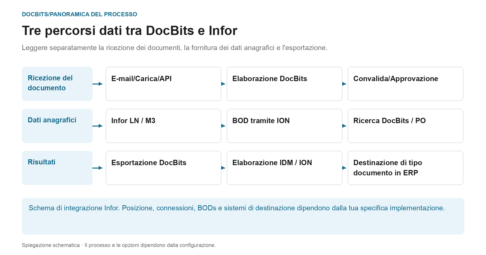
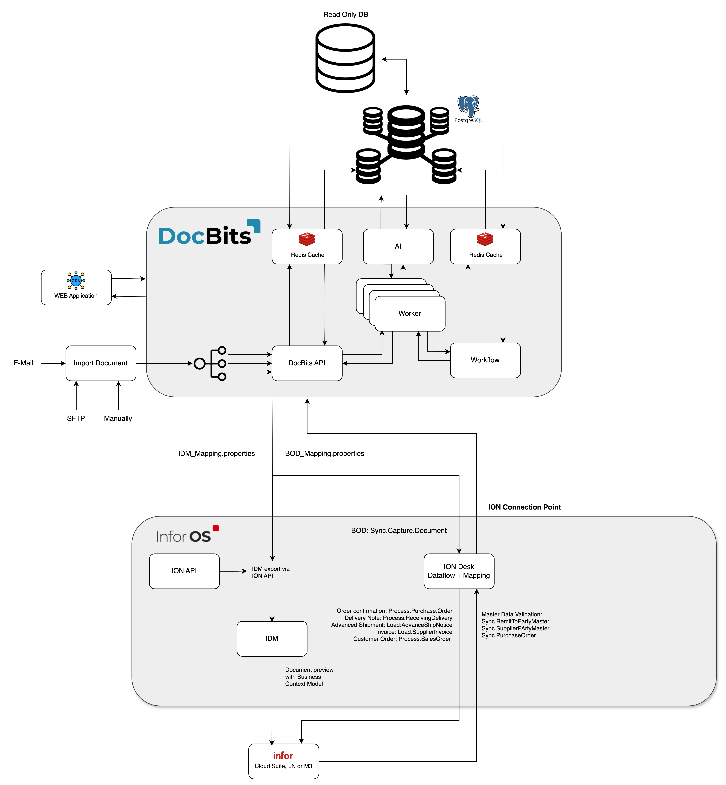

# Architettura

## L'architettura come tre percorsi dati separati

<figure><figcaption>
Leggere separatamente la ricezione dei documenti, la fornitura dei dati anagrafici e l&#x27;esportazione. Il diagramma è schematico; le impostazioni attive della tua organizzazione determinano il comportamento effettivo.
</figcaption></figure>

L'architettura contiene diversi flussi di dati con scopi diversi. I documenti vengono importati per l'elaborazione; i dati anagrafici provengono dall'integrazione ERP; i risultati riconosciuti e revisionati vengono restituiti tramite il percorso di esportazione configurato. Questi percorsi sono connessioni separate e devono essere tracciati separatamente durante la diagnosi.

| Percorso dei dati | Direzione e scopo | Punto di controllo |
| --- | --- | --- |
| **Ricevuta del documento** | E-mail, caricamento o interfaccia → DocBits. I documenti vengono inviati al processo di elaborazione previsto. | Il documento giusto ha raggiunto l'organizzazione giusta? |
| **Fornitura anagrafica** | LN/M3 → BODs e ION flusso dati → DocBits. I fornitori e gli ordini sono resi disponibili per l'identificazione e la riconciliazione. | Il set di dati richiesto è stato trasferito e accettato da DocBits? |
| **Esportazione risultati** | DocBits → connessione Infor configurata → IDM o ION e ERP. I documenti e i dati aziendali possono prendere percorsi a valle diversi. | Il trasferimento e la relativa elaborazione nella destinazione sono comprovati? |

Nell'esportazione Infor qui descritta, PDF e i suoi attributi vengono inviati a IDM e `Sync.CaptureDocument` viene inviato a ION Desk. ION lo trasforma nel target BODs richiesto in base al tipo di documento. L'accettazione da parte di LN o M3 deve essere verificata nel rispettivo sistema di destinazione; un passo DocBits da solo non dimostra ogni passo di elaborazione a valle.

**Utilizza la panoramica per indagare sugli errori:** Se manca un documento, inizia con l'importazione. Se mancano fornitori o righe dell'ordine di acquisto, seguire il percorso dei dati anagrafici. Se il trasferimento di ritorno fallisce, controlla la configurazione di esportazione, la risposta del destinatario e l'elaborazione ION/ERP. I diagrammi dell'architettura riportati di seguito aggiungono dettagli sulla distribuzione e sui componenti a questa panoramica del processo.

Inoltre: [Importa documenti](../../end-user-and-partner-section/end-user-section/how-to-import-documents/README.md), [Importa i dati anagrafici del cliente](../../infor-integration-and-configuration/importing-customer-master-data/README.md) e [Esporta da DocBits](../../infor-integration-and-configuration/exporting-in-docbits/README.md).

## **Cliente DocBits Cloud**

<figure><figcaption></figcaption></figure>

## DocBits in locale

<figure><figcaption></figcaption></figure>

Doc**Bits** si integra perfettamente con Infor LN/M3 attraverso l'API ION, ION Desk e i BOD standard di Infor. La nostra integrazione API ci consente di esportare dati in Infor e di eseguire la validazione dei dati master in Doc**Bits**.

## **Architettura di DocBits Operator**

Tutte le connessioni tra i componenti sono protette con protocolli di crittografia standard del settore. SSH, HTTPS e altri canali sicuri garantiscono l'integrità e la riservatezza dei dati in tutto il sistema.

**In sede:**

<figure><figcaption></figcaption></figure>


[prefect-local-setup-requirements.md](prefect-local-setup-requirements.md)


**Cloud**:

<figure><figcaption></figcaption></figure>

## Esportazione dei Dati in Infor

Utilizziamo l'API ION per inviare il PDF con gli attributi a IDM e il BOD Sync.CaptureDocument a ION Desk. In ION Desk, trasformiamo il [Sync.CaptureDocument](../../infor-integration-and-configuration/exporting-in-docbits/) nei BOD di destinazione desiderati in base al tipo di documento in fase di elaborazione. Questi BOD Infor trasformati vengono quindi importati automaticamente in LN o M3.


Esporta in [Infor](../../infor-integration-and-configuration/exporting-to-infor/)


## Validazione dei Dati Master in DocBits

Per identificare il fornitore o confrontare/corrispondere le righe degli ordini di acquisto, attiviamo un trigger in LN/M3 che invia i BOD Sync.RemitToPartyMaster, Sync.SupplierPartyMaster e Sync.PurchaseOrder a Doc**Bits**. Configuriamo questo processo in ION Desk definendo il flusso di dati verso un punto di connessione specifico a Doc**Bits**.

<figure><figcaption></figcaption></figure>


[Validazione dei Dati Master](../../infor-integration-and-configuration/importing-customer-master-data/)


## Importazione Email OAuth Office365

<figure><figcaption></figcaption></figure>
