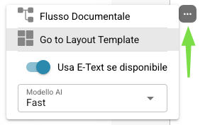
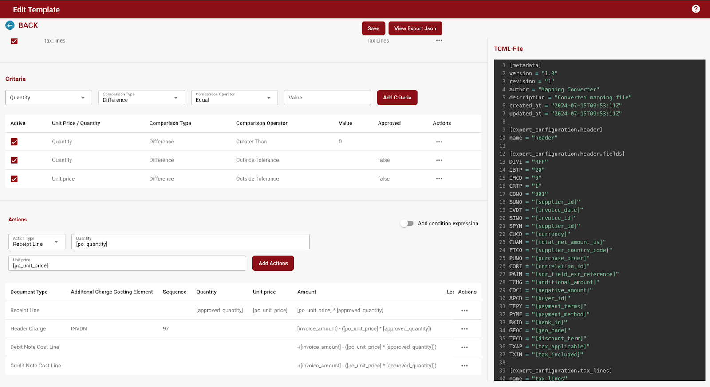
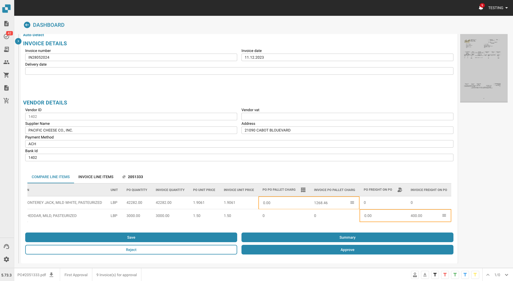

# Note di rilascio

**Disponibilità di NOVA R1.1:** Disponibile nell’ambiente di test dal **16 ottobre 2026**. Il rilascio in produzione è previsto per il **4 novembre 2026**.



**DocBits è il prodotto. NOVA indica il ciclo di rilascio.** [Guarda il video sul nuovo rilascio di DocBits](https://docbits-videos.fra1.cdn.digitaloceanspaces.com/settings-assistant/nova-release/v2/it.mp4) · [Sottotitoli](https://docbits-videos.fra1.cdn.digitaloceanspaces.com/settings-assistant/nova-release/v2/it.vtt).

Scegli un canale di rilascio per vedere cosa cambia per il tuo team. **Il ciclo NOVA introduce il nuovo rilascio minore di DocBits con capacità aggiuntive per i clienti. Gli hotfix di VESTA migliorano la release di produzione attuale.** Vedi il [ciclo di vita del rilascio](../docbits-release-lifecycle-strategy.md) per la disponibilità e il passaggio tra i canali.

**Le precedenti funzionalità beta di VESTA sono incluse nell’ambiente di test di NOVA.** Tutte le funzionalità precedentemente disponibili in versione beta in VESTA fanno parte delle funzionalità standard di NOVA e possono essere provate prima del rilascio previsto in produzione. Diventeranno anche funzionalità standard di VESTA con il [prossimo hotfix, previsto per l’**11 novembre 2026**](vesta-hotfix-11-november-2026.md).

| Canale di rilascio | Note di rilascio | Focus |
| --- | --- | --- |
| **NOVA – Rilascio minore** | [Novità per i clienti](nova-major-release.md) · **4 novembre 2026 (previsto)** | Tutte le ex funzionalità beta di VESTA, più nuove capacità ed estensioni rispetto a VESTA R1.0.15. |
| **VESTA — Prossimo hotfix (pianificato)** | [11 novembre 2026](vesta-hotfix-11-november-2026.md) | Introduce tutte le ex funzionalità beta di VESTA nel set di funzionalità standard di VESTA. |
| **VESTA — Rilascio hotfix** | [14 ottobre 2026 — R1.0.15](incremental-updates-14-october-2026.md) | Miglioramenti e correzioni per la release di produzione attuale di VESTA. |

## NOVA – Rilascio minore 4 novembre 2026

### Cosa ottiene il tuo team con NOVA

* **Usa le ex funzionalità beta di VESTA come funzionalità standard di NOVA.** Tutte le funzionalità precedentemente offerte nella beta di VESTA sono incluse in NOVA, inclusi i controlli di gestione delle regole e dei layout. Si applicano ancora le impostazioni dell'organizzazione, gli interruttori per tipo di documento e le autorizzazioni.
* **Risolvi i blocchi dei documenti con l'Assistente di convalida.** Chiedi cosa blocca un documento, passa al campo rilevante e rivedi le correzioni suggerite restando sul documento.
* **Trasforma le correzioni ripetute in miglioramenti automatizzati revisionati.** I revisori possono inviare richieste di miglioramento; gli amministratori possono valutare le proposte di regole apprese, rivedere i documenti interessati e misurare il risultato dopo l'attivazione.
* **Comprendi e agisci sugli errori delle fatture elettroniche.** Usa report raggruppati per livello di convalida, rivedi le policy per tipo di documento e la loro cronologia, e rifiuta una fattura idonea con una motivazione registrata.
* **Configura e controlla gli importazioni FTP/SFTP.** Usa la procedura guidata di connessione, segui i passaggi di importazione per singolo file, configura i tentativi ripetuti e le notifiche di errore, e opzionalmente elimina i file sorgente dopo un'importazione riuscita.
* **Abbina le righe di consegna con meno azioni ripetute.** Seleziona prima le righe del documento o dell'ordine di acquisto e collegale in entrambe le direzioni. Le esportazioni configurate possono preservare i dettagli delle sotto-righe e raggruppare i record per valori di riga.
* **Mantieni il lavoro esportato separato dal lavoro completato.** Usa lo stato Exported per l'elaborazione di follow-up e opzionalmente blocca i documenti Finished contro la riapertura ordinaria.
* **Accedi direttamente ai controlli di regole e layout.** Apri i pannelli di gestione senza un link beta, cerca e visualizza in anteprima i layout, e apri l'editor di layout da un documento.
* **Controlla l'estrazione e l'amministrazione di routine.** Riavvia un documento con un numero di pagine scelto, scegli se estrarre i campi nascosti, usa ulteriori azioni dell'Assistente impostazioni e limita le regole di notifica a una sub-organizzazione.

### Guide per la configurazione delle regole

* [**Regole di trasformazione**](../../administration-and-setup/settings/global-settings/document-types/transformation-rules.md): pulisci e riscrivi i valori estratti, crea una sequenza di passaggi e visualizza in anteprima il risultato. **Guarda:** [Guarda il video](https://docbits-videos.fra1.cdn.digitaloceanspaces.com/settings-assistant/transformation-rules/v1/it.mp4).
* [**Regole di convalida personalizzate**](../../administration-and-setup/settings/global-settings/document-types/custom-validation-rules.md): definisci controlli per i campi e le righe di tabella, scegli le condizioni e la gravità e testa le tue regole. **Guarda:** [Video in inglese](https://docbits-videos.fra1.cdn.digitaloceanspaces.com/settings-assistant/custom-validation-rules/v1/en.mp4).
* [**Regole di abbinamento degli ordini di acquisto**](../../administration-and-setup/settings/global-settings/document-types/more-settings/purchase-order/purchase-order-matching-rules.md): configura i tipi di abbinamento, le tolleranze e l'ordine di esecuzione e gestisci le versioni delle regole. **Video correlato — Scegli l'automazione giusta:** [Guarda il video](https://docbits-videos.fra1.cdn.digitaloceanspaces.com/settings-assistant/choose-automation/v1/it.mp4).

[Sfoglia tutti i video delle funzionalità](nova-major-release.md#watch-the-feature-videos), inclusi layout, Touchless Intelligence, convalida delle fatture elettroniche e la serie in sei parti su AI Table.

[Leggi il confronto completo delle funzionalità NOVA](nova-major-release.md), inclusi i requisiti di attivazione, i miglioramenti aggiuntivi e tutte le **16 versioni del servizio**.

**La baseline VESTA include funzionalità esistenti e funzionalità beta:** l'originale Assistente impostazioni, avvisi di base sullo stato di salute dell'importazione, livelli AI, Controllo campo intestazione, dashboard Touchless Intelligence, motori di regole, trasformazioni dopo la ricerca dei dati anagrafici e registri di esecuzione delle regole di base. Le note NOVA distinguono il passaggio da beta a disponibilità standard dai ulteriori miglioramenti a queste funzionalità.

## VESTA — Rilasci hotfix <a href="#vesta-hotfix-releases" id="vesta-hotfix-releases"></a>

**Prossimo hotfix pianificato: [11 novembre 2026](vesta-hotfix-11-november-2026.md).** Tutte le funzionalità precedentemente disponibili come beta in VESTA, e ora incluse in NOVA, diventeranno funzionalità VESTA regolari in questo hotfix.

**Ultimo hotfix rilasciato: [14 ottobre 2026 — R1.0.15](incremental-updates-14-october-2026.md).** Questo hotfix VESTA ha introdotto l'Assistente impostazioni, i livelli AI aggiornati, il Controllo campo intestazione, miglioramenti all'accesso e miglioramenti all'abbinamento dei costi degli ordini di acquisto.

Note degli hotfix VESTA precedenti:

* [15 settembre 2026 — R1.0.13](incremental-updates-15-september-2026.md)
* [8 settembre 2026](incremental-updates-8-september-2026.md)
* [12–25 agosto 2026](incremental-updates-12-25-august-2026.md)
* [29 luglio – 12 agosto 2026](incremental-updates-29-july-12-august-2026.md)
* [14–29 luglio 2026](incremental-updates-14-29-july-2026.md)
* [4–14 luglio 2026](incremental-updates-4-14-july-2026.md)
* [3–4 luglio 2026](incremental-updates-3-4-july-2026.md)
* [30 giugno – 3 luglio 2026](incremental-updates-30-june-3-july-2026.md)
* [26–30 giugno 2026](incremental-updates-26-30-june-2026.md)
* [21–25 giugno 2026](incremental-updates-21-25-june-2026.md)

Gli annunci di rilascio originali rimangono di seguito per riferimento.

## **Release R1.0 13/14 giugno 2026**

> **Disponibilità Sandbox:** 28 aprile 2026

### Nuove funzionalità:

* **Activity Logging / Access Audit:**\
  Registro dettagliato dell'attività e audit trail degli accessi in tutta l'applicazione per conformità e monitoraggio. Diverse tipologie di logging per tutti i microservizi e basate su intervalli di tempo.
* **Ricerca rapida globale:**\
  Premi Cmd+K / Ctrl+K da qualsiasi punto dell'app per cercare tra oltre 200 rotte e più di 40 funzionalità in-page. Mostra i primi 8 risultati con fuzzy matching, navigazione con i tasti freccia e collegamenti alla App Index Page completa.
* **Sitemap (App Index Page):**\
  Pagina indice ricercabile che cataloga ogni pagina navigabile e ogni funzionalità in-page (finestre di dialogo, sidebar, pannelli) in DocBits. Organizzata in 18 categorie con filtri per tipo, pill di categoria, ricerca sincronizzata con l'URL e voci con permessi mostrate come bloccate per gli utenti non amministratori.
* **Analytics Dashboard:**\
  Analisi complete dell'elaborazione dei documenti con Executive Overview, API Metrics, Quality Metrics, Processing Performance, Document Flow Analytics, Activity Log, Event Log e Audit Trail.
* **Funzionalità di esportazione dashboard:**\
  Nuova funzionalità di esportazione dashboard che consente l'esportazione di elenchi in formato CSV o XLSX.
* **Full-Text Search / DocSearch:**\
  Ricerca vettoriale basata su IA su tutti i documenti indicizzati, con filtro per fornitore in tempo reale, funzionalità "Find Similar" e impostazioni di indicizzazione configurabili.
* **Supplier Delivery Statistics:**\
  Nuove viste che forniscono informazioni sulle metriche di elaborazione dei documenti relative ai fornitori.
* **Debug Collector:**\
  Premi Ctrl+Shift+P per catturare uno snapshot completo di debug che include chiamate API, stato WebSocket, errori, log della console, metriche di performance e informazioni sull'ambiente. Gli snapshot possono essere copiati negli appunti o inviati direttamente come ticket di supporto con un report in formato HTML e un file JSON allegato.
* **AI Agents (DocNet):**\
  Agenti autonomi in background che elaborano automaticamente le e-mail in arrivo, classificando, estraendo e instradando i documenti senza intervento manuale. Gli agenti lavorano autonomamente sui task assegnati ed escalano agli utenti tramite richieste di approvazione quando è necessario il giudizio umano. Include una dashboard dedicata per monitorare attività e performance degli agenti.
* **Nuovi E-Documents:**\
  Oltre 80 nuovi tipi di e-invoice globali e più di 40 nuovi formati tra cui XRechnung 3.0.2, ZUGFeRD 2.2/2.3.2, varianti Factur-X e Asia-Pacific PINT Credit Notes. Copertura di classificazione ed estrazione al 100 %.
* **AI Script Chat:**\
  Assistente di chat basato su IA per lo sviluppo di base di script, con risposte in streaming in tempo reale.
* **Script Versioning:**\
  Cronologia completa delle versioni degli script con tracciamento delle modifiche, confronto e capacità di ripristino. Fornisce la gestione delle versioni per gli script analoga a quella utilizzata per le versioni degli E-Docs.
* **Cronologia di esportazione nelle Dashboard Actions:**\
  Accesso alla cronologia di esportazione di un documento direttamente dal menu delle azioni della dashboard.
* **Generic API Exporter (APS450, GLS840):**\
  Destinazione di esportazione API generica configurabile tramite una configurazione Mapping-File, per un'integrazione flessibile con sistemi esterni. È stato implementato il supporto per APS450 e GLS840.
* **Configurazioni di esportazione multiple:**\
  Supporto per più configurazioni di esportazione attive per tipo di documento, con ordine di esecuzione e un pulsante di ri-esportazione per riprovare dallo step fallito.
* **Nuova versione di Watchdog:**\
  Riprogettazione completa della pagina WatchDog Settings. Aggiunte nuove funzionalità di comfort, tra cui lo stato corrente di WatchDog, guida e comandi per l'installazione, configurazione dei template XSLT e un'impostazione per l'aggiornamento automatico. È stata inoltre implementata la funzionalità che consente a WatchDog di gestire più configurazioni contemporaneamente.
* **Integrazione Vertex:**\
  Integrazione Consumer Use Tax tramite Vertex per il calcolo automatizzato delle imposte e la conformità durante l'elaborazione dei documenti.
* **Riprogettazione della UI e ristrutturazione delle impostazioni:**\
  Rinnovamento completo della UI in tutta l'applicazione. Pagine di login e autenticazione ridisegnate. Area delle impostazioni ridisegnata con sidebar a scomparsa, sottocategorie organizzate, navigazione basata su ancore, pannello di aiuto contestuale e badge di tracciamento dello stato. Modifiche all'UI dei Document scripts. Nuova UI per il Document flow. UI migliorata di List of Values.
* **Idea Board:**\
  Bacheca di richieste di funzionalità in cui gli utenti possono inviare, discutere e votare nuove funzionalità, miglioramenti, bugfix necessari, ecc., con editor di testo ricco e supporto per le immagini.
* **API Key Management:**\
  Pagina delle impostazioni dedicata alla creazione, visualizzazione e gestione di più chiavi API.
* **Funzionalità di ricerca Master Data Lookup:**\
  Capacità di ricerca Master Data migliorata grazie a opzioni di ricerca adeguate in base ai campi selezionati.
* **User Activity Chart:**\
  Grafico visivo che mostra i pattern di attività degli utenti e le metriche di engagement. Dashboard dell'attività di login con grafici di confronto delle tendenze, aggregazione giornaliera/settimanale e geolocalizzazione basata su GeoLite2.
* **User Login History:**\
  Users Detail View con cronologia dei login.
* **Sidebar personalizzabile:**\
  Riordino drag-and-drop, toggle di visualizzazione e pin-to-top per gli elementi di menu della sidebar. Le preferenze vengono memorizzate per utente con un'opzione "Reset to default". Rispetta i feature flag.
* **Video Carousel:**\
  Carousel video con riproduzione automatica sulla pagina prepare-dashboard che mostra brevi video animati di suggerimenti sul prodotto (Global Search, Keyboard Shortcuts, Document Upload, Table Customization). Layout a due colonne con video a sinistra e preparazione della dashboard a destra. Il reindirizzamento automatico viene messo in pausa mentre gli utenti navigano tra i video.
* **Advanced Workflow Designer:**\
  Costruttore di automazioni visivo basato su nodi con canvas drag-and-drop per pipeline di elaborazione multi-step. Supporta wait step, percorsi paralleli, template riutilizzabili, Or condition card, pulsante manuale di test/run, esecuzione parziale "Test from Here" e log di esecuzione per nodo con evidenziazione visiva del flusso che mostra esattamente quali nodi sono stati eseguiti.
* **Workflow KPI Dashboard:**\
  Dashboard di metriche chiave per monitorare l'esecuzione dei workflow.
* **Workflow Partner Card SDK:**\
  SDK per sviluppatori terzi per creare card di workflow personalizzate, con revisione basata su IA, validazione in sandbox e documentazione introduttiva.
* **Workflow Test Manager:**\
  Test manager automatizzato per i workflow, che consente agli amministratori di creare ed eseguire test singolarmente o in blocco.

### Miglioramenti:

* **Database (tutti i moduli) — Migrazione delle colonne ID:**\
  Tutte le colonne "ID" del database DocBits sono state migrate internamente da stringhe a un tipo ID dedicato (UUID7). Il database Postgres sottostante è stato migrato alla V18 per supportare questo miglioramento.
* **Elaborazione dei documenti — Ulteriori miglioramenti:**\
  Modifica della logica di esportazione relativa al numero massimo di pagine da considerare: ora verrà esportato l'intero documento. Durante la validazione del documento, l'utente avrà la possibilità di sovrascrivere il limite massimo di pagine predefinito per quello specifico documento. Il calcolo del Pending Document Counter è stato migliorato.
* **Versioni, stato e data di rilascio dei servizi:**\
  Lo stato di disponibilità dei servizi è fornito nel popup "Service Versions".
* **Espansione linguistica:**\
  Supporto esteso a 22 lingue con selettore di lingua aggiornato.
* **Design di Access Control a livello di campo:**\
  Controllo degli accessi ridisegnato/migliorato con uno stato di attivazione più chiaro, accesso a livello di campo, gestione coerente delle regole e permessi basati su gruppi semplificati. Risolve i conflitti di regole tra Access Control e View Permissions, mostra il proprietario dell'importazione nell'UI e applica il controllo degli accessi in modo coerente alla validazione dei campi, alle tabelle estratte dall'IA e a tutte le viste.
* **Activity Stream per tutte le schermate:**\
  L'Activity Stream è ora disponibile su tutte le schermate di elaborazione documenti (Ready for Validation, PO Matching, Accounting, Quote Details, Reject), non solo su Pending Approval. Spostato in una posizione coerente nel pannello destro di tutte le schermate.
* **Pagina Document Flow:**\
  Pagina dedicata per visualizzare e tracciare il flusso di elaborazione dei documenti, mostrando le transizioni di stato e l'avanzamento attraverso la pipeline.
* **Dual Monitor Mode (impostazione utente globale):**\
  Dual Monitor Mode spostato in un'impostazione utente globale, persistente tra le sessioni.
* **Miglioramenti al Layout Builder:**\
  Supporto per campi nascosti e di sola lettura con indicatori visivi, divisore di pannello ridimensionabile e impostazioni di lunghezza dei campi. Applica il Default Layout a più Origins senza doverli visitare individualmente.

## **Release HotFix 3 16 aprile 2026**

### Miglioramenti di DocBits:

* **Estrazione QR code per fatture polacche:**\
  DocBits ora supporta l'estrazione del QR code specificamente per le fatture polacche, migliorando l'acquisizione automatizzata dei dati per i documenti provenienti dalla Polonia.

### Correzioni di bug:

* Corretto un problema in cui l'esportazione automatica falliva quando il PO Matching era già avvenuto ma l'ordine di acquisto non era associato al documento.
* Corretto un problema in cui i prezzi unitari venivano arrotondati in modo errato per le fatture con unità di imballaggio (Verpackungseinheiten / VPE).
* Corretto un problema in cui i messaggi di errore di esportazione da ION/MEC (ad es. fallimenti di Acknowledge.PurchaseOrder) non venivano visualizzati in DocBits, mostrando lo stato "Exported" nonostante l'esportazione fosse fallita.
* Corretto un problema in cui il prezzo unitario nella schermata di approvazione era errato quando veniva utilizzata l'estrazione delle tabelle tramite IA.
* Corretto un problema in cui lo script Total Matching generava un errore nella schermata di validazione.
* Corretto un problema in cui l'elaborazione del documento falliva con un errore ("UserAuthentication object has no setter for 'org\_id'").
* Corretto un problema in cui il training delle tabelle non funzionava per fornitori specifici, con le colonne che finivano nelle colonne nascoste invece che nei campi mappati.
* Corretto un problema in cui il PO Matching falliva su fatture di grandi dimensioni (oltre 10 pagine) a causa del superamento del limite di dimensione della richiesta multipart.
* Corretto un problema in cui i valori di colonna popolati dagli script non venivano mantenuti dopo un riavvio del documento.
* Corretto un problema in cui il toggle "Ignore Table Validation" veniva mostrato come attivo (verde) nell'UI ma era in realtà disattivato in background.
* Corretto un problema in cui la qualità del documento era significativamente degradata dopo l'importazione.
* Corretto un problema in cui le versioni dei microservizi e le date di rilascio visualizzate nell'app erano incoerenti tra gli ambienti dopo un deployment completo.
* Corretto un problema in cui l'estrazione del codice a barre falliva a causa di un errore durante la creazione dell'oggetto di autenticazione utente dai dati del task.
* Corretto un problema in cui i dettagli di contatto del fornitore venivano svuotati al salvataggio nel Supplier Portal.
* Corretto un problema in cui i documenti incappavano in un errore NoneType durante l'esportazione.
* Corretto un problema in cui il corpo dell'e-mail non veniva incluso quando il primo file allegato era un'immagine PNG o JPEG.
* Corretto un problema in cui il corpo dell'e-mail mancava per diversi documenti.
* Corretto un problema in cui il DocBits Operator "ai-exporting" non produceva risultati di esportazione nei sistemi di destinazione (LN/D3).

## **Release HotFix 2 31 marzo 2026**

### Miglioramenti di DocBits:

* **Elaborazione PDF ibrida — Estrazione XML controllata dall'utente:**\
  Quando un PDF contiene dati XML incorporati, gli utenti possono ora scegliere se DocBits deve utilizzare l'XML incorporato per l'estrazione o elaborare il documento come un PDF standard. Questo offre alle organizzazioni il pieno controllo su come vengono gestiti i documenti ibridi, garantendo che venga applicato il metodo di estrazione più adatto al loro flusso di lavoro.
* **AP Assignment Code nella schermata di Approval:**\
  La pagina AP Manager Approval ora include un campo AP Assignment Code, integrato con Infor M3 CRS620. Questo consente agli approvatori di verificare e confermare i codici di assegnazione direttamente durante il processo di approvazione senza passare a sistemi esterni.
* **Corrispondenza del totale PO con il totale del documento:**\
  DocBits ora supporta la corrispondenza del totale dell'ordine di acquisto con il totale del documento, fornendo un ulteriore livello di validazione durante il PO Matching per rilevare le discrepanze più precocemente nel processo.
* **Aggiornamento del numero di articolo fornitore e VPE:**\
  DocBits ora supporta l'aggiornamento dei campi numero di articolo fornitore e VPE (Verpackungseinheit / unità di imballaggio) durante l'elaborazione dei documenti, con i valori sincronizzati verso M3 in fase di esportazione.
* **Classificazione migliorata del layout del documento:**\
  L'ID del layout del documento (tfidf\_id) viene ora generato basandosi solo sul testo dell'intestazione, escludendo il testo del piè di pagina. Questo migliora la precisione della classificazione impedendo al contenuto del piè di pagina di influenzare il rilevamento del tipo di documento.
* **Pulsante Export & Next:**\
  È stato aggiunto un nuovo pulsante "Export & Next", che consente agli utenti di esportare il documento corrente e passare immediatamente al successivo nella coda, ottimizzando il flusso di lavoro di revisione ed esportazione.
* **Processo di approvazione per fatture di costo:**\
  Il processo di approvazione per le fatture di costo è stato migliorato con una logica di instradamento e validazione ottimizzata.

### Correzioni di bug:

* Corretto un problema in cui l'esportazione Infor SFTP falliva con un errore a causa di un comando di libreria errato.
* Corretto un problema in cui le caselle di controllo booleane non potevano essere visualizzate nella schermata di approvazione.
* Corretto un problema in cui venivano inviati messaggi UNMU anche quando non c'erano discrepanze nell'unità di acquisto.
* Corretto un problema in cui l'imposta sulle vendite veniva erroneamente classificata come addebito nella schermata di PO Matching, risultando in un importo non saldato negativo.
* Corretto un problema in cui l'esportazione falliva quando l'unità di acquisto non era impostata nella conferma d'ordine ma era presente nell'ordine di acquisto.
* Corretto un problema in cui il corpo dell'e-mail mancava per diversi documenti.
* Corretto un problema in cui il numero di articolo del fornitore non era visibile nella schermata di approvazione e gli aggiornamenti non venivano inviati a M3.
* Corretto un problema in cui l'esportazione dei fornitori verso Infor restituiva un errore.
* Corretto un problema in cui il PO Matching produceva errori durante l'elaborazione.
* Corretto un problema in cui la funzione `findAll` non funzionava correttamente negli script dei documenti.
* Corretto un problema in cui la colonna "Updated By" di Watchdog mostrava erroneamente l'utente Fellow Admin invece dell'utente effettivo.
* Corretto un problema in cui il BOD-Mapping non poteva essere configurato nell'interfaccia Watchdog.
* Corretto un problema in cui gli addebiti venivano erroneamente mostrati come importi non saldati invece di essere visualizzati come addebiti.
* Corretto un problema in cui l'abbinamento automatico non funzionava per le fatture multi-riga nonostante la presenza di una configurazione di abbinamento.
* Corretto un problema in cui un trattino ("-") nel numero di articolo veniva considerato durante il PO Matching per l'ordine di acquisto ma ignorato sulla fattura, causando una discrepanza falsa.
* Corretto un problema in cui sia i file PDF che XML venivano caricati nella cartella di esportazione anche quando l'interruttore "Export PDF" era disattivato.
* Corretto un problema in cui uno stato mancante sulla scheda del workflow impediva ai documenti di procedere attraverso il flusso di lavoro.
* Corretto un problema in cui la qualità del documento era significativamente degradata dopo l'importazione.
* Corretto un problema in cui la schermata PO Match generava un errore ("Cannot read properties of null").
* Corretto un problema in cui l'elenco dei valori predefiniti non poteva essere modificato.
* Corretto un problema in cui il workflow non riusciva a leggere correttamente lo stato del campo, causando un instradamento errato.
* Corretto un problema in cui le importazioni di e-mail in entrata fallivano con un errore.
* Corretto un problema in cui le righe mancanti non arrivavano correttamente in M3 durante l'esportazione.
* Corretto un problema in cui le fatture codificate e approvate occasionalmente non venivano aggiornate allo stato "approvato" in M3 tramite l'API APS110.
* Corretto un problema con la configurazione Multi Banking che non funzionava correttamente.
* Corretti molteplici problemi con la visualizzazione e il comportamento di salvataggio dei dashboard condivisi.
* Corretto un problema in cui il campo numero di articolo fornitore era limitato a 30 caratteri, impedendo la memorizzazione di valori più lunghi.
* Corretto un problema in cui i valori di prezzo unitario e prezzo unitario per unità causavano un errore durante l'esportazione.
* Corretto un problema in cui le righe PO con uno stato escluso (ad es. "Closed") potevano ancora essere trascinate e abbinate nella schermata di PO Matching nonostante fossero escluse dalle regole di abbinamento.

### Modifiche alla configurazione:

* Aggiornati i modelli e-mail per rimuovere il pulsante "Go to Task".
* Regolati gli script e le impostazioni dei campi obbligatori sugli elementi di costo.

## **Release HotFix 1 16 marzo 2026**

### Miglioramenti di DocBits:

* **Cronologia documenti nell'esportazione SFTP:**\
  DocBits ora supporta l'inclusione della cronologia completa del documento come parte del payload XML esportato durante l'esportazione su SFTP. Questa funzionalità è configurabile tramite Export Settings e fornisce ai sistemi a valle un registro di audit completo di ogni cambio di stato e azione eseguita su un documento in DocBits — incluso chi ha effettuato la modifica, quando è avvenuta e quali erano gli stati precedente e attuale. Questo è particolarmente prezioso per la conformità, la tracciabilità e l'analisi operativa.
* **Aggiornamento degli addebiti nella conferma d'ordine per Infor On Premise:**\
  I clienti Infor On Premise possono ora elaborare conferme d'ordine che includono addebiti direttamente in DocBits. Gli addebiti vengono completamente aggiornati attraverso l'esportazione, rendendo il processo di conferma d'ordine end-to-end fluido e rimuovendo la necessità di aggiustamenti manuali a valle.
*   **Applicare il Layout predefinito a tutti gli Origins:**\
    Un nuovo pulsante **Apply Default Layout to Origins** è stato introdotto nella schermata di configurazione del layout. Gli amministratori possono ora distribuire il layout predefinito a tutti gli origins all'interno di un'organizzazione con una singola azione, eliminando il laborioso processo manuale di copia e incolla del JSON di layout per ciascun origin individualmente. Questo è particolarmente utile durante l'onboarding di nuovi clienti dove più origins devono essere configurati in modo coerente.

    <figure><figcaption></figcaption></figure>
*   **Selezione del tipo di documento per l'importazione FTP:**\
    Le configurazioni di importazione FTP ora supportano l'assegnazione del tipo di documento per cartella. Durante la configurazione di un'importazione FTP, gli utenti possono specificare quale tipo di documento — come Fattura o Conferma d'Ordine — deve essere applicato a tutti i documenti importati da quella cartella. I documenti vengono classificati automaticamente all'importazione, eliminando la necessità di assegnazione manuale del tipo di documento dopo l'acquisizione. Questo supporta le organizzazioni che gestiscono più tipi di documento attraverso diverse sotto-organizzazioni e cartelle.

    <figure><figcaption></figcaption></figure>
* **Esportazione verso GLS840 per Infor On Premise**:\
  DocBits ora supporta l'esportazione di documenti verso il programma GLS840 per i clienti Infor On Premise, ampliando la gamma di destinazioni di esportazione supportate per gli ambienti on-premise.
*   **Miglioramenti dell'interfaccia per Watchdog e configurazione di esportazione:**\
    Le schermate di configurazione Watchdog e di configurazione dell'esportazione sono state aggiornate con un'interfaccia utente migliorata, offrendo un layout più pulito e un'esperienza più intuitiva per gli amministratori che gestiscono queste impostazioni.

    <figure><figcaption></figcaption></figure>

    <figure><figcaption></figcaption></figure>

### Correzioni di bug:

* Corretto un problema in cui gli utenti con diritti di visualizzazione validi non potevano visualizzare i documenti — la logica dei permessi è stata ristrutturata con un controllo del livello di accesso che sostituisce il precedente approccio di filtraggio basato sui gruppi.
* Migliorata la gestione delle eccezioni in molteplici aree dell'applicazione per una maggiore stabilità.
* Risolto un problema in cui le colonne di tipo booleano non venivano gestite correttamente durante l'estrazione dei campi.
* Corretto un problema di autenticazione asincrona nell'endpoint di caricamento file.
* Risolti problemi di visualizzazione dell'interfaccia per la tabella PO nella schermata di validazione.
* Aggiornato il modello di script per includere commenti di tracciamento delle modifiche per una migliore verificabilità.
* Corretto un problema con i campi a tendina che non si comportavano correttamente nella schermata di validazione.
* Corretto un problema in cui il campo sotto-organizzazione non era precompilato durante l'aggiornamento delle assegnazioni dei documenti dal dashboard.

## **Release Winter Summit 10 dicembre 2025**

### Miglioramenti di DocBits:

*   **Personalizzazione avanzata delle regole di corrispondenza ordini:**\
    DocBits ora fornisce un controllo più granulare e personalizzabile sulle regole di corrispondenza degli ordini di acquisto. Gli amministratori possono configurare con precisione quali colonne devono essere valutate durante il processo di corrispondenza per ogni tipo di documento, assicurando che vengano considerati solo i campi più rilevanti. Inoltre, le tolleranze possono essere definite a livello di colonna, consentendo una maggiore flessibilità nella gestione di piccole discrepanze. Ogni regola può anche essere configurata per applicarsi alla corrispondenza manuale, alla corrispondenza automatica o a entrambe, offrendo ai team la possibilità di adattare il flusso di lavoro di corrispondenza ai loro requisiti operativi esatti. Questi miglioramenti migliorano significativamente l'adattabilità e la precisione del processo di corrispondenza degli ordini di acquisto.

    <figure><figcaption></figcaption></figure>
*   **Supporto per più conti finanziari dei fornitori:**\
    DocBits ora supporta la gestione di più conti finanziari per i fornitori tramite il RemitToPartyMaster BOD fornito da Infor. Questo miglioramento consente alle organizzazioni di mantenere più record di conti di rimessa per un singolo fornitore, migliorando la flessibilità e l'accuratezza nell'elaborazione dei pagamenti. È stata introdotta una nuova impostazione di configurazione per abilitare o disabilitare questa capacità, consentendo agli amministratori di attivare la funzionalità in base alle loro esigenze operative.

    <figure><figcaption></figcaption></figure>
*   **Aggiunto accesso utente ai risultati di estrazione OCR:**\
    Il pulsante **OCR View** nella schermata di convalida dei campi è ora disponibile per tutti gli utenti che hanno accesso alla convalida, anziché essere limitato agli amministratori. Con questo aggiornamento, qualsiasi utente autorizzato può rivedere direttamente i risultati di estrazione OCR, facilitando la convalida dell'accuratezza dei dati e il monitoraggio delle prestazioni complessive dell'OCR. Questo miglioramento promuove una maggiore trasparenza e migliora l'efficienza del flusso di lavoro di convalida.

    <figure><figcaption></figcaption></figure>
* **Rendering dinamico delle colonne nelle schermate di approvazione:**\
  Visualizzazioni di approvazione migliorate per visualizzare dinamicamente solo le colonne configurate per il confronto nelle preferenze del database di ciascuna organizzazione. In precedenza, alcune colonne specifiche dell'organizzazione apparivano vuote quando non erano configurate per il confronto, causando confusione. Ora, le visualizzazioni di approvazione mostrano solo i campi che vengono attivamente confrontati. Ciò fornisce schermate di approvazione più chiare e specifiche per l'organizzazione senza colonne vuote o irrilevanti.
* **Campo tipo ordine aggiunto alla ricerca dati anagrafici**:\
  L'elenco di intestazione ordine di acquisto ora include una colonna "Tipo ordine" nella ricerca dati anagrafici, fornendo capacità di categorizzazione aggiuntive.
* **Miglioramenti al dashboard filtri personalizzati:**\
  La funzionalità di condivisione del dashboard è stata migliorata per fornire maggiore flessibilità agli utenti condivisi. Le persone che hanno dashboard condivisi con loro ora possono regolare e modificare i filtri del dashboard, consentendo loro di personalizzare le informazioni visualizzate in base alle loro esigenze specifiche. Questo miglioramento supporta un'esperienza di visualizzazione più personalizzata e interattiva, assicurando che gli utenti possano facilmente perfezionare le informazioni sui dati più rilevanti per le loro attività.
* **Prefissi personalizzabili per le colonne della schermata di approvazione:**\
  È stata introdotta una nuova opzione configurabile per visualizzare prefissi prima delle colonne dei documenti nelle schermate di approvazione. Questa funzionalità può essere gestita direttamente all'interno del generatore di layout, dando agli amministratori il controllo completo sulla visualizzazione dei prefissi e sui tipi di documento a cui si applicano. Abilitando questa opzione, gli utenti ottengono un contesto più chiaro e una migliore leggibilità durante la revisione dei documenti durante il processo di approvazione.

### Miglioramenti generali

* Migliorata la registrazione degli errori per le tabelle mal addestrate nell'estrazione delle tabelle.
* Aggiunto un limite di condivisione per i dashboard fino a 10 utenti o 5 gruppi, insieme a un messaggio di errore chiaro quando viene raggiunto il limite.
* Migliorata la gestione degli errori per i dashboard personalizzati quando un utente tenta di creare un dashboard con un nome già esistente.

### Correzioni di bug:

* Risolto un problema per cui le email sembravano inviate con successo dalla sezione Dettagli Fornitore ma non venivano consegnate ai destinatari.
* Risolto un problema per cui i campi a discesa aggiunti alle schermate di approvazione/rifiuto non venivano visualizzati.
* Risolto un problema per cui tutti i documenti esportati erano contrassegnati come ultimo aggiornamento dall'utente sbagliato.
* Risolto un problema per cui i documenti mostravano lo stato "Flusso di lavoro in corso" ma non venivano eseguiti flussi di lavoro e il registro rimaneva vuoto.
* Risolto un problema per cui utenti non correlati venivano assegnati ai documenti al momento dell'esportazione senza svolgere alcun lavoro su di essi.
* Risolto un problema per cui utenti con autorizzazioni corrette non potevano rifiutare documenti assegnati e ricevevano errori.
* Risolto un problema per cui le icone del flusso di documenti non venivano visualizzate per alcune organizzazioni.
* Risolto un problema per cui appariva un popup durante il caricamento di documenti tramite trascinamento sul dashboard.
* Risolto un problema per cui i flag E-TEXT venivano visualizzati come abilitati nell'interfaccia utente anche se la risposta API mostrava tutti i valori come falsi.
* Risolto un problema per cui si verificava un errore durante il caricamento di documenti contenenti pagine vuote.
* Risolto un problema per cui i collegamenti ipertestuali delle attività nelle notifiche email non reindirizzavano gli utenti alla schermata di approvazione corretta.
* Risolto un problema per cui la selezione della sotto-organizzazione trasversale causava la mancata visualizzazione dei fornitori nella Ricerca dei Dati Anagrafici. Gli utenti possono ora visualizzare correttamente i dati dei fornitori inter-organizzativi.

## Release Autumn Summit 22 ottobre 2025

### Miglioramenti di DocBits:

*   **Miglioramenti al design del modello e-mail:**

    L'editor dei modelli e-mail è stato ridisegnato per offrire una struttura più chiara e un'esperienza più fluida. La selezione dei campi del documento è ora più intuitiva e gli allegati possono essere inclusi direttamente nei modelli. Questi miglioramenti rendono più rapido e semplice creare e-mail professionali e personalizzate.

    <figure><figcaption></figcaption></figure>
*   **Miglioramenti al dashboard:**

    Il dashboard è stato ampliato per migliorare la navigazione e la personalizzazione. Con le nuove schede, gli utenti possono passare più rapidamente tra i diversi tipi di documento, riducendo il tempo dedicato alla ricerca della vista giusta.

    <figure><figcaption></figcaption></figure>
*   **Dashboard con filtri personalizzati:**\
    Inoltre, i dashboard possono ora essere personalizzati e filtrati in base alle preferenze individuali. Questi dashboard personalizzati possono anche essere condivisi con i colleghi, rendendo più semplice creare viste di reporting coerenti per l'intero team.

    <figure><figcaption></figcaption></figure>
*   **Registri delle notifiche e-mail:**

    È disponibile una nuova funzionalità di registrazione per tutte le notifiche e-mail. Gli utenti possono ora consultare la cronologia delle notifiche inviate, così da verificare più facilmente le consegne e risolvere i problemi quando le e-mail non vengono ricevute.
*   **Supporto e-invoice: e-SLOG 1.6 e 2.0:**

    È stato introdotto il supporto per ulteriori formati di e-invoice. Il sistema può ora elaborare e generare le versioni e-SLOG 1.6 e 2.0, ampliando la compatibilità con partner e requisiti normativi.
*   **Miglioramenti al rilevamento dei duplicati:**

    Il rilevamento dei duplicati è stato potenziato con due potenti opzioni di configurazione. Il **Duplicate Detection Interval** permette di definire un intervallo di tempo per controllare i duplicati in modo più preciso, mentre l'impostazione **Disallow Export of Duplicates** impedisce automaticamente l'esportazione dei documenti rilevati come duplicati. Insieme, questi miglioramenti offrono più controllo e garantiscono una maggiore accuratezza dei dati.

    <figure><figcaption></figcaption></figure>
*   **Miglioramenti all'albero decisionale:**

    Gli alberi decisionali sono ora più versatili, con la possibilità di restituire i valori dei campi del documento. Questo consente una logica di automazione più avanzata, permettendo ai workflow di prendere decisioni basate sui dati effettivi del documento.
*   **Nuove card di workflow:**

    Due nuove card di workflow ampliano le capacità di automazione. La prima consente di verificare se un documento appartiene a una specifica sotto-organizzazione, semplificando la gestione di configurazioni multi-entità. La seconda introduce un controllo della tolleranza sulla data di consegna, che confronta le date di consegna con la data corrente in giorni lavorativi per gestire e far rispettare in modo più efficace i requisiti di consegna.
*   **Miglioramenti all'esportazione CSV:**

    La funzionalità di esportazione CSV è stata notevolmente migliorata. Invece di esportare solo i documenti mostrati nella pagina corrente, il sistema ora esporta tutti i documenti di un set di dati. Ogni esportazione crea una voce di log e il CSV risultante viene inviato automaticamente via e-mail, per un processo di esportazione più completo e affidabile.
*   **Intervallo di tempo per l'eliminazione degli ordini di acquisto:**

    Una nuova opzione di configurazione permette agli amministratori di definire un intervallo di tempo per l'eliminazione degli ordini di acquisto. Questo miglioramento aggiunge flessibilità e controllo sulle policy di conservazione dei dati, garantendo che gli ordini di acquisto vengano rimossi solo quando appropriato.

### Correzioni di bug

* Corretto un problema in cui dati vecchi venivano inclusi durante l'esportazione dei documenti.
* Corretto il filtro per gli errori di esportazione, che in precedenza mostrava anche altri stati.
* Risolta una discrepanza nella validazione delle tabelle per cui “Unit Price” generava errori mentre “Unit Price Per” no, nonostante i valori fossero corretti.
* Corretto un problema in cui l'aggiunta di una nuova colonna al dashboard falliva.
* Corretto un problema in cui i task non erano visibili nella colonna dei task del dashboard.
* Corretto l'ordinamento casuale, così che gli elenchi seguano ora un ordine coerente.
* Risolto un problema per cui la modifica della dimensione delle colonne non poteva essere interrotta.
* Corretto un bug che impediva l'abbinamento manuale delle righe nella schermata PO-Matching.
* Corretto un problema in cui l'opzione allegato e-mail veniva reimpostata dopo il salvataggio.
* Corretto un problema per cui l'auto accounting mostrava inizialmente gli ID del database alla prima apertura.
* Corretto il comportamento dei campi fuzzy, così che i valori non vengano più sovrascritti in modo errato.
* Corretto un problema per cui i campi in auto account scomparivano dopo l'eliminazione del contenuto.
* Corretto un bug per cui l'utente non poteva rinominare “First Name” e “Last Name” nel popup delle impostazioni.
* Risolto un problema per cui i documenti potevano rimanere bloccati in “workflow in progress”.
* Corretto un problema con il colore delle icone del menu, in cui i colori dell'organizzazione selezionata non venivano applicati correttamente.
* Corretto un problema per cui i codici QR a volte non venivano riconosciuti.
* Corretto un problema per cui non era possibile rimuovere i conti con backspace per inserirne uno diverso.
* Risolta una confusione di lingua dopo il login in seguito al push in produzione.

## Release **Summer Bloom** luglio 2025

### Miglioramenti di DocBits:

* **Opzione filtro per il registro di importazione e-mail:**\
  Gli utenti possono ora filtrare i registri di importazione e ordinare la tabella per una panoramica più chiara ed efficiente. Questo miglioramento semplifica l'individuazione e la gestione delle voci e-mail, migliorando la risoluzione dei problemi e la gestione complessiva dei registri.
*   **Supporto multilingua per la List of Values:**\
    Abbiamo esteso le capacità multilingua alla funzionalità List of Values. Gli amministratori possono ora definire etichette in più lingue, in modo che l'etichetta corretta venga visualizzata automaticamente in base alle impostazioni della lingua di sistema dell'utente. Questo miglioramento favorisce una maggiore accessibilità e localizzazione, rendendo più semplice per gli utenti di tutto il mondo interagire con la piattaforma nella propria lingua.

    <figure><figcaption></figcaption></figure>
* **Miglioramenti ai dettagli utente nelle impostazioni:**\
  L'interfaccia delle impostazioni ora mostra informazioni complete sugli utenti. Gli amministratori possono visualizzare facilmente le appartenenze ai gruppi, i dettagli delle sotto-organizzazioni e altri dati chiave, per una migliore gestione dei ruoli utente e una comprensione più chiara delle strutture dei team. Inoltre, gli amministratori possono ora creare un System Admin per l'organizzazione.
* **Informazioni di auto accounting nella schermata di approvazione:**\
  La schermata di approvazione ora presenta i dettagli di auto accounting accanto alle informazioni della fattura. Questo miglioramento offre una visione più approfondita dei dati delle transazioni, facilitando i processi di revisione e decisioni più informate sulle fatture.
* **Contatore dei task per i documenti nella vista dashboard:**\
  I documenti nel dashboard possono ora indicare i task aperti ad essi associati e mostrare il numero totale di task in sospeso. Questa funzionalità offre agli utenti una rapida panoramica delle azioni in sospeso, migliorando la gestione dei task e l'efficienza del workflow.
* **Selezione del modello IA per fornitore:**\
  Gli utenti possono ora selezionare il modello IA utilizzato per l'estrazione dei dati per singolo fornitore. Questo miglioramento consente un'ottimizzazione mirata, garantendo una migliore accuratezza di estrazione per fornitori diversi e migliorando i risultati complessivi dell'elaborazione dei dati. [Scopri di più](https://docs.docbits.com/end-user-and-partner-section/end-user-section/validation-screen#supplier-based-ai-model)
* **Log di workflow migliorati per le card dell'albero decisionale:**\
  I log ora mostrano l'output dell'albero decisionale, rendendo più semplice tracciare e comprendere come sono state prese le decisioni all'interno dei workflow.
*   **Introduzione di un nuovo setup di auto-testing per migliorare funzionalità e stabilità del sistema:**

    Siamo lieti di annunciare l'implementazione di un nuovo sistema di test automatizzati, pensato per migliorare la funzionalità e l'affidabilità complessive della nostra piattaforma. Questo nuovo setup eseguirà controlli costanti e approfonditi sul nostro sistema per individuare eventuali problemi prima che incidano sulla tua esperienza. Automatizzando questi test, possiamo garantire risposte più rapide ai potenziali problemi e mantenere i più elevati standard di qualità del nostro sistema.
* **Implementazione dell'architettura a microservizi:**\
  Abbiamo ristrutturato la piattaforma suddividendo i componenti principali in microservizi dedicati. Questo cambiamento architetturale migliora la scalabilità, aumenta le prestazioni del sistema e consente cicli di sviluppo e rilascio più rapidi e modulari.
*   **Walkthrough:**\
    È ora disponibile un walkthrough guidato che aiuta gli utenti a orientarsi e a comprendere più facilmente le diverse parti dell'applicazione. È particolarmente utile per l'onboarding di nuovi utenti o per esplorare funzionalità poco note.

    <figure><figcaption></figcaption></figure>
* **Miglioramenti all'albero decisionale:**\
  Sono stati apportati miglioramenti all'interfaccia dell'albero decisionale, tra cui una funzione più intuitiva per aggiungere righe — ora posizionata in cima all'albero — per semplificare manutenzione e modifica.
* **DocOperator**\
  Nuovi strumenti basati su IA come DocOperator aiutano ad automatizzare le attività ripetitive, migliorando l'efficienza e riducendo lo sforzo manuale nei workflow dei documenti.
*   **Opzione di anteprima dei documenti elettronici:**\
    È stata aggiunta una funzione di anteprima per i documenti elettronici (eDocs), che consente agli utenti di testare e visualizzare le modifiche direttamente nelle impostazioni prima della distribuzione.\\

    <figure><figcaption></figcaption></figure>
* **Nuovo supporto linguistico – cinese:**\
  DocBits supporta ora il cinese, ampliando le opzioni di accessibilità e localizzazione per gli utenti dei mercati globali.
* **Task dashboard migliorato:**\
  Il task dashboard è stato potenziato per mostrare contemporaneamente un numero maggiore di task, offrendo agli utenti una panoramica più chiara e migliorando il monitoraggio dei task.
*   **Miglioramenti al PO Matching:**

    Aggiunti indicatori visivi per i diversi stati di abbinamento

    Nuova impostazione per ignorare le righe PO già abbinate per tipo di documento

    Migliorato il controllo automatico degli aggiornamenti dei PO per garantire coerenza
* **Miglioramenti al Layout Builder:**\
  Ora è possibile cercare sia per nome del campo sia per titolo del campo, rendendo più rapido e semplice configurare e individuare i componenti del layout.
* **Pulsante Export and Next nella schermata di approvazione:**\
  Nella schermata di approvazione è stato aggiunto un nuovo pulsante che permette agli utenti di esportare un documento e passare automaticamente al successivo nella coda “Ready for Validation”.
* **Nuove card di workflow:**\
  Sono state introdotte nuove card di workflow, tra cui quelle per eseguire workflow su nuovi ordini di acquisto e su eventi relativi alle offerte. Offrono più opzioni di automazione.
*   **Miglioramenti a Watchdog:**\
    La configurazione di Watchdog è stata spostata nell'interfaccia principale dell'applicazione, rendendone più semplice la gestione. Sono state inoltre introdotte ulteriori funzionalità per un migliore monitoraggio e controllo.\\

    <figure><figcaption></figcaption></figure>
* **Miglioramenti al rifiuto delle righe:**\
  Il rifiuto di una riga richiede ora che gli utenti indichino un motivo, garantendo una migliore tracciabilità e responsabilità nei workflow di revisione.
* **Elenco dei modelli IA per fornitore nelle impostazioni:**\
  Una nuova vista nelle impostazioni mostra i modelli IA assegnati a fornitori specifici, con un'opzione per reimpostarli. Questo migliora la trasparenza e la gestibilità delle configurazioni IA basate sul fornitore.
*   **Miglioramenti al log dei documenti:**\
    I log dei documenti includono ora informazioni più dettagliate per supportare un migliore auditing e la risoluzione dei problemi.

    <figure><figcaption></figcaption></figure>
* **Supporto PNG e JPG:**\
  Ora è possibile caricare file PNG e JPG, che vengono convertiti automaticamente in formato PDF per l'elaborazione.
* **Configurazione del formato dei documenti di esportazione IDM:**\
  Il formato di esportazione dei PDF in IDM può ora essere configurato, offrendo agli utenti un maggiore controllo su come vengono generati i documenti.
* **Nuovo tipo di eDoc – EDIFACT INVOIC02:**\
  Supportiamo ora il tipo di documento elettronico EDIFACT INVOIC02, ampliando la compatibilità con i formati di fattura standardizzati.
*   **Notifiche e-mail e opzioni dei modelli**

    DocBits offre ora un controllo avanzato sulle notifiche e-mail, tra cui:

    * **Timed Resend:** reinvia automaticamente le e-mail di notifica dopo un periodo definito se non viene intrapresa alcuna azione, assicurando che i task non vengano dimenticati.
    * **Resend on Reassignment:** le notifiche possono essere attivate anche quando i task vengono riassegnati, mantenendo gli utenti aggiornati sui cambi di responsabilità.
    * **Custom Email Templates:** gli amministratori possono ora creare e gestire modelli e-mail per personalizzare oggetto, contenuto del messaggio e formattazione. Questo permette notifiche personalizzate e contestuali, in linea con lo stile di comunicazione della tua organizzazione.

    Queste aggiunte migliorano l'efficienza della comunicazione e riducono i ritardi nei workflow di gestione dei documenti.
*   **Stato PO nel dashboard**

    Il dashboard include ora un'opzione per mostrare lo **stato degli ordini di acquisto (PO) collegati** direttamente nelle panoramiche dei documenti. Questo miglioramento offre agli utenti una visione immediata dell'avanzamento del PO — ad esempio ricevuto o fatturato — consentendo decisioni più rapide e un migliore allineamento tra documenti e processi di approvvigionamento.

### Correzioni di bug

* Risolto un problema per cui i task non apparivano nella schermata di validazione/approvazione.
* Corretta la posizione del pulsante Next/Previous, che ora rimane fissa.
* Corretti i problemi di scorrimento nelle viste degli script e dell'albero decisionale, garantendo che i pulsanti di azione restino fermi durante lo scorrimento.
* Rimosso il campo del paese di origine dalle e-invoice.
* Corretto un problema per cui il contatore dei task mostrava un numero errato di task.
* Aggiunte le traduzioni mancanti.
* Corretti i campi personalizzati per mostrare nomi descrittivi invece degli ID.
* Risolto un problema per cui i documenti venivano scaricati con un nome file errato.
* Corrette le incoerenze di ordinamento nella tabella delle righe fattura all'interno del PO matching.
* Corretto un problema che influiva sulla funzionalità di creazione dei task.
* Corretto un problema nel PO matching per cui l'ordinamento della tabella delle fatture veniva reimpostato quando si abbinava una riga.
* Risolti problemi di auto accounting garantendo che i riferimenti di registrazione vengano suddivisi correttamente quando un importo è diviso.
* Aggiornate le informazioni sull'host ClickHouse.
* Risolto un problema per cui i documenti duplicati non venivano riconosciuti come duplicati.
* Corretti problemi di esportazione causati da riferimenti di registrazione troppo lunghi.
* Corrette le previsioni fornite per l'auto accounting.
* Risolto un problema per cui le caselle di controllo di sola lettura non erano di sola lettura
* Corretto un problema per cui gli utenti potevano essere aggiunti due volte a una sotto-organizzazione
* Corretto un problema per cui la modifica della sotto-organizzazione di un documento causava il ripristino dell'utente o del gruppo assegnato
* Risolti alcuni problemi con la schermata auto.accounting
* Corretto un problema per cui gli utenti non riuscivano ad aggiungere la configurazione FTP
* Corretto un problema con il login SSO
* Corretti alcuni problemi relativi alle e-mail in entrata
* Corretto un problema per cui i documenti ricevevano un nome errato durante il download
* Corretto un problema per cui l'albero decisionale restituiva un risultato errato

## Release Hot Fix Winter Frost 10 aprile 2025

### Miglioramenti di DocBits:

* **Funzione script `set_column_date_value` migliorata:**\
  La funzione `set_column_date_value` include ora il supporto per l'opzione `skip_weekend`, che consente ai valori di data di saltare automaticamente i fine settimana quando applicati.
* **Supporto migliorato per il caricamento dei file:**\
  I file PNG e JPEG possono ora essere caricati direttamente e vengono convertiti automaticamente in formato PDF per una gestione dei documenti più fluida.
* **Miglioramenti alle funzionalità di Watchdog:**
  * Ora supporta l'esportazione verso **Enaio** per una migliore integrazione dei sistemi.
  * Capacità di parsing migliorate per estrarre informazioni dalle strutture XML `Sync.ContentDocument`, consentendo un'elaborazione dei dati più efficiente.

### Correzioni di bug

* Corretto un problema in una funzione script.
* Risolto un problema per cui gli ordini di acquisto avevano uno stato errato dopo essere stati aggiornati

## Release Hot Fix Winter Frost 17 marzo 2025

### Correzioni di bug

* Migliorate le scorciatoie.

## Release Hot Fix Winter Frost 11 marzo 2025

### Miglioramenti di DocBits:

* **Estrazione dati migliorata:** aggiunta un'opzione per estrarre il **Purchase Order** o l'**Item Number** da una riga sopra o sotto.
* **Accesso esteso alle Cross Sub-Organizations:** anche gli utenti non amministratori possono ora accedere alla funzionalità **Cross Sub-Organizations**. [Scopri di più](https://docs.docbits.com/administration-and-setup/settings/global-settings/groups-users-and-permissions/sub-organizations#cross-sub-organisations-access)

### **Correzioni di bug:**

* Corretto un problema per cui non era possibile aggiungere utenti a un gruppo.
* Corretto un problema con i fallimenti dell'importazione e-mail.
* Risolto un problema con il training dei campi su documenti con più di una pagina
* Corretto un problema per cui gli script non funzionavano correttamente.
* Risolto un problema per cui i dati del documento non venivano visualizzati correttamente
* Corretto un problema con l'impostazione di aggiornamento automatico degli ordini di acquisto
* Corretto un problema per cui i token di abbonamento venivano visualizzati in modo errato
* Risolto un problema per cui la schermata dei task mostrava una versione obsoleta del documento
* Corretto un problema che impediva ai documenti di cambiare stato

## Release Hot Fix Winter Frost 3 febbraio 2025

### **Miglioramenti di DocBits:**

* **Supporto di ISO-8859-1 per ZUGFeRD:** migliorata la compatibilità per le fatture che usano la codifica ISO-8859-1.
* **Sistema di logging ottimizzato:** tracciamento e diagnostica migliorati per un'individuazione e una risoluzione più rapide dei problemi.

## Release Winter Frost 22 gennaio 2025

#### Nuove funzionalità

### Supporto per ZUGFeRD 2.1 e versioni successive

DocBits include ora il supporto completo per le versioni ZUGFeRD 2.1 e superiori, che consente la gestione e l'elaborazione senza soluzione di continuità delle fatture elettroniche conformi a ZUGFeRD. L'integrazione garantisce:

* **Compatibilità**: DocBits è in grado di gestire le fatture ZUGFeRD sia in formato strutturato (XML) che non strutturato (PDF), mantenendo la conformità agli standard UE come la EN 16931 per la fatturazione elettronica.
* **Efficienza**: gli utenti possono importare, convalidare ed estrarre dati dalle e-invoice ZUGFeRD senza sforzo, riducendo al minimo l'inserimento manuale dei dati e i tempi di elaborazione.
* **Flessibilità**: che si lavori con i profili basic, comfort o extended dello standard ZUGFeRD, DocBits offre gli strumenti per gestire ogni livello di complessità delle fatture.
* **Preparazione al futuro**: con il supporto per le versioni più recenti, DocBits garantisce che le aziende restino conformi alle normative sull'e-invoicing in continua evoluzione negli Stati membri dell'UE e oltre.

Integrando gli standard ZUGFeRD 2.1 e più recenti, DocBits semplifica le transazioni transfrontaliere e si allinea alle esigenze aziendali moderne, diventando uno strumento essenziale per le organizzazioni che danno priorità alla trasformazione digitale e alla conformità normativa. [Scopri le versioni ZUGFeRD e le relative mappature DocBits](https://docs.docbits.com/administration-and-setup/settings/global-settings/document-types/edi/zugferd)

### Integrazione con API esterne per una migliore elaborazione dei documenti

DocBits introduce una funzionalità avanzata per sfruttare le API esterne durante l'elaborazione dei documenti, migliorando la completezza e l'accuratezza dei dati estratti. Questa funzionalità riduce significativamente l'inserimento manuale popolando i campi mancanti con informazioni accurate e aggiornate, recuperate in tempo reale da fonti affidabili. Garantisce così che i documenti vengano elaborati più rapidamente e con maggiore coerenza.

### Accesso Cross Sub-Organizations

Per le organizzazioni con più sotto-organizzazioni abilitate, DocBits introduce la funzionalità Cross Sub-Organizations. Questo miglioramento consente agli utenti amministrativi di semplificare la gestione dei documenti in tutte le sotto-organizzazioni sotto un'unica struttura. Gli utenti admin possono ora accedere e visualizzare tutti i documenti di ogni sotto-organizzazione senza dover cambiare sotto-organizzazione. Questa visibilità centralizzata permette agli amministratori di vedere tutti i documenti di tutte le sotto-organizzazioni, rendendo facile individuare file specifici e mantenendo al contempo una visione d'insieme. [Scopri di più](https://docs.docbits.com/administration-and-setup/settings/global-settings/groups-users-and-permissions/sub-organizations#cross-sub-organisations-access)

<figure><figcaption></figcaption></figure>

### Visibilità dei documenti in base ai permessi di gruppo

DocBits introduce controlli avanzati di visibilità dei documenti, che consentono una gestione più precisa dell'accesso per gli utenti non amministratori tramite permessi basati sui gruppi. Questa funzionalità permette agli amministratori di definire quali documenti sono visibili a utenti o gruppi specifici, garantendo flussi di lavoro semplificati e una maggiore sicurezza dei dati. Gli utenti admin possono assegnare i documenti a gruppi specifici, concedendo la visibilità solo agli utenti di quei gruppi. In questo modo gli utenti vedono solo i documenti rilevanti per il proprio ruolo o team, riducendo il disordine e migliorando la concentrazione. [Scopri di più](https://docs.docbits.com/administration-and-setup/settings/global-settings/groups-users-and-permissions/groups-and-permissions)

<figure><figcaption></figcaption></figure>

### Workflow sequenziale e cronologia di approvazione

DocBits introduce una potente funzionalità di workflow sequenziale e cronologia di approvazione, progettata per migliorare l'efficienza e la tracciabilità dell'elaborazione dei documenti. Consentendo ai documenti di seguire un albero decisionale predefinito, questa funzionalità garantisce revisione e approvazione ordinate, mantenendo un registro completo delle azioni intraprese. Gestione del workflow sequenziale:

* I documenti possono essere assegnati a più utenti in una sequenza predefinita, garantendo che ogni fase di revisione o convalida avvenga nell'ordine corretto.
* Ogni utente del workflow riceve una notifica quando è il suo turno di agire sul documento, riducendo confusione e ritardi.
* I workflow possono essere personalizzati in base a specifici processi aziendali

**Cronologia di approvazione:**

* Un registro completo di tutte le azioni eseguite sul documento è disponibile nelle viste di convalida e approvazione. Include:
  * Azioni utente (ad es. "approvato", "rifiutato")
  * Timestamp per ogni azione
  * Commenti o note aggiunti dagli utenti durante la revisione
* La cronologia garantisce trasparenza e fornisce una traccia di audit per conformità e risoluzione dei problemi. [Scopri di più](https://docs.docbits.com/administration-and-setup/settings/global-settings/document-types/more-settings/approval-history)

<figure><figcaption></figcaption></figure>

### Miglioramento dell'archivio documenti SFTP/FTP

Il miglioramento dell'archivio documenti SFTP/FTP in DocBits si basa sulla funzionalità di importazione esistente e introduce un metodo senza soluzione di continuità per archiviare i file dopo l'elaborazione. Una nuova impostazione nella configurazione dell'importazione FTP consente di abilitare o disabilitare l'archiviazione dei file. Una volta che i file sono stati acquisiti ed elaborati con successo in DocBits, vengono automaticamente archiviati in una cartella designata sul server SFTP/FTP se l'opzione è abilitata. Questo garantisce che i file elaborati siano conservati per fini di archiviazione senza ingombrare le directory di importazione attive. [Scopri di più](https://docs.docbits.com/end-user-and-partner-section/end-user-section/how-to-import-documents/ftp)

<figure><figcaption></figcaption></figure>

### Sezioni fiscali multiple per tipo di imposta ed esportazione in LN

Questa funzionalità migliora la gestione delle imposte consentendo la classificazione dettagliata e l'esportazione delle informazioni fiscali in Infor ERP / SAP (Full Tax, Reduced Tax, Tax Free). Ciò consente un migliore allineamento con strutture fiscali complesse e garantisce un'integrazione senza soluzione di continuità con i sistemi contabili.

**Più sezioni fiscali per tipo**:

* DocBits supporta ora l'aggiunta di più sezioni fiscali sotto ogni tipo di imposta, come:
  * Full Tax: aliquote IVA o imposte sulle vendite standard.
  * Reduced Tax: aliquote ridotte per specifici beni o servizi (ad es. beni di prima necessità).
  * Tax-Free: esenzioni per le operazioni ammissibili.
* Queste sezioni consentono una categorizzazione precisa degli importi fiscali, garantendo la conformità alle normative fiscali e agli standard contabili.

**Integrazione dinamica con Auto Accounting**:

* In base ai dati estratti durante l'elaborazione dei documenti, le sezioni fiscali rilevanti vengono visualizzate automaticamente nella schermata Auto Accounting.
* Questo consente agli utenti di convalidare e correggere rapidamente le voci fiscali senza calcoli o reinserimenti manuali, semplificando il flusso di lavoro.

**Esportazione in Infor ERP / SAP**:

* I dati fiscali, incluse tutte le sezioni e classificazioni rilevanti, vengono esportati senza soluzione di continuità in Infor ERP / SAP, garantendo coerenza tra l'elaborazione dei documenti in - DocBits e il sistema ERP (enterprise resource planning).
* I dati esportati sono collegati alle rispettive righe di costo in Infor ERP / SAP, mantenendo tracciabilità chiara e una rendicontazione finanziaria accurata.

<figure><figcaption></figcaption></figure>

<figure><figcaption></figcaption></figure>

### Miglioramenti della dashboard

DocBits ha introdotto aggiornamenti significativi nella dashboard, incentrati su usabilità, efficienza e migliore visibilità dei dati. Questi miglioramenti includono un nuovo filtro "Assigned To Group" e un'interfaccia ottimizzata per i log dei documenti, che semplificano l'interazione e la gestione dei documenti da parte degli utenti.

### Miglioramenti del PO Matching

DocBits introduce diversi miglioramenti di usabilità nella schermata di PO Matching, progettati per semplificare il processo di corrispondenza tra le righe degli ordini di acquisto (PO) e le fatture. Questi miglioramenti offrono controlli più intuitivi per la selezione di più righe e indicatori visivi chiari per la gestione dei dati PO obsoleti.

**Ctrl + clic per la selezione di singole righe**:

* Gli utenti possono ora tenere premuto il tasto Ctrl e cliccare su righe specifiche per selezionare più righe non contigue nella schermata di PO matching.

**Shift + clic per la selezione di un intervallo**:

* Gli utenti possono selezionare un intervallo di righe tenendo premuto il tasto Shift, cliccando sulla prima riga e poi sull'ultima. Tutte le righe comprese tra la prima e l'ultima selezione verranno selezionate automaticamente.

**Rilevamento automatico dei dati obsoleti**:

* Se i dati PO associati a una fattura sono vecchi (in base alle impostazioni di sistema), viene visualizzata un'icona di notifica all'utente. Questo indicatore visivo garantisce che l'utente sia consapevole dei dati non aggiornati che potrebbero non riflettere le ultime modifiche all'ordine di acquisto.

### Correzioni di bug

* Risolto un problema per garantire che tutti i valori possibili vengano visualizzati correttamente durante i processi di auto-accounting
* Migliorata l'interfaccia utente dei log di workflow per rendere la navigazione e l'usabilità più intuitive
* Aggiornati i campi del documento per visualizzare informazioni aggiuntive, come i flag obbligatorio e nascosto, direttamente nell'interfaccia utente
* Aggiunta la visibilità delle descrizioni dei gruppi nelle impostazioni dei gruppi
* Visualizzate le restrizioni di lunghezza per i nomi dei gruppi durante la creazione per prevenire errori
* Risolti problemi nella funzionalità di test dell'albero decisionale e risolte incongruenze di traduzione
* Migliorata la funzionalità di ricerca nei log di workflow per risultati di ricerca più accurati ed efficaci
* Corretto un problema per impedire agli utenti di eliminare inavvertitamente le bozze di e-document
* Risolti bug nel processo di importazione email per garantire un'integrazione e una gestione dei dati senza soluzione di continuità
* Corretti problemi nel salvataggio dei tag generati dall'IA, garantendo una conservazione coerente dei dati
* Corretto un problema di ordinamento che si verificava applicando l'ordinamento su pagine diverse della dashboard
* Migliorato il contatore dei documenti per visualizzare accuratamente il numero di documenti elaborati da DocBits
* Migliorate le traduzioni in tutta l'applicazione per aumentare l'usabilità nelle diverse lingue

## Release Hot Fix Feast 17 dicembre 2024

### **Miglioramenti di DocBits:**

#### Miglioramenti all'importazione e-mail

* Gli utenti possono ora importare senza problemi file XML ed EDI tramite la funzionalità di importazione e-mail.

## Release Hot Fix Feast 27 novembre 2024

### Miglioramenti di DocBits:

#### Ottimizzazione avanzata dei PO

* **Meccanismo di salvataggio ottimizzato**: il processo di salvataggio è stato semplificato e avviene solo dopo che l'utente ha completato l'abbinamento, riducendo i salvataggi ridondanti e migliorando l'efficienza.
* **Esportazione asincrona migliorata**: la funzionalità di esportazione ora viene eseguita in modo asincrono, garantendo operazioni più fluide e un'esperienza utente complessivamente migliore.

#### Miglioramenti ai workflow

La funzionalità dei workflow è stata potenziata per offrire un'esperienza utente migliore:

* **Log migliorati**: i log dei workflow offrono ora un'interfaccia più pulita e intuitiva, che rende più semplice rivedere e comprendere i dettagli dei processi.
* **Reattività migliorata**: i processi di esecuzione dei workflow sono ottimizzati per prestazioni più rapide e affidabili, consentendo un completamento più veloce dei task e ritardi ridotti.

#### Caching dell'applicazione migliorato

Abbiamo implementato strategie di caching avanzate in tutta l'applicazione per ottimizzare il recupero dei dati e ridurre i tempi di caricamento. Questi miglioramenti rendono l'uso complessivo più fluido, garantendo una navigazione più scorrevole e un'esperienza più reattiva, in particolare per le funzionalità utilizzate più di frequente.

#### Aggiornamenti di dashboard e UI

* **Miglioramenti al dashboard**: il dashboard è stato rinnovato con un layout migliorato e funzionalità aggiuntive per semplificare la navigazione e migliorare la visibilità delle metriche chiave.
* **Miglioramenti alla UI**: l'interfaccia utente dell'intera applicazione è stata rifinita per un'esperienza più moderna, intuitiva e facile da usare, che permette agli utenti di svolgere i propri compiti con il minimo sforzo.

### Correzioni di bug:

1. Migliorata la logica fuzzy per garantire un popolamento dei dati più accurato e affidabile dopo l'estrazione.
2. Corretti i bug noti che interessavano gruppi e permessi, garantendo una gestione degli accessi e dei ruoli senza interruzioni.
3. Risolte le incoerenze nelle traduzioni in tutta l'applicazione, migliorando chiarezza e localizzazione.
4. Risolti problemi relativi al layout, garantendo un'interfaccia utente coerente e ottimizzata in tutte le configurazioni.
5. Corretti errori nella funzionalità di master data lookup, garantendo un recupero dei dati accurato e affidabile.
6. Risolti problemi con la funzionalità di importazione e-mail in tutte le opzioni disponibili, garantendo operazioni fluide e prive di errori.

## Release Feast 4 novembre 2024

### Nuove funzionalità:

#### Miglioramenti all'importazione e-mail

Le impostazioni e-mail IMAP sono state configurate per inviare automaticamente notifiche sui risultati dell'importazione. Le notifiche di importazione riuscita confermeranno i file elaborati, mentre gli avvisi di errore includeranno i nomi dei file e i dettagli specifici dell'errore per una risoluzione tempestiva dei problemi.

<figure><figcaption><p>Configurazioni dell'importazione e-mail</p></figcaption></figure>

#### Revisione del Master Data Lookup

Le impostazioni del master data lookup sono state rinnovate con una categorizzazione più raffinata, che consente un recupero più rapido e preciso dei diversi tipi di master data. Questo miglioramento semplifica l'accesso ai dati organizzando i master data in categorie distinte, aumentando in modo significativo efficienza e accuratezza della ricerca. Gli utenti possono ora individuare più rapidamente i dati rilevanti, migliorando produttività e processo decisionale in tutta l'applicazione

<figure><figcaption><p>Master Data</p></figcaption></figure>

#### Miglioramenti delle prestazioni

È stato implementato un solido meccanismo di caching per aumentare in modo significativo le prestazioni dell'applicazione, soprattutto in presenza di carichi elevati di richieste. Questo miglioramento riduce il tempo di elaborazione del server memorizzando temporaneamente i dati usati di frequente, consentendo tempi di risposta più rapidi e un'esperienza utente più fluida. Il nuovo sistema di caching gestisce in modo efficiente l'aumento del traffico, garantendo prestazioni affidabili e scalabili anche nei periodi di massimo utilizzo

#### Miglioramento della funzione di blocco dei documenti

La funzionalità di blocco dei documenti è stata potenziata per impedire modifiche simultanee, garantendo l'integrità dei dati e riducendo al minimo i conflitti. Ora i documenti vengono bloccati automaticamente durante la modifica attiva, fornendo agli utenti indicatori chiari quando un documento è in uso e impedendo ad altri di apportare modifiche fino al termine della sessione di modifica. Questo miglioramento semplifica i workflow collaborativi e riduce il rischio di sovrascrittura dei dati.

#### Miglioramenti di navigazione ed esperienza utente

* **Breadcrumb Navigation**: aggiunti percorsi breadcrumb nelle pagine dell'applicazione per migliorare la navigazione, consentendo agli utenti di tracciare facilmente le sezioni precedenti e tornarvi, per un'esperienza di navigazione più intuitiva.
* **Interfaccia utente semplificata**: rimossa la notifica pop-up “nuova versione” per creare un workflow più fluido e ininterrotto, riducendo le distrazioni e migliorando l'usabilità complessiva.

### Correzioni di bug:

* Risolti problemi specifici degli utenti, come gli errori di allegato da e-mail crittografate o firmate.
* Corretti i problemi di visualizzazione e di flusso delle card.
* Corretti i problemi di instradamento con i pulsanti Next/Previous.
* Risolti i bug relativi alle tabelle dell'albero decisionale.
* Aggiornata la UI del campo password per migliorare l'usabilità.
* Corretti i problemi per cui il contatore dei task non veniva visualizzato correttamente.
* Corretto un problema dell'interfaccia utente con la tabella IA.
* Risolti gli errori nell'estrazione dei documenti durante il training delle tabelle.
* Aggiunto un avviso quando un PO viene abbinato durante la riformattazione e garantito che le righe abbinate vengano rimosse.
* Corretta la formattazione delle date, garantendo il corretto caricamento dei dati con i filtri per giorno e settimana, e assicurata la corretta visualizzazione dei tipi di documento.
* Corretta la visualizzazione dei documenti su doppio monitor.
* Corretto un problema per cui lo scollegamento di una riga PO rimuoveva tutte le righe.
* Risolte le traduzioni errate in tutta l'applicazione.
* Corretto il problema per cui le descrizioni lunghe nella gestione delle regole causavano lo scorrimento dell'elenco.
* FeastRipristinata la funzionalità mancante “Assign-To” per gli utenti non amministratori.

## Release Harvest 9 settembre 2024

#### Nuove funzionalità

### Gestione delle fatture duplicate

Questa funzionalità consente agli utenti di identificare se i documenti sono duplicati all'interno del sistema. Funziona analizzando i campi del documento configurabili dall'utente. Selezionando campi specifici, gli utenti possono personalizzare i criteri di rilevamento in base alle proprie esigenze, assicurando che vengano segnalati solo i duplicati rilevanti. Questo aiuta a mantenere l'integrità dei dati e riduce il disordine dei documenti ridondanti, semplificando i processi di gestione documentale.



### Albero decisionale

L'albero decisionale è uno strumento utilizzato per automatizzare il processo decisionale in un workflow mappando le scelte e i loro esiti. Integrando gli alberi decisionali, è possibile garantire decisioni coerenti basate su criteri specifici, semplificare i processi e ridurre gli errori. Questo approccio aumenta l'efficienza automatizzando i punti decisionali complessi all'interno del workflow.



### Scelta dei modelli IA

DocBits ora consente agli utenti di passare da un modello IA all'altro per adattarsi meglio alle proprie esigenze. È possibile scegliere il modello IA più adatto al proprio caso d'uso specifico, che si tratti di analisi dei documenti, estrazione dei dati o classificazione del testo. Questa flessibilità consente di ottimizzare le prestazioni e ottenere risultati più accurati, adattando le capacità dell'IA ai requisiti specifici della propria organizzazione.



### Scelta della versione OCR

DocBits offre ora la possibilità di cambiare la versione OCR (Optical Character Recognition) utilizzata all'interno della piattaforma. Gli utenti possono selezionare diverse versioni OCR in base alle proprie esigenze specifiche, garantendo una migliore accuratezza e compatibilità con vari tipi di documento. Questa funzionalità consente un'estrazione del testo più precisa da immagini e documenti scansionati, migliorando la qualità complessiva dei dati e l'efficienza del workflow.



## Release Sunset 12 agosto 2024

### Nuove funzionalità:

## Rule Manager

[rule-manager](../../administration-and-setup/settings/document-processing/rule-manager/ "mention") offre la flessibilità di creare e modificare regole di risoluzione dei conflitti su misura per il sistema di fatturazione di DocBits. Queste regole sono progettate per gestire automaticamente le discrepanze tra i dettagli della fattura e i dati dell'ordine di acquisto (PO), garantendo una riconciliazione finanziaria accurata. Il sistema applica queste regole per elaborare righe, addebiti e imposte della fattura e genera adeguamenti o note appropriati quando necessario.

<figure><figcaption><p>Rule Manager</p></figcaption></figure>

### Sincronizzazione dei dati tramite Stream

La sincronizzazione dei BOD da Infor utilizza AWS Stream per l'elaborazione dei dati in tempo reale, migliorando l'efficienza e riducendo in modo significativo i tempi di sincronizzazione dei dati.

### XRechnung

DocBits elabora ora XRechnung (fatture elettroniche) in modo fluido creando prima un PDF di facile lettura, ottimizzando e semplificando il workflow di elaborazione delle fatture.

<figure><figcaption></figcaption></figure>

### Correzioni di bug:

1. Visibilità del pulsante PO Match\
   Problema: il pulsante PO Match è disponibile quando non c'è alcuna tabella o la tabella è stata eliminata.\
   Stato: nella validazione dei campi, PO Match verrà nascosto se non c'è alcuna tabella o la tabella è stata eliminata
2. Ordinamento della tabella con drag & drop\
   Problema: drag & drop della tabella per l'ordinamento in tutti gli elenchi/dashboard\
   Soluzione: l'utente può ora trascinare e rilasciare per ordinare la tabella
3. Barra degli strumenti della schermata di validazione\
   Problema: schermata di validazione: il lato destro della barra degli strumenti non è scorrevole\
   Soluzione: corretto
4. Scorrimento orizzontale\
   Problema: scorrimento orizzontale nella schermata di approvazione\
   Soluzione: corretto
5. Cancellazione della decisione nella schermata di approvazione\
   Problema: possibilità di cancellare la decisione di approvazione/rifiuto nella schermata di approvazione\
   Soluzione: corretto
6. Visualizzazione dei task nella schermata di approvazione\
   Problema: task mostrato nella schermata di approvazione\
   Soluzione: è disponibile una barra degli strumenti che mostra il numero di task aperti/in corso
7. Dimensione della tabella PO Match\
   Problema: la tabella PO Match si rimpicciolisce dopo l'abbinamento di una riga\
   Soluzione: corretto
8. Assegnazione dei task in base al gruppo di approvvigionamento dell'articolo\
   Problema: traduzione per l'assegnazione del gruppo di approvvigionamento\
   Soluzione: corretto
9. Nome e ID del fornitore nella creazione dei task\
   Problema: aggiunta di nome e ID del fornitore nella creazione dei task\
   Soluzione: nome e ID del fornitore verranno ricavati dal documento
10. Copia del sottotipo di documento\
    Problema: il clic su Copy Document Subtype nelle impostazioni del sottotipo di documento non funzionava\
    Soluzione: corretto
11. Nuovo campo Label\
    Problema: nuovo campo Label nella list of values per aggiungere un'etichetta insieme a valore e sinonimo\
    Soluzione: corretto
12. Card Country Origin nel workflow\
    Problema: nuova card nel workflow che verifica il paese di origine di un fornitore e crea un task o prosegue l'elaborazione del documento di conseguenza\
    Soluzione: corretto
13. Correzione della dark mode nella barra di ricerca delle impostazioni\
    Problema: questo problema era stato identificato in precedenza\
    Soluzione: corretto
14. Indicatore di visibilità delle colonne della tabella estratta\
    Problema: indicatore se le colonne sono nascoste nella tabella estratta nella validazione dei campi\
    Soluzione: corretto
15. Assegnazione dal dashboard per gli amministratori\
    Problema: rendere Assign to nel dashboard disponibile solo per gli amministratori\
    Soluzione: corretto
16. Visibilità della divisione del documento\
    Problema: mostrare la divisione del documento solo quando ci sono più pagine\
    Soluzione: corretto
17. Colonne del dashboard fatture\
    Problema: colonne aggiuntive nel dashboard fatture\
    Soluzione: corretto
18. Disattivazione dello script di validazione dei campi\
    Problema: validazione dei campi: la disattivazione dello script non funzionava correttamente\
    Soluzione: corretto
19. Personalizzazione dei pulsanti del layout di approvazione\
    Problema: impossibile modificare il tipo e lo stile dei pulsanti nel layout builder di approvazione\
    Soluzione: corretto
20. Tabella di sincronizzazione dati\
    Problema: tabella di sincronizzazione dati nelle impostazioni\
    Soluzione: corretto
21. Totale nelle analytics del dashboard\
    Problema: analytics del dashboard: viene visualizzato un numero totale errato\
    Soluzione: corretto

## Release Firework luglio 8, 2024

### Nuove funzionalità

**Esportazione delle spese di riga in M3**

• Esporta le spese di riga in M3 con gli appropriati costing element in base alle esigenze della tua azienda.

**Gestione delle discrepanze tra PO e fattura**

• Gestione intelligente delle discrepanze in quantità, prezzi, addebiti e imposte.

### Principali risoluzioni di bug

#### 1. Funzionalità di ricerca PO

• Problema: la ricerca dei PO non funzionava.

• Stato: questo problema è stato identificato e non verrà risolto in questa release.

#### 2. Collegamento del PO Matching

• Problema: il collegamento del PO matching non veniva rimosso come previsto.

• Soluzione: corretto per garantire operazioni di PO matching fluide.

#### 3. Avvisi sui documenti esportati

• Problema: i documenti esportati mostravano avvisi relativi ai costing element anche quando il sistema non era configurato per questi.

• Soluzione: corretto per evitare avvisi superflui, garantendo esportazioni accurate dei documenti.

#### 4. Vista EDI Advance Shipment

• Problema: la vista EDI Advance Shipment mostrava gli ID nel titolo.

• Soluzione: i titoli ora vengono visualizzati correttamente, migliorando la leggibilità dei dati.

#### 5. Errori di calcolo nel problema Split by Total

• Problema: si verificavano errori di calcolo quando le righe venivano ulteriormente suddivise.

• Soluzione: corretto per garantire calcoli accurati in tutti gli scenari.

#### 6. Visualizzazione della tabella nella schermata PO

• Problema: nessuna tabella veniva mostrata nella schermata PO.

• Soluzione: problema di visualizzazione risolto per garantire che le tabelle appaiano correttamente.

#### 7. Esportazione automatica su Order Confirmation

• Problema: l'esportazione automatica non funzionava.

• Soluzione: funzionalità ripristinata per garantire il corretto funzionamento delle esportazioni automatiche.

#### 8. Problema di mismatch sul PO

• Problema: il mismatch sul PO veniva mostrato nonostante tutto fosse identico sulla Delivery Note.

• Soluzione: risolto per garantire un rilevamento accurato dei mismatch.

#### 9. Problemi di download dei report

• Problema: i report non venivano scaricati.

• Soluzione: corretto per consentire download dei report senza problemi.

#### 10. Importi totali e netti errati

• Problema: gli importi totali e netti mostravano valori errati.

• Soluzione: valori corretti per garantire l'accuratezza finanziaria.

#### 11. Formato della data fattura nel dashboard

• Problema: la colonna Invoice Date aveva valori in un formato errato.

• Soluzione: le date ora vengono visualizzate nel formato corretto, migliorando l'usabilità.

#### 12. Ritardi del workflow in “Ready for Validation”

• Problema: si verificavano ritardi del workflow in “Ready for Validation” fino al feedback di Doc2flow.

• Soluzione: tempistiche del workflow migliorate per processi di validazione più rapidi.

## Next Release Firework luglio 8, 2024

### Problema:

Il sistema esistente non dispone di regole automatizzate per abbinare ed elaborare con precisione gli addebiti delle fatture rispetto agli ordini di acquisto (PO). Questo processo manuale può portare a discrepanze, come illustrato negli screenshot, dove gli addebiti della fattura e i PO devono essere riconciliati per una fatturazione corretta.

<div><figure><figcaption></figcaption></figure> <figure><figcaption><p>Rule Manager DocBits</p></figcaption></figure></div>

### Soluzione:

Con il nuovo Rule Manager in DocBits, in arrivo a luglio, è possibile automatizzare questo processo:

#### 1. Creare le regole:

Definisci i criteri (ad es. Quantity > PO Quantity) per le righe della fattura.

#### 2. Impostare le azioni:

Mappa campi e azioni per esportare i dati senza interruzioni verso Infor.

#### 3. Testare le regole:

Convalida le regole con dati di esempio per garantirne l'accuratezza.

## Junebug Release Notes - 10 giugno 2024

Questo aggiornamento porta interessanti nuove funzionalità e correzioni di bug a Junebug:

**Nuove funzionalità:**

* **Estrazione automatizzata degli addebiti:** Junebug ora estrae e mappa automaticamente gli addebiti all'interno dei tuoi documenti Docbit. Questo elimina l'inserimento manuale dei dati e semplifica il tuo workflow.
* **Esportazione da Portal verso Infor IDM:** il nuovo Portal consente di esportare senza sforzo i documenti dei fornitori direttamente in Infor IDM. Questo semplifica l'elaborazione delle spedizioni e riduce l'intervento manuale.
* **Identificazione dell'origine (IA):** Junebug introduce una potente funzionalità IA che apprende automaticamente l'origine dei documenti. Questo ti fa risparmiare tempo e fatica nella classificazione dei documenti.
*

```
<div><figure><figcaption></figcaption></figure> <figure><figcaption></figcaption></figure> <figure><figcaption></figcaption></figure></div>
```

**Correzioni di bug:**

* **Correzione dei QR code:** è stato risolto un problema che in precedenza causava difficoltà nell'elaborazione dei QR code.
* **Gestione dei documenti non EDI:** Junebug ora gestisce in modo più efficace i documenti non EDI.

<figure><figcaption></figcaption></figure>

Hotfix - 5 giugno [**Sistema di priorità**](../../end-user-and-partner-section/end-user-section/our-document-priority-system.md)

## Next Release - Junebug Release 10 giugno 2024

Sandbox Freeze - 3 giugno 2024

<figure><figcaption></figcaption></figure>

Nella prossima release verrà introdotto un importante miglioramento delle capacità di classificazione ed estrazione, rivolto in particolare alle righe di tabella nei documenti. Questa nuova funzionalità consente agli utenti di definire se una riga di una tabella rappresenta un addebito. È particolarmente utile nei documenti finanziari dettagliati, come le fatture, dove distinguere tra diversi tipi di transazioni — come addebiti, imposte o spese — è fondamentale per un'elaborazione e una registrazione accurate.

**Punti chiave per le note di rilascio:**

* **Classificazione migliorata delle righe di tabella**: gli utenti possono ora specificare se una determinata riga della tabella di un documento è un addebito, migliorando l'accuratezza e la granularità dell'estrazione dei dati.

## Maypole Release 5.55.8.10 - ( 17 maggio )

### Note di rilascio - Web App

#### Nuove funzionalità:

▪ Traduzione delle card di workflow: miglioramenti nel workflow, inclusa la traduzione delle card per un migliore supporto alla localizzazione.

▪ Logging dell'importazione e-mail: aggiunto un logging dettagliato per le importazioni e-mail per migliorare la risoluzione dei problemi e il monitoraggio.

▪ Correzione della schermata fuzzy danneggiata: risolto un problema di visualizzazione della schermata fuzzy danneggiata in varie interfacce.

▪ Aggiornamenti dell'accounting: migliorato il processo di accounting rimuovendo i metodi di accounting obsoleti e integrando gli addebiti in modo più efficiente.

#### Miglioramenti:

▪ Miglioramenti al workflow Ruiz: corretti i bug relativi alla navigazione del workflow, in particolare riguardo ai passaggi nascosti.

▪ Adeguamenti dell'interfaccia utente: migliorati elementi dell'interfaccia come le condizioni di sconto cassa nelle condizioni di pagamento per maggiore chiarezza ed esperienza utente.

▪ Miglioramenti delle prestazioni: vari miglioramenti backend per aumentare prestazioni e stabilità del sistema.

#### Correzioni di bug:

▪ Problema del timbro di approvazione: corretti problemi critici relativi al processo del timbro di approvazione per garantire conformità e corretto funzionamento.

▪ Aggiunta di chiavi: aggiunte nuovamente al sistema le chiavi necessarie per garantire integrità dei dati e funzionalità del sistema.

▪ Adeguamento del campo master data: risolto un problema nel campo master data per allinearlo ai requisiti degli utenti.

#### Tecnico:

▪ Aggiornamenti di versione: aggiornamenti di routine a vari componenti del sistema per allinearli a standard e tecnologie attuali.

▪ Attività di merge: numerosi merge per integrare funzionalità, correzioni e miglioramenti da più branch di sviluppo nel branch main.

### Novità - API

▪ Miglioramenti alla gestione della cache: aggiornato get\_receive\_delivery\_cache per migliorare prestazioni e affidabilità.

▪ Nuove funzionalità per gli ordini di vendita: introdotta una funzione di anteprima per gli ordini di vendita, che migliora la visualizzazione e la gestione dei dati degli ordini.

▪ Miglioramenti alla gestione dei documenti: aggiunti job di test automatizzati per gli ambienti demotesting e sandbox per garantire robustezza.

▪ Funzionalità di cache migliorata: aggiunto field\_id per migliorare ulteriormente i meccanismi di caching.

#### Correzioni e miglioramenti

▪ Adeguamenti all'importazione e-mail di Office: apportati gli adeguamenti necessari alla funzionalità Office Email Import per migliorarne il funzionamento.

▪ Miglioramenti allo sviluppo: molteplici merge dai branch dev a main per garantire sincronizzazione e stabilità tra gli ambienti.

#### Varie

▪ Aggiornamenti della configurazione: vari aggiornamenti ai file di configurazione per migliorare l'impostazione e i parametri del sistema.

### Note di rilascio - Workflow

#### Miglioramenti:

▪ Implementato un nuovo test di workflow che ora può essere abilitato durante l'importazione, consentendo scenari di test più flessibili.

▪ Migliorata la funzionalità di logging per le action card, rendendo debug e monitoraggio più efficienti.

▪ Migliorata la compatibilità per le card di confronto dei campi con tipi data ed enum, garantendo confronti e validazioni più fluidi.

▪ Aggiornata la tax card e modificati i processi di ritorno per le action card per semplificare le operazioni.

#### Correzioni:

▪ Risolti problemi con gli aggiornamenti dello stato dei documenti, garantendo che vengano riflessi correttamente nel sistema.

▪ Corretto il calcolo per la card di confronto relativa a prezzo unitario e quantità per gestire correttamente le discrepanze.

▪ Risolti molteplici bug minori e apportati miglioramenti di stabilità.

#### Modifiche operative:

▪ Uniti più stadi di sviluppo nei branch sandbox e stage, a testimonianza di una significativa integrazione di nuove funzionalità e correzioni.
