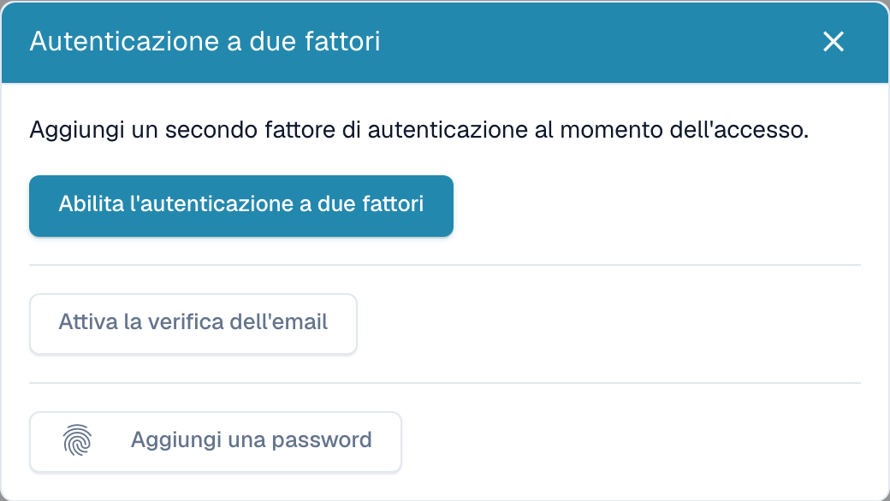
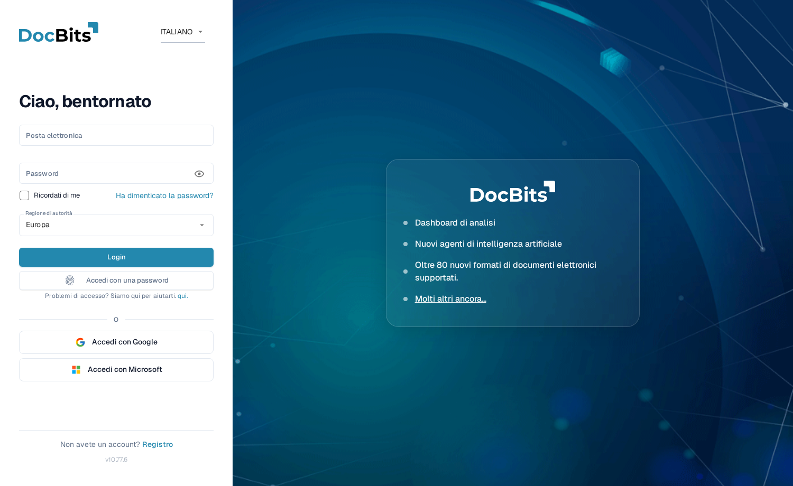

# Autenticazione a due fattori (2FA)

## Panoramica

L'autenticazione a due fattori (2FA) aggiunge un secondo passaggio al tuo accesso. Dopo la password, DocBits richiede un secondo fattore che solo tu possiedi — un codice generato da un'app di autenticazione, un codice inviato via email o una passkey (Touch ID, Windows Hello, YubiKey, 1Password). Anche se qualcuno venisse a conoscenza della tua password, non potrebbe accedere senza quel secondo fattore.

La 2FA è **facoltativa per ciascun utente** e può essere **resa obbligatoria dall'amministratore della tua organizzazione**. Gli accessi tramite single sign-on (SSO) (Google, Microsoft, SAML) sono esenti — il tuo provider di identità applica già la propria MFA.

Puoi registrare più di un metodo. I metodi supportati da DocBits sono:

* **App di autenticazione (TOTP)** — Google Authenticator, Microsoft Authenticator, 1Password, Authy, ecc.
* **Codice via email** — un codice a 6 cifre inviato all'email del tuo account.
* **Passkey (WebAuthn/FIDO2)** — Touch ID, Windows Hello, una chiave hardware (YubiKey) o un gestore di password.

Quando attivi il tuo primo fattore, DocBits ti fornisce anche **dieci codici di backup** da usare nel caso in cui dovessi perdere l'accesso al tuo metodo.

## Dove trovarla

Apri le **impostazioni del profilo / account** (menu account in alto a destra → **Modifica profilo**) e seleziona **Autenticazione a due fattori**. La finestra di dialogo 2FA mostra lo stato attuale e i metodi che puoi aggiungere.

<figure><figcaption>
Metodi di autenticazione a due fattori disponibili. Il comando Aggiungi una password indica in realtà l’aggiunta di una passkey.
</figcaption></figure>

## Configurare un'app di autenticazione (TOTP)

1. Nella finestra di dialogo 2FA, fai clic su **Abilita 2FA**.
2. Scansiona il codice QR con la tua app di autenticazione (Google Authenticator, 1Password, Authy, …). Se non riesci a scansionarlo, usa la **chiave manuale** mostrata sotto il codice QR.
3. Inserisci il codice a 6 cifre mostrato dall'app e conferma.
4. DocBits abilita la 2FA e mostra i tuoi **codici di backup** (vedi sotto).

## Configurare la verifica via email

1. Nella finestra di dialogo 2FA, fai clic su **Abilita verifica via email**.
2. DocBits invia un codice a 6 cifre all'indirizzo del tuo account.
3. Inserisci il codice per confermare. La verifica via email è ora attiva.

## Aggiungere una passkey

1. Nella finestra di dialogo 2FA, fai clic su **Aggiungi una passkey**.
2. Il browser o il dispositivo ti chiede di confermare con Touch ID, Windows Hello, una chiave hardware o il tuo gestore di password.
3. La passkey viene salvata. Puoi aggiungere diverse passkey e rinominarle o rimuoverle in seguito.

## Codici di backup

Quando abiliti il tuo **primo** fattore, DocBits mostra **dieci codici di backup** — **una sola volta**. Ogni codice funziona una sola volta e ti permette di accedere se perdi il tuo autenticatore o il telefono.

* Salvali in un luogo sicuro (un gestore di password è l'ideale).
* Puoi generare un nuovo set in qualsiasi momento con **Rigenera codici di backup** (questo invalida il set precedente).


I codici di backup vengono mostrati solo nel momento in cui vengono generati. DocBits non può mostrarli di nuovo — conservali immediatamente.


## Accedere con la 2FA

1. Inserisci la tua email e la password come al solito.

    <figure><figcaption>
La schermata di accesso. Puoi anche accedere senza password usando <strong>Accedi con una passkey</strong>.
</figcaption></figure>
2. DocBits richiede il tuo secondo fattore. Scegli il tuo metodo:
   * **Autenticatore** — digita il codice a 6 cifre attuale dalla tua app.
   * **Email** — fai clic su **Inviami un codice via email** per ricevere un codice via email, poi digitalo.
   * **Passkey** — fai clic su **Usa una passkey** e conferma con Touch ID / Windows Hello / la tua chiave.
   * **Codice di backup** — se non puoi usare il tuo metodo abituale.

3. In caso di successo hai effettuato l'accesso.

### Come appare il codice via email

Se scegli **Email**, DocBits invia un messaggio con un codice a 6 cifre che scade dopo 10 minuti:

## Considera attendibile questo dispositivo

Nella schermata del secondo fattore puoi selezionare **Ricorda questo dispositivo**. DocBits salterà quindi il passaggio 2FA su quel dispositivo per **30 giorni**. L'attendibilità viene annullata automaticamente quando cambi la password e puoi revocarla tu stesso in qualsiasi momento (vedi sotto).

## Gestire le passkey e i dispositivi attendibili

Apri la finestra di dialogo 2FA e fai clic su **Gestisci** per rivedere ciò che è registrato.

* **Passkey** — rinomina una passkey (fai clic sul suo nome) o eliminala. Eliminando l'ultimo fattore rimasto la 2FA viene disattivata.
* **Dispositivi attendibili** — revoca un singolo dispositivo oppure usa **Revoca tutti i dispositivi** per forzare una nuova richiesta 2FA ovunque.

## Disattivare la 2FA

Nella finestra di dialogo 2FA fai clic su **Disabilita 2FA** e conferma con un codice attuale dell'autenticatore o un codice di backup. Disattivando la 2FA vengono anche cancellati i tuoi codici di backup e revocati i tuoi dispositivi attendibili.


Se la tua organizzazione **richiede** la MFA, non puoi accedere con una password finché non è configurato almeno un fattore. Chiedi al tuo amministratore se non sei sicuro che la MFA sia obbligatoria per la tua organizzazione.


## Accesso senza password (facoltativo)

Una volta che disponi di una passkey, puoi accedere **senza digitare la password** usando **Accedi con una passkey** nella schermata di accesso. La tua password continua a funzionare come alternativa. L'accesso senza password richiede che la passkey ti verifichi (Touch ID / Windows Hello / PIN), quindi è sia più rapido sia resistente al phishing.

Conservare i codici di recupero in un luogo sicuro, separato dal dispositivo di autenticazione. Ogni codice può essere usato una sola volta.

Configurare la verifica via e-mail nella finestra di autenticazione a due fattori. Inserire il codice ricevuto nel proprio account ed effettuare la conferma prevista.

Configurare un’app di autenticazione nella finestra dei due fattori. Memorizzare il segreto solo nell’app approvata e confermare con il codice temporaneo attuale.
