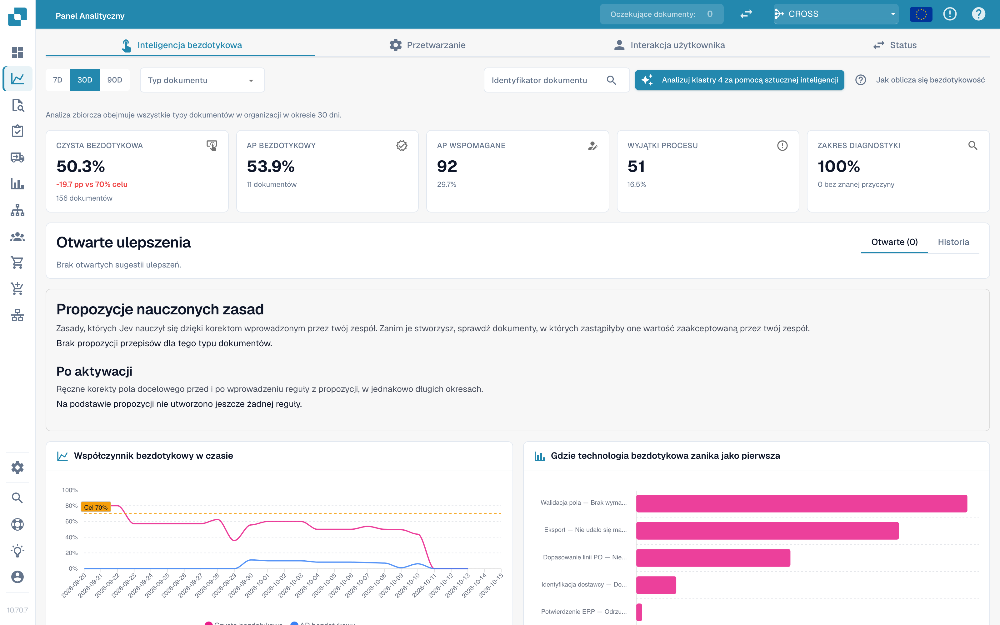
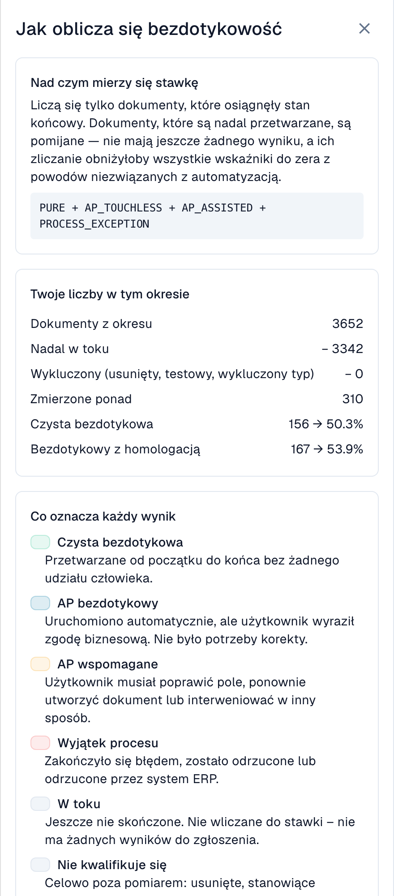
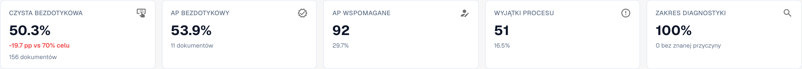
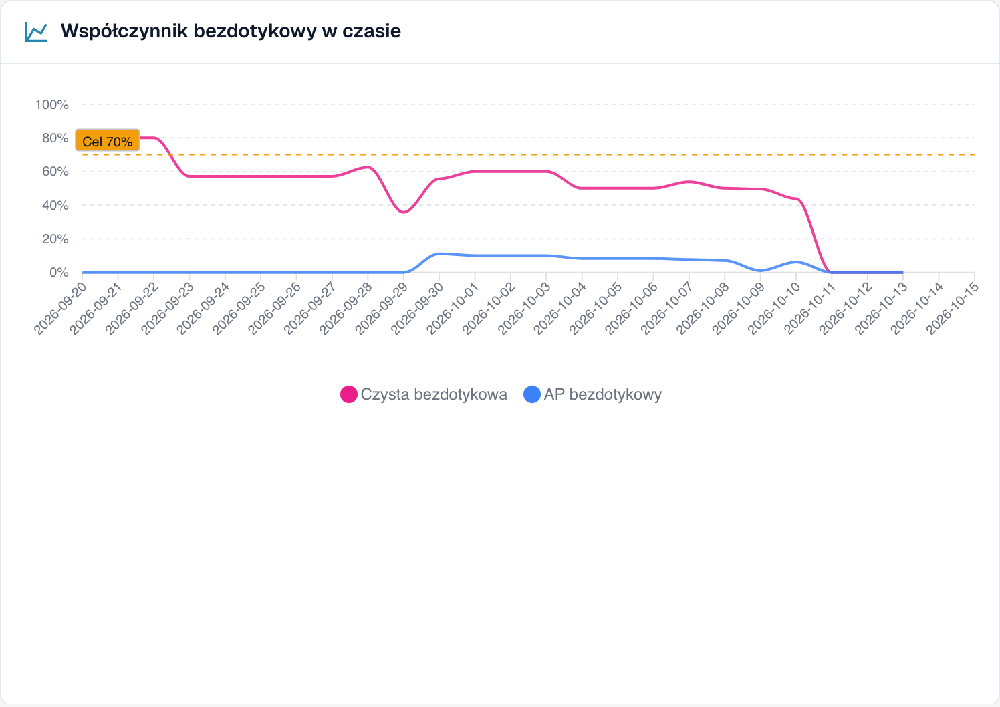
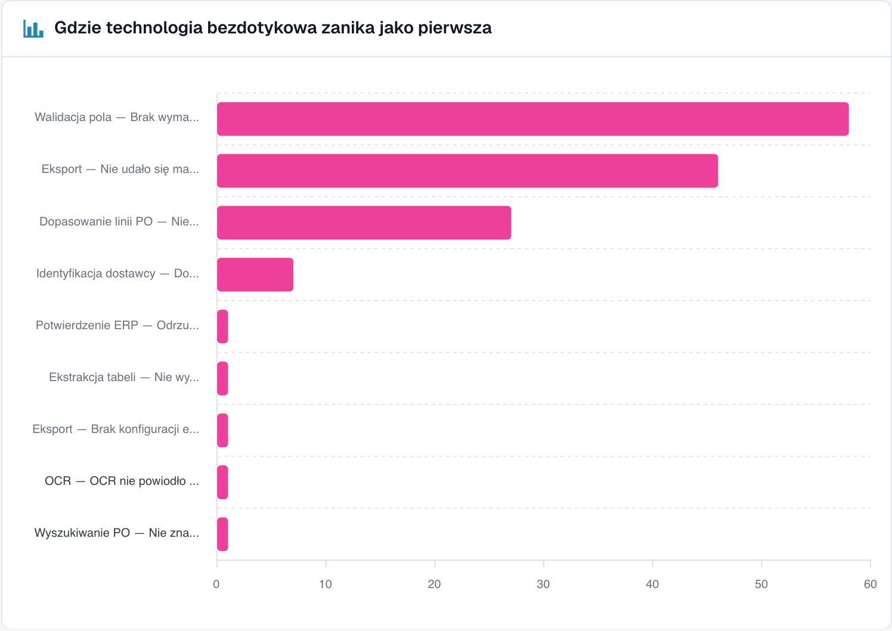
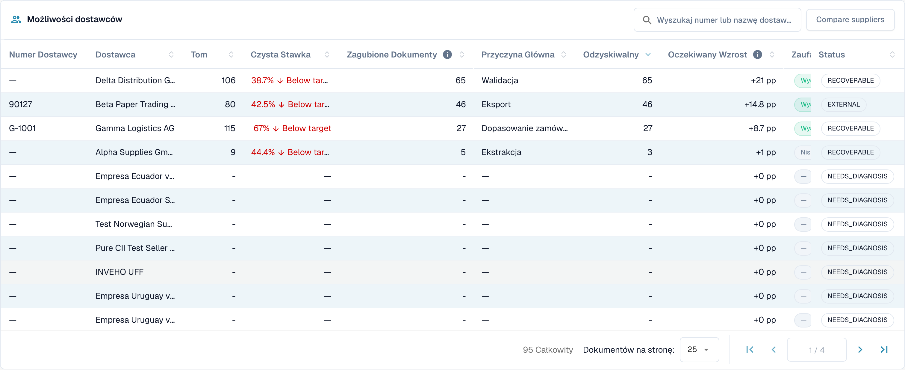
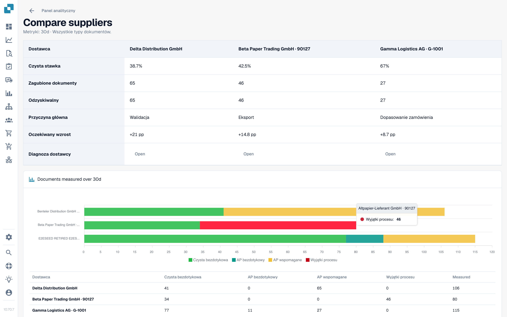

# Touchless Intelligence



## Przegląd

**Touchless Intelligence** odpowiada na dwa pytania dotyczące przetwarzania dokumentów:

1. **Ile dokumentów przechodzi przez DocBits bez niczyjej ingerencji?** To jest Twój _wskaźnik touchless_.
2. **Dlaczego pozostałe się zatrzymują i co zmienić, aby zatrzymywało się ich mniej?** To jest _diagnoza_.

To karta [Panelu Analitycznego](../). Nie dodaje pracy Twojemu zespołowi: DocBits rejestruje, co dzieje się z każdym dokumentem w potoku przetwarzania, i ocenia wynik co 15 minut.

<figure><figcaption><p>Karta Touchless Intelligence: kluczowe wskaźniki, usprawnienia, wskaźnik w czasie i wykres pierwszej utraty. Przykładowa organizacja z danymi demonstracyjnymi; nazwy dostawców są fikcyjne.</p></figcaption></figure>

### Co możesz z tym zrobić

| Chcesz…                                          | Użyj                                                                      | Przykład                                                                      |
| ------------------------------------------------ | ------------------------------------------------------------------------- | ----------------------------------------------------------------------------- |
| Zobaczyć, jak bardzo proces jest zautomatyzowany | Pięć **kluczowych wskaźników** u góry                                     | „63,2 % naszych dokumentów przeszło w zeszłym miesiącu bez udziału człowieka" |
| Zobaczyć trend                                   | **Wskaźnik touchless w czasie** (Touchless rate over time)                | „Wskaźnik wzrósł z 55 % do 68 %, odkąd poprawiliśmy dane podstawowe dostawcy" |
| Dowiedzieć się, gdzie dokumenty się zatrzymują   | **Gdzie touchless jest tracony najpierw** (Where touchless is lost first) | „Najwięcej dokumentów zatrzymuje się na Walidacji pól"                        |
| Zdecydować, którego dostawcę poprawić najpierw   | **Możliwości u dostawców** (Supplier opportunities)                       | „Dostawca A dałby nam +4,0 punktu procentowego"                               |
| Zrozumieć jednego dostawcę                       | Strona **Diagnoza dostawcy** (Supplier Diagnosis)                         | „Ich faktury nie mają numeru PO, więc dopasowanie PO się nie udaje"           |
| Zrozumieć jeden dokument                         | **Ślad dokumentu** (Document Trace)                                       | „Ta faktura zatrzymała się na etapie 8, Walidacji pól"                        |
| Porównać dostawców                               | **Porównaj dostawców** (Compare suppliers)                                | „Dostawcy A i B używają tego samego szablonu, ale tylko B zawodzi"            |
| Zmienić ustawienie, które pomaga                 | **Propozycje zmian** (Change proposals)                                   | „Włącz automatyczne dopasowanie PO: podgląd, zastosowanie, pomiar, cofnięcie" |

## Kto może to zobaczyć

* Karta jest częścią Panelu Analitycznego. Administrator włącza ją dla organizacji. Jeśli karty brakuje, zapytaj administratora.
* **Administratorzy organizacji** widzą ją zawsze.
* Inni użytkownicy widzą ją, gdy administrator przyznał ich roli kartę **Panel analityczny** (Analytics dashboard) (**Ustawienia → Role**). Bez przyznania dostęp mają tylko administratorzy.
* Niektóre działania są tylko dla administratorów: **analiza AI**, **zastosowanie i cofnięcie zmiany**, **propozycje nauczonych reguł** oraz **raport doradczy** (Consulting report).

Jeśli nie masz uprawnień, strona wyświetla komunikat _Action not allowed, please contact the administrator_ (Działanie niedozwolone, skontaktuj się z administratorem).

## Co oznacza „touchless"

Każdy dokument kończy się dokładnie **jednym** wynikiem:

| Wynik                                   | Znaczenie                                                                                                       | Wliczany do wskaźnika                                                                                 |
| --------------------------------------- | --------------------------------------------------------------------------------------------------------------- | ----------------------------------------------------------------------------------------------------- |
| **Czysty touchless** (Pure touchless)   | Przetworzony od importu do eksportu **bez jakiegokolwiek udziału człowieka**                                    | Tak, jako sukces                                                                                      |
| **AP touchless**                        | Przetworzony automatycznie, a człowiek udzielił tylko **zatwierdzenia biznesowego**. Korekta nie była potrzebna | Tak, jako sukces                                                                                      |
| **AP wspomagany** (AP assisted)         | Człowiek musiał **poprawić pole, zrestartować dokument** lub w inny sposób zainterweniować                      | Tak, jako chybienie. To nie jest błąd, tylko automatyzacja, która nie poprowadziła dokumentu do końca |
| **Wyjątek procesu** (Process exception) | Zakończył się **błędem**, został **odrzucony**, został **odrzucony przez ERP** lub **utknął** w potoku          | Tak, jako chybienie                                                                                   |
| **W toku** (In progress)                | Jeszcze nie zakończony                                                                                          | **Nie**. Nie ma jeszcze wyniku                                                                        |
| **Niekwalifikujący się** (Not eligible) | Usunięty, zarchiwizowany, dokument testowy lub wykluczony typ dokumentu                                         | **Nie**                                                                                               |

**Wskaźnik touchless** wynosi:

```
rate = (Pure touchless + AP touchless)
       ÷ (Pure touchless + AP touchless + AP assisted + Process exception)
```

Dokumenty, które są jeszcze **w toku** lub **niekwalifikujące się**, nigdy nie są uwzględniane w obliczeniach. Chroni to wskaźnik: dokument, który przyszedł pięć minut temu, nie może go obniżyć.


**Jeden dotyk liczy się na stałe.** Gdy człowiek dotknął dokumentu, pozostaje on policzony jako dotknięty, nawet jeśli późniejsze automatyczne uruchomienie nie wymagałoby nikogo. **Restart dokumentu nie sprawia, że znów staje się touchless.** Wskaźnik odzwierciedla pracę, która się wydarzyła.


### Przykładowe obliczenie (liczby poglądowe)

W ciągu 30 dni przyszło 200 dokumentów:

| Wynik                                    | Dokumenty |
| ---------------------------------------- | --------- |
| Czysty touchless                         | 120       |
| AP touchless                             | 30        |
| AP wspomagany                            | 30        |
| Wyjątek procesu                          | 10        |
| W toku                                   | 8         |
| Niekwalifikujące się (dokumenty testowe) | 2         |

* Mianownik: 120 + 30 + 30 + 10 = **190**. 8 dokumentów w toku i 2 niekwalifikujące się są pominięte.
* **Czysty touchless**: 120 ÷ 190 = **63,2 %**
* **AP touchless**: 30 ÷ 190 = **15,8 %**
* **Wskaźnik touchless**: (120 + 30) ÷ 190 = **78,9 %**

Karta pokazuje **cel** (70 %, chyba że Twoja organizacja używa innego). W tym przykładzie wskaźnik jest powyżej celu.

Kliknij **Jak obliczany jest touchless** (How touchless is calculated) w prawym górnym rogu, aby otworzyć to wyjaśnienie w DocBits, z liczbami z Twojego okresu (dokumenty w okresie, wciąż w toku, wykluczone, zmierzone).

<figure><figcaption><p>Panel boczny <strong>Jak obliczany jest touchless</strong>: wzór, <strong>Twoje liczby w tym okresie</strong> (Your numbers in this period) (tutaj 2 425 dokumentów, 2 115 wciąż w toku, 310 zmierzonych) i znaczenie każdego wyniku. Przykładowa organizacja z danymi demonstracyjnymi; nazwy dostawców są fikcyjne.</p></figcaption></figure>

### Jak aktualne są liczby

Wyniki są **przeliczane co 15 minut**. Wynik dokumentu może się jeszcze zmienić po jego pierwszym pojawieniu się: ERP może potwierdzić eksport kilka godzin później. Wiersz **Dane na dzień …** (Data as of …) na dole karty pokazuje, kiedy liczby były ostatnio obliczone.

## Karta przeglądu

### Filtry

| Filtr                                                                | Co robi                                                                                                                                                                                                                                       |
| -------------------------------------------------------------------- | --------------------------------------------------------------------------------------------------------------------------------------------------------------------------------------------------------------------------------------------- |
| **7D / 30D / 90D**                                                   | Okres dla kluczowych wskaźników i kolejki. Domyślnie 30 dni                                                                                                                                                                                   |
| **Typ dokumentu** (Document Type)                                    | Ogranicza wszystkie liczby do jednego typu, na przykład INVOICE                                                                                                                                                                               |
| **Pole segmentu / Wartość segmentu** (Segment field / Segment value) | Tylko jeśli Twoja organizacja prowadzi kilka procesów przez jeden typ dokumentu (na przykład zamówienia bezpośrednie, pośrednie i EAM w polu `order_type`). Wybierz pole, aby zobaczyć podział, wybierz wartość, aby zawęzić do niej wszystko |
| **ID dokumentu** (Document ID)                                       | Otwiera **Ślad dokumentu** dla jednego dokumentu                                                                                                                                                                                              |

**Podorganizacja** wybrana u góry w DocBits zawęża kluczowe wskaźniki i kolejkę dostawców. Klastry problemów i analiza AI zawsze obejmują całą organizację.

### Pięć kluczowych wskaźników

<figure><figcaption><p>Pięć kluczowych wskaźników. Tutaj czysty wskaźnik wynosi 50,3 % (156 dokumentów), czyli 19,7 punktu poniżej celu 70 %, a pokrycie diagnozą wynosi 100 %. Przykładowa organizacja z danymi demonstracyjnymi; nazwy dostawców są fikcyjne.</p></figcaption></figure>

| Kafelek                                    | Pokazuje                                            | Przykład (poglądowy)                                                               |
| ------------------------------------------ | --------------------------------------------------- | ---------------------------------------------------------------------------------- |
| **Czysty touchless**                       | Procent i różnicę względem celu                     | **63,2 %** · „120 dokumentów" · „−6,8 pp wobec celu 70 %" (czerwony, poniżej celu) |
| **AP touchless**                           | Procent                                             | **15,8 %** · „30 dokumentów"                                                       |
| **AP wspomagany**                          | Liczbę dokumentów i ich udział                      | **30** · 15,8 %                                                                    |
| **Wyjątki procesu**                        | Liczbę dokumentów i ich udział                      | **10** · 5,3 %                                                                     |
| **Pokrycie diagnozą** (Diagnosis coverage) | Ile zablokowanych dokumentów ma **znaną** przyczynę | **80 %** · „10 bez znanej przyczyny"                                               |

* Kafelek pokazuje kreskę (—) zamiast **0 %**, gdy nie ma czego mierzyć. Kreska oznacza „brak danych", nie „zero".
* **Pokrycie diagnozą** = dokumenty ze znanym powodem blokady ÷ wszystkie zablokowane dokumenty. Przykład: 50 zablokowanych dokumentów, 10 z nieznaną przyczyną → 40 ÷ 50 = **80 %**. Niska wartość oznacza „jeszcze nie rozumiemy, dlaczego dokumenty się zatrzymują". Popraw ją, zanim spróbujesz usuwać pojedyncze przyczyny.
* **Kliknij kafelek**, aby otworzyć w nowej karcie listę dokumentów stojących za liczbą („View the documents behind this number"). Kafelki z 0 dokumentów nie są klikalne.

### Wskaźnik touchless w czasie

<figure><figcaption><p>Wskaźnik na dzień z linią celu. Tutaj wskaźnik utrzymuje się między 40 a 60 % i gwałtownie spada od 10 października. Przykładowa organizacja z danymi demonstracyjnymi; nazwy dostawców są fikcyjne.</p></figcaption></figure>

Wykres z jedną linią dla **Czystego touchless**, jedną dla **AP touchless** i **linią celu**. Krótkie okresy pokazują punkty dzienne, długie punkty tygodniowe.

**Przykład.** Po włączeniu 1 października automatycznego dopasowania PO czysty wskaźnik rośnie z 55 % do 68 % w ciągu dwóch tygodni. Wykres pokazuje dzień, w którym krzywa się zmienia, więc możesz powiązać ją ze swoją zmianą.

### Gdzie touchless jest tracony najpierw

<figure><figcaption><p>Zablokowane dokumenty według etapu i powodu, w którym zatrzymały się najpierw. Tutaj <strong>Walidacja pól: Brak wymaganego pola</strong> kosztuje najwięcej dokumentów (58), następnie <strong>Mapowanie eksportu nie powiodło się</strong> (46) i <strong>Niezgodność pozycji PO</strong> (27). Przykładowa organizacja z danymi demonstracyjnymi; nazwy dostawców są fikcyjne.</p></figcaption></figure>

Wykres słupkowy **Zablokowanych dokumentów** (Blocked documents) według etapu potoku: **pierwszego** etapu, który zatrzymał dokument.

**Przykład.** Słupki: Identyfikacja dostawcy 12, Walidacja pól 41, Dopasowanie pozycji PO 7. Największy słupek mówi, że najpierw trzeba sprawdzić **Walidację pól**, zwykle dlatego, że wymagane pole nie jest wyodrębniane.

### Możliwości u dostawców

<figure><figcaption><p>Kolejka dostawców (skrócona do pierwszych czterech wierszy). Pierwszy dostawca ma 106 dokumentów, czysty wskaźnik 38,7 % i 65 dokumentów możliwych do odzyskania, więc jego poprawa jest warta <strong>+21 pp</strong>. Przykładowa organizacja z danymi demonstracyjnymi; nazwy dostawców są fikcyjne.</p></figcaption></figure>

Kolejka odpowiada na pytanie **„Którego dostawcę poprawić najpierw?"**. Jest posortowana według dokumentów **Możliwych do odzyskania** (Recoverable), od największej liczby, po 25 wierszy na stronę.

| Kolumna                                                    | Znaczenie                                                                                                                                                                           |
| ---------------------------------------------------------- | ----------------------------------------------------------------------------------------------------------------------------------------------------------------------------------- |
| **Numer dostawcy / Dostawca** (Supplier Number / Supplier) | Dostawca. Dokumenty bez rozpoznanego dostawcy pojawiają się jako **No supplier identified (n documents)** (Nie zidentyfikowano dostawcy)                                            |
| **Wolumen** (Volume)                                       | Kwalifikujące się dokumenty dostawcy w okresie                                                                                                                                      |
| **Czysty wskaźnik** (Pure Rate)                            | Udział dokumentów czystego touchless. Zielony, jeśli na poziomie celu lub powyżej, czerwony, jeśli poniżej                                                                          |
| **Utracone dokumenty** (Lost Documents)                    | Dokumenty, które zakończyły się jako AP wspomagany lub wyjątek procesu. Nie zawsze chodzi o człowieka: odrzucenie przez ERP lub dokument, który utknął na siedem dni, też się liczy |
| **Główna przyczyna** (Root Cause)                          | Kto odpowiada za naprawę: Konfiguracja, Integracja ERP, Eksport, Ekstrakcja, Dane podstawowe, Pomiar, Dopasowanie PO, Proces użytkownika, Walidacja lub Nieznana                    |
| **Możliwe do odzyskania** (Recoverable)                    | Utracone dokumenty, których przyczynę DocBits może naprawić: konfiguracja, dane podstawowe lub szablon dostawcy                                                                     |
| **Oczekiwany wzrost** (Expected Lift)                      | O ile **punktów procentowych** wzrósłby wskaźnik Twojej organizacji, gdyby każdy możliwy do odzyskania dokument tego dostawcy przeszedł touchless (**+x pp**)                       |
| **Pewność** (Confidence)                                   | **Wysoka**, **Średnia** lub **Niska**: jak pewna jest diagnoza                                                                                                                      |
| **Status**                                                 | Nowy, Otwarty, W badaniu, W toku, Potwierdzony, Rozwiązany, Odrzucony. Dostawca ze zbyt małą liczbą dokumentów pokazuje **NEEDS\_DIAGNOSIS**                                        |

**Przykład.** Twoja organizacja ma w okresie 1 000 kwalifikujących się dokumentów. Dostawca A ma 40 dokumentów możliwych do odzyskania, dostawca B ma 90 utraconych dokumentów, ale tylko 10 możliwych do odzyskania (jego problem leży po jego stronie).

* Dostawca A: 40 ÷ 1 000 = **+4,0 pp oczekiwanego wzrostu**
* Dostawca B: 10 ÷ 1 000 = **+1,0 pp**, chociaż B ma więcej utraconych dokumentów

Kolejka stawia A przed B, ponieważ **oczekiwany wzrost** jest mierzony względem całej Twojej organizacji, a nie względem dostawcy. Dostawca z czterema złymi dokumentami nie może wyprzedzić dostawcy z czterystoma.

Użyj pola wyszukiwania („Search supplier number or name"), aby znaleźć dostawcę. Kliknij wiersz, aby otworzyć **Diagnozę dostawcy**.

### Porównaj dostawców

<figure><figcaption><p>Trzej dostawcy obok siebie: czysty wskaźnik, utracone i możliwe do odzyskania dokumenty, główna przyczyna, oczekiwany wzrost i wykres słupkowy wyników. Każdy przycisk <strong>Otwórz</strong> (Open) prowadzi do Diagnozy dostawcy. Przykładowa organizacja z danymi demonstracyjnymi; nazwy dostawców są fikcyjne.</p></figcaption></figure>

Kliknij **Porównaj dostawców**, zaznacz **od dwóch do pięciu** dostawców (każdy jest wymieniony z liczbą zablokowanych dokumentów) i kliknij **Porównaj** (Compare).

Porównanie pokazuje dostawców obok siebie: **Czysty wskaźnik**, **Utracone dokumenty**, **Możliwe do odzyskania**, **Główna przyczyna**, **Oczekiwany wzrost**, wykres słupkowy wyników oraz link do **Diagnozy dostawcy** każdego z nich.

**Przykład.** Dostawcy A i B wysyłają faktury o tym samym układzie. B ma czysty wskaźnik 80 %, A tylko 35 %. Obaj mają główną przyczynę „Dane podstawowe". Porównanie pokazuje, że układ jest w porządku, a rekord dostawcy A jest niekompletny. Napraw dane podstawowe A zamiast zmieniać szablon.

### Analiza z AI

Przycisk **Analizuj n klastrów z AI** (Analyse n clusters with AI) analizuje klastry problemów o największym potencjale touchless (każdy z co najmniej minimalną liczbą dokumentów). Trwa to około 13 sekund na klaster i obejmuje **całą organizację**. Uruchomić ją mogą tylko administratorzy.

W trakcie działania przy każdym klastrze widzisz **W kolejce** (Queued), **W toku** (Running), **Gotowe** (Done), **Już przeanalizowane** (Already analysed) lub **Błąd** (Error), z linkiem **Otwórz klaster** (Open cluster). Jeśli AI jest wyłączone lub nieskonfigurowane w środowisku, przycisk jest nieaktywny i podaje powód, a **wszystko inne na stronie nadal działa**.

## Idź głębiej

| Strona                                                                   | Co obejmuje                                                                                                                                                             |
| ------------------------------------------------------------------------ | ----------------------------------------------------------------------------------------------------------------------------------------------------------------------- |
| [Diagnoza dostawcy i klastry problemów](touchless-supplier-diagnosis.md) | Jeden dostawca szczegółowo: kafelki wyników, trend, klastry problemów, skąd bierze się rekomendacja                                                                     |
| [Diagnoza dopasowania PO](touchless-po-matching-diagnosis.md)            | Dlaczego dokumenty zatrzymują się na wyszukiwaniu PO lub dopasowaniu pozycji PO oraz schemat decyzyjny pokazujący, jak DocBits dopasowuje pozycje faktury do pozycji PO |
| [Ślad dokumentu](touchless-document-trace.md)                            | Co działo się z jednym dokumentem, etap po etapie                                                                                                                       |
| [Propozycje zmian i raporty](touchless-change-proposals.md)              | Podgląd, zastosowanie, pomiar i cofnięcie zmiany; propozycje nauczonych reguł; raport doradczy                                                                          |

## Praca z Touchless Intelligence: rutyna

1. **Co tydzień**: otwórz kartę i sprawdź **wskaźnik** oraz **trend** względem celu.
2. Spójrz na **Pokrycie diagnozą**. Poniżej około 80 % najpierw dowiedz się, dlaczego dokumenty się zatrzymują.
3. Przeczytaj **Gdzie touchless jest tracony najpierw** i wybierz największy etap.
4. Otwórz **Możliwości u dostawców**. Posortuj według **Oczekiwanego wzrostu** i weź pierwszego dostawcę ze statusem **RECOVERABLE**.
5. Przeczytaj **klastry problemów**, sprawdź **Brakujące dowody** (Missing evidence), a następnie wykonaj **Co zmienić** (What to change).
6. Stosuj jedną zmianę naraz z **podglądem**, aby **Historia zmian** (Change history) mogła ją zmierzyć.
7. Po dwóch tygodniach sprawdź wynik **przed/po**.

## Pytaj zwykłym językiem: DocBits MCP

Wszystko to jest dostępne także dla Twojego asystenta AI przez [DocBits MCP](../../../advanced-functions-and-tools/docbits-mcp/). Przykłady pytań:

* „Jaki jest nasz wskaźnik touchless z ostatnich 30 dni?"
* „Którzy trzej dostawcy kosztują nas najwięcej dokumentów touchless?"
* „Dlaczego dokumenty tego dostawcy zatrzymują się u człowieka?"
* „Dlaczego dopasowanie PO nie powiodło się dla tego dokumentu?"

## FAQ

**Wskaźniki pokazują kreskę (—).** Żaden dokument nie osiągnął w okresie wyniku końcowego lub zmierzono mniej dokumentów niż wymagane minimum. Dokumenty, które są jeszcze w toku, nie są liczone.

**Brakuje karty.** Poproś administratora o włączenie modułu i przyznanie Twojej roli karty **Panel analityczny**.

**Dokument jest policzony jako dotknięty, ale tym razem przeszedł bez niczyjej pomocy.** Został dotknięty we wcześniejszym uruchomieniu (korekta lub restart). Wskaźnik liczy pracę, która się wydarzyła.

**Dlaczego liczba zmienia się po kilku godzinach?** ERP może potwierdzić eksport kilka godzin po jego wysłaniu. Wynik jest przeliczany co 15 minut.

**Czy AI zmienia cokolwiek samodzielnie?** Nie. AI pisze tylko wyjaśnienia. Ustawienie zmienia się dopiero po tym, jak administrator wyświetli podgląd i je zastosuje.

## Powiązane strony

* [Diagnoza dostawcy i klastry problemów](touchless-supplier-diagnosis.md)
* [Diagnoza dopasowania PO](touchless-po-matching-diagnosis.md)
* [Ślad dokumentu](touchless-document-trace.md)
* [Propozycje zmian i raporty](touchless-change-proposals.md)
* [Panel Analityczny](../)
* [Asystent ustawień](../../settings/global-settings/company-information/settings-assistant/)
* [DocBits MCP](../../../advanced-functions-and-tools/docbits-mcp/)
