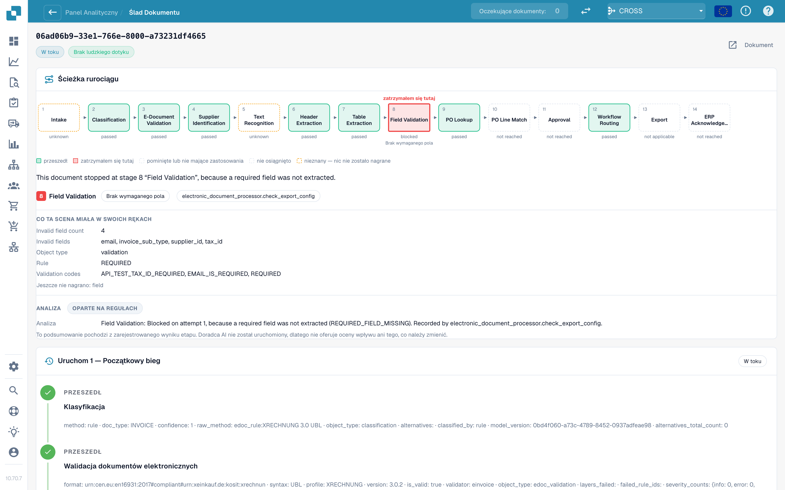

# Ślad dokumentu

Wpisz identyfikator dokumentu w polu **ID dokumentu** (Document ID) lub otwórz przykładowy dokument z klastra, aby zobaczyć, **co działo się z tym jednym dokumentem**.

<figure><figcaption>
Ślad dokumentu (Document Trace): ścieżka potoku z etapem, na którym dokument się zatrzymał, tym, co ten etap miał do dyspozycji, oraz historią uruchomień poniżej.
</figcaption></figure>

Na górze widać **ścieżkę potoku** z 14 etapami: Przyjęcie, Klasyfikacja, Walidacja e-dokumentu, Identyfikacja dostawcy, Rozpoznawanie tekstu, Ekstrakcja nagłówka, Ekstrakcja tabeli, Walidacja pól, Wyszukiwanie PO, Dopasowanie pozycji PO, Zatwierdzenie, Routing przepływu pracy, Eksport, Potwierdzenie ERP. Każde pole ma stan:

| Stan                                                      | Znaczenie                             |
| --------------------------------------------------------- | ------------------------------------- |
| **zaliczony** (passed) (zielony)                          | Etap przebiegł prawidłowo             |
| **zatrzymany tutaj** (stopped here) (czerwony)            | Etap zablokował dokument              |
| **pominięty lub nie dotyczy** (skipped or not applicable) | Etap nie dotyczy tego dokumentu       |
| **nieosiągnięty** (not reached)                           | Dokument nigdy nie dotarł tak daleko  |
| **nieznany** (unknown) (linia przerywana)                 | Dla tego etapu nic nie zarejestrowano |

Pod ścieżką zdanie podaje przyczynę. Na zrzucie ekranu: _This document stopped at stage 8 "Field Validation", because a required field was not extracted._ (Ten dokument zatrzymał się na etapie 8 „Walidacja pól", ponieważ wymagane pole nie zostało wyodrębnione). Blok **Co ten etap miał do dyspozycji** (What this stage had in its hands) wymienia fakty: **Liczba nieprawidłowych pól 5** (Invalid field count 5) oraz pola (`delivery_date`, `email`, `invoice_sub_type`, `payment_terms`, `supplier_id`), regułę (**REQUIRED**) i kody walidacji. Blok **Analiza** (Analysis) mówi, czy jest **oparta na regułach** (Rule-based), czy napisana przez AI.

**Historia uruchomień** (run history) poniżej wymienia każde uruchomienie (**Uruchomienie 1 · Pierwsze uruchomienie** (Run 1 · Initial run), potem każdy restart) z każdym etapem i jego zarejestrowanymi faktami. Jeśli dokument został poprawiony i zrestartowany, notatka przypomina, że **nadal liczy się jako dotknięty**.

**Przykład.** Dokumenty jednego dostawcy zatrzymują się na etapie 8. W śladzie za każdym razem widzisz te same pięć nieprawidłowych pól. To nie jest problem ekstrakcji pojedynczych dokumentów, tylko brakująca wartość domyślna w konfiguracji pól: napraw ją raz, a cały klaster będzie możliwy do odzyskania.

## Powiązane strony

* [Touchless Intelligence](./)
* [Diagnoza dostawcy i klastry problemów](touchless-supplier-diagnosis.md)
* [Diagnoza dopasowania PO](touchless-po-matching-diagnosis.md)
