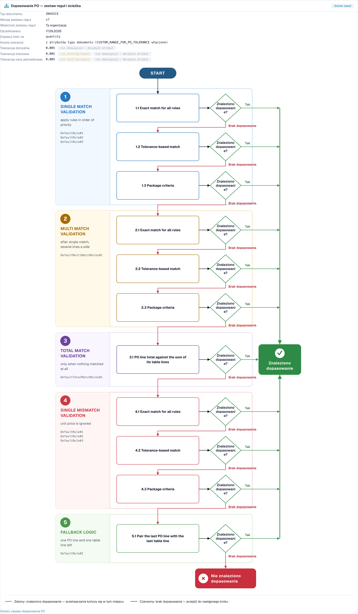

# Diagnoza dopasowania PO

## Przegląd

Wiele faktur zatrzymuje się na zamówieniu zakupu. Faktura mówi jedno, zamówienie zakupu (PO) mówi coś innego, a DocBits nie potrafi samodzielnie zdecydować, czy do siebie pasują. Każdy taki dokument wymaga człowieka, więc **nie jest touchless**.

Touchless Intelligence pokazuje, **dlaczego** dopasowanie PO się nie powiodło i **jak** DocBits próbował dopasować. Ta strona wyjaśnia dwa zaangażowane etapy potoku, powody, które zobaczysz, oraz **schemat decyzyjny dopasowania PO** (PO matching decision flow), czyli diagram pokazujący kroki dopasowania jeden po drugim.

### Gdzie widzisz dopasowanie PO w Touchless Intelligence

| Gdzie                                                                                                                   | Co widzisz                                                                                                                                                                          |
| ----------------------------------------------------------------------------------------------------------------------- | ----------------------------------------------------------------------------------------------------------------------------------------------------------------------------------- |
| **Gdzie touchless jest tracony najpierw** (karta przeglądu)                                                             | Słupek, na przykład _Dopasowanie pozycji PO: niezgodność pozycji PO_. Mówi, ile dokumentów tam się zatrzymało                                                                       |
| **Możliwości u dostawców**                                                                                              | Dostawca z główną przyczyną **Dopasowanie PO**                                                                                                                                      |
| **Diagnoza dostawcy**, sekcja **Jak ta organizacja dopasowuje** (How this organisation matches) i **klaster problemów** | Schemat decyzyjny z zestawem reguł Twojej organizacji                                                                                                                               |
| **Ślad dokumentu**                                                                                                      | Etap **Dopasowanie pozycji PO** ze statusem **zablokowany** (blocked) i powodem                                                                                                     |
| **Ustawienia → Typy dokumentów → Więcej ustawień → Zamówienie zakupu**                                                  | Same reguły dopasowania. Zobacz [Zasady Dopasowywania Zamówień Zakupu](../../settings/global-settings/document-types/more-settings/purchase-order/purchase-order-matching-rules.md) |

## Dwa etapy PO

| Etap                                            | Pytanie                                         | Kończy się komunikatem                                                                                                               |
| ----------------------------------------------- | ----------------------------------------------- | ------------------------------------------------------------------------------------------------------------------------------------ |
| **9 · Wyszukiwanie PO** (PO Lookup)             | Czy istnieje zamówienie zakupu dla tej faktury? | _Nie znaleziono zamówienia zakupu_                                                                                                   |
| **10 · Dopasowanie pozycji PO** (PO Line Match) | Czy każda pozycja faktury pasuje do pozycji PO? | _Niezgodność pozycji PO_, _Niezgodność identyfikatora pozycji PO_, _Cena jednostkowa poza tolerancją PO_, _Ilość poza tolerancją PO_ |

Dokument, który zatrzymuje się na etapie 9 lub 10, pojawia się w kolejce dostawców z pierwszą blokadą **Dopasowanie PO**.

## Powody niepowodzenia dopasowania PO

| Powód, który widzisz                                                      | Co oznacza                                                                                                                                  | Typowa przyczyna                                                                                               | Co zmienić                                                                                                                                                                                    |
| ------------------------------------------------------------------------- | ------------------------------------------------------------------------------------------------------------------------------------------- | -------------------------------------------------------------------------------------------------------------- | --------------------------------------------------------------------------------------------------------------------------------------------------------------------------------------------- |
| **Nie znaleziono zamówienia zakupu** (Purchase order not found)           | DocBits nie znalazł zamówienia zakupu dla numeru PO z faktury                                                                               | Numer PO jest źle odczytany lub brakuje go; PO nie zostało jeszcze zaimportowane; PO należy do innego dostawcy | Sprawdź ekstrakcję numeru PO dla tego dostawcy, import danych podstawowych PO i powiązanie z dostawcą                                                                                         |
| **Niezgodność pozycji PO** (PO item mismatch)                             | Pozycje faktury nie pasowały do pozycji PO                                                                                                  | Dostawca używa własnych numerów pozycji; opis się różni; pozycje zostały połączone lub rozdzielone             | Sprawdź mapowanie numerów pozycji i **priorytety reguł** w regułach dopasowania; dodaj regułę dla sposobu, w jaki dostawca identyfikuje pozycje                                               |
| **Niezgodność identyfikatora pozycji PO** (PO line identifier mismatch)   | Numer lub identyfikator pozycji na fakturze nie zgadza się z PO                                                                             | Dostawca zmienia numerację pozycji                                                                             | Dopasowuj według pozycji i ilości zamiast według numeru pozycji                                                                                                                               |
| **Cena jednostkowa poza tolerancją PO** (Unit price outside PO tolerance) | Cena różni się bardziej niż dozwolona tolerancja                                                                                            | Rzeczywista zmiana ceny, różnica zaokrąglenia lub inna jednostka ceny                                          | Sprawdź **Tolerancję ceny jednostkowej** w zestawie reguł; popraw PO lub zapytaj dostawcę                                                                                                     |
| **Ilość poza tolerancją PO** (Quantity outside PO tolerance)              | Ilość różni się bardziej niż dozwolona tolerancja                                                                                           | Dostawa częściowa, nadmierna dostawa                                                                           | Sprawdź **Dopasuj ilość według** i **Tolerancję ilości**                                                                                                                                      |
| **Błąd usługi dopasowania PO** (PO matching service error)                | Usługa dopasowania nie mogła odpowiedzieć                                                                                                   | Tymczasowy problem techniczny                                                                                  | Zrestartuj dokumenty; jeśli się powtarza, skontaktuj się z pomocą techniczną                                                                                                                  |
| **Automatyczny eksport PO wyłączony** (Automatic PO export disabled)      | Ustawienie **Automatyczny eksport, jeśli PO dopasowane w 100%** jest wyłączone, więc dopasowane dokumenty nie są eksportowane automatycznie | Ustawienie jest wyłączone                                                                                      | Włącz ustawienie, jeśli chcesz automatycznego eksportu. Zobacz [Automatyczny eksport, jeśli PO dopasowane w 100%](../../settings/document-processing/module/auto-export-if-po-matched-100.md) |


Nie każdy powód związany z dopasowaniem PO można naprawić w DocBits. Jeśli dostawca wysyła błędny numer PO, karta pokazuje **Tylko działanie dostawcy**: dostawca musi poprawić dokument i wysłać go ponownie.


## Schemat decyzyjny dopasowania PO

Schemat decyzyjny pokazuje, jak DocBits próbuje dopasować pozycję faktury do pozycji PO. Ma **pięć etapów**, a wygrywa pierwsze dopasowanie:

1. **Walidacja pojedynczego dopasowania** (Single match validation): zastosuj reguły według priorytetu. To normalny przypadek, jedna pozycja faktury i jedna pozycja PO
2. **Walidacja wielokrotnego dopasowania** (Multi match validation): po pojedynczym dopasowaniu, gdy po jednej ze stron występuje kilka pozycji
3. **Walidacja dopasowania sum** (Total match validation): tylko gdy nic nie zostało dopasowane. Suma pozycji PO jest porównywana z sumą jej pozycji tabeli
4. **Walidacja pojedynczej niezgodności** (Single mismatch validation): cena jednostkowa jest ignorowana, więc pozycję można dopasować według towaru i ilości, nawet jeśli cena się różni
5. **Logika awaryjna** (Fallback logic): zostają jedna pozycja PO i jedna pozycja tabeli, więc są sparowane

W obrębie etapów DocBits próbuje w tej kolejności:

* **Dokładne dopasowanie dla wszystkich reguł** (Exact match for all rules): każda porównywana wartość jest identyczna
* **Dopasowanie z tolerancją** (Tolerance-based match): wartości liczbowe mogą odbiegać w granicach tolerancji
* **Kryteria opakowania** (Package criteria): ostatni przebieg, oparty na kryteriach zestawu reguł związanych z opakowaniem

Każdy krok pyta **Znaleziono dopasowanie?** (Match found?). Odpowiedź **Tak** (zielona) prowadzi do **Znaleziono dopasowanie** (Match found), a dokument jest przetwarzany dalej. Odpowiedź **Brak dopasowania** (No match) (czerwona) przechodzi do następnego kroku, a po ostatnim kroku wynikiem jest **Nie znaleziono dopasowania** (No match found): dokument się zatrzymuje i wymaga człowieka.

<figure><figcaption>
Schemat decyzyjny dopasowania PO, otwarty z sekcji <strong>Jak ta organizacja dopasowuje</strong> na stronie Diagnoza dostawcy. Nagłówek pokazuje zestaw reguł (wersja 7, należąca do tej organizacji) i tolerancje. Pod nim pięć etapów z przebiegami biegnie od góry do dołu. Zielony prowadzi do <strong>Znaleziono dopasowanie</strong>, czerwony przechodzi do następnego kroku i kończy się w <strong>Nie znaleziono dopasowania</strong>. Przykładowa organizacja z danymi demonstracyjnymi.
</figcaption></figure>

### Co mówi nagłówek diagramu

| Pole                                                                                                 | Znaczenie                                                                                                                                  |
| ---------------------------------------------------------------------------------------------------- | ------------------------------------------------------------------------------------------------------------------------------------------ |
| **Typ dokumentu** (Document type)                                                                    | Typ dokumentu, do którego należy zestaw reguł, na przykład INVOICE                                                                         |
| **Wersja zestawu reguł** (Rule set version)                                                          | Wersja reguł dopasowania, na przykład v3                                                                                                   |
| **Właściciel zestawu reguł** (Rule set owner)                                                        | **Ta organizacja** (Twoje własne reguły) lub **Dostarczony domyślny zestaw reguł** (Shipped default rule set) (standardowe reguły DocBits) |
| **Opublikowano** (Published)                                                                         | Kiedy wersja została opublikowana                                                                                                          |
| **Dopasuj ilość według** (Match quantity on)                                                         | Która ilość jest porównywana (ilość zamówiona, ilość otwarta)                                                                              |
| **Kwota tolerancji** (Tolerance amount)                                                              | Czy tolerancje pochodzą z atrybutów typu dokumentu, czy z zestawu reguł                                                                    |
| **Tolerancja ceny jednostkowej** / **Tolerancja ilości** (Unit price tolerance / Quantity tolerance) | O ile może odbiegać cena lub ilość                                                                                                         |
| **Tolerancja domyślna** (Default tolerance)                                                          | Tolerancja dla wszystkich pozostałych wartości liczbowych                                                                                  |

W powyższym przykładzie tolerancje pokazują **nieskonfigurowane** (not configured) i **nieobowiązujące: decyduje atrybut** (not in force: attribute decides). Oznacza to: sam zestaw reguł nie ma własnej tolerancji, a wiersz **Kwota tolerancji** mówi, że tolerancje pochodzą z **atrybutów typu dokumentu**. Tolerancja decyduje tylko wtedy, gdy obowiązuje. Przeczytaj ten wiersz najpierw, gdy różnica ceny lub ilości blokuje dokumenty: mówi, **gdzie** zmienić tolerancję.

Stan zestawu reguł jest pokazany jako notatka: **Aktywna wersja** (Active version) (te reguły decydują), **Zatwierdzona, nieaktywna** (Approved, not active), **Wersja robocza, jeszcze nieobowiązująca** (Draft, not yet in force) lub **Stan wersji nieznany** (Version state unknown). Decyduje tylko aktywna wersja.

Jeśli reguły transformacji zmieniły dokument przed dopasowaniem, diagram o tym informuje, na przykład _2 applied: (names)_ (zastosowano 2: (nazwy)) lub _"(rule)" rebuilt (table): the PO match was lost here_ („(reguła)" przebudowała (tabela): dopasowanie PO zostało tu utracone). To częsta ukryta przyczyna: reguła, która przeformatowuje tabelę, może zepsuć dopasowanie, które wcześniej działało.

## Przykłady

Liczby w przykładach są poglądowe.

### Przykład 1: Cena w granicach tolerancji

Pozycja faktury ma cenę jednostkową **10,40**. Pozycja PO mówi **10,00**. Tolerancja ceny jednostkowej wynosi **5 %**.

* **Dokładne dopasowanie** nie udaje się (10,40 to nie 10,00).
* **Dopasowanie z tolerancją** udaje się: różnica wynosi **4 %**, czyli mieści się w 5 %.
* Pozycja jest dopasowana. **Znaleziono dopasowanie.**

Przy tolerancji **3 %** dopasowanie z tolerancją również się nie udaje. Po wszystkich etapach dokument zatrzymuje się z komunikatem **Cena jednostkowa poza tolerancją PO**. Diagram pokazuje dokładnie tę ścieżkę, a naprawą jest albo tolerancja (jeśli 4 % jest dla Twojej firmy akceptowalne), albo korekta u dostawcy.

### Przykład 2: Numery pozycji dostawcy różnią się od Twoich

Dostawca fakturuje towar **„A-4711-X"**, Twoje PO mówi **„4711"**. Żadna reguła nie porównuje tych dwóch wartości, więc nie znaleziono dopasowania, a Touchless Intelligence grupuje wszystkie faktury tego dostawcy w jeden klaster: **Dopasowanie pozycji PO, niezgodność pozycji PO**, 27 dokumentów.

* W klastrze czytasz _27 dotyczy, 27 do odzyskania_, oczekiwany wzrost na przykład **+8,7 pp**.
* Naprawa leży po Twojej stronie: dodaj lub zmień kolejność reguły, która dopasowuje według numeru pozycji dostawcy lub opisu, albo uzupełnij numery pozycji dostawcy w danych podstawowych.
* Po zmianie reguły zastosuj zmianę przez [propozycję zmiany](touchless-change-proposals.md) i dwa tygodnie później przeczytaj **Historię zmian**: czysty wskaźnik przed i po.

### Przykład 3: Zamówienia zakupu jeszcze nie ma

Faktury przychodzą, zanim PO zostało zaimportowane. Zatrzymują się na **Wyszukiwaniu PO** z komunikatem **Nie znaleziono zamówienia zakupu**. Klaster pokazuje krótki szczyt. Naprawą jest kolejność Twoich procesów lub harmonogram importu PO, a nie reguły dopasowania. Sprawdź **Gdzie touchless jest tracony najpierw**: słupek _Wyszukiwanie PO: nie znaleziono zamówienia zakupu_, który rośnie po każdej przerwie w imporcie, wskazuje tę przyczynę.

### Przykład 4: Jedna reguła przebudowała tabelę

Po wejściu w życie reguły transformacji dla tabeli dostawcy wskaźnik dopasowania tego dostawcy gwałtownie spadł. Diagram dotkniętego dokumentu mówi _"(rule)" rebuilt (table): the PO match was lost here_. Naprawą jest dostosowanie lub cofnięcie reguły transformacji, a nie reguł dopasowania.

## Rutyna dla problemów z dopasowaniem PO

1. Otwórz **Gdzie touchless jest tracony najpierw**. Czy etap dopasowania PO jest w pierwszej trójce?
2. Otwórz **Możliwości u dostawców** i posortuj według **Oczekiwanego wzrostu**. Weź dostawcę z główną przyczyną **Dopasowanie PO** i statusem **RECOVERABLE**.
3. Otwórz **Diagnozę dostawcy** i przeczytaj klaster: powód, dotknięte dokumenty, **Co zmienić**, **Brakujące dowody**.
4. Otwórz **Jak ta organizacja dopasowuje** i sprawdź zestaw reguł: wersję, właściciela i tolerancje.
5. Otwórz jeden **przykładowy dokument** i jego [Ślad dokumentu](touchless-document-trace.md): który etap, jaki powód?
6. Zmień **jedną** rzecz (kolejność reguł, tolerancję, mapowanie pozycji) z podglądem, aby **Historia zmian** mogła ją zmierzyć.

## Powiązane strony

* [Touchless Intelligence](./)
* [Diagnoza dostawcy i klastry problemów](touchless-supplier-diagnosis.md)
* [Ślad dokumentu](touchless-document-trace.md)
* [Propozycje zmian i raporty](touchless-change-proposals.md)
* [Zasady Dopasowywania Zamówień Zakupu](../../settings/global-settings/document-types/more-settings/purchase-order/purchase-order-matching-rules.md)
* Karty dopasowania PO: kompletny przewodnik (PO Matching Cards - Complete Guide)
