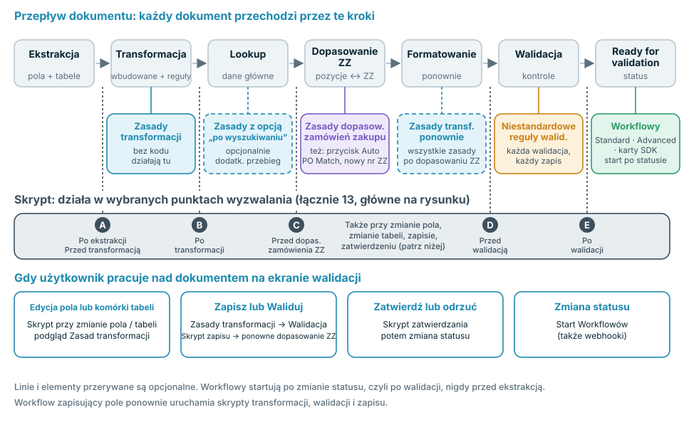
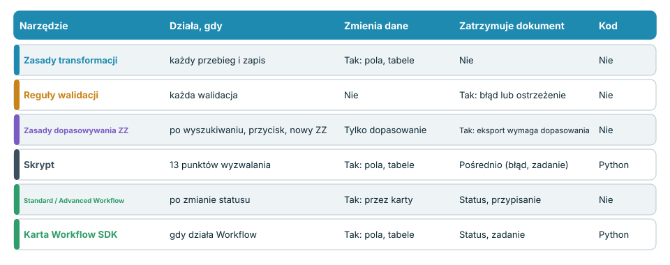
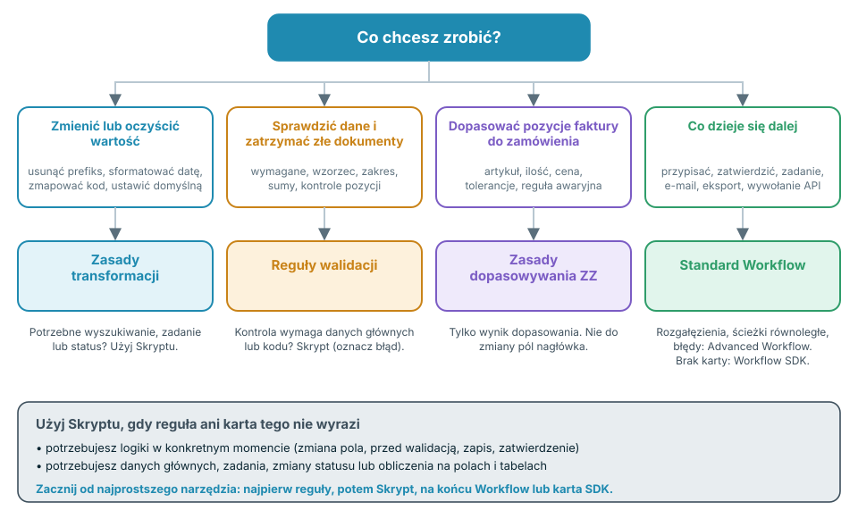

# Wybierz właściwą automatyzację



Wideo (prawie sześć minut) omawia te same tematy w czterech częściach: **0:00** gdzie każde narzędzie działa w przepływie dokumentu, **1:36** kod, workflowy i porównanie, **2:44** co każde narzędzie potrafi, a czego nie, **3:57** najlepsze praktyki i typowe błędy.

DocBits oferuje kilka sposobów zmiany, sprawdzania i kierowania dokumentów: **Zasady transformacji**, **Niestandardowe reguły walidacji**, **Zasady Dopasowywania Zamówień Zakupu**, **Skrypty**, **Standard Workflow**, **Advanced Workflow** i **karty Workflow SDK**. Zakresy tych narzędzi celowo się pokrywają. Ta strona podpowiada, które z nich wybrać, **kiedy każde z nich działa w przepływie dokumentu** oraz co potrafi, a czego nie.

## Krótka odpowiedź

| Chcę … | Użyj | Dlaczego |
| --- | --- | --- |
| Oczyścić lub przepisać wartość (przycięcie, prefiks, format daty, mapowanie jednostek, wartość domyślna) | [Zasady transformacji](settings/global-settings/document-types/transformation-rules.md) | Bez kodu, podgląd na żywo, działają przy każdym przebiegu i zapisie |
| Upewnić się, że dane są kompletne i wiarygodne, oraz zatrzymać dokumenty, które takie nie są | [Niestandardowe reguły walidacji](settings/global-settings/document-types/custom-validation-rules.md) | Deklaratywne kontrole, błąd lub ostrzeżenie, blokują automatyczny eksport |
| Dopasować pozycje faktury do pozycji zamówienia zakupu | [Zasady Dopasowywania Zamówień Zakupu](settings/global-settings/document-types/more-settings/purchase-order/purchase-order-matching-rules.md) | Zestawy reguł z tolerancjami, regułami awaryjnymi i diagramem wizualnym |
| Zrobić coś, czego reguła nie wyrazi: wyszukiwanie, obliczenie na polach i tabelach, zadanie, zmianę statusu w dokładnie określonym momencie | [Skrypt](settings/global-settings/document-types/script/README.md) | Python w 13 punktach wyzwalania w przepływie |
| Zdecydować, **co dzieje się dalej** z dokumentem: przypisać, zatwierdzić, utworzyć zadanie, wysłać e-mail, wyeksportować, wywołać API | [Standard Workflow](workflow/standard-workflow-builder.md) | Karty When / And / Then na zdarzeniach statusu |
| Zrobić to samo z rozgałęzieniami, wieloma warunkami i ścieżkami błędów | [Advanced Workflow](workflow/advanced-workflow-builder.md) | Wizualny graf węzłów |
| Potrzebuję akcji, której nie oferuje żadna wbudowana karta | [Workflow SDK (Card SDK)](workflow/card-sdk.md) | Własna karta, sprawdzana przez DocBits |

**Zasada praktyczna: używaj najmniej zaawansowanego narzędzia, które wykonuje zadanie.** Najpierw reguły, potem Skrypt, na końcu Workflow lub karta SDK. Reguły łatwiej czytać i testować, a nie mogą zepsuć dokumentu; kod potrafi więcej, więc wymaga większej ostrożności.

## Gdzie każde narzędzie działa w przepływie dokumentu

Każdy dokument przechodzi przez te same kroki. Każde narzędzie ma w tym przepływie swoje miejsce, a to miejsce decyduje o tym, co widzi i co jeszcze może zmienić.

<figure><figcaption></figcaption></figure>

Słowami:

1. **Ekstrakcja** odczytuje pola nagłówka i tabele z dokumentu. Skrypt może działać **po ekstrakcji**.
2. **Transformacja** stosuje wbudowane formatowanie i Twoje **Zasady transformacji**. Skrypty mogą działać przed nią i po niej.
3. **Wyszukiwanie danych głównych** uzupełnia pola, takie jak dostawca. Zasady transformacji oznaczone jako **uruchamiane po wyszukiwaniu** dostają tu dodatkowy przebieg.
4. **Dopasowanie zamówienia zakupu** działa tylko wtedy, gdy dopasowywanie zamówień zakupu jest aktywne dla typu dokumentu. Tu działają **Zasady Dopasowywania Zamówień Zakupu**. Skrypt może działać **przed dopasowaniem zamówienia zakupu**.
5. **Ponowne formatowanie**: wszystkie Zasady transformacji uruchamiają się ponownie, więc wartości zapisane przez wyszukiwanie lub dopasowanie również zostają sformatowane.
6. **Walidacja** uruchamia Twoje **Niestandardowe reguły walidacji**. Skrypty mogą działać **przed** walidacją i **po** niej.
7. Dokument otrzymuje status **Ready for validation**. To pierwszy moment, w którym może wystartować **Workflow**. Workflowy reagują na zmiany statusu, więc zawsze działają **po** walidacji, nigdy przed ekstrakcją.

Gdy użytkownik pracuje na ekranie walidacji, obowiązują kolejne wyzwalacze: edycja pola lub komórki tabeli uruchamia Skrypty dla zmian pól i tabel oraz odświeża podgląd Zasad transformacji. **Zapisz** i **Waliduj** ponownie uruchamiają Zasady transformacji, walidację i Skrypty zapisu, a gdy zmienił się numer zamówienia zakupu, także ponownie dopasowują zamówienie zakupu. **Zatwierdź** uruchamia Skrypty zatwierdzania przed zmianą statusu.


Workflow, który zapisuje pole, zachowuje się jak osoba zapisująca dokument: dla tego zapisu ponownie uruchamiają się Zasady transformacji, walidacja, Niestandardowe reguły walidacji i Skrypty zapisu. Uwzględnij to, gdy Workflow i reguła zmieniają to samo pole.


## Porównanie narzędzi

<figure><figcaption></figcaption></figure>

| | Zasady transformacji | Niestandardowe reguły walidacji | Zasady dopasowywania ZZ | Skrypt | Standard Workflow | Advanced Workflow | Karta SDK |
| --- | --- | --- | --- | --- | --- | --- | --- |
| **Działa, gdy** | Przy każdym przebiegu transformacji i każdym zapisie | Przy każdym uruchomieniu walidacji | Po wyszukiwaniu, **Auto PO Match**, nowy numer zamówienia | 13 punktów wyzwalania | Po zmianie statusu | Po zmianie statusu | Gdy działa jego Workflow |
| **Może odczytać** | Pola nagłówka, kolumny tabel | Pola, komórki tabel, sumy z wierszy | Tabele, numery zamówień, pozycje zamówienia zakupu, tolerancje | Wszystkie wyodrębnione dane, wyszukiwania, użytkownicy, grupy, wyszukiwanie pełnotekstowe | Dane dokumentu, użytkownicy, grupy, zmienne | To samo, plus wyniki wcześniejszych węzłów | Pola, tabele, wyszukiwania, użytkownicy, grupy |
| **Może zapisać** | Wartości pól i kolumn, wiersze, podorganizację | Nic: tylko znaczniki poprawny / niepoprawny | Tylko dane dopasowania | Pola, tabele, zadania, status | Pola, status, przypisanie, zadania, eksport, e-mail, wywołanie API | Te same karty, plus logikę i zmienne | Pola, tabele, status, zadania |
| **Może zatrzymać dokument** | Nie | Tak, błędy blokują automatyczny eksport i **Waliduj** | Tak, bez pełnego dopasowania automatyczny eksport czeka, gdy dopasowywanie ZZ jest aktywne | Pośrednio: oznaczyć pole jako niepoprawne, utworzyć zadanie | Ustawia status, przypisuje, zatwierdza, odrzuca | To samo | Jak typ karty |
| **Wymaga kodu** | Nie | Nie | Nie | Tak, ograniczony Python | Nie | Nie | Tak, Python w piaskownicy |
| **Typowe zastosowanie** | Normalizacja wartości | Pola wymagane, formaty, sumy | Dopasowanie pozycji | Logika specjalna | Routing i zatwierdzanie | Routing z rozgałęzieniami | Akcje partnerów |

## Zdecyduj za pomocą czterech pytań

<figure><figcaption></figcaption></figure>

1. **Czy wartość trzeba zmienić?** Użyj **Zasad transformacji**. Jeśli zmiana wymaga danych głównych, zadania lub statusu, użyj **Skryptu**.
2. **Czy wartość trzeba sprawdzić?** Użyj **Niestandardowych reguł walidacji**. Zatrzymują dokument, ale nigdy go nie zmieniają. Jeśli kontrola wymaga danych głównych lub kodu, **Skrypt** może oznaczyć pole jako niepoprawne.
3. **Czy pozycje faktury trzeba dopasować do zamówienia?** Użyj **Zasad Dopasowywania Zamówień Zakupu**. Tworzą one tylko wyniki dopasowania. Aby poprawić pole nagłówka przed dopasowaniem, użyj Zasady transformacji.
4. **Czy następny krok zależy od dokumentu?** Użyj **Workflow**. Wybierz **Advanced**, gdy potrzebujesz rozgałęzień, wielu warunków lub ścieżek błędów. Wybierz **kartę SDK** tylko wtedy, gdy żadna wbudowana karta nie robi tego, czego potrzebujesz.

## Narzędzie po narzędziu

### Zasady transformacji

* **Użyj ich, gdy** wartość jest merytorycznie poprawna, ale ma zły kształt: prefiksy, spacje, formaty dat, kody jednostek, wartości domyślne, numer zamówienia zakupu w złym polu albo tabele, które trzeba zwinąć do linii łącznej.
* **Działają** w pierwszym przebiegu transformacji, w opcjonalnym przebiegu po wyszukiwaniu danych głównych, ponownie po dopasowaniu zamówienia zakupu oraz przy każdym zapisie. Ekran walidacji pokazuje podgląd.
* **Mogą** zmieniać pola nagłówka, kolumny i wiersze tabel oraz podorganizację. Każdą zasadę można ograniczyć do wybranych dostawców lub warunków.
* **Nie mogą** zatrzymać dokumentu, wywoływać innych systemów, używać wyszukiwań danych głównych ani tworzyć zadań. Zasada, której nie da się zastosować, pozostawia wartość bez zmian.
* **Więcej informacji:** [Zasady transformacji](settings/global-settings/document-types/transformation-rules.md)

### Niestandardowe reguły walidacji

* **Użyj ich, gdy** dokument nie może iść dalej z błędnymi danymi: pola wymagane, wzorce, zakresy liczb, dozwolone wartości, porównanie dwóch pól, sumy, które muszą się zgadzać.
* **Działają** przy każdej walidacji: w potoku, przy każdym zapisie i po tym, jak Workflow zapisał dane.
* **Mogą** oznaczyć pole lub komórkę tabeli jako **błąd** (blokuje automatyczny eksport i **Waliduj**, chyba że zostanie pominięty) albo jako **ostrzeżenie** (widoczne, nie blokuje).
* **Nie mogą** zmieniać danych, wyszukiwać danych głównych ani wywoływać usług. Najpierw popraw dane Zasadą transformacji, potem je sprawdź.
* **Więcej informacji:** [Niestandardowe reguły walidacji](settings/global-settings/document-types/custom-validation-rules.md)

### Zasady Dopasowywania Zamówień Zakupu

* **Użyj ich, gdy** pozycje faktury trzeba dopasować do pozycji zamówienia zakupu: dopasowania pojedyncze, wielokrotne i łączne, tolerancje ilości i ceny, reguły awaryjne, gdy pierwsza reguła nie pasuje.
* **Działają** po wyszukiwaniu danych głównych, po kliknięciu **Auto PO Match** oraz gdy przy zapisie zmieni się numer zamówienia zakupu.
* **Mogą** wytworzyć wynik dopasowania i dane potrzebne do zatwierdzenia. Widok diagramu pokazuje, która reguła obowiązuje na którym etapie.
* **Nie mogą** przepisywać pól nagłówka, ustawiać statusu ani uruchamiać własnej logiki. Bez pełnego dopasowania automatyczny eksport czeka, gdy dopasowywanie zamówień zakupu jest aktywne.
* **Więcej informacji:** [Zasady Dopasowywania Zamówień Zakupu](settings/global-settings/document-types/more-settings/purchase-order/purchase-order-matching-rules.md)

### Skrypt

* **Użyj go, gdy** żadna reguła nie wyrazi logiki: obliczenie na polach i tabelach, wyszukiwanie, zadanie dla użytkownika, zmiana statusu w dokładnie określonym momencie albo reakcja na edycję na ekranie walidacji.
* **Działa** w wybranych przez Ciebie punktach wyzwalania: po ekstrakcji, przed transformacją i po niej, przed dopasowaniem zamówienia zakupu, przed walidacją i po niej, przy zmianie pól i tabel, przy zapisie i przy zatwierdzaniu.
* **Może** odczytać cały dokument, używać wyszukiwań danych głównych i wyszukiwania pełnotekstowego, zmieniać pola, flagi i tabele, tworzyć zadania i zmieniać status.
* **Nie może** importować modułów ani wywoływać usług zewnętrznych. To ograniczony Python. Błąd w skrypcie jest zapisywany w logu i nigdy nie zatrzymuje przetwarzania dokumentu, więc skrypt **nie** jest niezawodnym sposobem blokowania dokumentu: zamiast tego oznacz pole jako niepoprawne lub utwórz zadanie.
* **Więcej informacji:** [Skrypt](settings/global-settings/document-types/script/README.md)

### Standard Workflow

* **Użyj go, gdy** następny krok zależy od dokumentu: przypisanie do użytkownika lub grupy, zatwierdzenie lub odrzucenie, utworzenie zadania, wysłanie e-maila, eksport, ustawienie statusu, wywołanie API.
* **Działa**, gdy dokument osiągnie wybrany przez Ciebie status, czyli po walidacji. Może też wystartować z webhooka, według harmonogramu lub ręcznie.
* **Może** uruchomić łańcuch kart: **When** (start), **And** (warunki, wszystkie muszą być spełnione), **Then** (akcje po kolei).
* **Nie może** się rozgałęziać, czekać na kilka warunków ani reagować na błąd karty w osobnej ścieżce. Do tego użyj Advanced Workflow.
* **Więcej informacji:** [Standard Workflow](workflow/standard-workflow-builder.md)

### Advanced Workflow

* **Użyj go, gdy** jeden dokument wymaga różnych ścieżek: rozgałęzienia według warunku, kilka warunków połączonych przez ALL / ANY oraz ścieżka dla błędów lub niespełnionych warunków.
* **Działa** na tych samych zdarzeniach co Standard Workflow. Wymaga subskrypcji DocFlow Advanced.
* **Może** używać tych samych kart co Standard Workflow, plus kart logiki i zmiennych, rysowanych jako graf.
* **Nie może** robić tego, co dzieje się przed walidacją: startuje po zmianie statusu. Logika sprzed walidacji należy do Skryptu lub reguły.
* **Więcej informacji:** [Advanced Workflow](workflow/advanced-workflow-builder.md)

### Workflow SDK (Card SDK)

* **Użyj go, gdy** potrzebujesz karty, która nie istnieje, na przykład warunku lub akcji specyficznej dla aplikacji partnera.
* **Działa** za każdym razem, gdy uruchamia się Workflow zawierający tę kartę.
* **Może** odczytywać i zapisywać pola i tabele, zapisywać dokument, zmieniać status i tworzyć zadania.
* **Nie może** otwierać połączeń sieciowych. Jedno uruchomienie jest ograniczone do 60 sekund i 200 wywołań SDK. Karta trafia na produkcję dopiero po tym, jak DocBits ją sprawdzi i zatwierdzi.
* **Więcej informacji:** [Card SDK](workflow/card-sdk.md)

## Najlepsze praktyki

* **Zacznij od najprostszego narzędzia.** Zasada transformacji wygrywa ze Skryptem przy formatowaniu. Niestandardowa reguła walidacji wygrywa ze Skryptem przy kontroli. Po Skrypt lub kartę SDK sięgaj tylko wtedy, gdy reguła lub wbudowana karta nie wystarcza.
* **Najpierw popraw, potem sprawdź, na końcu skieruj.** Zasady transformacji i Skrypty przygotowują dane, Niestandardowe reguły walidacji je oceniają, Workflowy decydują, co zrobić z dokumentem. Tak wygląda kolejność w przepływie.
* **Jeden właściciel na pole.** Jeśli Zasada transformacji i Skrypt zapisują to samo pole, wynik zależy od kolejności. Przypisz każdemu polu jednego właściciela.
* **Nie używaj Workflow do naprawiania danych.** Workflowy startują po walidacji, więc naprawa przychodzi późno i wywołuje nową walidację. Naprawiaj dane w regule lub Skrypcie przed walidacją.
* **Waliduj regułą, nie Skryptem.** Błąd Skryptu nigdy nie zatrzymuje dokumentu. Niestandardowa reguła walidacji zatrzymuje.
* **Twórz małe skrypty i nazywaj je według celu.** Jeden skrypt do jednego zadania, z punktem wyzwalania w nazwie, łatwo wyłączyć, gdy coś wygląda źle.
* **Najpierw testuj na dev lub sandboxie.** Użyj kilku prawdziwych dokumentów, sprawdź wynik na ekranie walidacji, dopiero potem włącz regułę lub Workflow na produkcji.
* **Sprawdzaj logi.** Log dokumentu i log Workflow pokazują, co się uruchomiło i co się zmieniło.

## Typowe błędy

| Błąd | Lepiej |
| --- | --- |
| Skrypt, który przycina wartości i dodaje prefiksy | Zasada transformacji |
| Workflow, który ustawia pole po walidacji | Zasada transformacji lub Skrypt przed walidacją |
| Skrypt, od którego oczekuje się zatrzymania niepoprawnego dokumentu | Niestandardowa reguła walidacji |
| Niestandardowa reguła walidacji, od której oczekuje się poprawienia wartości | Zasada transformacji, potem reguła walidacji |
| Przepisywanie numeru zamówienia zakupu w regule dopasowywania ZZ | Zasada transformacji na polu *Purchase Order*, przed dopasowaniem |
| Advanced Workflow dla pojedynczego *When → Then* | Standard Workflow |
| Karta SDK dla czegoś, co potrafi wbudowana karta | Wbudowana karta |

## Powiązane strony

* [Zasady transformacji](settings/global-settings/document-types/transformation-rules.md)
* [Niestandardowe reguły walidacji](settings/global-settings/document-types/custom-validation-rules.md)
* [Zasady Dopasowywania Zamówień Zakupu](settings/global-settings/document-types/more-settings/purchase-order/purchase-order-matching-rules.md)
* [Skrypt](settings/global-settings/document-types/script/README.md)
* [Workflow](workflow/README.md)
