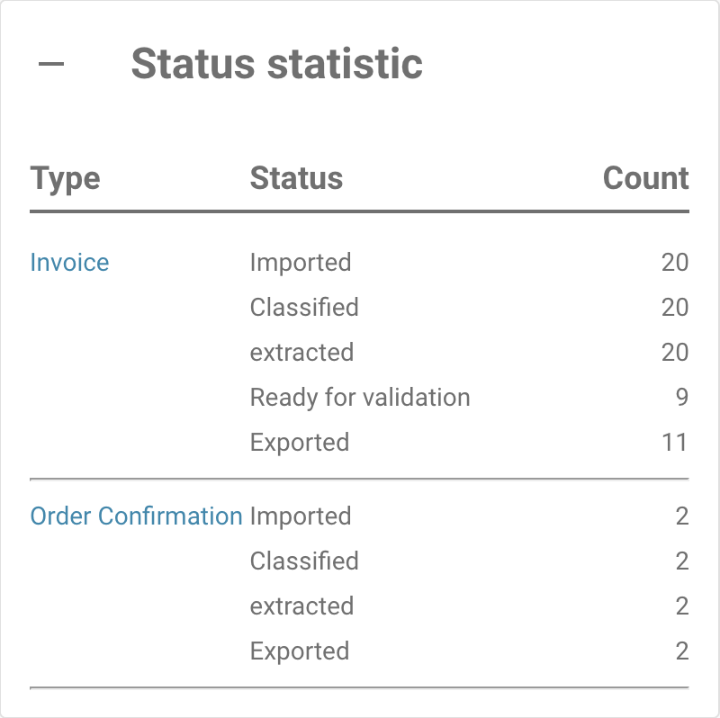

# Strona raportów



### 1. Jak włączyć stronę raportów

Przejdź do **Ustawienia** → **Przetwarzanie dokumentów** → **Moduł** → **Typ dokumentu** → **Pokaż raport** i przełącz przycisk, aby włączyć to ustawienie.

<figure><figcaption></figcaption></figure>

### 2. **Jak uzyskać dostęp do strony raportów**

Wykonaj poniższe kroki, aby otworzyć **stronę raportów** w DocBits:

1. **Zaloguj się do DocBits**
   * Otwórz DocBits i zaloguj się, używając swoich danych logowania.
2. **Kliknij ikonę raportu**
   * Na lewym pasku bocznym znajdź i kliknij ikonę **Raport** (przedstawioną jako wykres lub diagram).

<figure><figcaption></figcaption></figure>

### **3. Korzystanie z filtra jednostki czasu**

*   U góry strony możesz dostosować filtr **Jednostka czasu**, aby wybrać zakres czasu raportu:

    * **Ostatnie 30 dni**
    * **Ostatnie 7 dni**
    * **Własny przedział czasu** (dowolny zakres dat)

    <figure><figcaption></figcaption></figure>

### **4. Wyświetlanie nowych dokumentów**

* Obok filtra **Jednostka czasu** znajduje się wskaźnik informacyjny **Nowe dokumenty**. Pokazuje on liczbę nowych dokumentów zaimportowanych w wybranym przedziale czasu.

<figure><figcaption></figcaption></figure>

### **5. Wyświetlanie średniego czasu systemowego**

* Za etykietą **Nowe dokumenty** znajdziesz wskaźnik **Średni czas systemowy**. Pokazuje on średni czas w sekundach, jaki system potrzebował na przetworzenie nowego dokumentu w wybranym przedziale czasu.

<figure><figcaption></figcaption></figure>

### **6. Sekcja zmienionych pól**

* Poniżej informacji o czasie znajduje się sekcja **Zmienione pola**. Wyświetla ona diagram pokazujący, jak często poszczególne pola dokumentu były ręcznie modyfikowane przez użytkowników w wybranym przedziale czasu.
* Każde pole jest przedstawione z odpowiadającą mu liczbą zmian w postaci słupków na diagramie.

<figure><figcaption></figcaption></figure>

* **Opcje pobierania diagramu**
  * Po prawej stronie diagramu **Zmienione pola** znajduje się małe menu, które umożliwia pobranie diagramu w różnych formatach. Diagram możesz pobrać jako:
    * **SVG**
    * **PNG**
    * **CSV**
  * Aby pobrać diagram, kliknij menu i wybierz preferowany format pliku.

### **7. Dodatkowe sekcje raportu**

Poniżej sekcji **Zmienione pola** znajdziesz cztery dodatkowe przyciski, które po kliknięciu wyświetlają bardziej szczegółowe informacje. Każdy przycisk po kliknięciu rozwija się i pokazuje więcej informacji.

1.  **Łączna liczba dokumentów według typu**

    * Ten przycisk wyświetla łączną liczbę dokumentów dla każdego typu dokumentu (np. faktura, zamówienie zakupu itp.) w wybranym przedziale czasu.
    * Po kliknięciu przycisku rozwija się lista typów dokumentów wraz z liczbą dokumentów każdego typu przetworzonych w wybranym przedziale czasu.

    <figure><figcaption></figcaption></figure>
2.  **Średnia dzienna według typu dokumentu**

    * Ten przycisk pokazuje średnią dzienną liczbę przetworzonych dokumentów, z podziałem na typy dokumentów.
    * Po kliknięciu przycisku rozwijają się typy dokumentów i odpowiadająca im średnia dzienna liczba.

    <figure><figcaption></figcaption></figure>
3.  **Statystyka statusów**

    * Ten przycisk pokazuje rozkład statusów dla każdego typu dokumentu (np. faktura, zamówienie zakupu itp.). Po kliknięciu rozwija się i wyświetla status dokumentów w obrębie każdego typu dokumentu, pokazując, ile dokumentów znajduje się w każdej kategorii statusu.

    <figure><figcaption></figcaption></figure>
4.  **Statystyka eksportu**

    * Ten przycisk umożliwia wyświetlenie statystyk eksportu dokumentów. Po kliknięciu rozwija się i udostępnia dane dotyczące eksportów dokumentów, takie jak liczba eksportów, wskaźniki powodzeń i niepowodzeń oraz inne istotne informacje.

    <figure><figcaption></figcaption></figure>
