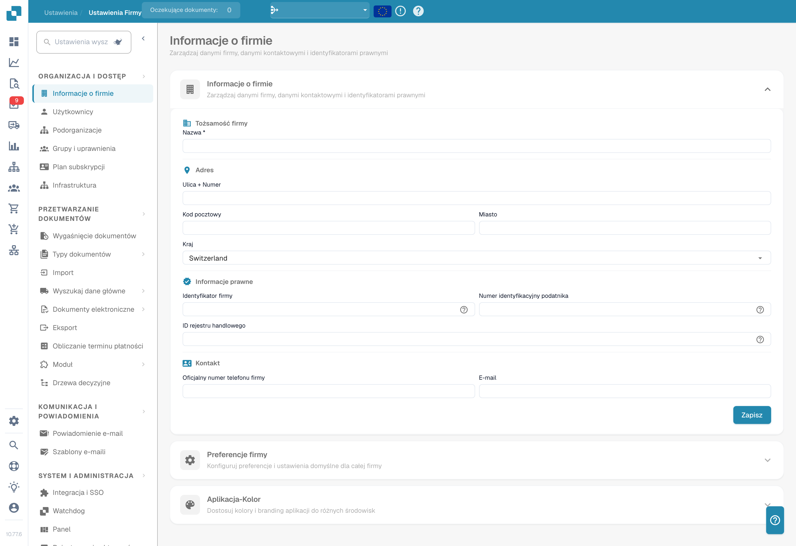

# Ustawienia

## Samouczek wideo: Przegląd ustawień i moduły


Przegląd ustawień i moduły w DocBits


Film pokazuje pięć grup przeglądu ustawień, wyszukiwarkę i szybkie linki oraz to, czym sterują trzy strony modułów.

<figure><figcaption>
Ustawienia organizacji z ukrytymi danymi identyfikacyjnymi. Widoczny kraj jest wartością konfiguracji.
</figcaption></figure>

Obszar Ustawień to centralne miejsce konfiguracji DocBits. Jest podzielony na pięć głównych sekcji:

## 1. Organizacja i dostęp

Zarządzaj profilem firmy i kontroluj, kto ma dostęp do czego.

* **Informacje o firmie**: Wprowadź nazwę firmy, adres, numer identyfikacji podatkowej i inne identyfikatory prawne.
* **Użytkownicy**: Dodawaj, edytuj lub dezaktywuj konta użytkowników i przypisuj role (Admin, System Admin).
* **Podorganizacje**: Twórz podorganizacje i zarządzaj nimi w konfiguracjach wielopodmiotowych.
* **Grupy i uprawnienia**: Definiuj grupy użytkowników i konfiguruj szczegółowe uprawnienia dla każdej grupy.

## 2. Przetwarzanie dokumentów

Skonfiguruj sposób importu, przetwarzania i eksportu dokumentów.

* **Wygasanie dokumentów**: Ustaw reguły automatycznego usuwania dokumentów (np. usunięcie po 48 godzinach, po tygodniu itd.).
* **Typy dokumentów**: Definiuj i konfiguruj typy dokumentów przetwarzane przez DocBits (faktury, zamówienia, dowody dostawy itd.), w tym pola, kolumny tabel, skrypty i inne.
* **Import**: Skonfiguruj sposób, w jaki dokumenty trafiają do DocBits — przez e-mail (IMAP/Office 365), FTP lub przesyłanie plików. Skonfiguruj typy plików i limity stron.
* **Zarządzanie regułami**: Definiuj reguły rozwiązywania konfliktów przy uzgadnianiu faktur z zamówieniami zakupu, w tym ustawienia tolerancji i przepływy zatwierdzania.
* **Ustawienia OCR**: Skonfiguruj progi jakości optycznego rozpoznawania znaków, użycie E-Text, wersję AI OCR i sposób ekstrakcji tabel.
* **Klasyfikacja i ekstrakcja**: Skonfiguruj dzielenie dokumentów, formatowanie kwot, metody ekstrakcji tabel, reguły klasyfikacji i modele AI.
* **Wyszukiwanie danych podstawowych**: Skonfiguruj sposób walidacji wyodrębnionych danych względem danych podstawowych z systemu ERP (np. konta dostawców, zamówienia zakupu).
* **Listy wartości**: Twórz predefiniowane listy wartości używane w listach rozwijanych i walidacji danych oraz zarządzaj nimi.
* **Eksport**: Skonfiguruj, jak i dokąd są wysyłane przetworzone dokumenty — przez Webhook, SFTP, SMB lub integracje Infor (IDM, ION, M3, LN).
* **Moduł**: Włączaj lub wyłączaj opcjonalne funkcje, takie jak PO Dashboard, Auto Accounting, Supplier Portal, Workflow Builder, ekstrakcja kodów QR i inne.
* **Drzewa decyzyjne**: Buduj logikę decyzyjną opartą na regułach za pomocą projektanta wizualnego. Obsługuje wiele polityk (Unique, First, Priority, Collect itd.).
* **Konfiguracja agentów**: Twórz agentów automatyzacji i kanały komunikacji dla zautomatyzowanych przepływów przetwarzania dokumentów oraz zarządzaj nimi.

## 3. Komunikacja i powiadomienia

Kontroluj, jak DocBits komunikuje się z użytkownikami i przetwarza przychodzące e-maile.

* **Powiadomienia e-mail**: Skonfiguruj alerty e-mail dla zdarzeń przetwarzania dokumentów i zmian statusu.
* **Szablony e-mail**: Twórz wielokrotnego użytku szablony e-mail dla powiadomień, uporządkowane według typu dokumentu, i zarządzaj nimi.
* **Przyjmowanie e-maili**: Skonfiguruj, jak przychodzące e-maile są automatycznie klasyfikowane i przekształcane w dokumenty. Obejmuje reguły klasyfikacji, ekstrakcji pól, przetwarzania, zarządzanie nadawcami i trenowanie — uporządkowane według typu dokumentu (zamówienia, faktury, oferty, dowody dostawy, COA, potwierdzenia PO).

## 4. System i administracja

Monitoruj kondycję systemu, zarządzaj integracjami i dbaj o bezpieczeństwo.

* **Integracja i SSO**: Skonfiguruj klucze API dla integracji zewnętrznych oraz jednokrotne logowanie (SSO) z dostawcami tożsamości.
* **Watchdog**: Skonfiguruj usługę Watchdog do automatycznego importu dokumentów z katalogów lokalnych.
* **Dashboard**: Dostosuj zachowanie dashboardu — filtry, ustawienia eksportu, uprawnienia do akcji i opcje wyświetlania statusów.
* **Rejestrowanie aktywności**: Przeglądaj dzienniki zdarzeń systemowych w czasie rzeczywistym, filtrowane według ważności (Debug, Info, Warning, Error), zakresu czasu i usługi.
* **Analityka**: Uzyskaj dostęp do szczegółowych dashboardów analitycznych, w tym Logs Analytics, monitorowania bezpieczeństwa uwierzytelniania (Auth Security) i metryk API (API Metrics) z Real User Monitoring (RUM).
* **Audyt dostępu**: Włącz i przeglądaj ścieżki audytu, które śledzą wszystkie akcje tworzenia, aktualizacji i usuwania w całej organizacji na potrzeby zgodności i bezpieczeństwa.
* **Licencje systemowe**: Wyświetlaj informacje o licencjach API i ich użyciu oraz zarządzaj nimi.
* **Zarządzanie pamięcią podręczną**: Skonfiguruj interwały automatycznego czyszczenia pamięci podręcznej (TTL) dla pamięci podręcznej przyjętych dostaw, zamówień zakupu oraz zadań i powiadomień.
* **Ustawienia wyszukiwania pełnotekstowego**: Skonfiguruj możliwości wyszukiwania pełnotekstowego w dokumentach i danych (wymaga włączonego modułu Fulltext Search).

## 5. Ustawienia dostawców

Skonfiguruj Supplier Portal i zarządzaj przepływami pracy związanymi z dostawcami.

* **Ogólne ustawienia dostawców**: Skonfiguruj pola zaproszeń do portalu dostawców, statusy przepływu pracy (Nie zaproszony, Otwarty, Oczekuje na rejestrację, Zatwierdzony, Odrzucony) i zarządzaj ustawieniami zatwierdzania.
* **Szablony e-mail**: Twórz szablony e-mail przeznaczone specjalnie do komunikacji z dostawcami i zarządzaj nimi.
* **Układ dostawcy**: Dostosuj układ i wygląd Supplier Portal.
* **Konfiguracja eksportu**: Skonfiguruj, jak dane dostawców są eksportowane do systemów zewnętrznych.
* **Grupa dostawców**: Twórz grupy dostawców, aby kategoryzować i porządkować dostawców, oraz zarządzaj nimi.
* **Mapowanie użytkowników i grup dostawców**: Powiąż użytkowników wewnętrznych z określonymi grupami dostawców, aby kontrolować widoczność i dostęp.
