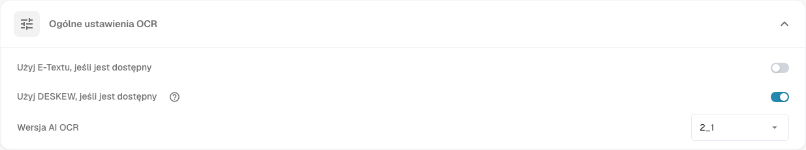

# Przetwarzanie dokumentów

Ustawienia sekcji **Przetwarzanie Dokumentów** określają, jak DocBits odczytuje, wzbogaca i eksportuje dokumenty. Otwórz **Ustawienia** i wybierz potrzebny obszar w sekcji **Przetwarzanie Dokumentów**.

* [Ustawienia OCR](ocr-settings.md): sposób odczytywania tekstu z dokumentów.
* [Wyszukiwanie danych podstawowych](master-data-lookup.md): sposób porównywania wyodrębnionych wartości z danymi podstawowymi.
* [Obliczanie terminu płatności](due-date-calculation.md): sposób obliczania terminów płatności.
* [Eksport](export.md): miejsce i sposób eksportowania przetworzonych dokumentów.

Na przykład otwórz **Ustawienia OCR**, aby sprawdzić **Ogólne ustawienia OCR**. Opcja **Użyj E-Textu, jeśli jest dostępny** wykorzystuje osadzony tekst elektroniczny. Opcja **Użyj DESKEW, jeśli jest dostępny** prostuje zeskanowane strony. Opcja **Wersja AI OCR** wybiera wersję silnika rozpoznawania. Szczegółowy opis elementów sterujących znajdziesz na stronie [Ustawienia OCR](ocr-settings.md).

<figure><figcaption>
Ogólne ustawienia OCR to jeden z obszarów przetwarzania dokumentów. Wybrane wartości zależą od organizacji.
</figcaption></figure>

Pozostałe obszary w tej sekcji to [Import](import/README.md), [Klasyfikacja i ekstrakcja](classification-and-extraction/README.md), [Zarządzanie regułami](rule-manager/README.md), [Listy wartości](list-of-values.md) i [Moduł](module/README.md).

Jeśli ustawienie nie działa zgodnie z oczekiwaniami, sprawdź je najpierw za pomocą dokumentu testowego. Zmiana może wpłynąć na każdy nowy dokument organizacji.
