# Klasyfikacja i ekstrakcja

<figure>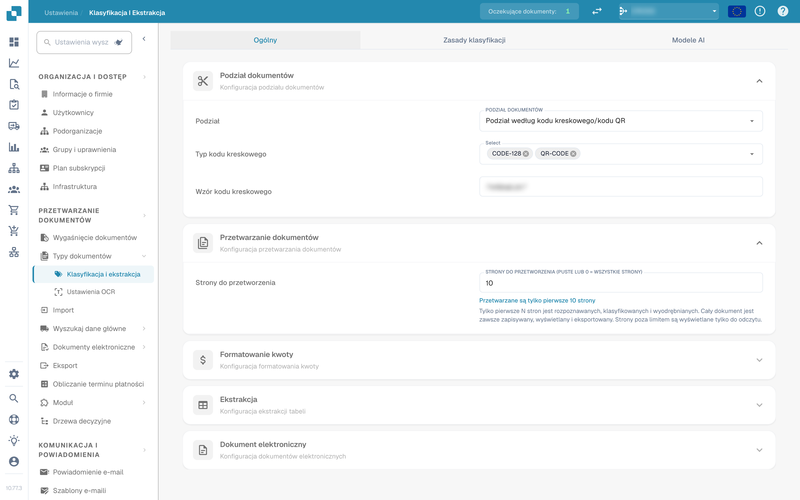<figcaption>
Ustawienia klasyfikacji i ekstrakcji
</figcaption></figure>

## Przegląd

W ustawieniach **Klasyfikacja i ekstrakcja** możesz:

* kontrolować, jak przesyłane dokumenty są **dzielone** i ile stron jest przetwarzanych
* skonfigurować **formatowanie kwoty** na potrzeby porównywania kwot
* skonfigurować **ekstrakcję tabeli**, w tym model AI używany dla danego dostawcy
* włączyć lub wyłączyć przetwarzanie nieobsługiwanych plików **ZUGFeRD**
* zdefiniować **zasady klasyfikacji**, które automatycznie przypisują typ dokumentu
* przejrzeć **modele AI** i ich wytrenowane etykiety

Strona ma trzy karty: **Ogólny**, **Zasady klasyfikacji** i **Modele AI**. Karta *Modele AI* jest wyświetlana tylko wtedy, gdy moduł modeli i etykiet jest włączony dla Twojej organizacji.

| Karta | Zawartość |
|---|---|
| Ogólny | Podział dokumentów, Przetwarzanie dokumentów, Formatowanie kwoty, Ekstrakcja, Dokument elektroniczny |
| Zasady klasyfikacji | Reguły regex, które klasyfikują dokumenty na podstawie nazwy źródła |
| Modele AI | Modele trenowane indywidualnie wraz z etykietami, typami dokumentów i priorytetem |

## Dostęp do ustawień klasyfikacji i ekstrakcji

Przejdź do **Ustawienia → Typy Dokumentu → Klasyfikacja i Ekstrakcja**.

## Ogólny

Karta **Ogólny** grupuje ustawienia w rozwijanych sekcjach. Wszystkie zmiany są zapisywane natychmiast po zmianie wartości; nie ma osobnego przycisku zapisu.

### Podział dokumentów

**Podział** określa, czy przesyłany dokument jest dzielony na kilka dokumentów, gdy na jednej z jego stron pojawi się kod kreskowy. Lista rozwijana oferuje:

* **Nie dziel przesłanych dokumentów** – wartość domyślna; dokument jest przetwarzany jako jeden plik.
* **Podział według kodu kreskowego/kodu QR** – dokument jest dzielony przy każdym wykrytym kodzie kreskowym.

<figure>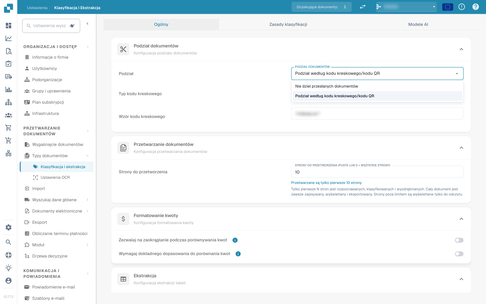<figcaption>
Opcje podziału w sekcji «Podział dokumentów»
</figcaption></figure>

Po wybraniu **Podział według kodu kreskowego/kodu QR** pojawiają się dwa dodatkowe pola:

* **Typ kodu kreskowego** – jeden lub więcej typów kodów kreskowych do wykrycia, na przykład *CODE-128* lub *QR-CODE*.
* **Wzór kodu kreskowego** – wyrażenie regularne, które musi spełniać wartość kodu kreskowego, zanim zostanie wywołany podział. Pozostaw puste, aby dzielić przy każdym kodzie kreskowym wybranych typów. Wzór jest sprawdzany przed zapisaniem; nieprawidłowe wyrażenie jest zgłaszane od razu.

Po udanym podziale dokument nadrzędny jest usuwany, a strony kontynuują jako osobne dokumenty w tym samym wsadzie.

### Przetwarzanie dokumentów

**Strony do przetworzenia** ogranicza, ile stron na dokument jest rozpoznawanych przez OCR, klasyfikowanych i wyodrębnianych.

<figure>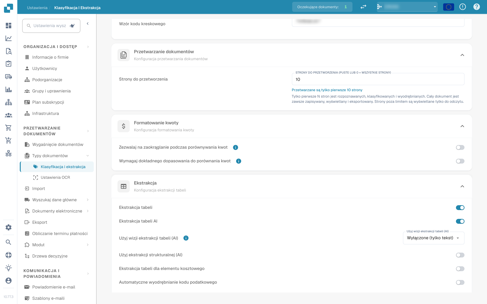<figcaption>
Strony do przetworzenia w sekcji «Przetwarzanie dokumentów»
</figcaption></figure>

* Puste lub **0** oznacza, że przetwarzane są wszystkie strony.
* Liczba *N* ogranicza OCR, klasyfikację i ekstrakcję do pierwszych *N* stron. Cały dokument jest nadal zapisywany, wyświetlany i eksportowany; strony powyżej limitu są wyświetlane tylko do odczytu.

### Formatowanie kwoty

Dwa przełączniki kontrolują, jak kwoty są porównywane z danymi głównymi i zamówieniami zakupu.

<figure>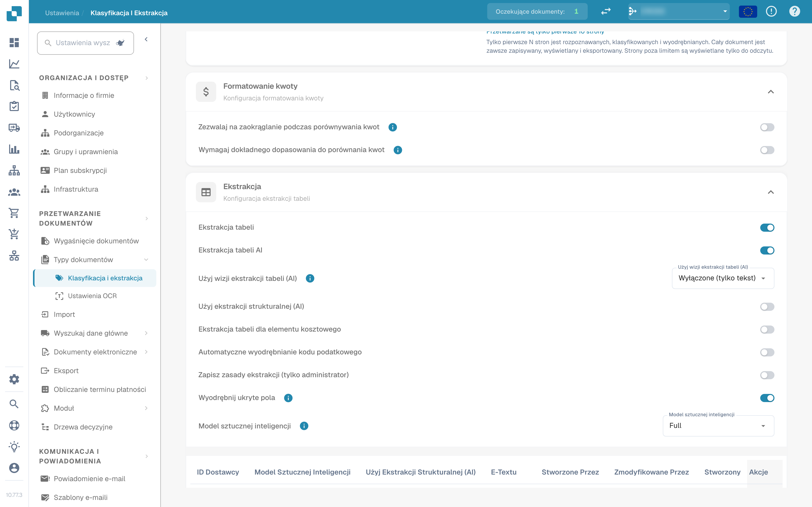<figcaption>
Sekcja «Formatowanie kwoty»
</figcaption></figure>

* **Zezwalaj na zaokrąglanie podczas porównywania kwot** – po włączeniu dopuszczalna jest tolerancja ±0,5. Po wyłączeniu obowiązuje ±0,05.
* **Wymagaj dokładnego dopasowania do porównania kwot** – po włączeniu kwoty muszą się zgadzać dokładnie, bez tolerancji. Po wyłączeniu obowiązuje ±0,05.

Tylko jeden z dwóch przełączników może być aktywny jednocześnie; włączenie jednego wyłącza drugi.

### Ekstrakcja


**Warunki działającej ekstrakcji tabeli**

* Typ dokumentu ma **kolumny tabeli** (Ustawienia → Ustawienia globalne → Typy Dokumentu → [Kolumny tabeli](../../global-settings/document-types/table-columns/README.md)). Bez kolumn nie ma do czego wyodrębniać.
* **Ekstrakcja tabeli** lub **Ekstrakcja tabeli AI** jest włączona poniżej, dla całej organizacji.
* Dokument zawiera czytelny tekst: uruchomiono OCR lub dla PDF-ów utworzonych cyfrowo używany jest E-Text ([Ustawienia OCR](../ocr-settings.md)).
* Trenowanie i modele AI dotyczą **konkretnego dostawcy**. Wytrenowana tabela jest stosowana tylko do dokumentów dostawcy, dla którego została wytrenowana.


Możesz wyodrębniać tabele z dokumentów, włączając **Ekstrakcję tabeli** lub **Ekstrakcję tabeli AI**. Wytrenowana tabela (oparta na AI lub ręczna) jest zawsze powiązana z konkretnym dostawcą.

<figure>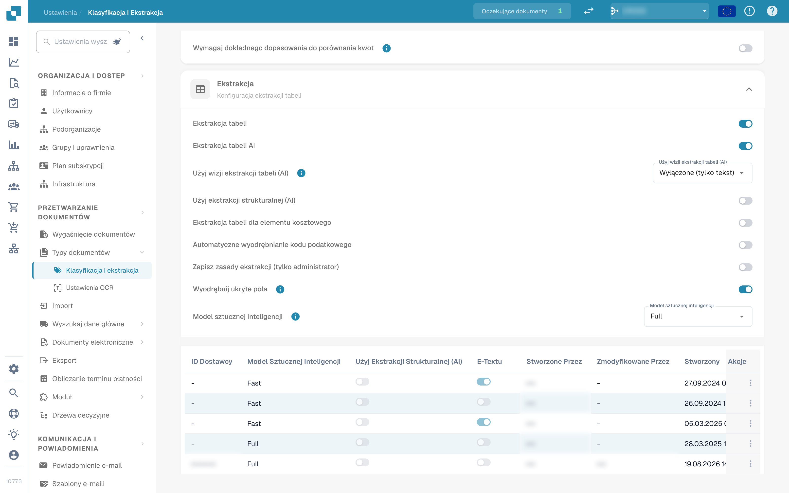<figcaption>
Przełączniki ekstrakcji tabeli
</figcaption></figure>

**Ekstrakcja tabeli:** Włącza opartą na regułach ekstrakcję tabel. Tabele są trenowane dla każdego dostawcy na ekranie walidacji (*Go to table extraction view*).\
Więcej o trenowaniu dowiesz się [tutaj](../../../setup/document-training/training-line-fields-table-training/defining-tables-and-columns.md).

**Ekstrakcja tabeli AI:** Wykorzystuje AI do wyodrębniania tabeli dowolnego dostawcy bez trenowania. Jeśli wyniki dla danego dostawcy nie są wystarczająco dokładne, wytrenuj tabelę tego dostawcy; zapisane reguły mają wtedy pierwszeństwo przed AI dla tego dostawcy.

**Użyj wizji ekstrakcji tabeli (AI):** AI czyta obraz strony zamiast warstwy tekstowej. Pomaga przy skanowanych dokumentach i tabelach bez wyraźnej struktury tekstu; jest wolniejsza. Lista rozwijana obok przełącznika określa, jak intensywnie używany jest obraz strony:

* **Wyłączone (tylko tekst)** – Używana jest tylko warstwa tekstowa. To wartość domyślna.
* **Tylko obrazy** – Odczytiwany jest tylko obraz strony.
* **Hybrydowe (tekst i obrazy)** – Warstwa tekstowa i obraz strony są łączone w jednym żądaniu.
* **Auto (decydowane dla dokumentu)** – DocBits decyduje dla każdego dokumentu, czy warstwa tekstowa wystarcza.

**Użyj ekstrakcji strukturalnej (AI):** AI zwraca tabelę w stałej strukturze, która jest odwzorowywana bezpośrednio na skonfigurowane kolumny tabeli. Zalecane, gdy nagłówki kolumn na dokumentach mocno się różnią. Kliknięcie ustawienia otwiera podgląd dokładnie tych pól i kolumn, o które AI zostanie poproszona: pola nagłówka i kolumny wierszy są wymienione wraz ze swoim źródłem (żądane lub wyłączone pola standardowe), a także oczekiwany tryb wyjścia (na przykład *strict* – bez dodatkowych kolumn). Pola skonfigurowane dla typu dokumentu, ale wyłączone, nie są żądane od AI.

**Ekstrakcja tabeli dla elementu kosztowego:** Po włączeniu DocBits może wyodrębniać elementy kosztowe z tabel na poziomie pozycji i odpowiednio je klasyfikować.\
Szczegółowe wyjaśnienie znajdziesz [tutaj](table-extraction-for-costing-element.md).

**Automatyczne wyodrębnianie kodu podatkowego:** Po włączeniu system automatycznie wypełnia pole **Kod podatkowy** na ekranie walidacji, o ile skonfigurowano pole kodu podatkowego.\
Więcej informacji o tym ustawieniu [tutaj](auto-extract-tax-code.md).

**Zapisz zasady ekstrakcji (tylko administrator):** Tylko administratorzy mogą klikać *Save Rules* podczas trenowania tabel. Włącz to, gdy użytkownicy stale zapisują reguły, które psują ekstrakcję dostawcy.

**Wyodrębnij ukryte pola:** Pola oznaczone jako ukryte w ustawieniach pól są również wyodrębniane. Przydatne, gdy wartość jest potrzebna do reguły lub eksportu, ale nie powinna być widoczna na ekranie walidacji.

**Model sztucznej inteligencji:** Wybiera poziom AI używany do ekstrakcji tabeli. Dostępnych jest sześć opcji: **Full** (najwyższa dokładność, najwolniejszy, 2 tokeny na dokument), **Fast** (domyślnie; 1 token na dokument), **Nexus** i **Nexus Flash** (alternatywna rodzina modeli, opcjonalnie), a także **Auto** i **Auto Nexus**, w których DocBits decyduje dla każdego dokumentu, jak silny model jest potrzebny. Tabela pod selektorem pokazuje:

* którzy **dostawcy** używają którego modelu AI
* czy używają ekstrakcji strukturalnej (AI) i E-Textu
* opcje usunięcia wpisu i przywrócenia w ten sposób dostawcy do wartości domyślnej

To ustawienie jest szczegółowo opisane [tutaj](ai-model.md).

#### Dlaczego tabela wygląda inaczej u każdego dostawcy?

Wszystko, czego DocBits uczy się o tabeli, jest przechowywane **dla konkretnego dostawcy**:

* **Zapisane reguły** (trenowanie tabeli): pozycja tabeli i odwzorowanie jej kolumn w układzie tego dostawcy.
* **Tagi tabeli AI i reguły formatowania**: wskazówki zapisane przez użytkownika dla tabeli AI tego dostawcy.
* **Model AI specyficzny dla dostawcy**: poziom wybrany dla tego dostawcy w *More settings* na ekranie walidacji.

Dostawca A z zapisanymi regułami pokazuje więc deterministyczną tabelę na karcie *Extracted table* ekranu walidacji, a dostawca B bez reguł otrzymuje *AI Extracted table*. Aby dostawca B zachowywał się jak A, raz wytrenuj tabelę B. Aby zresetować dostawcę, usuń jego reguły na ekranie walidacji lub zresetuj jego dane treningowe w tabeli Model sztucznej inteligencji.

#### Klucze preferencji

Każdy przełącznik w tej sekcji jest przechowywany jako preferencja organizacji. Użyj klucza, gdy ustawiasz wartość przez API (`/preferences/set_preference`), skrypt lub DocBits MCP (`get_preference` / `set_preference`).

| Ustawienie (etykieta interfejsu) | Klucz preferencji | Wartości |
|---|---|---|
| Podział | `SPLIT_DOCUMENT_ON_BARCODE` | `true` / `false` |
| Typ kodu kreskowego | `SPLIT_DOCUMENT_BARCODE_TYPE` | lista nazw typów kodów kreskowych |
| Wzór kodu kreskowego | `SPLIT_DOCUMENT_BARCODE_PATTERN` | ciąg regex |
| Strony do przetworzenia | `RESTRICT_TO_PAGES` | liczba; puste lub `0` = wszystkie strony |
| Zezwalaj na zaokrąglanie podczas porównywania kwot | `AMOUNTS_ROUNDING` | `true` / `false` |
| Wymagaj dokładnego dopasowania do porównania kwot | `AMOUNTS_NO_ROUNDING` | `true` / `false` |
| Ekstrakcja tabeli | `TABLE_EXTRACTION_SETTING` | `true` / `false` |
| Ekstrakcja tabeli AI | `USE_AI_TABLE_EXTRACTION` | `true` / `false` |
| Użyj wizji ekstrakcji tabeli (AI) | `TABLE_EXTRACTION_VISION_MODE` | `off` (domyślnie), `vision`, `hybrid`, `auto` |
| Użyj wizji ekstrakcji tabeli (AI) – stary przełącznik | `TABLE_EXTRACTION_USE_VISION` | `true` / `false`; oznacza `vision` |
| Użyj ekstrakcji strukturalnej (AI) | `USE_STRUCTURED_EXTRACTION` | `true` / `false` |
| Ekstrakcja tabeli dla elementu kosztowego | `CHARGES_TABLE_EXTRACTION` | `true` / `false` |
| Automatyczne wyodrębnianie kodu podatkowego | `AUTO_EXTRACT_TAX_CODE` | `true` / `false` |
| Zapisz zasady ekstrakcji (tylko administrator) | `ONLY_ADMIN_CAN_SAVE_RULES` | `true` / `false` |
| Wyodrębnij ukryte pola | `EXTRACT_HIDDEN_FIELDS` | `true` / `false` |
| Model sztucznej inteligencji | `AI_MODEL` | `gpt-6-sol` (Full), `gpt-6-luna` (Fast), `qwen3.8-max` (Nexus), `glm-5.3-flash` (Nexus Flash), `auto` (Auto), `auto-nexus` (Auto Nexus) |
| Wersja ekstrakcji tabeli (okno potwierdzenia) | `TBL_EXT_VERSION` | ciąg wersji |
| Ustawienia OCR → Używaj danych AI dla tabel, jeśli są dostępne | `USE_AI_DATA_FOR_TABLE` | `true` / `false` |
| Ustawienia OCR → Używaj E-Textu, jeśli jest dostępny | `USE_ETEXT_IF_AVAILABLE` | `true` / `false` |

Uwagi:

* Preferencje logiczne są przechowywane jako ciągi `true` / `false`; klucz nigdy nieustawiony liczy się jako `false`. Jeśli wyślesz `1` lub `0`, DocBits zapisze `true` / `false`.
* Nieustawiony `AI_MODEL` oznacza **Fast**.
* Nieustawiony `TABLE_EXTRACTION_VISION_MODE` jest wyliczany ze starego przełącznika `TABLE_EXTRACTION_USE_VISION`: `true` daje `vision`, każda inna wartość daje `off`.
* Zmiana klucza działa dla dokumentów przetwarzanych później. Uruchom dokument ponownie, aby wyodrębnić go z nowym ustawieniem.
* Wybory dla dostawcy (E-Text, model AI, zapisane reguły) nie są preferencjami organizacji; ustawia się je na ekranie walidacji w *More settings* dla dokumentu tego dostawcy.

### Dokument elektroniczny

**Przetwarzaj nieobsługiwany ZUGFeRD PDF:** Po włączeniu nieobsługiwane wersje **ZUGFeRD** są przetwarzane jako standardowe pliki PDF, a osadzony XML jest ignorowany.

Listę obsługiwanych wersji **ZUGFeRD** znajdziesz [tutaj](../../global-settings/document-types/edi/zugferd/README.md).

## Zasady klasyfikacji

Karta **Zasady klasyfikacji** zawiera listę reguł, które podczas przetwarzania automatycznie przypisują typ dokumentu. Każda reguła porównuje **wzór regex** z nazwą źródła dokumentu i w razie dopasowania ustawia typ dokumentu oraz opcjonalnie typ dokumentu podrzędnego.

Przejdź na kartę, klikając **Zasady klasyfikacji** u góry strony.

<figure>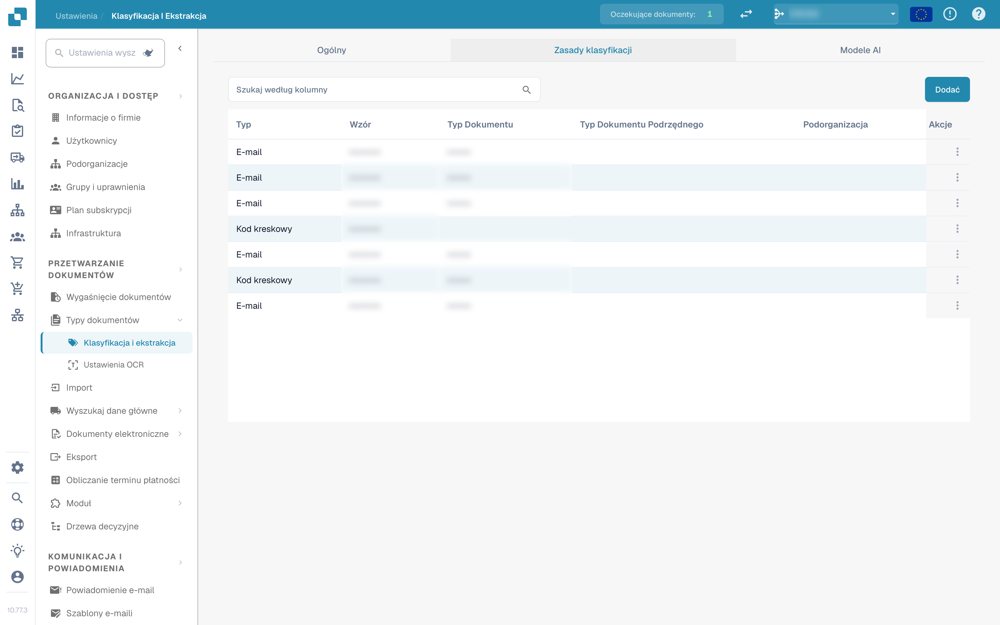<figcaption>
Karta «Zasady klasyfikacji» z tabelą reguł
</figcaption></figure>

Tabela ma jeden wiersz na regułę z następującymi kolumnami:

* **Typ** – gdzie stosowany jest wzór. Istnieją dwa typy: **Kod kreskowy** i **E-mail**.
* **Wzór** – wyrażenie regularne zapisane dla reguły.
* **Typ Dokumentu** – typ dokumentu przypisywany przy dopasowaniu wzoru.
* **Typ Dokumentu Podrzędnego** – typ dokumentu podrzędnego przypisywany przy dopasowaniu wzoru.
* **Podorganizacja** – podorganizacja, do której ogranicza się reguła. Puste oznacza, że reguła dotyczy wszystkich podorganizacji.
* **Akcje** – menu wiersza z pozycjami *Redagować* i *Usuwać*.

Pole wyszukiwania nad tabelą filtruje wszystkie kolumny, w tym wyświetlane etykiety kolumn list rozwijanych.

### Dodawanie zasady klasyfikacji

1.  Kliknij **Dodać** nad tabelą.

    <figure>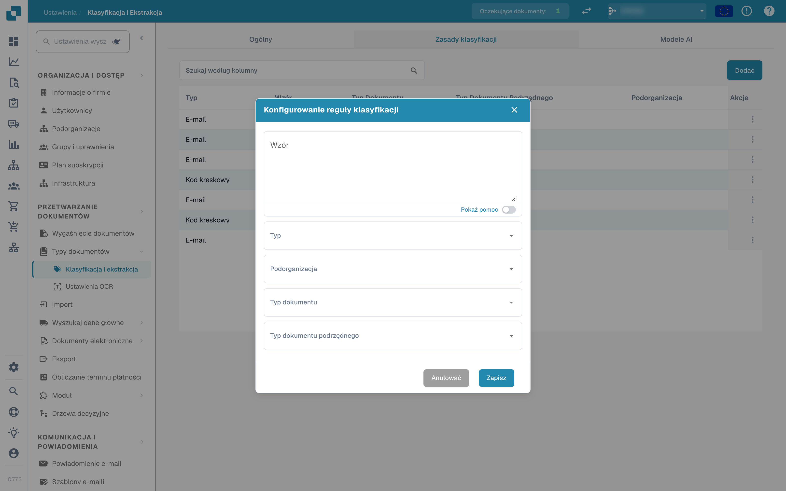<figcaption>
Okno «Konfigurowanie reguły klasyfikacji»
</figcaption></figure>
2. Wypełnij pola:
   * **Wzór** (wymagane) – wyrażenie regularne, którego szuka reguła.
   * **Typ** (wymagane) – **Kod kreskowy** lub **E-mail**. To decyduje, z którą nazwą źródła porównywany jest wzór.
   * **Podorganizacja** *(opcjonalnie)* – ogranicza regułę do jednej podorganizacji.
   * **Typ Dokumentu** – typ dokumentu przypisywany przy dopasowaniu wzoru.
   * **Typ Dokumentu Podrzędnego** *(opcjonalnie)* – bardziej szczegółowy typ; lista zależy od wybranego typu dokumentu. Zmiana typu dokumentu czyści typ dokumentu podrzędnego.
3.  Kliknij **Ratować**.

Okno sprawdza wzór przed zapisaniem. Wzór już używany przez inną regułę jest odrzucany z komunikatem *Wzór już istnieje*; pusty wzór jest odrzucany z komunikatem o polu wymaganym.

#### Pomoc dotycząca wzoru

Przełącznik **Pokaż pomoc** pod polem wzoru otwiera wbudowane odniesienie z formatami nazwy źródła, z którymi porównywany jest wzór:

* **O365** – `Współdzielony e-mail + Folder › Współdzielony e-mail › Folder › E-mail › Identyfikator`
* **Gmail** – `E-mail + Folder › Folder › E-mail › Identyfikator`

<figure>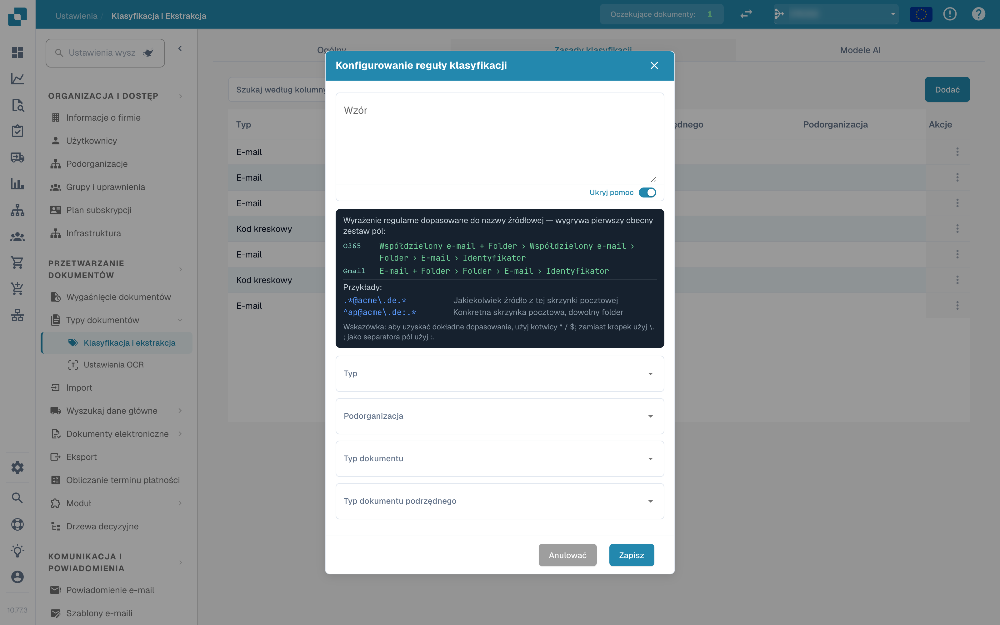<figcaption>
Panel pomocy dotyczącej wzoru w oknie reguły
</figcaption></figure>

Przykłady w panelu:

* `.*@acme\.de.*` – dowolne źródło z tej skrzynki pocztowej
* `^ap@acme\.de:.*` – konkretna skrzynka pocztowa, dowolny folder

Wskazówka: użyj `^` / `$` jako kotwicy dla dokładnych dopasowań, escapuj kropki jako `\.` i używaj `:` jako separatora pól. Wygrywa pierwszy obecny zestaw pól w nazwie źródła.

Jeśli używasz typu **E-mail**, wzór jest porównywany z nazwami skrzynki pocztowej i folderu importowanego maila, a nie z treścią dokumentu.

### Edytowanie zasady klasyfikacji

1.  Kliknij trzy kropki w kolumnie **Akcje** reguły, którą chcesz zmienić.

    <figure>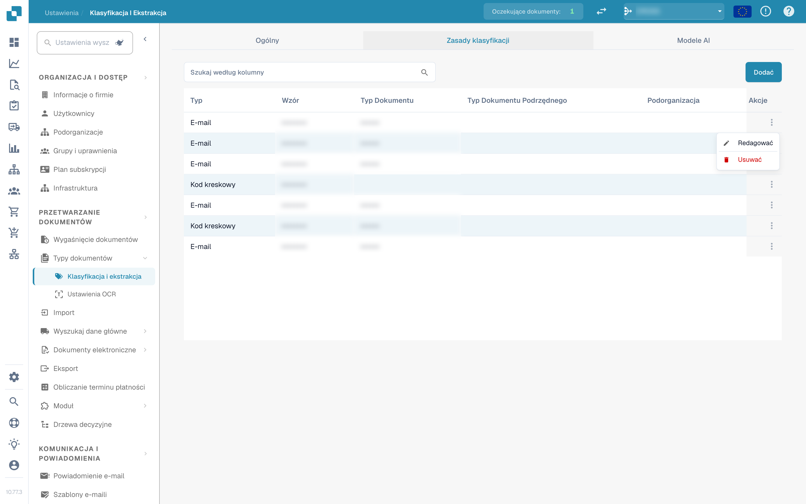<figcaption>
Menu wiersza z pozycjami Redagować i Usuwać
</figcaption></figure>
2.  Wybierz **Redagować**. Okno otwiera się z bieżącymi wartościami reguły.

    <figure>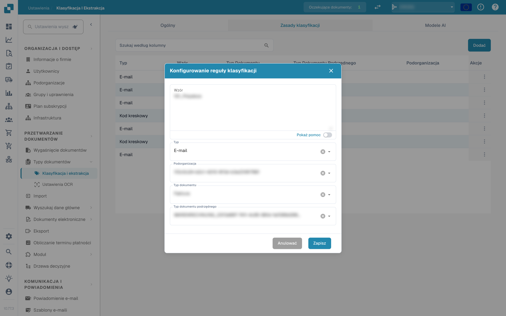<figcaption>
Edytowanie istniejącej zasady klasyfikacji
</figcaption></figure>
3. Wprowadź zmiany we wzorze, typie, podorganizacji, typie dokumentu lub typie dokumentu podrzędnego.
4.  Kliknij **Ratować**.

Obowiązuje ta sama walidacja co przy dodawaniu: wzór nie może być pusty ani duplikować wzoru innej reguły.

### Usuwanie zasady klasyfikacji

1. Kliknij trzy kropki w kolumnie **Akcje**.
2. Wybierz **Usuwać**.

Reguła jest natychmiast usuwana z listy. Usunięcie reguły nie zmienia dokumentów, które zostały już z jej pomocą sklasyfikowane.

## Modele AI

Karta **Modele AI** pokazuje modele trenowane indywidualnie, dostępne do klasyfikacji dokumentów, oraz ich etykiety. Pojawia się tylko wtedy, gdy moduł modeli i etykiet jest włączony dla Twojej organizacji.

<figure>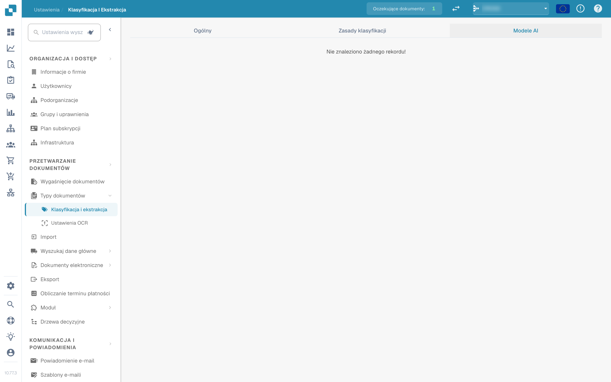<figcaption>
Karta «Modele AI»
</figcaption></figure>

Jeśli dla organizacji nie ma własnego modelu, karta pokazuje *Nie znaleziono żadnego rekordu!*.

### Modele

Każdy model to rozwijany wpis z:

* **nazwą modelu** i plakietką **Domyślny** przy modelu używanym, gdy nic innego nie ma zastosowania.
* liczbą **etykiet** wytrenowanych dla tego modelu.
* dla każdego modelu, po rozwinięciu: **Typ**, **Tylko pierwsza strona** i **Wersja**.

Pod tymi informacjami wymienione są etykiety modelu.

### Etykiety

Etykiety to to, czego uczy się model. Każda etykieta przypisuje wzór rozpoznawany przez model do typu dokumentu.

* **Nazwa** – nazwa etykiety.
* **Następny model** – model, który kontynuuje przetwarzanie wyniku tej etykiety.
* **TYP DOKUMENTU** – typ dokumentu przypisywany przez etykietę.
* **Typ Dokumentu Podrzędnego** – bardziej szczegółowy typ dla etykiety.
* **Priorytet** – kolejność oceniania etykiet; najpierw niższe liczby.

Pole wyszukiwania nad tabelą etykiet filtruje etykiety wybranego modelu.

### Edytowanie etykiety

Kliknij ikonę ołówka w wierszu etykiety, aby otworzyć okno edycji. Oferuje ono **Następny model** i **Typ Dokumentu**; ustaw jedno z nich, ponieważ okno wymaga następnego modelu lub typu dokumentu. Kliknij **Ratować**, aby zastosować zmianę.

## Powiązane strony

* [Model sztucznej inteligencji](ai-model.md) – sześć poziomów ekstrakcji i sposób, w jaki dostawca otrzymuje własny model
* [Automatyczne wyodrębnianie kodu podatkowego](auto-extract-tax-code.md)
* [Ekstrakcja tabeli dla elementu kosztowego](table-extraction-for-costing-element.md)
* [Ustawienia OCR](../ocr-settings.md)
