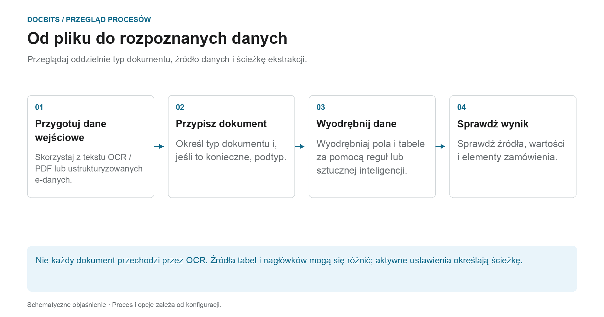

# Classification And Extraction

## Które ustawienie działa na którym etapie procesu?

<figure><figcaption>
Przeglądaj oddzielnie typ dokumentu, źródło danych i ścieżkę ekstrakcji. Schemat ma charakter schematyczny; aktywne ustawienia Twojej organizacji określają rzeczywiste zachowanie.
</figcaption></figure>

Klasyfikacja odpowiada na pytanie **„Co to za dokument?”**. Ekstrakcja odpowiada **„Jakie wartości zawiera?”**. Ustawienia na tej stronie wpływają na różne punkty przetwarzania i nie należy ich rozumieć jako pojedynczego przełącznika AI.

1. **Przygotuj dane wejściowe:** W przypadku PDFs można użyć istniejącego tekstu lub OCR; obsługiwane dokumenty elektroniczne mogą zapewniać wartości strukturalne. Aktywowany podział może oddzielić przychodzący dokument na podstawie skonfigurowanych kryteriów kodu kreskowego lub QR.
2. **Określ typ dokumentu:** Reguły i modele klasyfikacji przypisują dokumenty do typu i, w razie potrzeby, podtypu. To przypisanie należy odróżnić od późniejszego wyodrębniania pól i tabel.
3. **Wyodrębnij wartości:** Tabele mogą podążać różnymi ścieżkami w zależności od konfiguracji i odpowiednich zapisanych reguł. Pola nagłówka mają własne wskaźniki źródła. Dlatego sam wybrany model AI nie wyjaśnia wartości każdego wiersza lub pola.
4. **Śledź wynik:** Na ekranie sprawdzania poprawności sprawdź, która zakładka tabeli zawiera wiersze i jaki wskaźnik źródła ma pole nagłówka. Jeśli brakuje etapu przetwarzania, przed zmianą ustawień przeczytaj dzienniki dokumentów.

### Rozróżnij ścieżkę reguły od ścieżki AI

Odpowiednie zapisane reguły tabel mogą określić ekstrakcję tabeli dla odpowiedniego szablonu lub dostawcy. Bez odpowiednich reguł ścieżkę AI można wykorzystać, gdy aktywowana jest ekstrakcja tabeli AI. Poszczególne kolumny mogą mieć własne opcje AI. Źródło AI dla pola nagłówka nie oznacza, że ​​cała tabela pochodzi z AI.

Przewodnik diagnostyczny [Która ścieżka ekstrakcji została wykorzystana?](../../../../overview-and-basics/faq/document-processing/which-extraction-path-was-used.md) objaśnia karty, identyfikatory źródeł i dzienniki. Strona [Model sztucznej inteligencji](ai-model.md) objaśnia nadpisania standardów organizacji i szablonów.

## Przegląd

W ustawieniach **Klasyfikacja i ekstrakcja** możesz:

* Włącz **Podział dokumentu** w oparciu o kody QR
* Skonfiguruj **formatowanie kwoty**
* Skonfiguruj **ekstrakcję tabeli**
* Przełącz przetwarzanie nieobsługiwanych plików **ZUGFeRD**
* Zdefiniuj specjalne zasady klasyfikacji
* Monitoruj specjalnie przeszkolone **AI modele** wykorzystywane w procesie klasyfikacji

Na tej stronie znajduje się szczegółowy opis wszystkich dostępnych ustawień.

## **Dostęp do ustawień klasyfikacji i wyodrębniania**

Aby uzyskać dostęp do ustawień **Klasyfikacja i wyodrębnianie**, przejdź do:\
**Ustawienia → Przetwarzanie dokumentu → Klasyfikacja i wyodrębnianie**

<figure><figcaption>
Otwórz <strong>Ustawienia → Przetwarzanie dokumentów → Klasyfikacja i ekstrakcja</strong>.
</figcaption></figure>

## Document Splitting

W sekcji **Podział dokumentu** możesz skonfigurować, czy przesłany dokument powinien być dzielony na wiele dokumentów, gdy na jednej z jego stron pojawi się **kod kreskowy**.

Aby aktywować tę funkcję:

1. Przejdź do sekcji **Podział dokumentu**.
2.  Otwórz menu rozwijane.

    <figure><figcaption></figcaption></figure>
3.  Wybierz **Podziel według kodu kreskowego/QR kodu**.

    <figure><figcaption></figcaption></figure>

Będziesz wtedy mieć możliwość:

* Wybierz jeden lub więcej typów kodów kreskowych, które mają zostać wykryte.
*   Określ wzór wyrażenia regularnego, do którego musi pasować kod kreskowy, aby uruchomić podział dokumentu.

    <figure><figcaption></figcaption></figure>

## Formatowanie kwot

W sekcji **Formatowanie kwoty** masz dwie opcje:

* **Zezwalaj na zaokrąglanie podczas porównywania kwot:**\
  Jeśli ta opcja jest włączona, podczas porównywania ilości dozwolona jest tolerancja ±0.5.\
  Jeżeli opcja jest wyłączona, obowiązuje domyślna tolerancja ±0.05.
* **Wymagaj dokładnego dopasowania do porównania kwot:**\
  Jeśli ta opcja jest włączona, kwoty muszą dokładnie odpowiadać zerowej tolerancji.\
  Jeśli opcja jest wyłączona, dozwolona jest tolerancja ±0.05.

<mark style="color:red;">**Uwaga**</mark>: Tylko jedno z tych ustawień może być aktywne w danym momencie.

## Ekstrakcja tabeli


**Warunki wstępne działającej ekstrakcji tabeli**

* Typ dokumentu ma **kolumny tabeli** (Ustawienia → Ustawienia globalne → Typy dokumentów → [Kolumny tabeli](../../global-settings/document-types/table-columns/README.md)). Bez kolumn nie ma do czego wyodrębniać.
* Poniżej włączona jest opcja **Ekstrakcja tabeli** lub **Ekstrakcja tabeli AI**, dla całej organizacji.
* Dokument ma czytelny tekst: wykonano OCR albo dla plików PDF utworzonych cyfrowo używany jest E-Text ([Ustawienia OCR](../ocr-settings.md)).
* Szkolenie i modele AI działają **dla każdego dostawcy osobno**. Wytrenowana tabela dotyczy tylko dokumentów dostawcy, na którym została wytrenowana.


Tabele z dokumentów można wyodrębniać, włączając opcję **Ekstrakcja tabeli** lub **Ekstrakcja tabeli AI**. Wytrenowana tabela (oparta na AI lub ręczna) jest zawsze powiązana z konkretnym dostawcą.

**Ekstrakcja tabeli (Table Extraction):** Włącza ekstrakcję tabeli opartą na regułach. Tabele trenuje się dla każdego dostawcy na ekranie walidacji (*Go to table extraction view*).\
Więcej o szkoleniu [tutaj](../../../setup/document-training/training-line-fields-table-training/defining-tables-and-columns.md).

**Ekstrakcja tabeli AI (AI Table Extraction):** Wykorzystuje AI do wyodrębniania tabeli dowolnego dostawcy bez szkolenia. Jeśli wyniki dla jednego dostawcy nie są wystarczająco dokładne, wytrenuj tabelę tego dostawcy; zapisane reguły mają wtedy pierwszeństwo przed AI dla tego dostawcy.

**Użyj wizji ekstrakcji tabeli (AI):** AI odczytuje obraz strony zamiast warstwy tekstowej. Pomaga przy dokumentach skanowanych i tabelach bez wyraźnej struktury tekstowej; działa wolniej. Rozwijana lista obok przełącznika określa, jak intensywnie używany jest obraz strony:

* **Wyłączone (tylko tekst)** – Używana jest tylko warstwa tekstowa. To ustawienie domyślne.
* **Tylko obrazy** – Odczytywany jest wyłącznie obraz strony.
* **Hybrydowy (tekst i obrazy)** – Warstwa tekstowa i obraz strony są łączone w tym samym żądaniu.
* **Auto (decydowane dla każdego dokumentu)** – DocBits decyduje dla każdego dokumentu osobno, czy warstwa tekstowa wystarcza.

Tryb jest zapisywany pod kluczem preferencji `TABLE_EXTRACTION_VISION_MODE`; starszy przełącznik `TABLE_EXTRACTION_USE_VISION` pozostaje i oznacza w praktyce *Tylko obrazy*.

**Użyj ekstrakcji strukturalnej (AI):** AI zwraca tabelę w stałej strukturze, która mapuje się bezpośrednio na skonfigurowane kolumny tabeli. Zalecane, gdy nagłówki kolumn na dokumentach mocno się różnią. Kliknięcie tego ustawienia otwiera podgląd tego, o jakie pola i kolumny AI zostanie dokładnie poproszona: pola nagłówka oraz kolumny wierszy są wymienione wraz z ich źródłem (żądane albo wyłączone pola standardowe) wraz z oczekiwanym trybem wyjścia (na przykład *strict* – bez dodatkowych kolumn). Pola skonfigurowane dla typu dokumentu, ale wyłączone, nie są żądane od AI.

**Ekstrakcja tabeli dla elementu kosztowego (Table Extraction for Costing Element):** Po włączeniu DocBits może wyodrębniać elementy kosztowe z tabel na poziomie pozycji i odpowiednio je klasyfikować.\
Szczegółowe wyjaśnienie [tutaj](table-extraction-for-costing-element.md).

**Automatyczne wyodrębnianie kodu podatkowego (Auto Extract Tax Code):** Po włączeniu system automatycznie wypełnia pole **Kod podatkowy** na ekranie walidacji, pod warunkiem że pole kodu podatkowego jest skonfigurowane.\
Więcej informacji o tym ustawieniu [tutaj](auto-extract-tax-code.md).

**Zapisywanie reguł ekstrakcji (tylko administrator) (Save extraction rules (Admin only)):** Tylko administratorzy mogą kliknąć *Save Rules* w szkoleniu tabeli. Włącz tę opcję, gdy użytkownicy zapisują reguły, które psują ekstrakcję dostawcy.

**Model AI:** Ustawia model organizacji na potrzeby wyodrębniania pól i tabel. W menu dostępne są Full, Fast, Nexus, Nexus Flash, Auto i Auto Nexus. Sprawdź dostępność, jakość, czas realizacji i koszt na podstawie reprezentatywnych dokumentów. Poziom nie zawsze jest najdokładniejszy i najszybszy w przypadku każdego dokumentu. Zastąpienia szablonu mogą zastąpić ustawienia organizacji. Tabela pod selektorem pokazuje:

* Którzy **dostawcy** używają którego modelu AI
* Czy używają ekstrakcji strukturalnej (AI) i E-Textu
* Opcje usunięcia wpisu i zresetowania w ten sposób dostawcy do wartości domyślnej

To ustawienie jest szczegółowo opisane [tutaj](ai-model.md).

### Dlaczego tabela wygląda inaczej u każdego dostawcy?

Przetwarzanie tabeli zależy od zapisanych reguł i ustawień w kontekście odpowiedniego dostawcy lub szablonu:

* **Zapisane reguły** (szkolenie tabeli): położenie tabeli i mapowanie jej kolumn w układzie tego dostawcy.
* **Tagi tabeli AI i reguły formatowania**: wskazówki zapisane przez użytkownika dla tabeli AI tego dostawcy.
* **Model AI specyficzny dla szablonu:** Wybór dokonany na ekranie walidacji jest zapisywany dla każdej organizacji i bieżącego szablonu wyodrębniania. Nie zmienia automatycznie każdego szablonu tego samego dostawcy. Bez zastąpienia używane jest odpowiednie ustawienie organizacji.

Dlatego dostawca A z zapisanymi regułami pokazuje deterministyczną tabelę w zakładce *Extracted table* na ekranie walidacji, a dostawca B bez reguł otrzymuje zakładkę *AI Extracted table*. Aby dostawca B zachowywał się jak A, wytrenuj raz tabelę dostawcy B. Aby zresetować dostawcę, usuń jego reguły na ekranie walidacji albo zresetuj jego dane szkoleniowe w tabeli Model AI.

### Klucze preferencji

Każdy przełącznik w tej sekcji jest zapisywany jako preferencja organizacji. Użyj klucza, gdy ustawiasz wartość przez API (`/preferences/set_preference`), skrypt lub DocBits MCP (`get_preference` / `set_preference`).

| Ustawienie (etykieta w interfejsie) | Klucz preferencji | Wartości |
|---|---|---|
| Table Extraction | `TABLE_EXTRACTION_SETTING` | `true` / `false` |
| AI Table extraction | `USE_AI_TABLE_EXTRACTION` | `true` / `false` |
| Use Table Extraction Vision (AI) | `TABLE_EXTRACTION_VISION_MODE` | `off` (domyślnie), `vision`, `hybrid`, `auto` |
| Use Table Extraction Vision (AI) – starszy przełącznik | `TABLE_EXTRACTION_USE_VISION` | `true` / `false`; oznacza w praktyce `vision` |
| Użyj wyodrębnienia strukturalnego (AI) | `USE_STRUCTURED_EXTRACTION` | `true` / `false` |
| Ekstrakcja tabeli dla elementu kosztorysowego | `CHARGES_TABLE_EXTRACTION` | `true` / `false` |
| Automatyczne wyodrębnianie kodu podatkowego | `AUTO_EXTRACT_TAX_CODE` | `true` / `false` |
| Zapisz reguły wyodrębniania (tylko administrator) | `ONLY_ADMIN_CAN_SAVE_RULES` | `true` / `false` |
| Model sztucznej inteligencji | `AI_MODEL` | `gpt-6-sol` (Full), `gpt-6-luna` (Fast), `qwen3.8-max` (Nexus), `glm-5.3-flash` (Nexus Flash), `auto` (Auto), `auto-nexus` (Auto Nexus) |
| Wersja ekstrakcji tabeli (okno potwierdzenia) | `TBL_EXT_VERSION` | ciąg wersji |
| Ustawienia OCR → Use AI data for tables if available | `USE_AI_DATA_FOR_TABLE` | `true` / `false` |
| Ustawienia OCR → Use E-Text if available | `USE_ETEXT_IF_AVAILABLE` | `true` / `false` |

Uwagi:

* Preferencje logiczne są zapisywane jako ciągi `true` / `false`; klucz, który nigdy nie został ustawiony, liczy się jako `false`. Jeśli wyślesz `1` lub `0`, DocBits zapisze `true` / `false`.
* Nieustawiony `AI_MODEL` oznacza **Fast**.
* Nieustawiony `TABLE_EXTRACTION_VISION_MODE` jest wyznaczany ze starszego przełącznika `TABLE_EXTRACTION_USE_VISION`: `true` daje `vision`, każda inna wartość daje `off`.
* Zmiana klucza obowiązuje dla dokumentów przetwarzanych później. Uruchom dokument ponownie, aby wyodrębnić go ponownie z nowym ustawieniem.
* Zastąpienia szablonów różnią się od preferencji organizacji. Przewodnik po modelu AI wyjaśnia dokładny zakres.

## Dokument elektroniczny

**Przetwarzaj nieobsługiwane pliki PDF ZUGFeRD:** Jeśli ta opcja jest włączona, nieobsługiwane wersje **ZUGFeRD** będą przetwarzane jako standardowe pliki PDF, a osadzone XML będą ignorowane.

Listę obsługiwanych wersji **ZUGFeRD** można znaleźć [tutaj](../../global-settings/document-types/edi/zugferd/README.md).

## **Reguły klasyfikacji**

W sekcji **Zasady klasyfikacji** możesz zdefiniować konkretne wzorce i kryteria **regex**, które pomogą systemowi automatycznie klasyfikować dokumenty podczas przetwarzania.

Aby uzyskać dostęp do tej sekcji, kliknij zakładkę **Zasady klasyfikacji** u góry strony.

<figure><figcaption></figcaption></figure>

### **Dodaj nową regułę klasyfikacji**

Aby utworzyć nową regułę:

1.  Kliknij **Dodaj** w prawym górnym rogu.

    <figure><figcaption></figcaption></figure>
2. Wypełnij następujące pola:
   * **Wzorzec**: Wzorzec wyrażenia regularnego, którego system powinien szukać, aby wywołać klasyfikację.
   * **Type**: Gdzie należy szukać wzorca (np. **Kod kreskowy**).
   * **Podorganizacja** _(opcjonalnie)_: Określ, której organizacji podrzędnej dotyczy reguła.
   * **Typ dokumentu**: Określ typ dokumentu, który ma zostać przypisany po dopasowaniu wzorca.
   *   **Podtyp dokumentu** _(opcjonalnie)_: Określ podtyp w celu uzyskania bardziej szczegółowej klasyfikacji.

       <figure><figcaption></figcaption></figure>
3.  Kliknij **Zapisz**, aby zapisać regułę klasyfikacji.

    <figure><figcaption></figcaption></figure>

### **Edytuj regułę klasyfikacji**

Aby edytować istniejącą regułę:

1.  Kliknij trzy kropki w kolumnie **Akcje**.

    <figure><figcaption></figcaption></figure>
2.  Select **Edit**.

    <figure><figcaption></figcaption></figure>
3. Wprowadź żądane zmiany.
4.  Kliknij **Zapisz**, aby zastosować aktualizacje.

    <figure><figcaption></figcaption></figure>

### **Usuń regułę klasyfikacji**

Aby usunąć regułę:

1.  Kliknij trzy kropki w kolumnie **Akcje**.

    <figure><figcaption></figcaption></figure>
2.  Select **Delete**.

    <figure><figcaption></figcaption></figure>

## Modele AI

Sekcja **Modele AI** wyświetla wszystkie specjalnie wytrenowane modele, które zostały specjalnie dostosowane do Twoich potrzeb.

### Dostęp do sekcji modeli AI

Aby otworzyć tę sekcję, kliknij zakładkę **Modele AI** znajdującą się na górze strony.

<figure><figcaption></figcaption></figure>

### Kategorie modeli

Modele są podzielone na kategorie. Pod każdą nazwą kategorii pokazana jest liczba modeli, które zawiera.\
Kliknij kategorię, aby wyświetlić jej szczegóły.

<figure><figcaption></figcaption></figure>

U góry strony wybranej kategorii zobaczysz najważniejsze informacje o każdym modelu:

* **Type**: Typ modelu.
* **Tylko pierwsza strona**: Wskazuje, czy model przetwarza tylko pierwszą stronę dokumentu.
* **Version**: Numer wersji modelu.

### Tabela modeli

Wszystkie modele w danej kategorii są wymienione w tabeli zawierającej następujące informacje:

* **Nazwa**: Nazwa modelu.
* **Następny model**: Model, który będzie dalej przetwarzał dane wyjściowe bieżącego modelu.
* **Typ dokumentu**: Podstawowy typ dokumentu przypisany przez model podczas klasyfikacji.
* **Podtypy dokumentów**: Podtypy, na które dokument jest dalej klasyfikowany.
* **Priority**: Poziom priorytetu określający pozycję modelu w kolejce klasyfikacyjnej.

<figure><figcaption></figcaption></figure>

### Edycja modelu

Aby edytować model:

1.  Kliknij ikonę pióra w kolumnie **Akcje** obok modelu, który chcesz edytować.

    <figure><figcaption></figcaption></figure>
2. Zaktualizuj dostępne pola:
   * **Następny model**: Wybierz model, który powinien przetwarzać dane wyjściowe z bieżącego modelu.
   * **Typ dokumentu**: Wybierz typ dokumentu, jako który model powinien klasyfikować dane wejściowe.
3.  Kliknij **Zapisz**, aby zastosować zmiany.

    <figure><figcaption></figcaption></figure>
