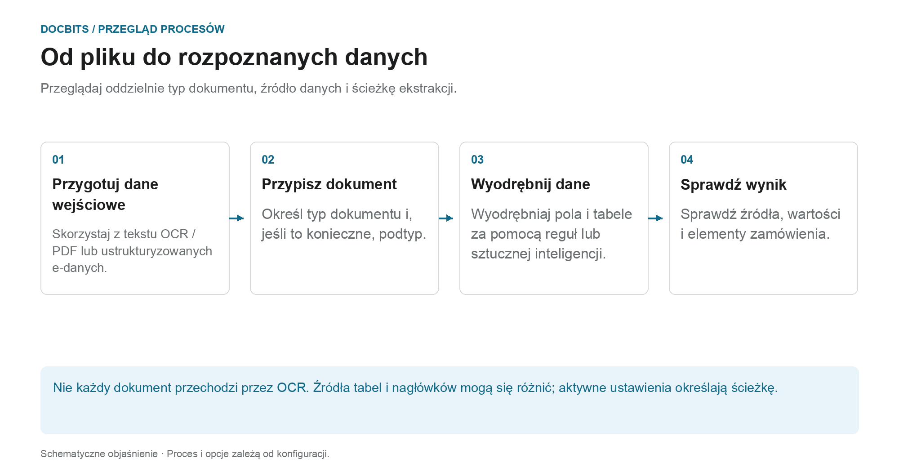
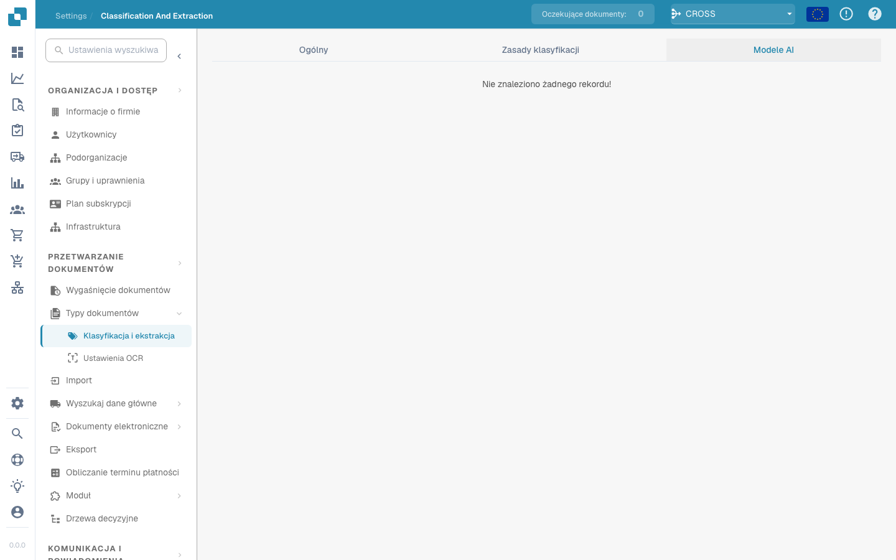
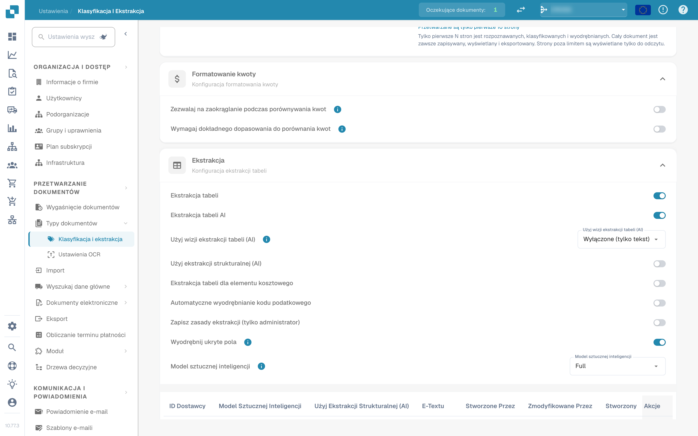
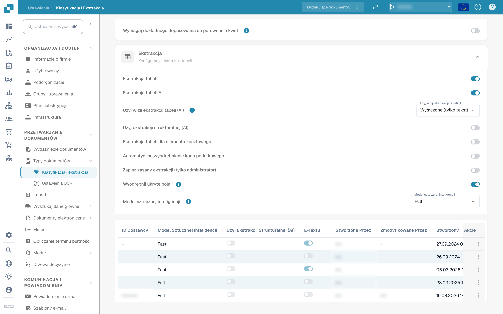
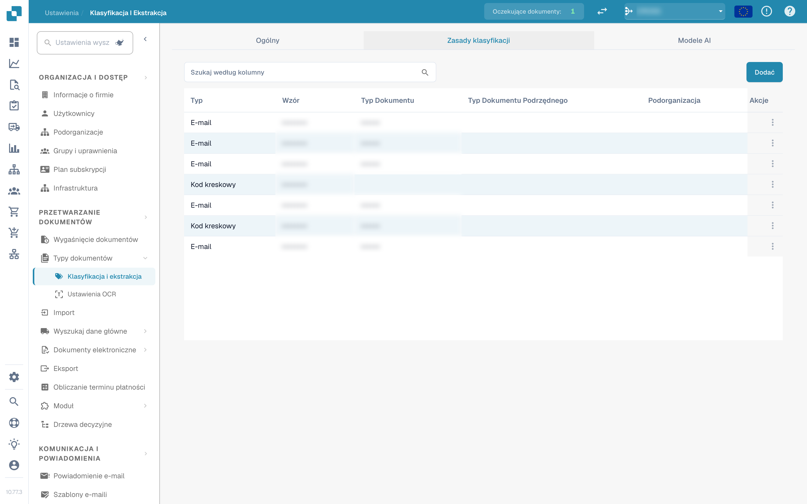
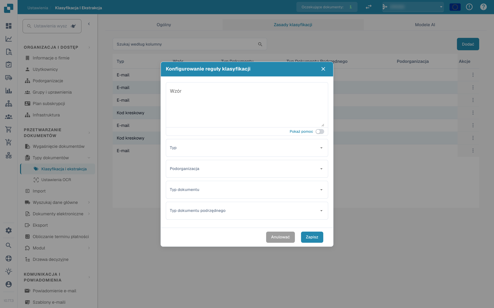

# Klasyfikacja i ekstrakcja

## Które ustawienie działa na którym etapie procesu?

<figure><figcaption>
Przeglądaj oddzielnie typ dokumentu, źródło danych i ścieżkę ekstrakcji. Schemat ma charakter schematyczny; aktywne ustawienia Twojej organizacji określają rzeczywiste zachowanie.
</figcaption></figure>

Klasyfikacja odpowiada na pytanie **„Co to za dokument?”**. Ekstrakcja odpowiada **„Jakie wartości zawiera?”**. Ustawienia na tej stronie wpływają na różne punkty przetwarzania i nie należy ich rozumieć jako pojedynczego przełącznika AI.

1. **Przygotuj dane wejściowe:** W przypadku PDFs można użyć istniejącego tekstu lub OCR; obsługiwane dokumenty elektroniczne mogą zapewniać wartości strukturalne. Aktywowany podział może oddzielić przychodzący dokument na podstawie skonfigurowanych kryteriów kodu kreskowego lub QR.
2. **Określ typ dokumentu:** Reguły i modele klasyfikacji przypisują dokumenty do typu i, w razie potrzeby, podtypu. To przypisanie należy odróżnić od późniejszego wyodrębniania pól i tabel.
3. **Wyodrębnij wartości:** Tabele mogą podążać różnymi ścieżkami w zależności od konfiguracji i odpowiednich zapisanych reguł. Pola nagłówka mają własne wskaźniki źródła. Dlatego sam wybrany model AI nie wyjaśnia wartości każdego wiersza lub pola.
4. **Śledź wynik:** Na ekranie sprawdzania poprawności sprawdź, która zakładka tabeli zawiera wiersze i jaki wskaźnik źródła ma pole nagłówka. Jeśli brakuje etapu przetwarzania, przed zmianą ustawień przeczytaj dzienniki dokumentów.

### Rozróżnij ścieżkę reguły od ścieżki AI

Odpowiednie zapisane reguły tabel mogą określić ekstrakcję tabeli dla odpowiedniego szablonu lub dostawcy. Bez odpowiednich reguł ścieżkę AI można wykorzystać, gdy aktywowana jest ekstrakcja tabeli AI. Poszczególne kolumny mogą mieć własne opcje AI. Źródło AI dla pola nagłówka nie oznacza, że ​​cała tabela pochodzi z AI.

Przewodnik diagnostyczny [Która ścieżka ekstrakcji została wykorzystana?](../../../../overview-and-basics/faq/document-processing/which-extraction-path-was-used.md) objaśnia karty, identyfikatory źródeł i dzienniki. Strona [Model sztucznej inteligencji](ai-model.md) objaśnia nadpisania standardów organizacji i szablonów.

## Przegląd

W ustawieniach **Klasyfikacja i ekstrakcja** możesz:

* Włącz **Podział dokumentu** w oparciu o kody QR
* Skonfiguruj **formatowanie kwoty**
* Skonfiguruj **ekstrakcję tabeli**
* Przełącz przetwarzanie nieobsługiwanych plików **ZUGFeRD**
* Zdefiniuj specjalne zasady klasyfikacji
* Monitoruj specjalnie przeszkolone **AI modele** wykorzystywane w procesie klasyfikacji

Na tej stronie znajduje się szczegółowy opis wszystkich dostępnych ustawień.

## **Dostęp do ustawień klasyfikacji i wyodrębniania**

Aby uzyskać dostęp do ustawień **Klasyfikacja i wyodrębnianie**, przejdź do:\
**Ustawienia → Przetwarzanie dokumentu → Klasyfikacja i wyodrębnianie**

## Dostęp do ustawień klasyfikacji i ekstrakcji

Przejdź do **Ustawienia → Typy Dokumentu → Klasyfikacja i Ekstrakcja**.

W sekcji **Podział dokumentu** możesz skonfigurować, czy przesłany dokument powinien być dzielony na wiele dokumentów, gdy na jednej z jego stron pojawi się **kod kreskowy**.

Aby aktywować tę funkcję:

1. Przejdź do sekcji **Podział dokumentu**.
2.  Otwórz menu rozwijane.

    <figure><figcaption></figcaption></figure>
3.  Wybierz **Podziel według kodu kreskowego/QR kodu**.

* **Nie dziel przesłanych dokumentów** – wartość domyślna; dokument jest przetwarzany jako jeden plik.
* **Podział według kodu kreskowego/kodu QR** – dokument jest dzielony przy każdym wykrytym kodzie kreskowym.

Będziesz wtedy mieć możliwość:

* Wybierz jeden lub więcej typów kodów kreskowych, które mają zostać wykryte.
*   Określ wzór wyrażenia regularnego, do którego musi pasować kod kreskowy, aby uruchomić podział dokumentu.

* **Typ kodu kreskowego** – jeden lub więcej typów kodów kreskowych do wykrycia, na przykład *CODE-128* lub *QR-CODE*.
* **Wzór kodu kreskowego** – wyrażenie regularne, które musi spełniać wartość kodu kreskowego, zanim zostanie wywołany podział. Pozostaw puste, aby dzielić przy każdym kodzie kreskowym wybranych typów. Wzór jest sprawdzany przed zapisaniem; nieprawidłowe wyrażenie jest zgłaszane od razu.

## Formatowanie kwot

W sekcji **Formatowanie kwoty** masz dwie opcje:

* **Zezwalaj na zaokrąglanie podczas porównywania kwot:**\
  Jeśli ta opcja jest włączona, podczas porównywania ilości dozwolona jest tolerancja ±0.5.\
  Jeżeli opcja jest wyłączona, obowiązuje domyślna tolerancja ±0.05.
* **Wymagaj dokładnego dopasowania do porównania kwot:**\
  Jeśli ta opcja jest włączona, kwoty muszą dokładnie odpowiadać zerowej tolerancji.\
  Jeśli opcja jest wyłączona, dozwolona jest tolerancja ±0.05.

<mark style="color:red;">**Uwaga**</mark>: Tylko jedno z tych ustawień może być aktywne w danym momencie.

* Puste lub **0** oznacza, że przetwarzane są wszystkie strony.
* Liczba *N* ogranicza OCR, klasyfikację i ekstrakcję do pierwszych *N* stron. Cały dokument jest nadal zapisywany, wyświetlany i eksportowany; strony powyżej limitu są wyświetlane tylko do odczytu.

### Formatowanie kwoty

Dwa przełączniki kontrolują, jak kwoty są porównywane z danymi głównymi i zamówieniami zakupu.

<figure><figcaption>
Sekcja «Formatowanie kwoty»
</figcaption></figure>

* **Zezwalaj na zaokrąglanie podczas porównywania kwot** – po włączeniu dopuszczalna jest tolerancja ±0,5. Po wyłączeniu obowiązuje ±0,05.
* **Wymagaj dokładnego dopasowania do porównania kwot** – po włączeniu kwoty muszą się zgadzać dokładnie, bez tolerancji. Po wyłączeniu obowiązuje ±0,05.

Tylko jeden z dwóch przełączników może być aktywny jednocześnie; włączenie jednego wyłącza drugi.

### Ekstrakcja


**Warunki działającej ekstrakcji tabeli**

* Typ dokumentu ma **kolumny tabeli** (Ustawienia → Ustawienia globalne → Typy dokumentów → [Kolumny tabeli](../../global-settings/document-types/table-columns/README.md)). Bez kolumn nie ma do czego wyodrębniać.
* Poniżej włączona jest opcja **Ekstrakcja tabeli** lub **Ekstrakcja tabeli AI**, dla całej organizacji.
* Dokument ma czytelny tekst: wykonano OCR albo dla plików PDF utworzonych cyfrowo używany jest E-Text ([Ustawienia OCR](../ocr-settings.md)).
* Szkolenie i modele AI działają **dla każdego dostawcy osobno**. Wytrenowana tabela dotyczy tylko dokumentów dostawcy, na którym została wytrenowana.


Możesz wyodrębniać tabele z dokumentów, włączając **Ekstrakcję tabeli** lub **Ekstrakcję tabeli AI**. Wytrenowana tabela (oparta na AI lub ręczna) jest zawsze powiązana z konkretnym dostawcą.

<figure><figcaption>
Przełączniki ekstrakcji tabeli
</figcaption></figure>

**Ekstrakcja tabeli:** Włącza opartą na regułach ekstrakcję tabel. Tabele są trenowane dla każdego dostawcy na ekranie walidacji (*Go to table extraction view*).\
Więcej o trenowaniu dowiesz się [tutaj](../../../setup/document-training/training-line-fields-table-training/defining-tables-and-columns.md).

**Ekstrakcja tabeli AI:** Wykorzystuje AI do wyodrębniania tabeli dowolnego dostawcy bez trenowania. Jeśli wyniki dla danego dostawcy nie są wystarczająco dokładne, wytrenuj tabelę tego dostawcy; zapisane reguły mają wtedy pierwszeństwo przed AI dla tego dostawcy.

**Użyj wizji ekstrakcji tabeli (AI):** AI czyta obraz strony zamiast warstwy tekstowej. Pomaga przy skanowanych dokumentach i tabelach bez wyraźnej struktury tekstu; jest wolniejsza. Lista rozwijana obok przełącznika określa, jak intensywnie używany jest obraz strony:

* **Wyłączone (tylko tekst)** – Używana jest tylko warstwa tekstowa. To wartość domyślna.
* **Tylko obrazy** – Odczytiwany jest tylko obraz strony.
* **Hybrydowe (tekst i obrazy)** – Warstwa tekstowa i obraz strony są łączone w jednym żądaniu.
* **Auto (decydowane dla dokumentu)** – DocBits decyduje dla każdego dokumentu, czy warstwa tekstowa wystarcza.

**Użyj ekstrakcji strukturalnej (AI):** AI zwraca tabelę w stałej strukturze, która jest odwzorowywana bezpośrednio na skonfigurowane kolumny tabeli. Zalecane, gdy nagłówki kolumn na dokumentach mocno się różnią. Kliknięcie ustawienia otwiera podgląd dokładnie tych pól i kolumn, o które AI zostanie poproszona: pola nagłówka i kolumny wierszy są wymienione wraz ze swoim źródłem (żądane lub wyłączone pola standardowe), a także oczekiwany tryb wyjścia (na przykład *strict* – bez dodatkowych kolumn). Pola skonfigurowane dla typu dokumentu, ale wyłączone, nie są żądane od AI.

**Ekstrakcja tabeli dla elementu kosztowego:** Po włączeniu DocBits może wyodrębniać elementy kosztowe z tabel na poziomie pozycji i odpowiednio je klasyfikować.\
Szczegółowe wyjaśnienie znajdziesz [tutaj](table-extraction-for-costing-element.md).

**Automatyczne wyodrębnianie kodu podatkowego:** Po włączeniu system automatycznie wypełnia pole **Kod podatkowy** na ekranie walidacji, o ile skonfigurowano pole kodu podatkowego.\
Więcej informacji o tym ustawieniu [tutaj](auto-extract-tax-code.md).

**Zapisz zasady ekstrakcji (tylko administrator):** Tylko administratorzy mogą klikać *Save Rules* podczas trenowania tabel. Włącz to, gdy użytkownicy stale zapisują reguły, które psują ekstrakcję dostawcy.

**Model AI:** Ustawia model organizacji na potrzeby wyodrębniania pól i tabel. W menu dostępne są Full, Fast, Nexus, Nexus Flash, Auto i Auto Nexus. Sprawdź dostępność, jakość, czas realizacji i koszt na podstawie reprezentatywnych dokumentów. Poziom nie zawsze jest najdokładniejszy i najszybszy w przypadku każdego dokumentu. Zastąpienia szablonu mogą zastąpić ustawienia organizacji. Tabela pod selektorem pokazuje:

**Model sztucznej inteligencji:** Wybiera poziom AI używany do ekstrakcji tabeli. Dostępnych jest sześć opcji: **Full** (najwyższa dokładność, najwolniejszy, 2 tokeny na dokument), **Fast** (domyślnie; 1 token na dokument), **Nexus** i **Nexus Flash** (alternatywna rodzina modeli, opcjonalnie), a także **Auto** i **Auto Nexus**, w których DocBits decyduje dla każdego dokumentu, jak silny model jest potrzebny. Tabela pod selektorem pokazuje:

* którzy **dostawcy** używają którego modelu AI
* czy używają ekstrakcji strukturalnej (AI) i E-Textu
* opcje usunięcia wpisu i przywrócenia w ten sposób dostawcy do wartości domyślnej

To ustawienie jest szczegółowo opisane [tutaj](ai-model.md).

#### Dlaczego tabela wygląda inaczej u każdego dostawcy?

Przetwarzanie tabeli zależy od zapisanych reguł i ustawień w kontekście odpowiedniego dostawcy lub szablonu:

* **Zapisane reguły** (trenowanie tabeli): pozycja tabeli i odwzorowanie jej kolumn w układzie tego dostawcy.
* **Tagi tabeli AI i reguły formatowania**: wskazówki zapisane przez użytkownika dla tabeli AI tego dostawcy.
* **Model AI specyficzny dla szablonu:** Wybór dokonany na ekranie walidacji jest zapisywany dla każdej organizacji i bieżącego szablonu wyodrębniania. Nie zmienia automatycznie każdego szablonu tego samego dostawcy. Bez zastąpienia używane jest odpowiednie ustawienie organizacji.

Dostawca A z zapisanymi regułami pokazuje więc deterministyczną tabelę na karcie *Extracted table* ekranu walidacji, a dostawca B bez reguł otrzymuje *AI Extracted table*. Aby dostawca B zachowywał się jak A, raz wytrenuj tabelę B. Aby zresetować dostawcę, usuń jego reguły na ekranie walidacji lub zresetuj jego dane treningowe w tabeli Model sztucznej inteligencji.

#### Klucze preferencji

Każdy przełącznik w tej sekcji jest przechowywany jako preferencja organizacji. Użyj klucza, gdy ustawiasz wartość przez API (`/preferences/set_preference`), skrypt lub DocBits MCP (`get_preference` / `set_preference`).

| Ustawienie (etykieta interfejsu) | Klucz preferencji | Wartości |
|---|---|---|
| Table Extraction | `TABLE_EXTRACTION_SETTING` | `true` / `false` |
| AI Table extraction | `USE_AI_TABLE_EXTRACTION` | `true` / `false` |
| Use Table Extraction Vision (AI) | `TABLE_EXTRACTION_VISION_MODE` | `off` (domyślnie), `vision`, `hybrid`, `auto` |
| Use Table Extraction Vision (AI) – starszy przełącznik | `TABLE_EXTRACTION_USE_VISION` | `true` / `false`; oznacza w praktyce `vision` |
| Użyj wyodrębnienia strukturalnego (AI) | `USE_STRUCTURED_EXTRACTION` | `true` / `false` |
| Ekstrakcja tabeli dla elementu kosztorysowego | `CHARGES_TABLE_EXTRACTION` | `true` / `false` |
| Automatyczne wyodrębnianie kodu podatkowego | `AUTO_EXTRACT_TAX_CODE` | `true` / `false` |
| Zapisz reguły wyodrębniania (tylko administrator) | `ONLY_ADMIN_CAN_SAVE_RULES` | `true` / `false` |
| Model sztucznej inteligencji | `AI_MODEL` | `gpt-6-sol` (Full), `gpt-6-luna` (Fast), `qwen3.8-max` (Nexus), `glm-5.3-flash` (Nexus Flash), `auto` (Auto), `auto-nexus` (Auto Nexus) |
| Wersja ekstrakcji tabeli (okno potwierdzenia) | `TBL_EXT_VERSION` | ciąg wersji |
| Ustawienia OCR → Używaj danych AI dla tabel, jeśli są dostępne | `USE_AI_DATA_FOR_TABLE` | `true` / `false` |
| Ustawienia OCR → Używaj E-Textu, jeśli jest dostępny | `USE_ETEXT_IF_AVAILABLE` | `true` / `false` |

Uwagi:

* Preferencje logiczne są przechowywane jako ciągi `true` / `false`; klucz nigdy nieustawiony liczy się jako `false`. Jeśli wyślesz `1` lub `0`, DocBits zapisze `true` / `false`.
* Nieustawiony `AI_MODEL` oznacza **Fast**.
* Nieustawiony `TABLE_EXTRACTION_VISION_MODE` jest wyznaczany ze starszego przełącznika `TABLE_EXTRACTION_USE_VISION`: `true` daje `vision`, każda inna wartość daje `off`.
* Zmiana klucza obowiązuje dla dokumentów przetwarzanych później. Uruchom dokument ponownie, aby wyodrębnić go ponownie z nowym ustawieniem.
* Zastąpienia szablonów różnią się od preferencji organizacji. Przewodnik po modelu AI wyjaśnia dokładny zakres.

## Dokument elektroniczny

**Przetwarzaj nieobsługiwane pliki PDF ZUGFeRD:** Jeśli ta opcja jest włączona, nieobsługiwane wersje **ZUGFeRD** będą przetwarzane jako standardowe pliki PDF, a osadzone XML będą ignorowane.

Listę obsługiwanych wersji **ZUGFeRD** można znaleźć [tutaj](../../global-settings/document-types/edi/zugferd/README.md).

## **Reguły klasyfikacji**

W sekcji **Zasady klasyfikacji** możesz zdefiniować konkretne wzorce i kryteria **regex**, które pomogą systemowi automatycznie klasyfikować dokumenty podczas przetwarzania.

Aby uzyskać dostęp do tej sekcji, kliknij zakładkę **Zasady klasyfikacji** u góry strony.

<figure><figcaption>
Karta «Zasady klasyfikacji» z tabelą reguł
</figcaption></figure>

### **Dodaj nową regułę klasyfikacji**

Aby utworzyć nową regułę:

1.  Kliknij **Dodaj** w prawym górnym rogu.

    <figure><figcaption></figcaption></figure>
2. Wypełnij następujące pola:
   * **Wzorzec**: Wzorzec wyrażenia regularnego, którego system powinien szukać, aby wywołać klasyfikację.
   * **Type**: Gdzie należy szukać wzorca (np. **Kod kreskowy**).
   * **Podorganizacja** _(opcjonalnie)_: Określ, której organizacji podrzędnej dotyczy reguła.
   * **Typ dokumentu**: Określ typ dokumentu, który ma zostać przypisany po dopasowaniu wzorca.
   *   **Podtyp dokumentu** _(opcjonalnie)_: Określ podtyp w celu uzyskania bardziej szczegółowej klasyfikacji.

       <figure><figcaption></figcaption></figure>
3.  Kliknij **Zapisz**, aby zapisać regułę klasyfikacji.

    <figure><figcaption>
Okno «Konfigurowanie reguły klasyfikacji»
</figcaption></figure>
2. Wypełnij pola:
   * **Wzór** (wymagane) – wyrażenie regularne, którego szuka reguła.
   * **Typ** (wymagane) – **Kod kreskowy** lub **E-mail**. To decyduje, z którą nazwą źródła porównywany jest wzór.
   * **Podorganizacja** *(opcjonalnie)* – ogranicza regułę do jednej podorganizacji.
   * **Typ Dokumentu** – typ dokumentu przypisywany przy dopasowaniu wzoru.
   * **Typ Dokumentu Podrzędnego** *(opcjonalnie)* – bardziej szczegółowy typ; lista zależy od wybranego typu dokumentu. Zmiana typu dokumentu czyści typ dokumentu podrzędnego.
3.  Kliknij **Ratować**.

### **Edytuj regułę klasyfikacji**

Aby edytować istniejącą regułę:

1.  Kliknij trzy kropki w kolumnie **Akcje**.

* **O365** – `Współdzielony e-mail + Folder › Współdzielony e-mail › Folder › E-mail › Identyfikator`
* **Gmail** – `E-mail + Folder › Folder › E-mail › Identyfikator`

    <figure><figcaption></figcaption></figure>
3. Wprowadź żądane zmiany.
4.  Kliknij **Zapisz**, aby zastosować aktualizacje.

Przykłady w panelu:

### **Usuń regułę klasyfikacji**

Aby usunąć regułę:

1.  Kliknij trzy kropki w kolumnie **Akcje**.

### Edytowanie zasady klasyfikacji

1.  Kliknij trzy kropki w kolumnie **Akcje** reguły, którą chcesz zmienić.

## Modele AI

Sekcja **Modele AI** wyświetla wszystkie specjalnie wytrenowane modele, które zostały specjalnie dostosowane do Twoich potrzeb.

### Dostęp do sekcji modeli AI

Aby otworzyć tę sekcję, kliknij zakładkę **Modele AI** znajdującą się na górze strony.

1. Kliknij trzy kropki w kolumnie **Akcje**.
2. Wybierz **Usuwać**.

### Kategorie modeli

Modele są podzielone na kategorie. Pod każdą nazwą kategorii pokazana jest liczba modeli, które zawiera.\
Kliknij kategorię, aby wyświetlić jej szczegóły.

Karta **Modele AI** pokazuje modele trenowane indywidualnie, dostępne do klasyfikacji dokumentów, oraz ich etykiety. Pojawia się tylko wtedy, gdy moduł modeli i etykiet jest włączony dla Twojej organizacji.

U góry strony wybranej kategorii zobaczysz najważniejsze informacje o każdym modelu:

* **Type**: Typ modelu.
* **Tylko pierwsza strona**: Wskazuje, czy model przetwarza tylko pierwszą stronę dokumentu.
* **Version**: Numer wersji modelu.

### Tabela modeli

Wszystkie modele w danej kategorii są wymienione w tabeli zawierającej następujące informacje:

* **Nazwa**: Nazwa modelu.
* **Następny model**: Model, który będzie dalej przetwarzał dane wyjściowe bieżącego modelu.
* **Typ dokumentu**: Podstawowy typ dokumentu przypisany przez model podczas klasyfikacji.
* **Podtypy dokumentów**: Podtypy, na które dokument jest dalej klasyfikowany.
* **Priority**: Poziom priorytetu określający pozycję modelu w kolejce klasyfikacyjnej.

Pod tymi informacjami wymienione są etykiety modelu.

### Edycja modelu

Aby edytować model:

1.  Kliknij ikonę pióra w kolumnie **Akcje** obok modelu, który chcesz edytować.

    <figure><figcaption></figcaption></figure>
2. Zaktualizuj dostępne pola:
   * **Następny model**: Wybierz model, który powinien przetwarzać dane wyjściowe z bieżącego modelu.
   * **Typ dokumentu**: Wybierz typ dokumentu, jako który model powinien klasyfikować dane wejściowe.
3.  Kliknij **Zapisz**, aby zastosować zmiany.

### Edytowanie etykiety

Kliknij ikonę ołówka w wierszu etykiety, aby otworzyć okno edycji. Oferuje ono **Następny model** i **Typ Dokumentu**; ustaw jedno z nich, ponieważ okno wymaga następnego modelu lub typu dokumentu. Kliknij **Ratować**, aby zastosować zmianę.

## Powiązane strony

* [Model sztucznej inteligencji](ai-model.md) – sześć poziomów ekstrakcji i sposób, w jaki dostawca otrzymuje własny model
* [Automatyczne wyodrębnianie kodu podatkowego](auto-extract-tax-code.md)
* [Ekstrakcja tabeli dla elementu kosztowego](table-extraction-for-costing-element.md)
* [Ustawienia OCR](../ocr-settings.md)
