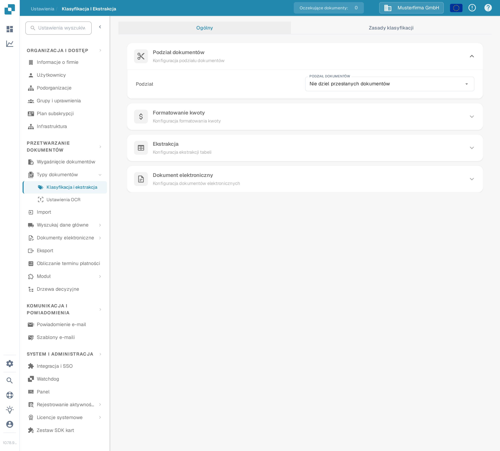

# Klasyfikacja i ekstrakcja

## Overview

In the **Classification and Extraction** settings, you can:

* Enable **Document Splitting** based on QR codes
* Configure **amount formatting**
* Set up **table extraction**
* Toggle processing of unsupported **ZUGFeRD** files
* Define special classification rules
* Monitor Custom-Trained **AI Models** used in the classification process

This page provides a detailed explanation of all available settings.

## **Accessing Classification and Extraction Settings**

To access the **Classification and Extraction** settings, go to:\
**Settings → Document Processing → Classification and Extraction**

<figure><figcaption>
Otwórz <strong>Ustawienia → Przetwarzanie dokumentów → Klasyfikacja i ekstrakcja</strong>.
</figcaption></figure>

## Document Splitting

In the **Document Splitting** section, you can configure whether an uploaded document should be split into multiple documents whenever a **barcode** appears on one of its pages.

To activate this feature:

1. Go to the **Document Splitting** section.
2.  Open the dropdown menu.

    <figure><figcaption></figcaption></figure>
3.  Select **Split by Barcode/QR Code**.

    <figure><figcaption></figcaption></figure>

You will then have the option to:

* Select one or more barcode types to be detected.
*   Specify a regex pattern that the barcode must match in order to trigger document splitting.

    <figure><figcaption></figcaption></figure>

## Amount Formatting

In the **Amount Formatting** section, you have two options:

* **Allow Rounding During Amount Comparison:**\
  If enabled, a tolerance of ±0.5 is allowed during amount comparison.\
  If disabled, a default tolerance of ±0.05 applies.
* **Require Exact Match for Amount Comparison:**\
  If enabled, amounts must match exactly with zero tolerance.\
  If disabled, a tolerance of ±0.05 is allowed.

<mark style="color:red;">**Note**</mark>: Only one of these settings can be active at a time.

## Ekstrakcja tabeli


**Warunki wstępne działającej ekstrakcji tabeli**

* Typ dokumentu ma **kolumny tabeli** (Ustawienia → Ustawienia globalne → Typy dokumentów → [Kolumny tabeli](../../global-settings/document-types/table-columns.md)). Bez kolumn nie ma do czego wyodrębniać.
* Poniżej włączona jest opcja **Ekstrakcja tabeli** lub **Ekstrakcja tabeli AI**, dla całej organizacji.
* Dokument ma czytelny tekst: wykonano OCR albo dla plików PDF utworzonych cyfrowo używany jest E-Text ([Ustawienia OCR](../ocr-settings.md)).
* Szkolenie i modele AI działają **dla każdego dostawcy osobno**. Wytrenowana tabela dotyczy tylko dokumentów dostawcy, na którym została wytrenowana.


Tabele z dokumentów można wyodrębniać, włączając opcję **Ekstrakcja tabeli** lub **Ekstrakcja tabeli AI**. Wytrenowana tabela (oparta na AI lub ręczna) jest zawsze powiązana z konkretnym dostawcą.

**Ekstrakcja tabeli (Table Extraction):** Włącza ekstrakcję tabeli opartą na regułach. Tabele trenuje się dla każdego dostawcy na ekranie walidacji (_Go to table extraction view_).\
Więcej o szkoleniu [tutaj](../../../setup/document-training/training-line-fields-table-training/defining-tables-and-columns.md).

**Ekstrakcja tabeli AI (AI Table Extraction):** Wykorzystuje AI do wyodrębniania tabeli dowolnego dostawcy bez szkolenia. Jeśli wyniki dla jednego dostawcy nie są wystarczająco dokładne, wytrenuj tabelę tego dostawcy; zapisane reguły mają wtedy pierwszeństwo przed AI dla tego dostawcy.

**Użyj wizji ekstrakcji tabeli (AI):** AI odczytuje obraz strony zamiast warstwy tekstowej. Pomaga przy dokumentach skanowanych i tabelach bez wyraźnej struktury tekstowej; działa wolniej. Rozwijana lista obok przełącznika określa, jak intensywnie używany jest obraz strony:

* **Wyłączone (tylko tekst)** – Używana jest tylko warstwa tekstowa. To ustawienie domyślne.
* **Tylko obrazy** – Odczytywany jest wyłącznie obraz strony.
* **Hybrydowy (tekst i obrazy)** – Warstwa tekstowa i obraz strony są łączone w tym samym żądaniu.
* **Auto (decydowane dla każdego dokumentu)** – DocBits decyduje dla każdego dokumentu osobno, czy warstwa tekstowa wystarcza.

Tryb jest zapisywany pod kluczem preferencji `TABLE_EXTRACTION_VISION_MODE`; starszy przełącznik `TABLE_EXTRACTION_USE_VISION` pozostaje i oznacza w praktyce _Tylko obrazy_.

**Użyj ekstrakcji strukturalnej (AI):** AI zwraca tabelę w stałej strukturze, która mapuje się bezpośrednio na skonfigurowane kolumny tabeli. Zalecane, gdy nagłówki kolumn na dokumentach mocno się różnią. Kliknięcie tego ustawienia otwiera podgląd tego, o jakie pola i kolumny AI zostanie dokładnie poproszona: pola nagłówka oraz kolumny wierszy są wymienione wraz z ich źródłem (żądane albo wyłączone pola standardowe) wraz z oczekiwanym trybem wyjścia (na przykład _strict_ – bez dodatkowych kolumn). Pola skonfigurowane dla typu dokumentu, ale wyłączone, nie są żądane od AI.

**Ekstrakcja tabeli dla elementu kosztowego (Table Extraction for Costing Element):** Po włączeniu DocBits może wyodrębniać elementy kosztowe z tabel na poziomie pozycji i odpowiednio je klasyfikować.\
Szczegółowe wyjaśnienie [tutaj](table-extraction-for-costing-element.md).

**Automatyczne wyodrębnianie kodu podatkowego (Auto Extract Tax Code):** Po włączeniu system automatycznie wypełnia pole **Kod podatkowy** na ekranie walidacji, pod warunkiem że pole kodu podatkowego jest skonfigurowane.\
Więcej informacji o tym ustawieniu [tutaj](auto-extract-tax-code.md).

**Zapisywanie reguł ekstrakcji (tylko administrator) (Save extraction rules (Admin only)):** Tylko administratorzy mogą kliknąć _Save Rules_ w szkoleniu tabeli. Włącz tę opcję, gdy użytkownicy zapisują reguły, które psują ekstrakcję dostawcy.

**Model sztucznej inteligencji:** Wybiera poziom AI używany do ekstrakcji tabeli. Dostępnych jest sześć opcji: **Full** (najwyższa dokładność, najwolniejsza, 2 tokeny na dokument), **Fast** (domyślna; 1 token na dokument), **Nexus** i **Nexus Flash** (alternatywna rodzina modeli, opcjonalnie) oraz **Auto** i **Auto Nexus**, w których DocBits decyduje dla każdego dokumentu, jak silny model jest potrzebny. Tabela pod selektorem pokazuje:

* Którzy **dostawcy** używają którego modelu AI
* Czy używają ekstrakcji strukturalnej (AI) i E-Textu
* Opcje usunięcia wpisu i zresetowania w ten sposób dostawcy do wartości domyślnej

To ustawienie jest szczegółowo opisane [tutaj](ai-model.md).

### Dlaczego tabela wygląda inaczej u każdego dostawcy?

Wszystko, czego DocBits uczy się o tabeli, jest zapisywane **dla każdego dostawcy osobno**:

* **Zapisane reguły** (szkolenie tabeli): położenie tabeli i mapowanie jej kolumn w układzie tego dostawcy.
* **Tagi tabeli AI i reguły formatowania**: wskazówki zapisane przez użytkownika dla tabeli AI tego dostawcy.
* **Model AI specyficzny dla dostawcy**: poziom wybrany dla tego dostawcy w _Więcej ustawień_ na ekranie walidacji.

Dlatego dostawca A z zapisanymi regułami pokazuje deterministyczną tabelę w zakładce _Extracted table_ na ekranie walidacji, a dostawca B bez reguł otrzymuje zakładkę _AI Extracted table_. Aby dostawca B zachowywał się jak A, wytrenuj raz tabelę dostawcy B. Aby zresetować dostawcę, usuń jego reguły na ekranie walidacji albo zresetuj jego dane szkoleniowe w tabeli Model AI.

### Klucze preferencji

Każdy przełącznik w tej sekcji jest zapisywany jako preferencja organizacji. Użyj klucza, gdy ustawiasz wartość przez API (`/preferences/set_preference`), skrypt lub DocBits MCP (`get_preference` / `set_preference`).

| Ustawienie (etykieta w interfejsie)                    | Klucz preferencji              | Wartości                                                                                                                                |
| ------------------------------------------------------ | ------------------------------ | --------------------------------------------------------------------------------------------------------------------------------------- |
| Table Extraction                                       | `TABLE_EXTRACTION_SETTING`     | `true` / `false`                                                                                                                        |
| AI Table extraction                                    | `USE_AI_TABLE_EXTRACTION`      | `true` / `false`                                                                                                                        |
| Use Table Extraction Vision (AI)                       | `TABLE_EXTRACTION_VISION_MODE` | `off` (domyślnie), `vision`, `hybrid`, `auto`                                                                                           |
| Use Table Extraction Vision (AI) – starszy przełącznik | `TABLE_EXTRACTION_USE_VISION`  | `true` / `false`; oznacza w praktyce `vision`                                                                                           |
| Use Structured Extraction (AI)                         | `USE_STRUCTURED_EXTRACTION`    | `true` / `false`                                                                                                                        |
| Table extraction for costing element                   | `CHARGES_TABLE_EXTRACTION`     | `true` / `false`                                                                                                                        |
| Auto extract tax code                                  | `AUTO_EXTRACT_TAX_CODE`        | `true` / `false`                                                                                                                        |
| Save extraction rules (Admin only)                     | `ONLY_ADMIN_CAN_SAVE_RULES`    | `true` / `false`                                                                                                                        |
| Model sztucznej inteligencji                           | `AI_MODEL`                     | `gpt-6-sol` (Full), `gpt-6-luna` (Fast), `qwen3.8-max` (Nexus), `glm-5.3-flash` (Nexus Flash), `auto` (Auto), `auto-nexus` (Auto Nexus) |
| Wersja ekstrakcji tabeli (okno potwierdzenia)          | `TBL_EXT_VERSION`              | ciąg wersji                                                                                                                             |
| Ustawienia OCR → Use AI data for tables if available   | `USE_AI_DATA_FOR_TABLE`        | `true` / `false`                                                                                                                        |
| Ustawienia OCR → Use E-Text if available               | `USE_ETEXT_IF_AVAILABLE`       | `true` / `false`                                                                                                                        |

Uwagi:

* Preferencje logiczne są zapisywane jako ciągi `true` / `false`; klucz, który nigdy nie został ustawiony, liczy się jako `false`. Jeśli wyślesz `1` lub `0`, DocBits zapisze `true` / `false`.
* Nieustawiony `AI_MODEL` oznacza **Fast**.
* Nieustawiony `TABLE_EXTRACTION_VISION_MODE` jest wyznaczany ze starszego przełącznika `TABLE_EXTRACTION_USE_VISION`: `true` daje `vision`, każda inna wartość daje `off`.
* Zmiana klucza obowiązuje dla dokumentów przetwarzanych później. Uruchom dokument ponownie, aby wyodrębnić go ponownie z nowym ustawieniem.
* Wybory dla poszczególnych dostawców (E-Text, model AI, zapisane reguły) nie są preferencjami organizacji; ustawia się je na ekranie walidacji w _Więcej ustawień_ dla dokumentu tego dostawcy.

## Electronic Document

**Process Unsupported ZUGFeRD PDF:** If enabled, unsupported **ZUGFeRD** versions will be processed as standard PDFs, and the embedded XML will be ignored.

The list of supported **ZUGFeRD** versions can be found [here](../../global-settings/document-types/edi/zugferd/).

## **Classification Rules**

In the **Classification Rules** section, you can define specific **regex** patterns and criteria to help the system automatically classify documents during processing.

To access this section, click the **Classification Rules** tab at the top of the page.

<figure><figcaption></figcaption></figure>

### **Add a New Classification Rule**

To create a new rule:

1.  Click **Add** in the top-right corner.

    <figure><figcaption></figcaption></figure>
2. Fill in the following fields:
   * **Pattern**: The regex pattern the system should search for to trigger classification.
   * **Type**: Where the pattern should be searched (e.g., **Barcode**).
   * **Sub Organization** _(optional)_: Specify which sub organization the rule applies to.
   * **Document Type**: Define the document type to assign when the pattern is matched.
   *   **Sub Document Type** _(optional)_: Specify a sub type for more detailed classification.

       <figure><figcaption></figcaption></figure>
3.  Click **Save** to save your classification rule.

    <figure><figcaption></figcaption></figure>

### **Edit a Classification Rule**

To edit an existing rule:

1.  Click the three dots in the **Actions** column.

    <figure><figcaption></figcaption></figure>
2.  Select **Edit**.

    <figure><figcaption></figcaption></figure>
3. Make your desired changes.
4.  Click **Save** to apply the updates.

    <figure><figcaption></figcaption></figure>

### **Delete a Classification Rule**

To delete a rule:

1.  Click the three dots in the **Actions** column.

    <figure><figcaption></figcaption></figure>
2.  Select **Delete**.

    <figure><figcaption></figcaption></figure>

## AI Models

The **AI Models** section displays all custom-trained models that have been specifically fine-tuned for your needs.

### Accessing the AI Models Section

To open this section, click the **AI Models** tab located at the top of the page.

<figure><figcaption></figcaption></figure>

### Model Categories

Models are organized into categories. Below each category name, the number of models it contains is shown.\
Click on a category to view its details.

<figure><figcaption></figcaption></figure>

At the top of the selected category page, you’ll see key information about each model:

* **Type**: The type of model.
* **First Page Only**: Indicates whether the model processes only the first page of a document.
* **Version**: The version number of the model.

### Model Table

All models within a category are listed in a table, which includes the following information:

* **Name**: The name of the model.
* **Next Model**: The model that will further process the output of the current model.
* **Document Type**: The primary document type assigned by the model during classification.
* **Document Sub Types**: The sub types into which the document is further classified.
* **Priority**: The priority level that determines the model’s position in the classification queue.

<figure><figcaption></figcaption></figure>

### Editing a Model

To edit a model:

1.  Click the pen icon in the **Actions** column next to the model you want to edit.

    <figure><figcaption></figcaption></figure>
2. Update the available fields:
   * **Next Model**: Select the model that should process the output from the current model.
   * **Document Type**: Choose the document type the model should classify the input as.
3.  Click **Save** to apply your changes.

    <figure><figcaption></figcaption></figure>
