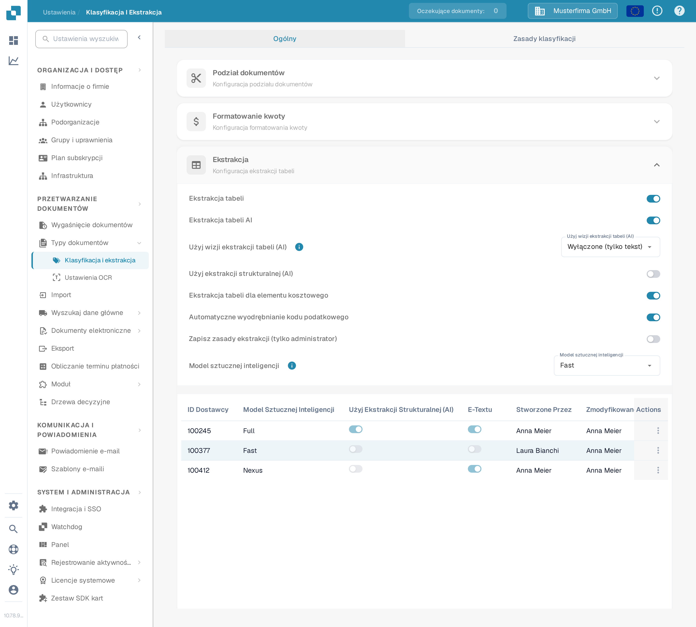
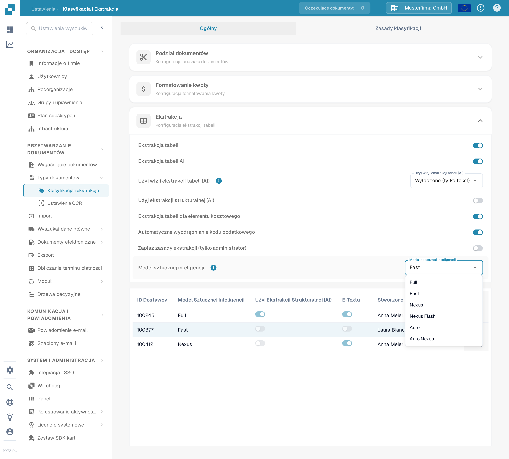
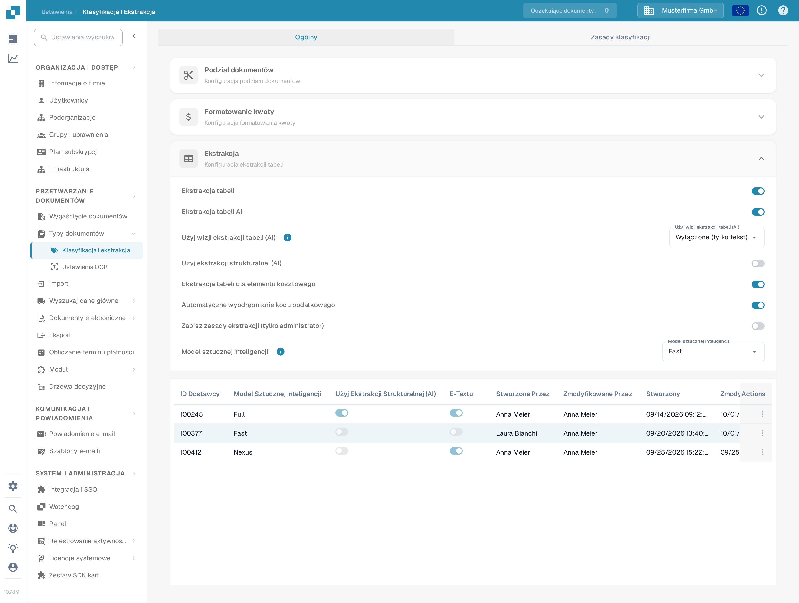
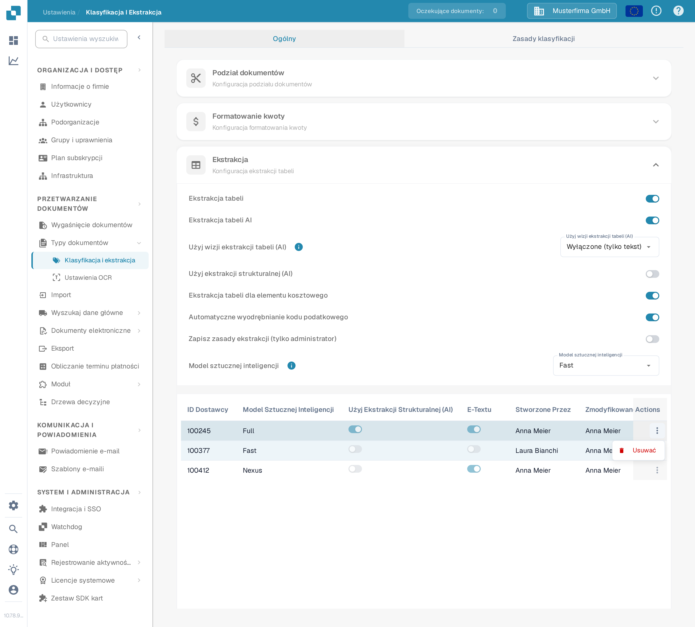
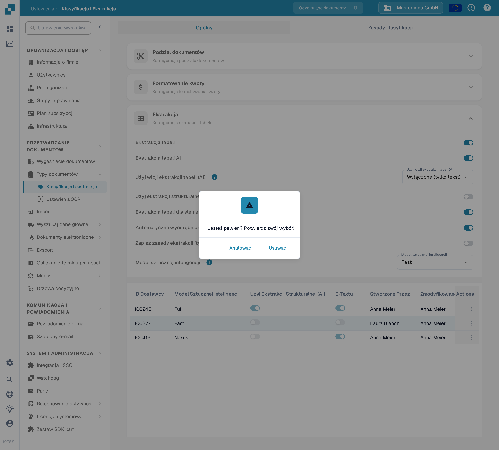

# Model sztucznej inteligencji

## Przegląd

Ustawienie **Model sztucznej inteligencji** pozwala zdefiniować, który model AI jest używany domyślnie do **ekstrakcji pól** i **ekstrakcji tabeli** podczas przetwarzania dokumentów.\
W tej sekcji możesz przejrzeć koszt tokenów dla każdego modelu oraz sprawdzić, który model jest obecnie przypisany do każdego dostawcy.

## Jak uzyskać dostęp

1.  Przejdź do **Ustawienia** → **Przetwarzanie dokumentów** → **Klasyfikacja i ekstrakcja**

    <figure><figcaption>
Otwórz <strong>Ustawienia → Przetwarzanie dokumentów → Klasyfikacja i ekstrakcja</strong>.
</figcaption></figure>
2.  Przewiń w dół do sekcji **Ekstrakcja tabeli**

    <figure><figcaption>
Sekcja <strong>Ekstrakcja</strong> zawiera ustawienie <strong>Model sztucznej inteligencji</strong> oraz tabelę przypisania dostawców.
</figcaption></figure>

## Opcje Modelu sztucznej inteligencji

DocBits oferuje sześć opcji modelu AI do ekstrakcji pól i tabel. Różnią się równowagą między **dokładnością ekstrakcji**, **szybkością przetwarzania** i **kosztem tokenów na dokument** — dzięki temu możesz dopasować opcję do rodzaju przetwarzanych dokumentów. Najedź kursorem na ikonę informacji obok ustawienia, aby zobaczyć koszt tokenów dla aktualnie wybranej opcji. Jeśli dla dostawcy nie ustawiono żadnego modelu, używany jest model **Fast**.

* **Full** – Najbardziej dokładna opcja, o najwyższej dokładności ekstrakcji. Najlepsza do złożonych układów, skanów niskiej jakości lub dokumentów, w których precyzja jest najważniejsza. Jako najpotężniejsza opcja jest też najwolniejsza, przy **2 tokenach za dokument**.
* **Fast** – Zrównoważona opcja łącząca wysoką dokładność z szybszym przetwarzaniem przy niższym koszcie. To opcja domyślna: dostawcy bez własnego ustawienia modelu AI używają **Fast**, przy **1 tokenie za dokument**.
* **Nexus** – Opcjonalna opcja działająca na innej rodzinie modeli (Qwen 3.8 Max). Przydatna, gdy chcesz uzyskać drugą opinię dla dostawców, u których Fast i Full dają rozbieżne wyniki, albo gdy alternatywny model lepiej odczytuje dany układ, przy **1 tokenie za dokument**.
* **Nexus Flash** – Szybszy poziom z rodziny Nexus (GLM-5.3 Flash). Przetwarza dokumenty szybciej niż Nexus przy tym samym koszcie tokenów, przy **1 tokenie za dokument**.
* **Auto** – To nie jest osobny model: dla każdego dokumentu DocBits decyduje, czy wystarczy Fast, czy potrzebny jest Full, dzięki czemu złożone dokumenty automatycznie otrzymują silniejszy model, przy **1 tokenie za dokument**.
* **Auto Nexus** – Jak Auto, ale ograniczone do rodziny modeli Nexus (Nexus Flash i Nexus). Dokumenty pozostają całkowicie poza standardową rodziną modeli, przy **1 tokenie za dokument**.

| Opcja           | Najlepsza do                                                                | Dokładność  | Szybkość      | Koszt tokenów |
| --------------- | --------------------------------------------------------------------------- | ----------- | ------------- | ------------- |
| **Full**        | Złożone układy, słabe skany, wysoka precyzja                                | Najwyższa   | Najwolniejsza | 2 / dokument  |
| **Fast**        | Codzienne dokumenty (domyślnie, gdy nic nie ustawiono)                      | Wysoka      | Szybka        | 1 / dokument  |
| **Nexus**       | Dostawcy, u których alternatywna rodzina modeli działa lepiej (opcjonalnie) | Wysoka      | Szybka        | 1 / dokument  |
| **Nexus Flash** | Jakość Nexus z szybszym przetwarzaniem                                      | Wysoka      | Szybsza       | 1 / dokument  |
| **Auto**        | Zróżnicowana jakość dokumentów bez ręcznego dostrajania                     | Za dokument | Za dokument   | 1 / dokument  |
| **Auto Nexus**  | Decyzje Auto ograniczone do rodziny Nexus                                   | Za dokument | Za dokument   | 1 / dokument  |

<figure><figcaption>
Lista <strong>Model sztucznej inteligencji</strong> z sześcioma dostępnymi opcjami.
</figcaption></figure>

## Tabela przypisania Modelu sztucznej inteligencji

Możesz również skonfigurować specyficzne dla dostawcy **modele AI** bezpośrednio na ekranie **Walidacja**, co pozwala dostosować dokładność ekstrakcji dla poszczególnych dostawców.\
\
Więcej informacji znajdziesz w odpowiedniej dokumentacji [tutaj](../../../../end-user-and-partner-section/end-user-section/validation-screen/supplier-specific-ai-model-for-field-and-table-extraction.md).

Tabela przypisania wyświetla ustawienia modelu AI dla każdego dostawcy i zawiera następujące szczegóły:

* **ID Dostawcy** – Unikalny identyfikator dostawcy
* **Model Sztucznej Inteligencji** – Poziom modelu AI obecnie przypisany do dostawcy
* **Użyj Ekstrakcji Strukturalnej (AI)** – Czy dla tego dostawcy włączono ekstrakcję strukturalną
* **E-Textu** – Wskazuje, czy funkcja E-Text jest włączona
* **Stworzone Przez / Zmodyfikowane Przez / Stworzony / Zmodyfikowany** – Kto ustawił wpis i kiedy
* **Actions** – Zawiera opcję usunięcia wpisu

<figure><figcaption>
Tabela przypisania pokazuje etykietę poziomu dla każdego dostawcy, nigdy surowy identyfikator modelu.
</figcaption></figure>

### Usuń wpis – Zresetuj ustawienia specyficzne dla dostawcy

Aby zresetować ustawienie modelu AI dostawcy do domyślnych:

1.  Kliknij trzy kropki w kolumnie **Actions** obok wpisu dostawcy i wybierz **Usuwać**.

    <figure><figcaption>
Otwórz menu akcji wiersza i wybierz <strong>Usuwać</strong>.
</figcaption></figure>
2.  Pojawi się okno potwierdzenia — potwierdź, że chcesz usunąć wpis.

    <figure><figcaption>
Potwierdź usunięcie w oknie dialogowym.
</figcaption></figure>

Po usunięciu dostawca wróci do korzystania z domyślnego **modelu AI** do **ekstrakcji pól** i **ekstrakcji tabeli**.
