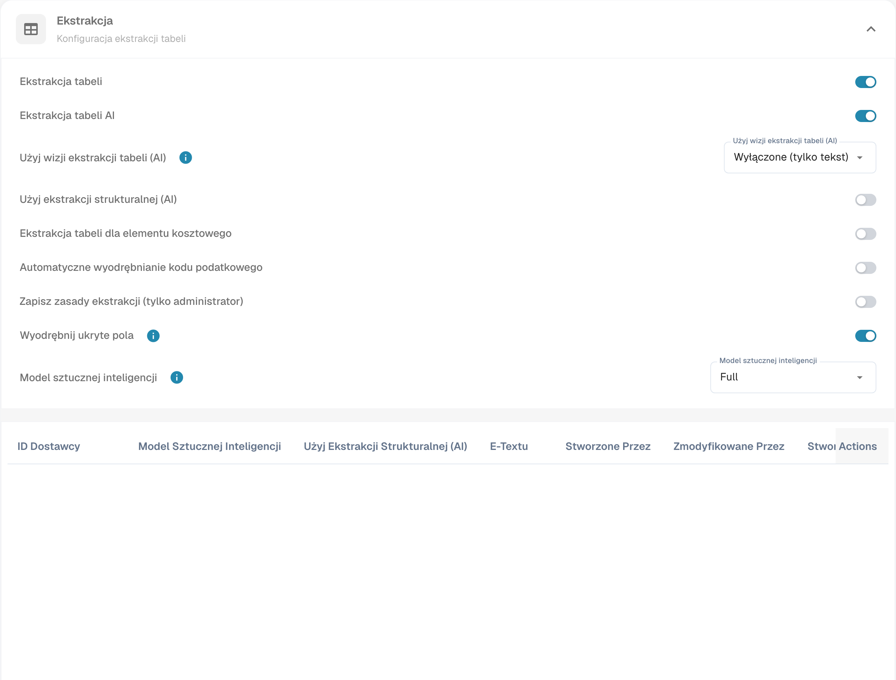

# Automatyczny odczyt kodu podatkowego

Otwórz ustawienia klasyfikacji i ekstrakcji typu dokumentu i znajdź automatyczny odczyt kodu podatkowego. Sprawdź zamierzoną konfigurację przed włączeniem i zapisaniem funkcji.

<figure><figcaption>
Ustawienia automatycznego odczytu kodu podatkowego.
</figcaption></figure>

Jeśli funkcja jest aktywna i skonfigurowano pole kodu podatkowego, DocBits może je automatycznie uzupełnić podczas walidacji. Porównaj znaleziony kod z dokumentem i konfiguracją ERP. Obraz pokazuje ustawienia i nie dowodzi sprawdzonej ekstrakcji podatku. Tabela zachowuje techniczne kody i reguły przykładu integracji; sprawdź wartości dla własnej organizacji.

<table data-full-width="true"><thead><tr><th>Typ dokumentu faktury</th><th></th><th>Kod podatkowy</th><th>Lub w polu tekstowym</th><th>Numer zamówienia</th><th>Kraj dostawcy</th><th>Reguła</th></tr></thead><tbody><tr><td>Faktura kosztowa</td><td>Z kwotą podatku</td><td>NAGDH</td><td>LD + % (zaokrąglone do najwyższej wartości bezwzględnej)</td><td>Puste</td><td>Pierwsze dwa znaki numeru podatkowego  lub kraj adresu dostawcy: tccom120.cadr → tccom130.cadr, pole tcom130.ccty</td><td>Gdy kraj jest krajem firmy</td></tr><tr><td>Faktura kosztowa</td><td>Bez kwoty podatku</td><td>NAGD0</td><td>LD + % (zaokrąglone do najwyższej wartości bezwzględnej)</td><td>Puste</td><td>Pierwsze dwa znaki numeru podatkowego  lub kraj adresu dostawcy: tccom120.cadr → tccom130.cadr, pole tcom130.ccty</td><td>Gdy kraj jest krajem firmy</td></tr><tr><td>Faktura kosztowa</td><td>Bez kwoty podatku</td><td>EUDH</td><td>ED 0 %</td><td>Puste</td><td>Pierwsze dwa znaki numeru podatkowego  lub kraj adresu dostawcy: tccom120.cadr → tccom130.cadr, pole tcom130.ccty</td><td>Gdy kraj różni się od kraju firmy i jest krajem UE w tabeli krajów (tcmcs010)</td></tr><tr><td>Faktura zamówienia</td><td>Z kwotą podatku</td><td>NAHGH</td><td>IG + % (zaokrąglone do najwyższej wartości bezwzględnej)</td><td>Niepuste</td><td>Pierwsze dwa znaki numeru podatkowego  lub kraj adresu dostawcy: tccom120.cadr → tccom130.cadr, pole tcom130.ccty</td><td>Gdy kraj jest krajem firmy</td></tr><tr><td>Faktura zamówienia</td><td>Bez kwoty podatku</td><td>NAHG0</td><td>IG + % (zaokrąglone do najwyższej wartości bezwzględnej)</td><td>Niepuste</td><td>Pierwsze dwa znaki numeru podatkowego  lub kraj adresu dostawcy: tccom120.cadr → tccom130.cadr, pole tcom130.ccty</td><td>Gdy kraj jest krajem firmy</td></tr><tr><td>Faktura zamówienia</td><td>Z kwotą podatku</td><td>EUGH</td><td>ED 0 %</td><td>Niepuste</td><td>Pierwsze dwa znaki numeru podatkowego  lub kraj adresu dostawcy: tccom120.cadr → tccom130.cadr, pole tcom130.ccty</td><td>Gdy kraj różni się od kraju firmy i jest krajem UE w tabeli krajów (tcmcs010)</td></tr><tr><td>Faktura kosztowa</td><td>Bez kwoty podatku</td><td>IMGD</td><td>ID 0 %</td><td>Puste</td><td>Pierwsze dwa znaki numeru podatkowego  lub kraj adresu dostawcy: tccom120.cadr → tccom130.cadr, pole tcom130.ccty</td><td>Gdy kraj różni się od kraju firmy i nie jest członkiem UE w tabeli krajów (tcmcs010)</td></tr><tr><td>Faktura zamówienia</td><td>Z kwotą podatku</td><td>IMHG</td><td>IG 0 %</td><td>Niepuste</td><td>Pierwsze dwa znaki numeru podatkowego  lub kraj adresu dostawcy: tccom120.cadr → tccom130.cadr, pole tcom130.ccty</td><td>Gdy kraj różni się od kraju firmy i nie jest członkiem UE w tabeli krajów (tcmcs010)</td></tr></tbody></table>
