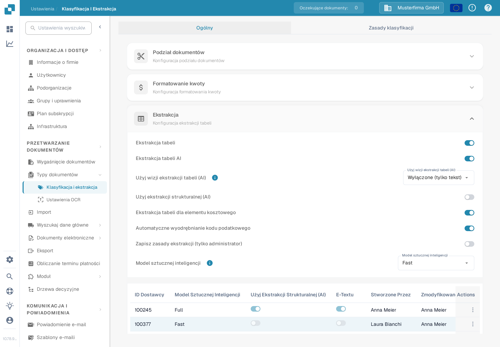

# Ekstrakcja tabeli dla elementu kosztowego

Elementy kosztowe to opłaty lub inne kwoty przedstawione jako pozycje w tabeli faktury. Jeśli ta funkcja jest włączona i dokument ma wyodrębnione pozycje, DocBits może klasyfikować te pozycje względem elementów kosztowych skonfigurowanych dla organizacji. Osoba weryfikująca może poprawić klasyfikację pozycji w tabeli dokumentu.

## Włączanie ustawienia

1. Otwórz **Ustawienia → Przetwarzanie dokumentów → Klasyfikacja i ekstrakcja**.
2. Pozostań na karcie **Ogólny** i rozwiń sekcję **Ekstrakcja**.
3. Znajdź **Ekstrakcja tabeli dla elementu kosztowego** poniżej pól wymaganych do ekstrakcji tabeli. Administrator może włączyć ten przełącznik dla organizacji.

<figure><figcaption>
Przełącznik jest wyłączony w syntetycznej organizacji testowej. Nie został zmieniony na potrzeby tego przewodnika.
</figcaption></figure>


Sam przełącznik nie tworzy elementów kosztowych ani pozycji faktury. Najpierw skonfiguruj elementy i zaimportuj wymagane dane. Połączony [przewodnik konfiguracji elementów kosztowych](../../../../infor-integration-and-configuration/importing-customer-master-data/m3/table-extraction-for-costing-element.md) pokazuje przykład M3. Inne ustawienia ekstrakcji opisuje sekcja [Klasyfikacja i ekstrakcja](README.md).


## Sprawdzanie lub poprawianie pozycji

Otwórz dokument, którego tabela faktury zawiera wyodrębnione pozycje, i odszukaj ikonę elementu kosztowego obok odpowiedniej pozycji. Wybierz ikonę, aby otworzyć dostępne klasyfikacje. Wybierz właściwy skonfigurowany element kosztowy albo wybierz opcję **Niekategoryzowane**, jeśli pozycja jest zwykłym artykułem. Następnie sprawdź wynikową pozycję i sumy przed zapisaniem dokumentu.

Jeśli ikona lub klasyfikacja jest niedostępna, najpierw upewnij się, że dokument ma wyodrębnione pozycje, funkcja jest włączona, a dla organizacji skonfigurowano element kosztowy. Syntetyczny dokument testowy użyty do tej kontroli dokumentacji nie miał wyodrębnionych pozycji faktury, więc menu klasyfikacji nie mogło zostać przedstawione ani przetestowane. Powyższe kroki odzwierciedlają bieżącą obsługę dokumentu; podczas tej kontroli nie zapisano żadnej klasyfikacji.
