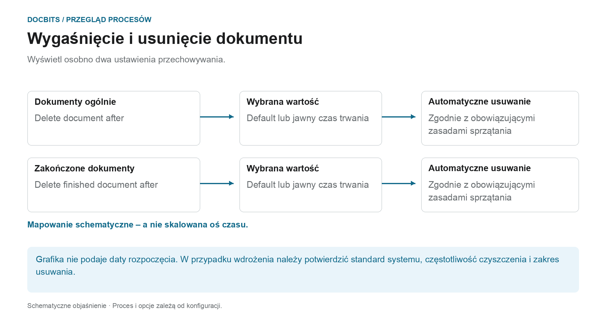

# Wygaśnięcie dokumentów

## Dwie reguły przechowywania zamiast ogólnego okresu usuwania

<figure><figcaption>
Wyświetl osobno dwa ustawienia przechowywania. Schemat ma charakter schematyczny; aktywne ustawienia Twojej organizacji określają rzeczywiste zachowanie.
</figcaption></figure>

Wygaśnięcie dokumentu odróżnia ogólne przechowywanie dokumentów od przechowywania dokumentów zakończonych. Sprawdź oba ustawienia wraz z wymaganiami procesu i zamierzonym archiwum docelowym.

| Ustawienie | Co powinieneś wyjaśnić |
| --- | --- |
| **Delete document after** | Która wartość przechowywania dokumentów jest faktycznie efektywna w Twojej organizacji. |
| **Delete finished document after** | Która wartość dotyczy dokumentów wypełnionych, w pełni przetworzonych i wyeksportowanych. |
| **Default** | Który standard systemu jest przechowywany w Twoim wdrożeniu. Sama nazwa nie wskazuje czasu trwania. |

Diagram **nie jest osią czasu narysowaną w odpowiedniej skali**. Nie określa technicznego początku okresu przechowywania ani tego, które ustawienie ma pierwszeństwo. Sama wartość rozwijana nie określa czasu usuwania z dokładnością do sekundy. Aby zapewnić niezawodne planowanie, należy również potwierdzić częstotliwość uruchamiania czyszczenia.

### Oddzielny eksport, przechowywanie i kopie zapasowe

Pomyślny eksport nie oznacza, że kopia DocBits została już usunięta. I odwrotnie, usunięcie dokumentu w DocBits nie powoduje usunięcia niezależnie zapisanej kopii ERP lub archiwum. Kopie zapasowe mogą mieć osobne zasady przechowywania; usunięcie dokumentu z aktywnego systemu nie oznacza, że ​​wszystkie kopie zapasowe zostały usunięte w tym samym czasie.

Przed wprowadzeniem zmian sprawdź terminy i uzgodnij archiwum docelowe oraz sposób postępowania z kopiami zapasowymi. Przegląd [Przechowywanie, przechowywanie i usuwanie danych](../../../security/data-storage-and-retention.md) wyjaśnia różnice pomiędzy dokumentami, plikami pośrednimi OCR, logami i kopiami zapasowymi.

<figure><figcaption>
Ustawienia wygaśnięcia dokumentów
</figcaption></figure>

W obszarze Przetwarzanie dokumentów → Wygaśnięcie dokumentów skonfiguruj przechowywanie dokumentów. Przed ich zmianą sprawdź obowiązujące ustawienia, archiwum docelowe i zakres usuwania dla swojej organizacji.

Automatyczne usuwanie kontrolują dwa ustawienia:

| Ustawienie | Co kontroluje |
|---------|------------------|
| **Delete document after** | Jak długo każdy przetworzony dokument jest przechowywany, zanim zostanie automatycznie usunięty. |
| **Usuń gotowy dokument po** | Jak długo dokument zakończony (w pełni przetworzony i wyeksportowany) jest przechowywany, zanim zostanie automatycznie usunięty. |

Dla każdego ustawienia wybierasz przedział czasu z listy rozwijanej:

<figure><figcaption>
Dostępne okresy przechowywania
</figcaption></figure>

| Opcja | Znaczenie |
|--------|---------|
| **Default** | Użyj domyślnego okresu przechowywania systemu (bez własnego nadpisania). |
| **48 Hours** | Wyraźna wartość przechowywania wynosząca 48 godzin; oddzielnie potwierdzić początek okresu i harmonogram sprzątania. |
| **1 Week** | Jawna wartość przechowywania wynosząca jeden tydzień. |
| **2 Weeks** | Jawna wartość przechowywania wynosząca dwa tygodnie. |
| **4 Weeks** | Wyraźna wartość przechowywania wynosząca cztery tygodnie. |

Te ustawienia obsługują planowane przechowywanie dokumentów. Nie zastępują one potwierdzenia obowiązujących okresów przechowywania, docelowego archiwum i postępowania z kopiami zapasowymi w Twojej organizacji.
