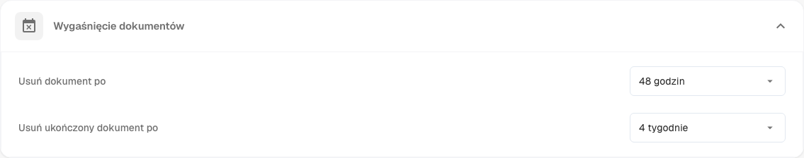
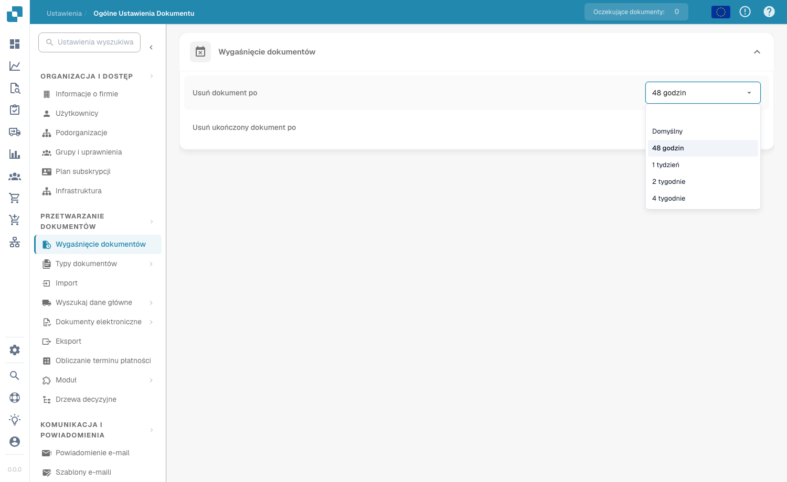

# Wygaśnięcie dokumentów

<figure><figcaption>
Ustawienia wygaśnięcia dokumentów
</figcaption></figure>

W sekcji **Document Processing → Documents Expiry** określasz, jak długo DocBits przechowuje Twoje dokumenty, zanim zostaną automatycznie usunięte. Pomaga to zarządzać przestrzenią dyskową, egzekwować zasady retencji danych i zachować zgodność z przepisami prawa lub regulacjami organizacji dotyczącymi okresu przechowywania dokumentów.

Automatyczne usuwanie kontrolują dwa ustawienia:

| Ustawienie | Co kontroluje |
|---------|------------------|
| **Delete document after** | Jak długo każdy przetworzony dokument jest przechowywany, zanim zostanie automatycznie usunięty. |
| **Usuń gotowy dokument po** | Jak długo dokument zakończony (w pełni przetworzony i wyeksportowany) jest przechowywany, zanim zostanie automatycznie usunięty. |

Dla każdego ustawienia wybierasz przedział czasu z listy rozwijanej:

<figure><figcaption>
Dostępne okresy przechowywania
</figcaption></figure>

| Opcja | Znaczenie |
|--------|---------|
| **Default** | Użyj domyślnego okresu przechowywania systemu (bez własnego nadpisania). |
| **48 Hours** | Usuń 48 godzin po przetworzeniu. |
| **1 Week** | Usuń po tygodniu. |
| **2 Weeks** | Usuń po dwóch tygodniach. |
| **4 Weeks** | Usuń po czterech tygodniach. |

Oba ustawienia gwarantują, że dokumenty nie są przechowywane w systemie dłużej, niż to konieczne — pozwala to uniknąć zbędnego zużycia przestrzeni dyskowej i utrzymuje przepływ dokumentów w porządku. Mają szczególne znaczenie dla organizacji, które muszą przestrzegać określonych wymogów regulacyjnych dotyczących retencji dokumentów.
