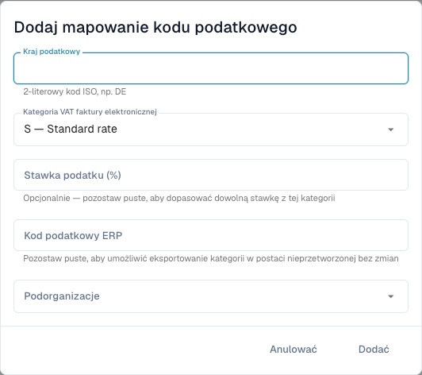

# Mapowanie kategorii VAT e-faktur na kody podatkowe ERP

<figure><figcaption>
Formularz mapowania podatków przed zapisaniem wpisu. Niektóre opisy kategorii pozostają po angielsku w bieżącym interfejsie; kody techniczne nie zmieniają się.
</figcaption></figure>

E-faktura może zawierać kategorię VAT, np. **S**, zamiast kodu podatkowego ERP. Mapowanie określa konwersję. Jest odrębne od korekty kwot podatku i reguł walidacji.

## Wymagania

Potrzebujesz praw administratora, kraju podatkowego, kategorii i stawki z faktury oraz ważnego kodu uzgodnionego z administratorem ERP. Potwierdź organizację i podorganizację. Strona musi być dostępna w używanej wersji.

## Dodawanie i kontrola

1. Otwórz **Ustawienia → Dokumenty elektroniczne → Mapowanie kodów podatkowych** i sprawdź wpisy.
2. Wybierz **Dodaj mapowanie kodu podatkowego**.
3. Wprowadź dwuliterowy kod ISO kraju podatkowego, np. `DE`.
4. Wybierz kategorię: **S** standardowa, **Z** zerowa, **E** zwolniona lub **O** poza zakresem. Nie zamieniaj kategorii, aby ominąć błąd.
5. Podaj procent dla konkretnej stawki. Puste pole dopasowuje każdą stawkę tej kategorii zgodnie z opisem formularza.
6. Wpisz kod ERP i właściwe podorganizacje. Pusty kod ERP jawnie dopuszcza eksport niezmienionej kategorii źródłowej; używaj tylko, jeśli cel ją obsługuje.
7. Dodaj i sprawdź zapisany kraj, kategorię, stawkę, kod, zakres i aktywność.
8. Przetestuj odpowiednią e-fakturę z kontrolowanym celem eksportu. Sprawdź faktyczny kod ERP i odpowiedź oraz przypadek błędnego/brakującego mapowania.

Niemiecka faktura `S` ze stawką `19` wymaga kodu skonfigurowanego dla tego przypadku. Pobierz prawdziwy kod z ERP; przykład nie jest domyślną wartością produkcyjną.

## Rozwiązywanie błędów

Porównaj kraj, kategorię, stawkę, zakres i aktywność. Sprawdź odpowiedź integracji przed ponowieniem eksportu o niepewnym wyniku. Usunięcie mapowania zmienia przyszłe operacje, nie cofa wcześniejszych eksportów.

Zobacz [Walidacja e-faktur](validation-rules.md) i [Eksport](../export.md).
