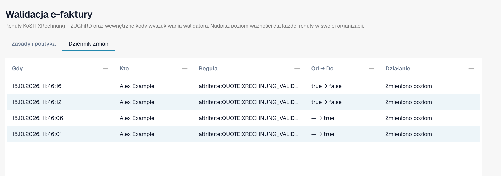

# Dziennik zmian

**Dziennik zmian** zapisuje każdą zmianę ustawień walidacji. Należy do strony [Walidacja e-faktury](validation-rules.md). Widzą go tylko administratorzy organizacji.

Otwórz kartę **Dziennik zmian** obok karty **Zasady i polityka**.

<figure><figcaption>
Dziennik zmian z czterema przykładowymi wpisami. Nazwa użytkownika jest zastąpiona przykładową nazwą.
</figcaption></figure>

| Kolumna | Co pokazuje |
| --- | --- |
| **Gdy** | Czas zmiany. |
| **Kto** | Użytkownik, który dokonał zmiany. |
| **Reguła** | Ustawienie lub reguła, która się zmieniła. |
| **Od → Do** | Stara i nowa wartość. |
| **Działanie** | Rodzaj zmiany. Wiersze z kreatora konfiguracji można otworzyć, aby zobaczyć pojedyncze zmiany. |

Lista pokazuje 50 wpisów na stronie.

Każda zmiana w tabeli [Walidacja dla każdego typu dokumentu](validation-per-document-type.md) tworzy wpis po jej potwierdzeniu.
