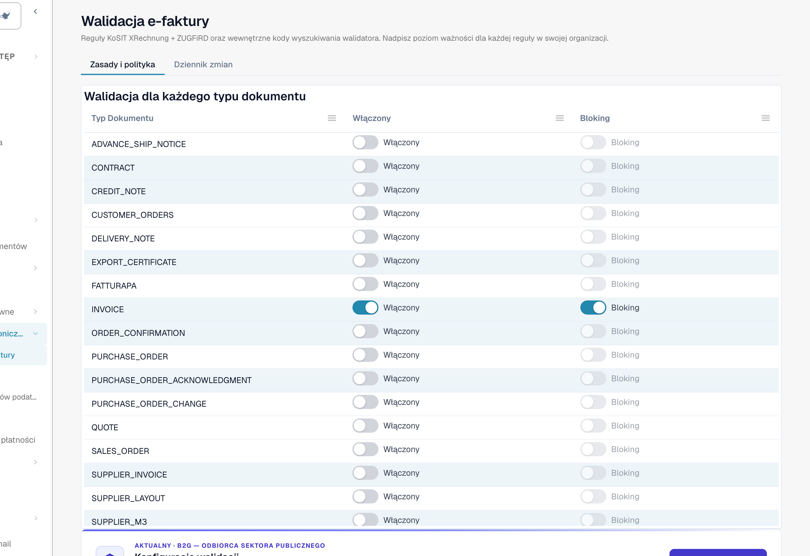

# Walidacja e-faktury

Strona **Walidacja e-faktury** (**Ustawienia → Dokumenty elektroniczne → Walidacja e-faktury**, ścieżka `/settings/einvoice-validation`; wcześniej nazywana *Reguły walidacji*) kontroluje sposób, w jaki DocBits weryfikuje przychodzące e-faktury. Opiera się na oficjalnym zestawie reguł **KoSIT XRechnung + ZUGFeRD** oraz wewnętrznych kodach wyników walidatora i pozwala nadpisać wagę każdej reguły dla Twojej organizacji.

> Ta strona dotyczy **e-faktur** (XRechnung, ZUGFeRD, Factur-X). To coś innego niż **Reguły walidacji danych**, które sprawdzają wyodrębnione pola dokumentu.

## Co znajdziesz na tej stronie

<figure><figcaption>
Strona Walidacja e-faktury. Karta <strong>Zasady i polityka</strong> zaczyna się od tabeli <strong>Walidacja dla każdego typu dokumentu</strong>. Przykładowa organizacja.
</figcaption></figure>

| Temat | Co robi | Kto |
| --- | --- | --- |
| [Konfiguracja walidacji i akceptowane wersje](validation-setup.md) | Kreator konfiguracji, akceptowane wersje XRechnung, akceptowane profile i znaczenie każdej wagi. | Administratorzy organizacji |
| [Wagi reguł](validation-rule-severities.md) | Tabela reguł: zmień wagę każdej reguły dla swojej organizacji. | Administratorzy organizacji |
| [Walidacja dla każdego typu dokumentu](validation-per-document-type.md) | Włącz walidację (**Włączony**) i zdecyduj, czy nieudana kontrola zatrzymuje dokument (**Bloking**). Każda zmiana wymaga potwierdzenia. | Administratorzy organizacji |
| [Dziennik zmian](validation-change-log.md) | Każda zmiana ustawień: kiedy, kto, jaka reguła, od → do. | Administratorzy organizacji |
| [Raport walidacyjny](validation-report.md) | Co widzi użytkownik, gdy faktura nie przejdzie kontroli: wyniki prostym językiem. Raport otwiera się z dokumentu, a nie z tej strony. | Wszyscy, którzy przetwarzają faktury |
| [Następny krok i odrzucenie dokumentu](validation-next-step-and-reject.md) | Co zrobić po przeczytaniu raportu, pobieranie raportu i **Odrzuć dokument**. | Wszyscy, którzy przetwarzają faktury |
