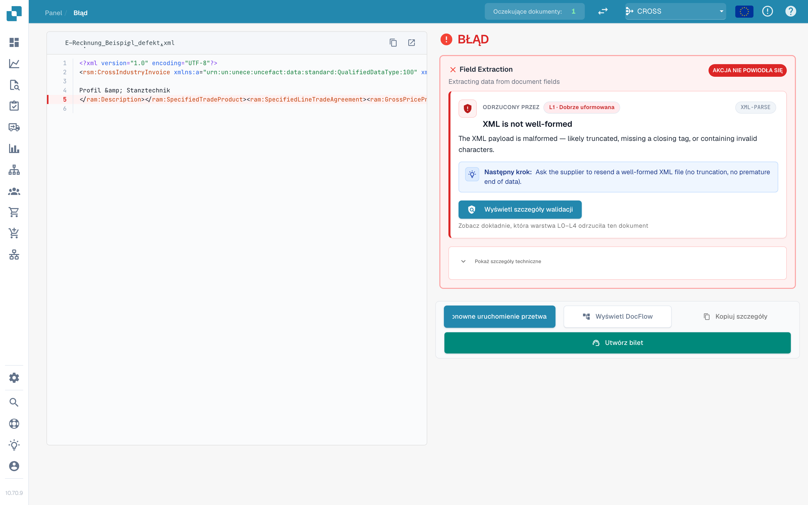
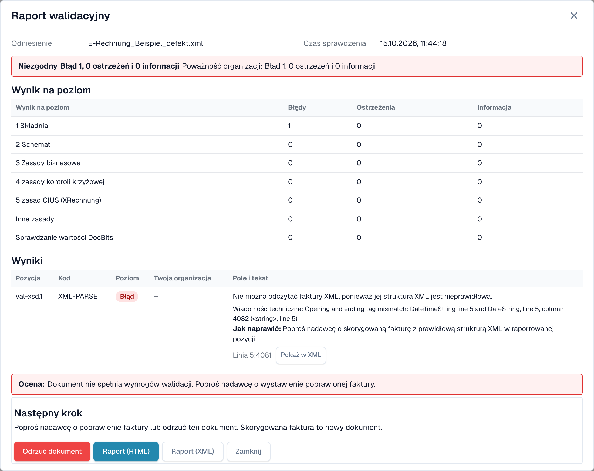

# Ekran błędu odrzuconej e-faktury

Gdy wgrasz błędną e-fakturę, DocBits jej nie gubi. Dokument dostaje status **Błąd**, a ekran błędu pokazuje, co jest nie tak, gdzie i co zrobić dalej. Ta strona pokazuje dwa przykłady: plik XML, który nie jest poprawnie sformułowany, oraz fakturę, która łamie regułę biznesową.

> Faktura dostaje status **Błąd** tylko wtedy, gdy walidacja jest **włączona** i **blokująca** dla jej typu dokumentu. Zobacz [Walidacja dla każdego typu dokumentu](validation-per-document-type.md).

## Przykład 1: plik XML jest uszkodzony

Dostawca wysyła plik XML, w którym znacznik zamykający nie pasuje do znacznika otwierającego. Pliku nie można odczytać, więc DocBits zatrzymuje się na pierwszej kontroli, **L1 · Dobrze uformowana**.

<figure><figcaption>
Ekran błędu dla uszkodzonego pliku XML. Błędna linia jest zaznaczona w XML. Przykładowy plik z fikcyjnymi danymi.
</figcaption></figure>

Ekran ma dwie strony:

* **Po lewej: plik XML.** DocBits pokazuje plik z numerami linii. Linia z problemem jest zaznaczona na czerwono. Przyciskami nad plikiem skopiujesz XML lub otworzysz go w nowej karcie.
* **Po prawej: wyjaśnienie.** Karta **Odrzucony przez** wskazuje kontrolę, która zatrzymała plik (tutaj **L1 · Dobrze uformowana**), oraz kod reguły (tutaj `XML-PARSE`). Poniżej widzisz tytuł (_XML is not well-formed_), krótkie wyjaśnienie i blok **Następny krok**.

Wybierz **Wyświetl szczegóły walidacji**, aby otworzyć pełny [raport walidacyjny](validation-report.md).

<figure><figcaption>
Raport uszkodzonego pliku: jeden błąd na poziomie 1 Składnia, z komunikatem technicznym i pozycją
</figcaption></figure>

Raport podaje dokładną pozycję (tutaj linia 5, kolumna 4081) i techniczny komunikat parsera XML. Wybierz **Pokaż w XML**, aby przejść do tej linii. Wskazówka **Jak naprawić** mówi, że należy poprosić nadawcę o poprawiony plik.

## Przykład 2: faktura łamie regułę biznesową

XML jest poprawny, ale brakuje wymaganego pola. Na przykład nie można zidentyfikować sprzedawcy, ponieważ brak identyfikatora sprzedawcy, identyfikatora rejestracyjnego lub identyfikatora VAT (reguła `BR-CO-26`).

<figure><figcaption>
Ekran błędu dla błędu reguły biznesowej: warstwa <strong>L3 · Zasady biznesowe</strong>, kod reguły i następny krok
</figcaption></figure>

Tutaj karta wskazuje warstwę **L3 · Zasady biznesowe** i kod `BR-CO-26`. Raport wymienia wszystkie wyniki faktury, zobacz [Raport walidacyjny](validation-report.md).

## Przyciski pod kartą

| Przycisk                               | Co robi                                                                                                           |
| -------------------------------------- | ----------------------------------------------------------------------------------------------------------------- |
| **Ponowne uruchomienie przetwarzania** | Uruchamia przetwarzanie dokumentu ponownie, na przykład po zmianie ustawienia. Kontrola używa bieżących ustawień. |
| **Wyświetl DocFlow**                   | Pokazuje przepływ pracy dokumentu.                                                                                |
| **Kopiuj szczegóły**                   | Kopiuje szczegóły błędu, na przykład do wiadomości dla administratora.                                            |
| **Utwórz bilet**                       | Otwiera zgłoszenie do wsparcia ze szczegółami błędu.                                                              |

Wybierz **Pokaż szczegóły techniczne** na karcie, aby zobaczyć surowe informacje techniczne.

## Co zrobić dalej

* **Błędy:** poproś nadawcę o poprawioną fakturę lub [odrzuć dokument](validation-next-step-and-reject.md). Poprawiona faktura to nowy dokument.
* **Tylko ostrzeżenia:** dokument nie jest blokowany. Możesz kontynuować.

## Powiązane strony

* [Raport walidacyjny](validation-report.md): wszystkie wyniki, poziom po poziomie.
* [Następny krok i odrzucenie dokumentu](validation-next-step-and-reject.md)
* [Walidacja dla każdego typu dokumentu](validation-per-document-type.md): włącz walidację i ustaw blokowanie.
