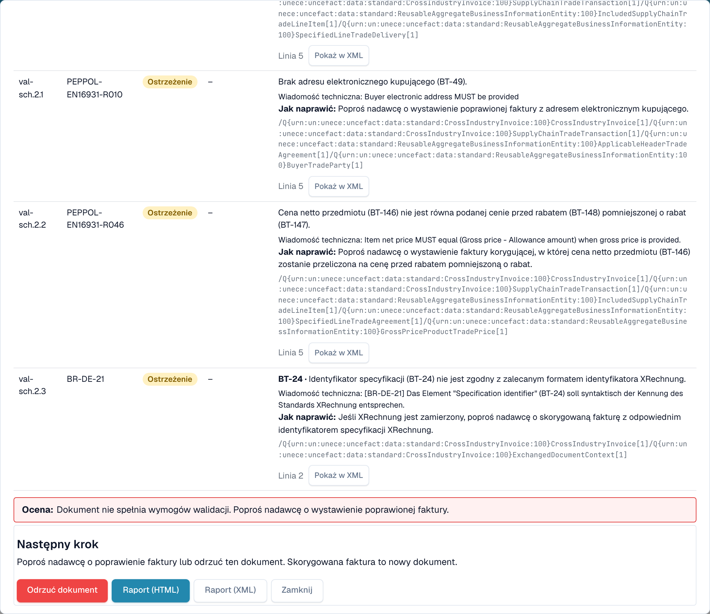
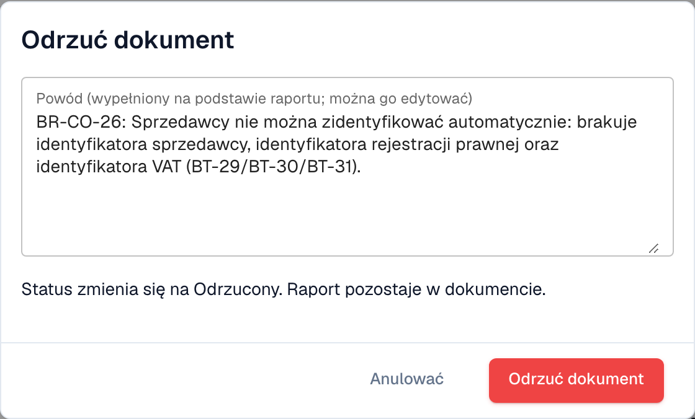

# Następny krok i odrzucenie dokumentu

Po przeczytaniu [raportu walidacyjnego](validation-report.md) raport podpowiada, co zrobić. Możesz też odrzucić dokument.

## Co zrobić dalej

<figure><figcaption>
Ocena, następny krok i przyciski na końcu raportu
</figcaption></figure>

**Ocena** mówi jednym zdaniem, czy faktura jest zgodna. Blok **Następny krok** mówi, co zrobić:

| Wynik                      | Następny krok                                                                                  |
| -------------------------- | ---------------------------------------------------------------------------------------------- |
| Co najmniej jeden **błąd** | Poproś nadawcę o poprawioną fakturę albo odrzuć dokument. Poprawiona faktura to nowy dokument. |
| Tylko **ostrzeżenia**      | Możesz kontynuować pracę z dokumentem.                                                         |

Przyciski na końcu raportu:

* **Odrzuć dokument**: otwiera okno odrzucenia (patrz niżej).
* **Raport (HTML)** i **Raport (XML)**: pobierają raport, na przykład aby wysłać go dostawcy.
* **Zamknij**: wraca do dokumentu.

## Odrzucanie dokumentu

<figure><figcaption>
Powód jest wypełniany na podstawie błędów z raportu. Możesz go edytować.
</figcaption></figure>

1. W raporcie wybierz **Odrzuć dokument**.
2. Sprawdź **Powód**. DocBits wypełnia go na podstawie błędów z raportu. Możesz edytować tekst.
3. Wybierz **Odrzuć dokument**, aby potwierdzić. Status zmienia się na **Odrzucony**. Powód jest zapisywany jako notatka, a raport pozostaje w dokumencie.

Wybierz **Anulować**, aby zostawić dokument bez zmian.

> **Odrzuć dokument** widzą tylko użytkownicy, którzy mogą edytować dokumenty. Przycisk jest ukryty, gdy dokument jest już odrzucony lub zakończony.
