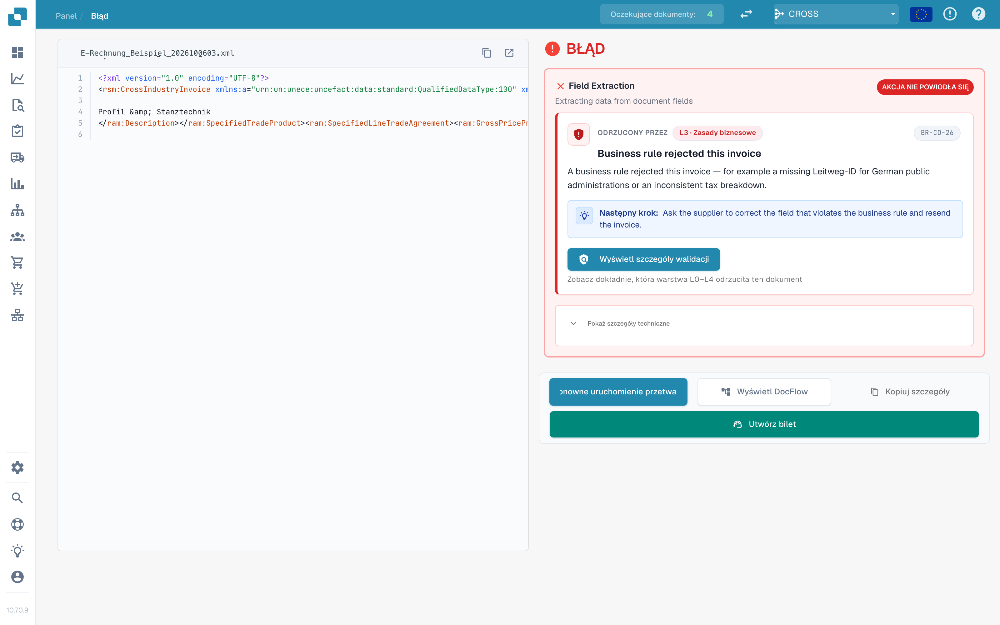
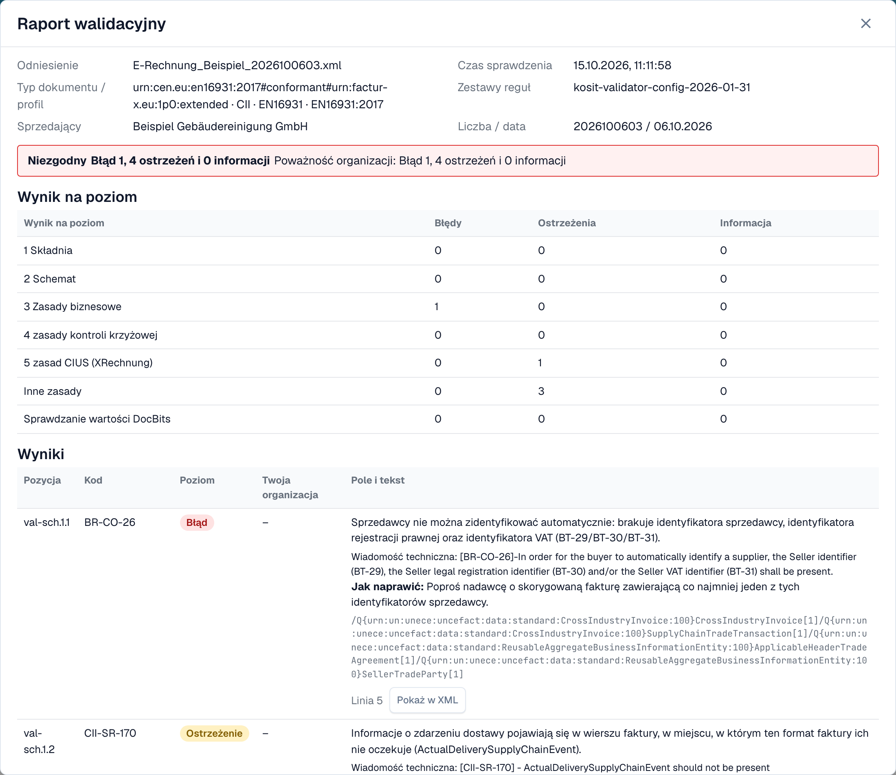
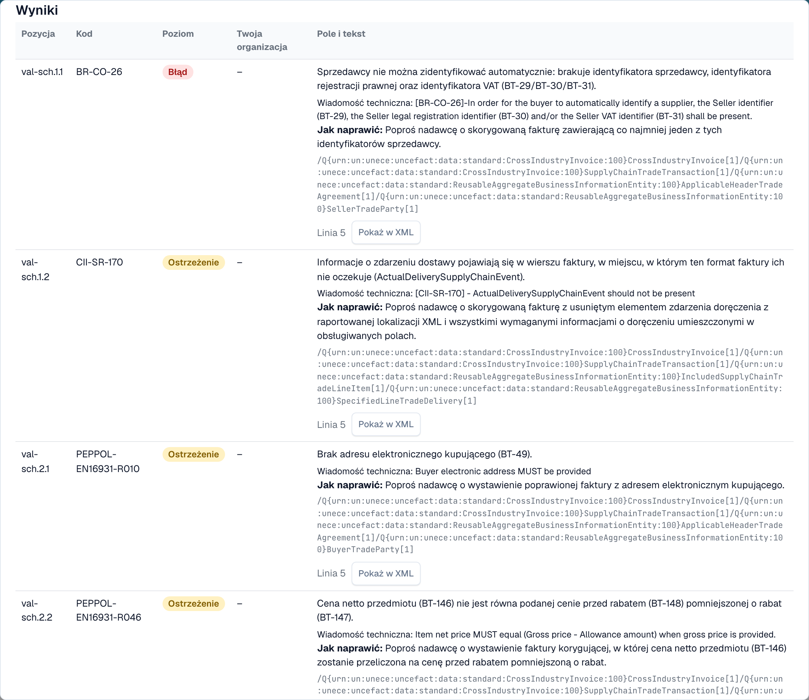

# Raport walidacyjny

Gdy DocBits odrzuca e-fakturę, możesz dokładnie przeczytać dlaczego. **Raport walidacyjny** wymienia każdy wynik prostym językiem, mówi, co poprawić, i pokazuje następny krok. Otwierasz go z dokumentu, a nie z ustawień. Ekran, na którym go znajdziesz, opisuje strona [Ekran błędu odrzuconej e-faktury](validation-error-screen.md).

Ta strona jest dla osób, które przetwarzają faktury. Administratorzy ustawiają reguły na stronie [Walidacja e-faktury](./) i wybierają dla każdego typu dokumentu, czy nieudana kontrola blokuje fakturę, zobacz [Walidacja dla każdego typu dokumentu](validation-per-document-type.md).

## Gdy dokument dostaje błąd

Jeśli walidacja jest **włączona** i **blokująca** dla danego typu dokumentu, faktura z wynikiem blokującym dostaje status **Błąd**. Otwórz dokument z panelu. Widok błędu pokazuje XML po lewej stronie, a powód po prawej.

<figure><figcaption>
Widok błędu: XML faktury i pierwszy wynik blokujący z następnym krokiem. Przykładowa faktura z fikcyjnymi nazwami.
</figcaption></figure>

Karta po prawej wskazuje warstwę, która odrzuciła fakturę (na przykład **L3 · Zasady biznesowe**), kod reguły (na przykład `BR-CO-26`), krótkie wyjaśnienie i **Następny krok**. Wybierz **Wyświetl szczegóły walidacji**, aby otworzyć pełny raport.

## Czytanie raportu

<figure><figcaption>
Górna część raportu: dane pliku, werdykt i wynik dla każdego poziomu
</figcaption></figure>

Raport zaczyna się od informacji o pliku:

| Pole                       | Co pokazuje                                                              |
| -------------------------- | ------------------------------------------------------------------------ |
| **Odniesienie**            | Nazwa pliku faktury.                                                     |
| **Czas sprawdzenia**       | Kiedy DocBits wykonał kontrolę. Zapisany raport nie zmienia się później. |
| **Typ dokumentu / profil** | Format faktury, na przykład CII i EN 16931.                              |
| **Zestawy reguł**          | Wersja zestawów reguł, których użył DocBits.                             |
| **Sprzedający**            | Sprzedawca odczytany z XML.                                              |
| **Liczba / data**          | Numer faktury i data faktury odczytane z XML.                            |

Pod danymi pliku widzisz **werdykt**, na przykład **Niezgodny**, z liczbą błędów, ostrzeżeń i informacji. Jeśli Twoja organizacja zmieniła wagę reguły, druga linia **Poważność organizacji** pokazuje liczby po uwzględnieniu ustawień organizacji.

### Wynik na poziom

Tabela **Wynik na poziom** pokazuje, ile błędów, ostrzeżeń i informacji znalazła każda kontrola. Kontrole opierają się na sobie nawzajem:

| Poziom                           | Co sprawdza                                                    |
| -------------------------------- | -------------------------------------------------------------- |
| **1 Składnia**                   | XML jest poprawnie zbudowany.                                  |
| **2 Schemat**                    | Struktura jest zgodna z oficjalnym schematem XML.              |
| **3 Zasady biznesowe**           | Wymagane pola są obecne i poprawne (reguły `BR-…`).            |
| **4 zasady kontroli krzyżowej**  | Pola są ze sobą zgodne, na przykład sumy.                      |
| **5 zasad CIUS (XRechnung)**     | Dodatkowe niemieckie reguły XRechnung.                         |
| **Inne zasady**                  | Dalsze reguły, na przykład reguły PEPPOL.                      |
| **Sprawdzanie wartości DocBits** | Kontrole dodawane przez DocBits, na przykład IBAN i numer VAT. |

> Dla faktur w profilu EN 16931 lub EXTENDED reguły specyficzne dla XRechnung są pokazywane jako **ostrzeżenia**, a nie jako błędy.

## Wyniki

<figure><figcaption>
Każdy wynik ma kod, poziom, zrozumiały tekst i wskazówkę, jak go naprawić
</figcaption></figure>

Każdy wynik to jeden wiersz:

* **Pozycja** i **Kod**: pozycja w raporcie i kod reguły, na przykład `BR-CO-26`.
* **Poziom**: **Błąd**, **Ostrzeżenie** lub **Informacja**.
* **Twoja organizacja**: poziom po uwzględnieniu ustawień Twojej organizacji. Myślnik oznacza, że Twoja organizacja nie zmieniła poziomu.
* **Pole i tekst**: problem prostym językiem, pole, którego dotyczy (na przykład _BT-29 Seller identifier_), techniczny komunikat walidatora i **Jak naprawić**.
* **Linia** i **Pokaż w XML**: wybierz **Pokaż w XML**, aby zamknąć raport i przejść do tej linii w podglądzie XML.

DocBits ma teksty prostym językiem dla najczęstszych reguł. Dla reguły bez takiego tekstu raport pokazuje techniczny komunikat walidatora.

## Dalej

* [Następny krok i odrzucenie dokumentu](validation-next-step-and-reject.md): co zrobić po przeczytaniu raportu.

## Powiązane strony

* [Walidacja e-faktury](./): akceptowane wersje, profile i waga każdej reguły.
* [Walidacja dla każdego typu dokumentu](validation-per-document-type.md): włączanie walidacji i ustawianie blokowania.
* [Routing powiadomień](../notification-routing.md): kto obsługuje który wynik.
