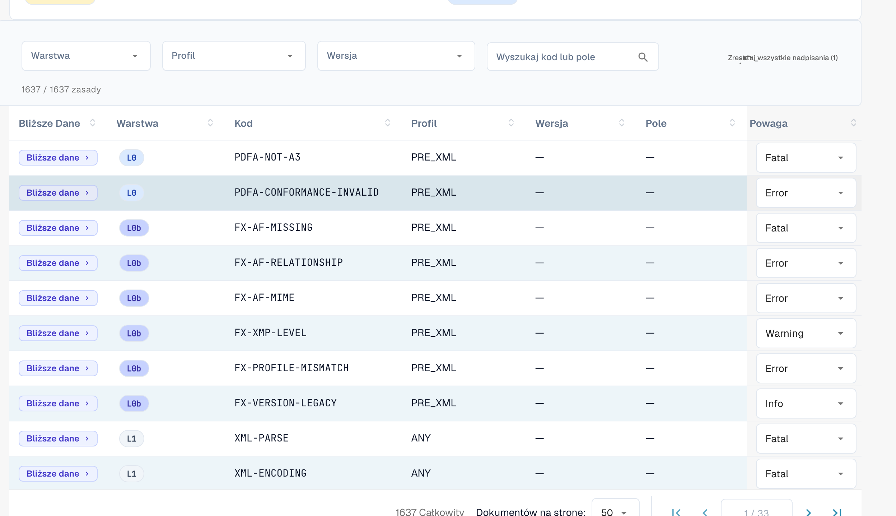

# Wagi reguł

Każda reguła walidacji ma wagę. Możesz zmienić wagę każdej reguły dla swojej organizacji. Ta strona należy do sekcji [Walidacja e-faktury](./). Wagi mogą zmieniać tylko administratorzy organizacji.

<figure><figcaption>
Pełna tabela reguł z nadpisaniem wagi dla każdej reguły
</figcaption></figure>

Tabela reguł wymienia każdą regułę walidacji (łącznie ponad 1600). Filtruj według **Warstwy (Layer)**, **Profilu** lub **Wersji** albo wyszukuj według kodu lub pola. Dla każdej reguły możesz nadpisać **Wagę** z listy rozwijanej, aby dopasować ją do polityki swojej organizacji — na przykład obniżyć regułę z `ERROR` do `WARNING`, aby nie odrzucała już dokumentu.

Znaczenie wag **FATAL**, **ERROR**, **WARNING** i **INFO** opisano na stronie [Konfiguracja walidacji i akceptowane wersje](validation-setup.md#akceptowane-profile-i-model-wagi). Zmieniona waga pojawia się też w [raporcie walidacyjnym](validation-report.md), w kolumnie **Twoja organizacja**.
