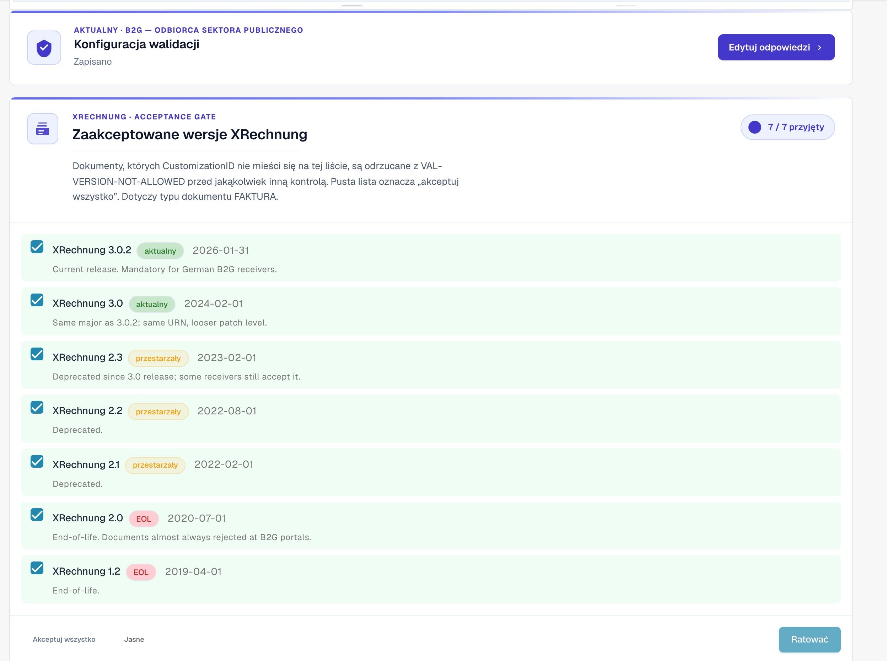
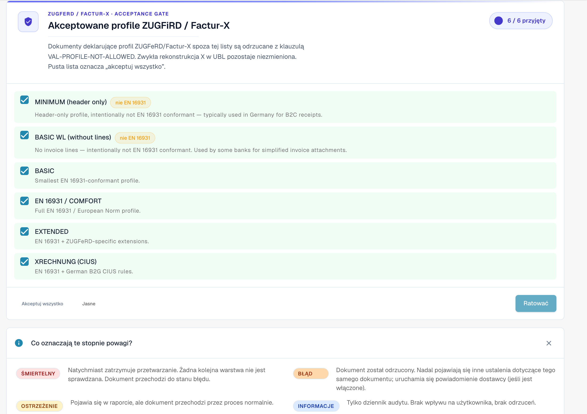

# Konfiguracja walidacji i akceptowane wersje

Ta strona opisuje kreator konfiguracji, akceptowane wersje XRechnung oraz akceptowane profile na stronie [Walidacja e-faktury](validation-rules.md). Te ustawienia mogą zmieniać tylko administratorzy organizacji.

## Konfiguracja walidacji

<figure><figcaption>
Konfiguracja walidacji i akceptowane wersje XRechnung
</figcaption></figure>

Karta **Konfiguracja walidacji** pokazuje Twój bieżący profil walidacji (na przykład *B2G — Public Sector Receiver*). Kliknij **Edytuj odpowiedzi**, aby ponownie uruchomić kreatora konfiguracji i zmienić standard, względem którego prowadzona jest walidacja.

## Akceptowane wersje XRechnung

Bramka **Akceptowane wersje XRechnung** wymienia każdą wersję XRechnung. Zaznacz wersje, które akceptujesz — dokumenty, których CustomizationID znajduje się poza tą listą, są odrzucane z kodem `VAL-VERSION-NOT-ALLOWED` przed jakąkolwiek inną kontrolą. Pusta lista oznacza „akceptuj wszystko". Każda wersja jest oznaczona jako **current**, **deprecated** lub **EOL** wraz z datą wydania.

## Akceptowane profile i model wagi

<figure><figcaption>
Akceptowane profile i znaczenie poszczególnych wag
</figcaption></figure>

Wybierz, które **profile** akceptujesz (BASIC WL, BASIC, EN 16931 / COMFORT, EXTENDED, XRECHNUNG (CIUS)), używając przycisków **Akceptuj wszystko** / **Wyczyść**, a następnie **Zapisz**.

Każda reguła walidacji ma **wagę**, która decyduje, co się dzieje po jej uruchomieniu:

| Waga | Skutek |
|------|--------|
| **FATAL** | Natychmiast zatrzymuje przetwarzanie. Żadna kolejna warstwa nie jest sprawdzana; dokument przechodzi w stan Błąd. |
| **ERROR** | Dokument jest odrzucany. Pozostałe wyniki dla tego samego dokumentu są nadal pokazywane; powiadomienie dostawcy (jeśli włączone) jest wyzwalane. |
| **WARNING** | Pojawia się w raporcie walidacji, ale dokument przechodzi przez potok normalnie. |
| **INFO** | Tylko dziennik audytu. Brak widocznego efektu dla użytkownika i brak odrzucenia. |

### Co zmienia kreator

Karta **Konfiguracja walidacji** niżej na stronie otwiera kreatora przyciskiem **Edytuj odpowiedzi**. Kreator zastępuje cały zestaw nadpisanych reguł Twojej organizacji. DocBits ostrzega Cię przed zapisem. Sprawdź dokładnie krok **Review and apply**.

Dalej: [Wagi reguł](validation-rule-severities.md) i [Walidacja dla każdego typu dokumentu](validation-per-document-type.md).
