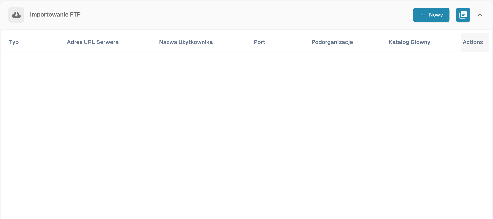

# Import

W ustawieniach importu można określić sposób obsługi dokumentów oraz skonfigurować automatyczny odbiór przez FTP lub pocztę. Otwórz **Ustawienia → Przetwarzanie dokumentów → Import**.

## Opcje dokumentów

Sprawdź limit stron, domyślny termin płatności w dniach i format daty. Limit stron może powodować odrzucenie stron przekraczających ustawioną liczbę. Wartość domyślna opisana dla tej funkcji wynosi 60 stron; przed importem porównaj ją z konfiguracją własnej organizacji.

## Import FTP

Potrzebny jest zgodny serwer FTP, zatwierdzone dane połączenia oraz wydzielony katalog importu dostępny dla konta serwera.

<figure><figcaption>
Przegląd połączeń importu FTP.
</figcaption></figure>

### Konfiguracja połączenia

Utwórz nowe połączenie. Kreator zaczyna od konfiguracji serwera, a następnie udostępnia opcje i konfigurację importu.

<figure><figcaption>
Konfiguracja serwera w kreatorze importu FTP.
</figcaption></figure>

| Ustawienie | Znaczenie |
| --- | --- |
| Protokół i port | Wybierz FTP, FTPS lub SFTP oraz port podany przez administratora serwera. |
| Serwer i dane logowania | Adres serwera oraz konto uprawnione do odczytu katalogu importu. |
| Wzorce nazw plików | Ograniczają import do pasujących nazw. |
| Podorganizacja | Określa przypisanie importowanych dokumentów. |
| Klucz API | Jeżeli jest udostępniany przez konfigurację, musi odpowiadać właściwej organizacji. Nie publikuj jego wartości. |
| Katalog główny i katalog importu | Wskazują lokalizację plików na serwerze. |
| Archiwizacja po imporcie | Przenosi poprawnie zaimportowane pliki do wskazanego katalogu archiwum. Konto musi mieć odpowiednie uprawnienia. |
| Uwzględnianie podkatalogów | Rozszerza wyszukiwanie plików na katalogi podrzędne. |

Sprawdź wszystkie etapy przed zapisaniem. Po zapisaniu kontroluj oddzielnie, czy połączenie jest aktywne. Dostępne działania obejmują test połączenia, dzienniki, aktywację lub dezaktywację, edycję i usunięcie. Przeczytaj wynik testu i dzienniki przed uruchomieniem regularnego importu. Obrazy pokazują listę oraz niezapisany początek kreatora, nie sprawdzone połączenie z serwerem.

## Import poczty {#email-import}

Połączenie pocztowe pobiera dokumenty z własnej skrzynki przez IMAP lub OAuth Microsoft365. Przekazywanie poczty na adres dostarczony przez DocBits jest oddzielną metodą: zobacz [Poczta przychodząca](../module/inbound-emails.md).

### Obsługiwane załączniki

Importowane typy dokumentów obejmują `.pdf`, `.tiff` / `.tif`, `.eml`, `.dat`, `.xml`, `.edi` i `.purchaseorder`.

DocBits rozpoznaje dokument również po rzeczywistej zawartości, a nie tylko po typie zadeklarowanym przez serwer poczty. Jest to istotne, gdy przekazany załącznik otrzymuje ogólny typ `application/octet-stream` zamiast `application/pdf` lub `application/xml`.

* Przekazane wiadomości `.eml` i załączniki Outlook `winmail.dat` (TNEF) są rozpakowywane, aby zaimportować zawarte dokumenty.
* XML z ogólnym typem jest rozpoznawany po deklaracji `<?xml`, z obsługą początkowego BOM UTF-8 lub UTF-16 (LE/BE). Obecnie tylko te kodowania BOM są automatycznie wykrywane na podstawie zawartości. Nazwa kończąca się `.xml` umożliwia import niezależnie od kodowania.
* Obrazy osadzone w wiadomości, takie jak logotypy podpisów i grafiki PNG, JPG, GIF lub BMP, są pomijane i nie liczą się jako nieudane importy.
* Jeśli włączono odpowiedź po nieudanym imporcie dla adresu przychodzącego, powiadomienie trafia na skonfigurowany adres odpowiedzi.

### Połączenie IMAP

W sekcji importu poczty utwórz połączenie i wybierz IMAP. Sprawdź szyfrowanie SSL lub TLS, serwer, port, nazwę konfiguracji lub użytkownika, adres e-mail i hasło. Wybierz właściwą podorganizację i adres do powiadomień o błędach. Jeżeli konfiguracja pokazuje klucz API, sprawdź kontekst organizacji.

Po utworzeniu połączenia można wybrać katalog pocztowy i przenoszenie przetworzonych wiadomości do innego katalogu. Jeśli opcje nie są jeszcze dostępne, otwórz zapisane połączenie do edycji. Zależnie od konfiguracji można również łączyć załączone dokumenty, wysyłać potwierdzenie do nadawcy oraz blokować import powtórzonej nazwy pliku. Sprawdź temat i treść potwierdzenia przed jego włączeniem.

Zapisanie i aktywacja to oddzielne działania. Menu połączenia może udostępniać test połączenia, dzienniki połączenia i importu, edycję, aktywację, dezaktywację oraz usunięcie.

### OAuth Office365

Utwórz połączenie pocztowe i wybierz OAuth Office365. Rozpocznij uwierzytelnianie Microsoft. Jeśli wyświetlany jest kod urządzenia, skopiuj kod z DocBits na wskazaną stronę Microsoft i zaloguj się właściwym kontem. Wróć do DocBits i zakończ uwierzytelnianie.

Sprawdź podorganizację, katalog, opcjonalną skrzynkę współdzieloną, katalog docelowy przetworzonych wiadomości i adres powiadomień o błędach. Sprawdź również kierowanie dokumentów do DocBits lub AI Workforce, jeżeli ta opcja jest dostępna. Zapisz konfigurację i świadomie wybierz moment aktywacji lub rozpoczęcia importu. Wariant OAuth Office365 – Tenant wymaga danych rejestracji aplikacji organizacji; omów je z administratorem i sprawdź [Pocztę przychodzącą](../module/inbound-emails.md).

### Dzienniki importu

Dzienniki połączenia pomagają badać problemy komunikacji; dzienniki importu pokazują wyniki poprzednich importów. Zbiorczy dziennik sekcji poczty obejmuje skonfigurowane połączenia. Można filtrować według tematu lub nadawcy, sortować nagłówkami i zmieniać kolejność kolumn. Zbadaj komunikat przed ponownym importem.
