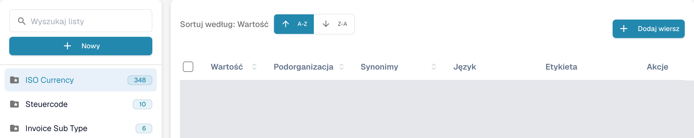
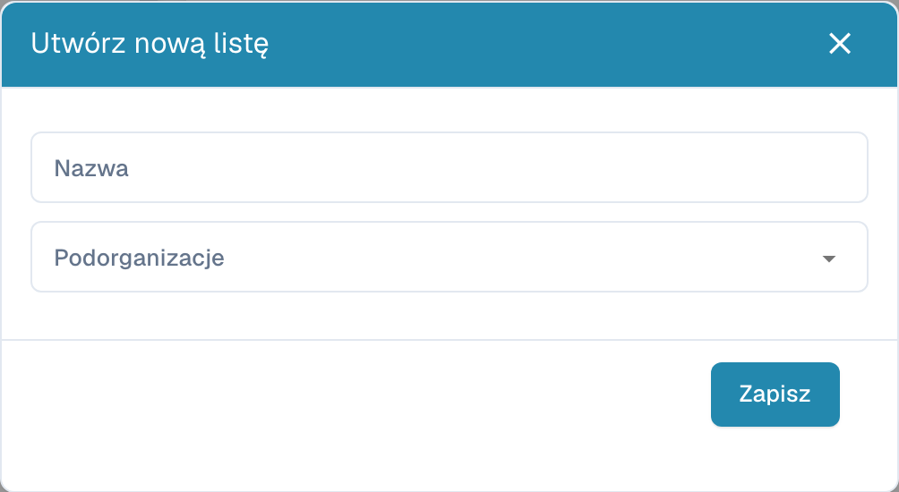
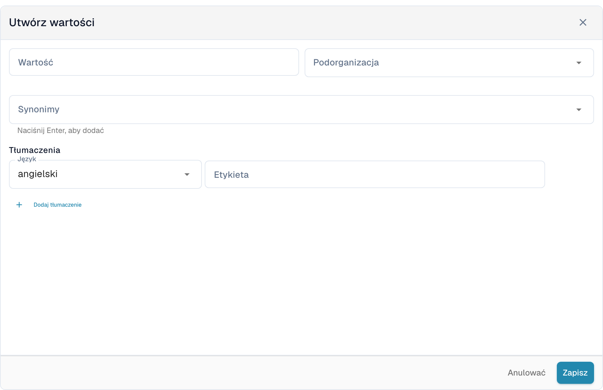

# Listy wartości

## Samouczek wideo: Dane główne i listy wartości


Źródła danych głównych, listy wartości i ustawienia danych głównych w DocBits


Film pokazuje źródła danych głównych, listy wartości oraz ustawienia danych głównych typu dokumentu.

Listy wartości zawierają wstępnie zdefiniowane opcje pól dokumentu. Pole może korzystać z listy, aby wyświetlać opcje podczas walidacji. Etykiety mogą mieć tłumaczenia; wartość techniczna jest taka sama we wszystkich językach.

## Otwieranie list

W ustawieniach otwórz dane podstawowe i wybierz listy wartości. Pole **Wyszukaj listy** po lewej stronie pozwala znaleźć listę. Wybierz jej nazwę, aby otworzyć wartości po prawej stronie. Folder z gwiazdką oznacza listę systemową; liczba obok nazwy wskazuje liczbę wczytanych wartości.

<figure><figcaption>
Listy wartości z ukrytymi skonfigurowanymi nazwami.
</figcaption></figure>

<figure><figcaption>
Wybrana lista systemowa otwiera tabelę wartości. A-Z i Z-A sortują wartości; Dodaj wiersz otwiera formularz. Wartości i własne nazwy są ukryte; nazwy list systemowych, takie jak ISO Currency, są istniejącymi danymi.
</figcaption></figure>

## Tworzenie listy

1. Wybierz **Nowy** nad nazwami list.
2. Uzupełnij pole **Nazwa** i w razie potrzeby wybierz **Podorganizacje**, aby ograniczyć zakres listy.
3. **Zapisz** tworzy listę. **X** zamyka okno bez tworzenia listy.

<figure><figcaption>
Nowy otwiera puste okno Utwórz nową listę z polami Nazwa i Podorganizacje oraz przyciskami X i Zapisz. Widok nie przedstawia zapisanej listy.
</figcaption></figure>

Aby usunąć listę utworzoną przez swoją organizację, użyj opcji usuwania w menu z trzema kropkami obok jej nazwy i potwierdź tylko właściwą listę. Listy systemowe nie mają tego menu usuwania i nie można ich usuwać.

## Dodawanie i zmienianie wartości

1. Wybierz listę po lewej stronie, a następnie **Dodaj wiersz** nad tabelą.
2. Wprowadź techniczną **Wartość** i w razie potrzeby wybierz pole **Podorganizacja**.
3. Dodaj potrzebne **Synonimy**. Każdy z nich potwierdź klawiszem **Enter**, aby dodać go do pola.
4. W sekcji **Tłumaczenia** wybierz **Język** i uzupełnij pole **Etykieta**. Etykieta nie może być pusta. Nowa wartość wymaga co najmniej jednego pełnego tłumaczenia.
5. **Zapisz** tworzy wartość. **Anulować** lub **X** zamyka formularz bez zapisywania.

<figure><figcaption>
Dodaj wiersz otwiera Utwórz wartości pod tabelą: Wartość, Podorganizacja, Synonimy, Język, Etykieta i Dodaj tłumaczenie. Zapisz tworzy wartość; Anulować odrzuca niezapisany szkic.
</figcaption></figure>

Aby edytować wartość, wybierz jej wiersz lub opcję edycji w kolumnie **Akcje**. Chronione pola pozostają tylko do odczytu; wartość techniczna także może być zablokowana, gdy istnieją już tłumaczenia. **Anulować** odrzuca niezapisane zmiany.

Opcja duplikowania w menu wiersza tworzy inną wartość. Aby skopiować kilka wartości, zaznacz ich pola wyboru i użyj przycisku kopiowania nad tabelą. Usuwanie jest dostępne dla wartości własnej organizacji i usuwa wybraną wartość; wartości systemowe nie mają tej akcji. Lista systemowa może zawierać zarówno wartości chronione, jak i wartości własnej organizacji.

## Import CSV

Ten interfejs nie udostępnia dawnego importu CSV z menu **Akcje**. Poprzednie kroki przesyłania pliku CSV nie dotyczą tego ekranu; użyj **Dodaj wiersz**, aby wprowadzić tutaj wartości.

## Dodawanie tłumaczeń

W formularzu wartości wybierz **Język** i uzupełnij pole **Etykieta**. **Dodaj tłumaczenie** dodaje kolejny język i jego etykietę. Przed zapisaniem uzupełnij lub usuń dodatkowe puste wiersze tłumaczeń. Jeżeli wiersz tłumaczenia można usunąć, jego kosz najpierw usuwa go z formularza; zapisz, aby zastosować zmianę.

Wyświetlany tekst może zależeć od języka, ale wartość techniczna pozostaje taka sama. Bez etykiety dla aktywnego języka pojawia się wartość techniczna. Wartości systemowe i odziedziczone tłumaczenia mogą mieć chronione pola; zmieniaj tylko dane swojej organizacji, których pola można edytować.
