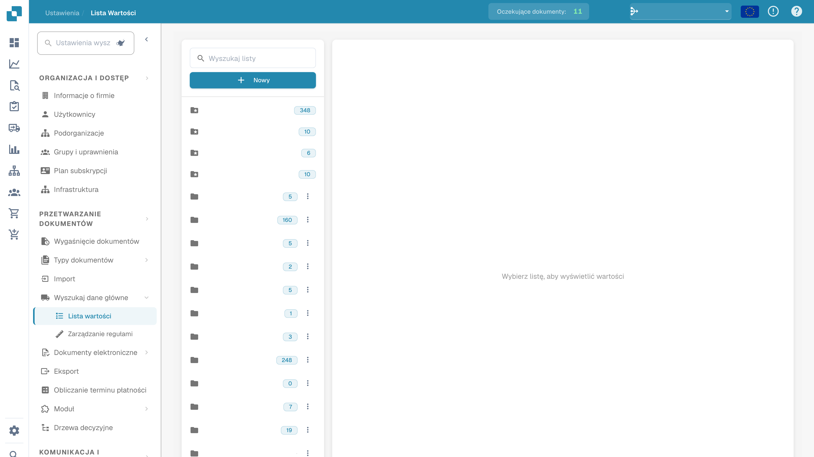

# Listy wartości

Listy wartości zawierają wstępnie zdefiniowane opcje pól dokumentu. Pole może korzystać z listy, aby wyświetlać opcje podczas walidacji. Etykiety mogą mieć tłumaczenia; wartość techniczna jest taka sama we wszystkich językach.

## Otwieranie list

Otwórz dane podstawowe i listy wartości w ustawieniach. Wybierz listę, aby sprawdzić wartości. Skonfigurowane nazwy są ukryte.

<figure><figcaption>
Listy wartości z ukrytymi skonfigurowanymi nazwami.
</figcaption></figure>

## Tworzenie listy

1. Wybierz utworzenie nowej listy.
2. Wprowadź nazwę i w razie potrzeby ogranicz listę do podorganizacji.
3. Sprawdź dane przed zapisaniem.

Listy domyślne są dostarczane przez system i nie można ich usuwać. Przed usunięciem własnej listy sprawdź korzystające z niej pola: działanie może mieć natychmiastowy skutek.

## Dodawanie i zmienianie wartości

Otwórz właściwą listę i dodaj wiersz. Sprawdź właściwości każdej wartości:

| Właściwość | Znaczenie |
| --- | --- |
| Wartość | Wartość techniczna zapisywana przez DocBits, jednakowa dla wszystkich języków. |
| Etykieta | Tekst wybranego języka. Bez etykiety dla aktywnego języka pojawia się wartość techniczna. |
| Język | Język etykiety. |
| Podorganizacje | Zakres dostępności; bez ograniczenia wartość dotyczy wszystkich podorganizacji. |
| Synonimy | Warianty wartości, na przykład EURO i € dla EUR. Potwierdź każdy synonim w przeznaczonym polu. |

Sprawdź wszystkie właściwości przed zapisaniem. Edycja i usuwanie zależą od uprawnień oraz wybranej wartości. Wartości systemowych nie można usuwać.

## Import CSV

Otwórz działania listy i wybierz import CSV. Wybierz plik oraz prawidłowy separator, na przykład `;` lub `,`. Sprawdź strukturę i zawartość przed importem.

## Dodawanie tłumaczeń

Dodaj język przy wartości i wprowadź etykietę. Powtórz dla pozostałych języków, sprawdź dane i zapisz. Można dodawać etykiety językowe do wartości systemowych, których nie można usuwać.

Tłumaczenie etykiety nie zmienia wartości technicznej. Po zamierzonych zmianach sprawdź pole w walidacji i wybranym języku. Obraz pokazuje odczyt list; nie potwierdza zapisania zmian ani wykonania importu.
