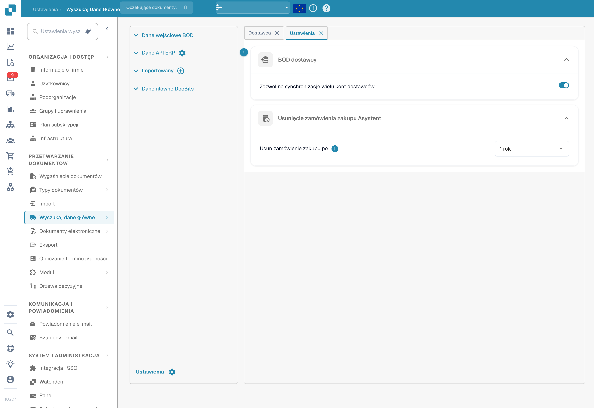

# Wyszukiwanie danych podstawowych

## Samouczek wideo: Dane główne i listy wartości


Źródła danych głównych, listy wartości i ustawienia danych głównych w DocBits


Film pokazuje źródła danych głównych, listy wartości oraz ustawienia danych głównych typu dokumentu.




**Wyszukiwanie danych podstawowych** (pasek boczny: **Lookup Master Data**) umożliwia przeglądanie danych podstawowych, których DocBits używa do walidacji danych wyodrębnionych z dokumentów względem systemu ERP, oraz zarządzanie nimi. Jest to niezbędne do precyzyjnego PO matchingu, walidacji dostawców i automatycznego uzupełniania pól. Otwórz tę stronę z poziomu **Ustawienia → Przetwarzanie dokumentów → Lookup Master Data**.

<figure><figcaption>
Wyszukiwanie danych podstawowych: źródła i tabela dostawców z ukrytymi wartościami.
</figcaption></figure>

## Źródła danych

Panel po lewej stronie wyświetla cztery kategorie źródeł danych:

| Źródło | Opis |
|--------|------|
| **BOD Input Data** | Dane otrzymywane za pośrednictwem komunikatów Infor BOD (Business Object Document). |
| **ERP API Data** | Dane pobierane bezpośrednio z systemu ERP za pośrednictwem API. Kliknij ikonę koła zębatego, aby skonfigurować połączenie API. |
| **Imported** | Dane zaimportowane ręcznie (na przykład przez przesłanie pliku CSV). Kliknij ikonę **+**, aby dodać nowe dane. |
| **DocBits Master Data** | Wewnętrzne dane podstawowe zarządzane w DocBits. |

## Tabela danych

Po wybraniu źródła danych jego dane są otwierane po prawej stronie w przeszukiwalnej, sortowalnej tabeli:

* **Karty** – każda karta to typ danych podstawowych (na przykład Dostawca, Zamówienie zakupu, Pozycja).
* **Wyszukiwanie** – filtruj według kolumny (**Search by column**) lub wyszukuj według tekstu (**Search String**).
* **Akcje** – aktualizowanie etykiet kolumn, ukrywanie pustych kolumn, aktualizowanie aliasów lub pobieranie danych jako CSV.
* **Stronicowanie** – poruszaj się po dużych zbiorach danych za pomocą elementów sterujących stronami.

Tabele Dostawca i Zamówienie zakupu zawierają kolumny takie jak ID dostawcy, Nazwa dostawcy, Adres, Bank Id, Numer PO, ID pozycji, Opis, Ilość, Cena jednostkowa, Kwota łączna, Waluta i Status, a także pola niestandardowe.

## Ustawienia

Kliknij **Settings** (ikona koła zębatego) w lewym dolnym rogu panelu źródeł danych, aby otworzyć ustawienia danych podstawowych.

<figure><figcaption>
Ustawienia synchronizacji dostawców i okresu przechowywania zamówień zakupu.
</figcaption></figure>

### BOD dostawcy

**Zezwalaj na synchronizację wielu kont dostawców**

* **Włączone**: pojedynczy dostawca może mieć wiele elementów `<FinancialParty>` w BOD (często z powodu wielu numerów IBAN lub kont finansowych). Wszystkie wpisy `<FinancialParty>` są wyodrębniane i zapisywane w tabeli dostawców, dzięki czemu można przechowywać wiele atrybutów finansowych.
* **Wyłączone**: wyodrębniany jest tylko ostatni znaleziony dla dostawcy element `<FinancialParty>`. Wcześniejsze atrybuty finansowe (na przykład dodatkowe numery IBAN) są ignorowane i zapisywane są tylko dane z ostatniego wystąpienia.

### Asystent usuwania zamówień zakupu

**Delete Purchase Order After** – wybierz, kiedy zamknięte zamówienia zakupu mają zostać usunięte. Po wybranym okresie rekordy są usuwane automatycznie.


Aby dowiedzieć się, jak wczytać dane podstawowe do DocBits, zobacz [Importowanie danych podstawowych](../../../infor-integration-and-configuration/importing-customer-master-data/).

