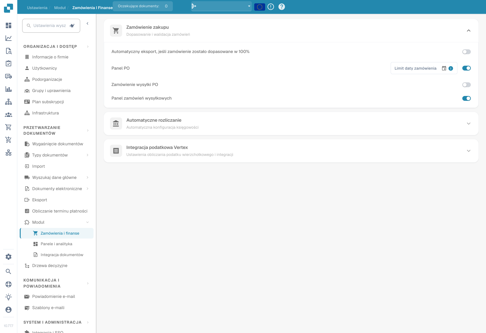
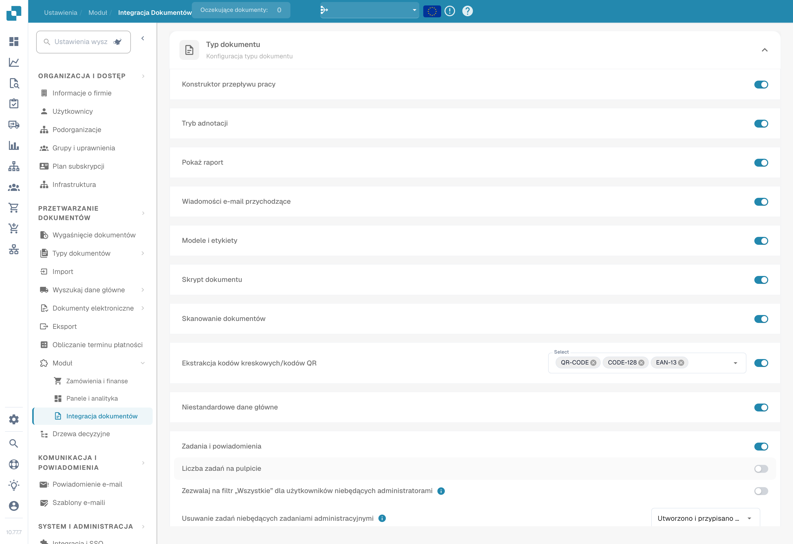
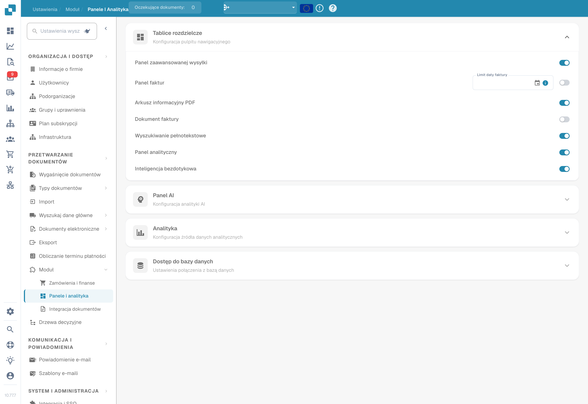

# Moduł

## Samouczek wideo: Przegląd ustawień i moduły


Przegląd ustawień i moduły w DocBits


Film pokazuje pięć grup przeglądu ustawień, wyszukiwarkę i szybkie linki oraz to, czym sterują trzy strony modułów.

<figure><figcaption>
Moduły zamówień i finansów w istniejącym stanie konfiguracji. Opis integracji Vertex zawiera błędne określenie „podatku wierzchołkowego”; dotyczy on usługi podatkowej Vertex.
</figcaption></figure>

<figure><figcaption>
Moduły integracji dokumentów: skrypty, skanowanie, kody kreskowe i niestandardowe dane podstawowe. W przedstawionej wersji etykieta wyboru kodów kreskowych „Select” pozostaje angielska.
</figcaption></figure>

<figure><figcaption>
Moduły pulpitów i analiz w istniejącym stanie konfiguracji.
</figcaption></figure>

Strona Module pozwala włączać i wyłączać opcjonalne funkcje w DocBits. Każda sekcja grupuje powiązane moduły, które można włączyć lub wyłączyć.

## Zamówienie zakupu

Ustawienia PO Matching i walidacji.

| Ustawienie | Opis |
|---------|-------------|
| **Auto Export if PO matched 100%** | Automatycznie eksportuje dokument, gdy dopasowanie PO osiągnie 100%. |
| **PO Dashboard** | Włącza dashboard zamówień zakupu. Zawiera pole **PO Date Limit**, które ogranicza dane PO według daty. |
| **PO Shipment Order** | Włącza przetwarzanie zleceń wysyłkowych powiązanych z zamówieniami zakupu. |
| **Panel zamówień wysyłki** | Włącza dedykowany dashboard dla zleceń wysyłkowych. |

## Automatyczne księgowanie

| Ustawienie | Opis |
|---------|-------------|
| **Auto Accounting** | Włącza automatyczne księgowanie dokumentów. Wybierz typ ERP (np. LN, M3). |

## Panele

| Ustawienie | Opis |
|---------|-------------|
| **Panel wysyłkowy z wyprzedzeniem** | Dashboard do monitorowania zaawansowanych działań związanych z wysyłkami. |
| **Invoice Dashboard** | Dashboard do monitorowania i analizy faktur. |
| **Wyszukiwanie pełnotekstowe** | Włącza wyszukiwanie pełnotekstowe we wszystkich dokumentach. |
| **Analytics Dashboard** | Włącza dashboard z przeglądem analitycznym. |

## Dostęp do bazy danych

| Ustawienie | Opis |
|---------|-------------|
| **DB Access** | Włącza bezpośredni dostęp do bazy danych dla organizacji. |

## Panel AI

| Ustawienie | Opis |
|---------|-------------|
| **AI Document Warehouse** | Analityka magazynu dokumentów oparta na AI. |
| **Dashboard v2** | Zaktualizowany dashboard z ulepszonymi funkcjami. |
| **Clickhouse Direct Access** | Włącza bezpośredni dostęp do bazy danych Clickhouse. |
| **Supplier Statistics** | Włącza statystyki i raportowanie na poziomie dostawców. |

## Wysyłka i dostawca

| Ustawienie | Opis |
|---------|-------------|
| **Supplier Portal** | Włącza portal dostawców, umożliwiający współpracę z dostawcami. |

## Typ dokumentu

| Ustawienie | Opis |
|---------|-------------|
| **Workflow Builder** | Tworzenie i dostosowywanie workflowów przetwarzania dokumentów. |
| **Annotation Mode** | Pozwala użytkownikom adnotować dokumenty w widoku walidacji. |
| **Show Report** | Włącza generowanie raportów dla dokumentów. |
| **Inbound Emails** | Włącza obsługę przychodzących e-maili dla poszczególnych typów dokumentów. |
| **Models & Labels** | Zarządzanie modelami AI i etykietami do rozpoznawania dokumentów. |
| **Document Script** | Włącza własne skrypty do przetwarzania dokumentów. |
| **Document Scan** | Włącza funkcję skanowania dokumentów. |
| **Kod kreskowy/QR Ekstrakcja kodu** | Wyodrębnia dane z kodów kreskowych i kodów QR w dokumentach. Wybierz obsługiwane typy kodów. |
| **Custom Master Data** | Włącza własne pola danych podstawowych. |
| **Tasks & Notifications** | Włącza zarządzanie zadaniami i powiadomienia. Zawiera przełącznik **Dashboard Tasks Count**. |
| **DocBits Operator** | Włącza funkcję automatyzacji przeglądarki DocBits Operator. |
| **DocNet** | Włącza DocNet, czyli sieciową wymianę dokumentów. |
| **IDM ACL Updater** | Aktualizuje listy kontroli dostępu (ACL) w Infor Document Management. Prześlij plik ION-Mapping i skonfiguruj mapowania Infor-Doctype na ACL. |
| **Barcode Assignment** | Włącza przypisywanie kodów kreskowych do dokumentów. |
| **Ustaw znak ujemny dla not kredytowych** | Automatycznie stosuje znak ujemny do kwot not kredytowych. |

## Strumień połączenia BOD

| Ustawienie | Opis |
|---------|-------------|
| **BOD Connection Stream** | Włącza integrację BOD (Business Object Document). Wyświetla **Stream Name** używaną w połączeniu. |

## Analityka

| Ustawienie | Opis |
|---------|-------------|
| **Use PostgreSQL for Quality Analytics** | Przełączanie między Prometheus (czas rzeczywisty, dane resetowane przy wdrożeniu) a PostgreSQL (trwałe przez 90 dni, analiza trendów, najgorzej działające pola). |

## Integracja podatkowa Vertex

| Ustawienie | Opis |
|---------|-------------|
| **Integracja podatkowa Vertex** | Włącza obliczanie podatków przez Vertex. Skonfiguruj **Base URL**, **Client ID** i **Client Secret**. Użyj **Test Connection**, aby zweryfikować połączenie. |
