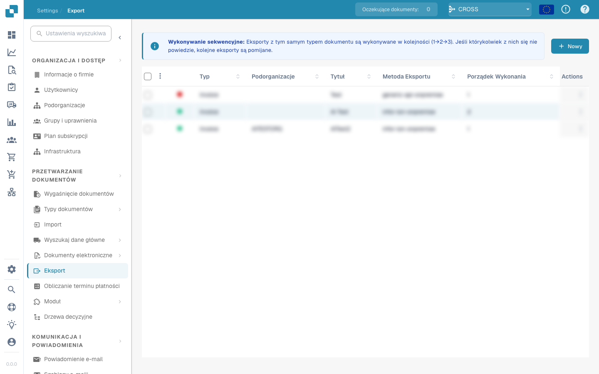

# Automatyczny eksport przy zgodności z PO wynoszącej 100%

### Przegląd

Opcja **Auto Export if PO matched 100%** w module zamówień zakupu (PO) pozwala, aby pełna zgodność z PO umożliwiła dalsze przetwarzanie bieżącej faktury lub dokumentu w kierunku automatycznego eksportu. Zamówienie zakupu stanowi punkt odniesienia do porównania; ta opcja nie eksportuje samego zamówienia.

### Działanie

Po włączeniu opcji sprawdzany jest wynik dopasowania bieżącego dokumentu do PO. Zgodność wynosząca 100% spełnia ten warunek dopasowania, ale nie gwarantuje natychmiastowego eksportu. Walidacja dokumentu, skonfigurowany proces eksportu, wymagane zatwierdzenia i oczekujące zadania mogą nadal blokować lub opóźniać eksport. Niepełne dopasowanie blokuje automatyczny eksport na podstawie tego warunku.

### Korzyści

* **Wydajność:** Może ograniczyć pracę ręczną przy fakturach w pełni zgodnych z PO i spełniających pozostałe wymagania.
* **Kontrola:** Wykorzystuje wynik dopasowania do PO jako dodatkowy warunek eksportu.
* **Czas przetwarzania:** Może przyspieszyć obsługę kwalifikujących się faktur; termin eksportu zależy od pozostałych warunków procesu.

### Użycie

1. **Włączenie funkcji:**
   * Otwórz **Ustawienia** → **Przetwarzanie dokumentów** → **Moduł** → **Zamówienie zakupu**.
   * Włącz przełącznik **Auto Export if PO matched 100%**.

<figure><figcaption></figcaption></figure>

2. **Monitorowanie przetwarzania:**
   * Sprawdź status dopasowania, walidacji i eksportu bieżącej faktury.
   * Jeśli nie została wyeksportowana mimo zgodności 100%, sprawdź konfigurację eksportu, wymagane zatwierdzenia i oczekujące zadania.
3. **Kontrola konfiguracji:**
   * Upewnij się, że kryteria dopasowania i ustawienia eksportu odpowiadają zamierzonemu procesowi.
   * Regularnie przeglądaj wyeksportowane faktury i wyjątki.

### Kiedy używać tej funkcji?

* **Duża liczba faktur:** Gdy wiele faktur można wiarygodnie dopasować do zamówień zakupu.
* **Powtarzalne zakupy:** Gdy ilości, ceny i pozostałe kryteria dopasowania są stabilne.
* **Pilne przetwarzanie:** Gdy kwalifikujące się faktury mają przechodzić dalej automatycznie po spełnieniu wszystkich warunków.

Gdy dopasowanie do zamówienia jest aktywne dla danego typu dokumentu, oddzielna opcja `ALLOW_AUTO_EXPORT_FOR_NON_MATCHABLE_PO_LINES` dopuszcza także status `NO_MATCHABLE_PO_LINES`. Nie zezwala ogólnie na eksport przy innych stanach niepełnego dopasowania.
