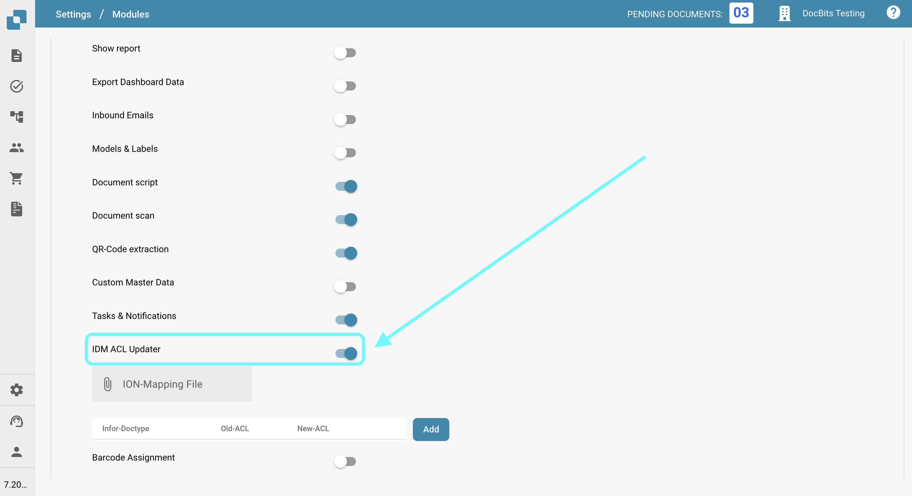
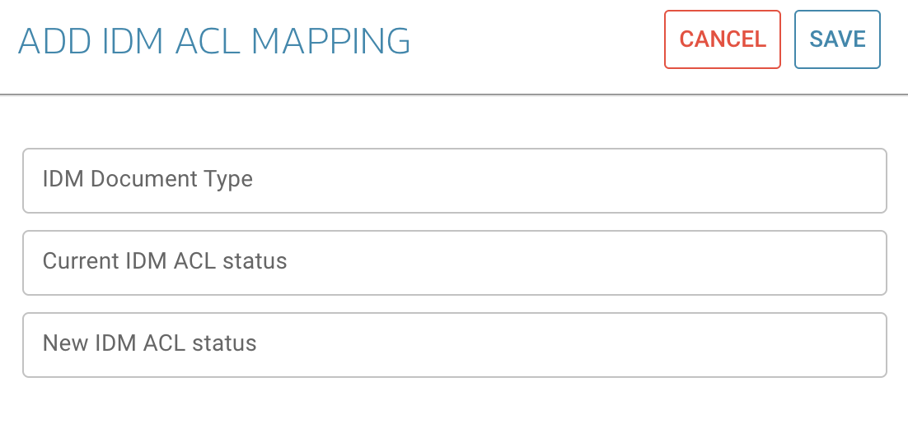

# IDM ACL Updater

## Przegląd

Moduł ACL-Updater jest odpowiedzialny za aktualizację i zarządzanie listami kontroli dostępu (ACL) w DocBits. Zapewnia to wprowadzenie odpowiednich uprawnień i środków bezpieczeństwa w zakresie dostępu do dokumentów i ich obsługi.

## Instrukcje aktywacji

Aby aktywować moduł ACL-Updater, wykonaj następujące kroki:

1. Przejdź do **Ustawienia**.
2. Wybierz **Przetwarzanie dokumentów**.
3. Select **Module**.
4. Przejdź do **Typ dokumentu**.
5. Aktywuj **IDM ACL-Updater**, włączając odpowiedni suwak.

Po aktywowaniu modułu możesz wybrać **ION plik mapowania** do użycia.

<figure><figcaption></figcaption></figure>

### Dodawanie informacji ACL

Aby dodać informację ACL, kliknij przycisk **Dodaj**. Następnie możesz określić następujące szczegóły:

* **IDM Document Type**
* **Current IDM ACL Status**
* **New IDM ACL Status**

<figure><figcaption></figcaption></figure>

