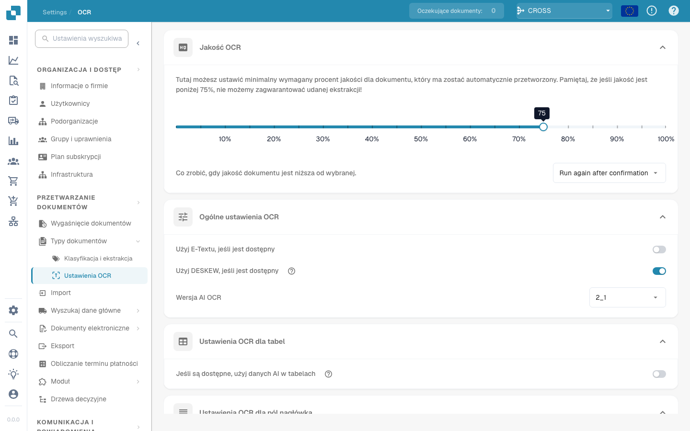

# Ustawienia OCR

## Przegląd

W ustawieniach **OCR (optyczne rozpoznawanie znaków)** możesz skonfigurować sposób stosowania OCR podczas przetwarzania dokumentu. Obejmuje to określenie minimalnej wymaganej jakości, wybór, czy używać osadzonego tekstu (e-tekstu), wybór wersji OCR i nie tylko. Na tej stronie znajduje się szczegółowy opis wszystkich dostępnych ustawień.

## Otwieranie ustawień OCR

Aby uzyskać dostęp do ustawień OCR:

*   Przejdź do: **Ustawienia** → **Przetwarzanie dokumentów** → **OCR Ustawienia**

    <figure><figcaption></figcaption></figure>

## Jakość OCR

W tej sekcji możesz ustawić minimalną jakość dokumentu wymaganą do przetwarzania OCR, dostosowując suwak jakości. Przesuń suwak w lewo lub w prawo, aby odpowiednio zmniejszyć lub zwiększyć próg jakości.

Jeżeli dokument nie spełnia określonego poziomu jakości, DocBits udostępnia trzy możliwości jego obsługi:

* **Run Anyway**\
  Dokument zostanie rozpatrzony bez względu na jego jakość.
* **Uruchom ponownie po potwierdzeniu**\
  **DocBits** zatrzyma się i poprosi o potwierdzenie, czy kontynuować przetwarzanie.
* **Throw Error**\
  Przetwarzanie dokumentu zostanie całkowicie zatrzymane i wyświetlony zostanie komunikat o błędzie wskazujący, że dokument nie osiągnął wymaganego progu jakości.

<figure><figcaption></figcaption></figure>

## Ogólne ustawienia OCR

* **Użyj e-tekstu, jeśli jest dostępny**\
  Po włączeniu **DocBits** użyje osadzonego tekstu elektronicznego (np. z plików PDF) zamiast wykonywać OCR. Poprawia to zarówno szybkość, jak i dokładność, ponieważ tekst jest wyodrębniany bezpośrednio, bez konieczności przetwarzania OCR.
* **Użyj DESKEW, jeśli jest dostępny**\
  Ta opcja automatycznie koryguje wyrównanie zeskanowanych dokumentów. Prostowanie przekrzywionych obrazów pomaga poprawić dokładność OCR.
*   **AI OCR Version**\
    Umożliwia wybranie konkretnej wersji silnika OCR opartego na AI.\
    Może to być przydatne, jeśli:

    * Przy aktualnie wybranej wersji nie osiągasz pożądanych rezultatów.
    * Rozwiązujesz problemy związane z wydajnością lub dokładnością OCR.

    <figure><figcaption></figcaption></figure>

## Ustawienia OCR dla tabel

* **Użyj AI danych dla tabel, jeśli są dostępne**\
  Po włączeniu DocBits będzie używać danych OCR w tabelach zamiast osadzonego tekstu elektronicznego (E-Tekst) — nawet jeśli włączona jest opcja **Użyj E-tekstu, jeśli jest dostępny**.

## Ustawienia OCR dla pól nagłówka

* **Użyj wyodrębniania reguł**\
  DocBits zastosuje predefiniowane reguły ekstrakcji do identyfikacji pól nagłówka.
* **Use AI Extraction**\
  DocBits użyje AI do automatycznego wykrywania i wyodrębniania pól nagłówka.

**Execution Order:**\
Jeśli obie opcje są włączone, **DocBits** przeprowadzi wyodrębnianie w następującej kolejności:\
**Wyodrębnianie reguł → AIWyodrębnianie**\
\
<mark style="color:red;">**Uwaga**</mark>: Aby uzyskać najlepsze wyniki i spójne działanie, włącz obie opcje. Dzięki temu **DocBits** może używać zarówno metod opartych na regułach, jak i metod opartych na AI w połączeniu podczas ekstrakcji nagłówka.
