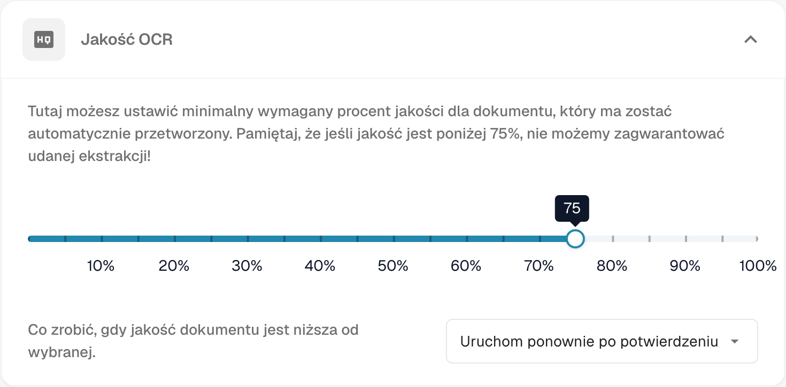
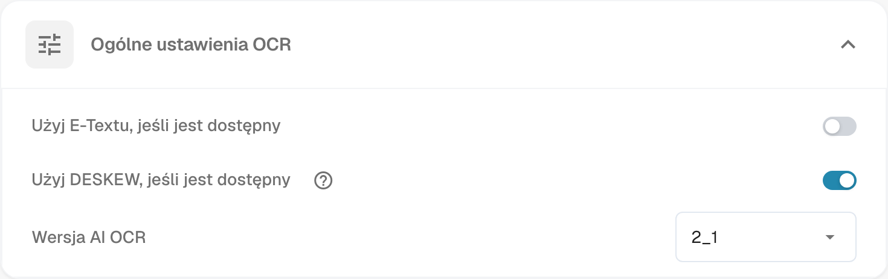
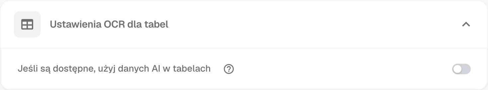
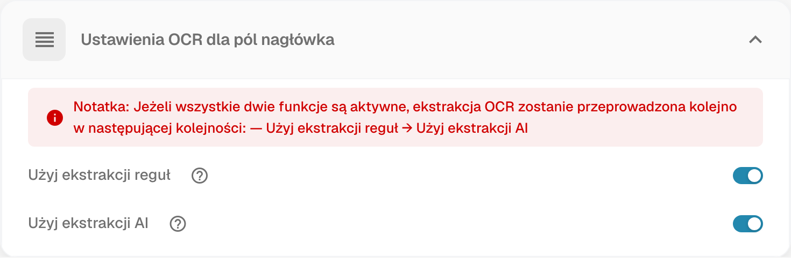

# Ustawienia OCR

## Przegląd

W ustawieniach **OCR (optyczne rozpoznawanie znaków)** możesz skonfigurować sposób stosowania OCR podczas przetwarzania dokumentu. Obejmuje to określenie minimalnej wymaganej jakości, wybór, czy używać osadzonego tekstu (e-tekstu), wybór wersji OCR i nie tylko. Na tej stronie znajduje się szczegółowy opis wszystkich dostępnych ustawień.

## Otwieranie ustawień OCR

Aby uzyskać dostęp do ustawień OCR:

*   Przejdź do: **Ustawienia** → **Przetwarzanie dokumentów** → **Ustawienia OCR**

Zrzuty ekranu pokazują przykład bieżącej konfiguracji. Próg 75% i widoczne stany przełączników nie oznaczają ustawień domyślnych.

## Jakość OCR

W tej sekcji możesz ustawić minimalną jakość dokumentu wymaganą do przetwarzania OCR, dostosowując suwak jakości. Przesuń suwak w lewo lub w prawo, aby odpowiednio zmniejszyć lub zwiększyć próg jakości.

Jeżeli dokument nie spełnia określonego poziomu jakości, DocBits udostępnia trzy sposoby postępowania. Poniżej opisano ich znaczenie:

* **Przetwarzanie mimo niskiej jakości**\
  Dokument zostanie rozpatrzony bez względu na jego jakość.
* **Uruchom ponownie po potwierdzeniu**\
  **DocBits** zatrzyma się i poprosi o potwierdzenie, czy kontynuować przetwarzanie.
* **Zatrzymanie z błędem**\
  Przetwarzanie dokumentu zostanie całkowicie zatrzymane i wyświetlony zostanie komunikat o błędzie wskazujący, że dokument nie osiągnął wymaganego progu jakości.

<figure><figcaption>
Jakość OCR: próg jakości i sposób postępowania z dokumentami poniżej tego progu.
</figcaption></figure>

## Ogólne ustawienia OCR

* **Użyj E-Textu, jeśli jest dostępny**\
  Po włączeniu **DocBits** użyje osadzonego tekstu elektronicznego (np. z plików PDF) zamiast wykonywać OCR. Poprawia to zarówno szybkość, jak i dokładność, ponieważ tekst jest wyodrębniany bezpośrednio, bez konieczności przetwarzania OCR.
* **Użyj DESKEW, jeśli jest dostępny**\
  Ta opcja automatycznie koryguje wyrównanie zeskanowanych dokumentów. Prostowanie przekrzywionych obrazów pomaga poprawić dokładność OCR.
*   **Wersja AI OCR**\
    Umożliwia wybranie konkretnej wersji silnika OCR opartego na AI.\
    Może to być przydatne, jeśli:

    * Przy aktualnie wybranej wersji nie osiągasz pożądanych rezultatów.
    * Rozwiązujesz problemy związane z wydajnością lub dokładnością OCR.

<figure><figcaption>
Ogólne ustawienia OCR: korzystanie z osadzonego tekstu, prostowanie obrazu i wybór wersji OCR.
</figcaption></figure>

## Ustawienia OCR dla tabel

* **Jeśli są dostępne, użyj danych AI w tabelach**\
  Po włączeniu DocBits będzie używać danych OCR w tabelach zamiast osadzonego tekstu elektronicznego (E-Tekst) — nawet jeśli włączona jest opcja **Użyj E-Textu, jeśli jest dostępny**.

<figure><figcaption>
Ustawienia OCR dla tabel z opcją korzystania z danych AI, jeśli są dostępne.
</figcaption></figure>

## Ustawienia OCR dla pól nagłówka

* **Użyj ekstrakcji reguł**\
  DocBits zastosuje predefiniowane reguły ekstrakcji do identyfikacji pól nagłówka.
* **Użyj ekstrakcji AI**\
  DocBits użyje AI do automatycznego wykrywania i wyodrębniania pól nagłówka.

**Kolejność ekstrakcji:**\
Jeśli obie opcje są włączone, **DocBits** przeprowadzi wyodrębnianie w następującej kolejności:\
**Ekstrakcja reguł → Ekstrakcja AI**\
\
<mark style="color:red;">**Uwaga**</mark>: Aby uzyskać najlepsze wyniki i spójne działanie, włącz obie opcje. Dzięki temu **DocBits** może używać zarówno metod opartych na regułach, jak i metod opartych na AI w połączeniu podczas ekstrakcji nagłówka.

<figure><figcaption>
Ustawienia OCR dla pól nagłówka z opcjami ekstrakcji opartej na regułach i AI.
</figcaption></figure>
