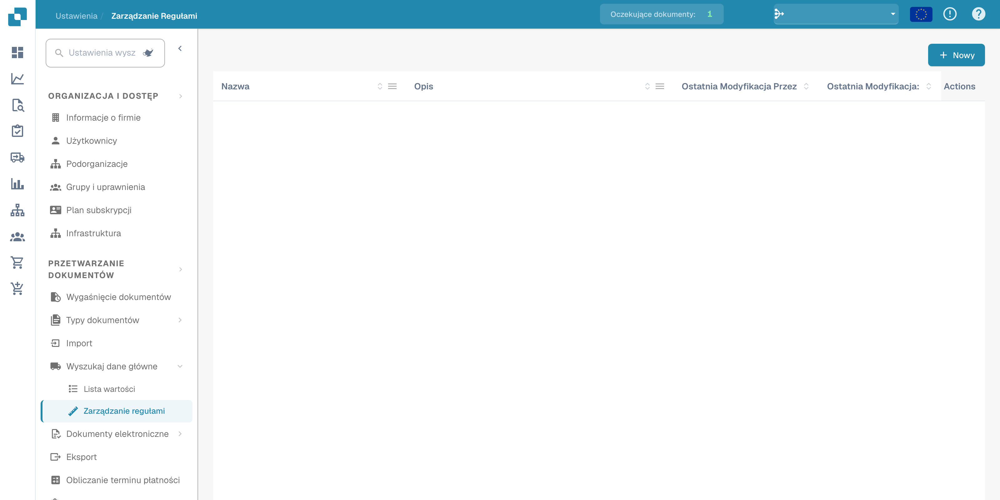
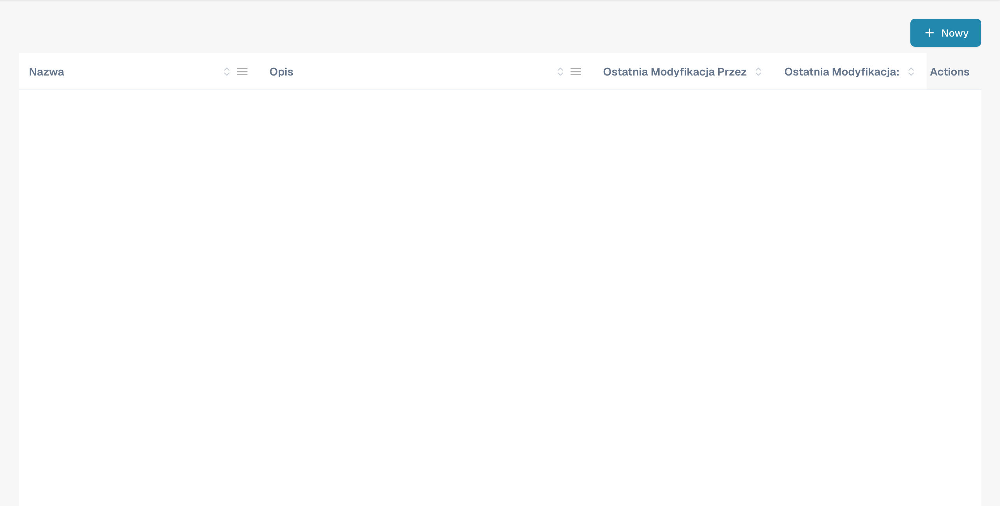
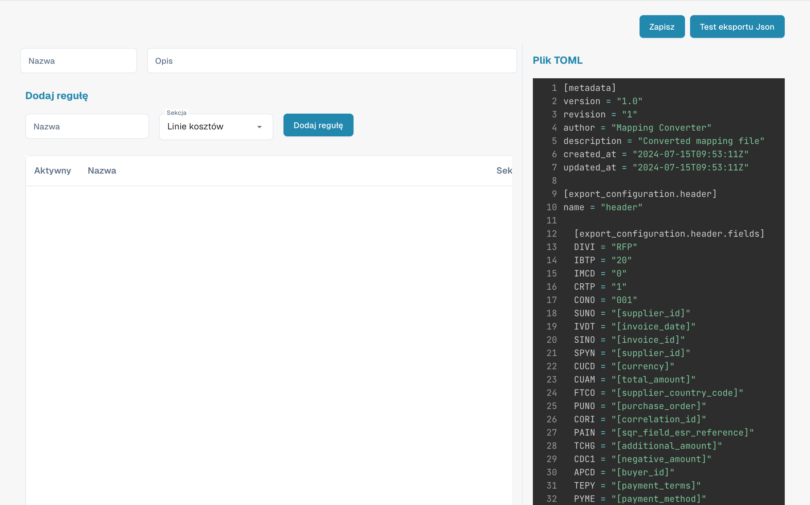

# Zarządzanie regułami

<figure><figcaption>
Zarządzanie regułami z ukrytymi skonfigurowanymi nazwami.
</figcaption></figure>

Rule Management umożliwia tworzenie reguł rozwiązywania konfliktów opartych na TOML i zarządzanie nimi. Reguły te są używane podczas PO matchingu i eksportu dokumentów. Każdy zestaw reguł określa, jak DocBits postępuje z rozbieżnościami między danymi faktury a danymi zamówienia zakupu.

## Lista reguł

Główna tabela pokazuje wszystkie konfiguracje reguł:

| Kolumna | Opis |
|--------|-------------|
| **Nazwa** | Nazwa zestawu reguł. Pozycje oznaczone tagiem **domyślny** to szablony dostarczane przez system. |
| **Opis** | Podsumowanie tego, czym zajmuje się zestaw reguł. |
| **Ostatnia modyfikacja przez** | Użytkownik, który ostatnio edytował ten zestaw reguł. |
| **Ostatnia modyfikacja:** | Znacznik czasu ostatniej zmiany. |
| **Akcje** | Menu z trzema kropkami do edycji, kopiowania lub usuwania. |

Kliknij **+ New**, aby utworzyć nowy zestaw reguł, lub kliknij istniejącą nazwę, aby otworzyć edytor reguł.

---

## Opis struktury reguł

Ta sekcja zawiera szczegółowe objaśnienie reguł rozwiązywania konfliktów używanych w systemie fakturowania DocBits. Reguły te mają automatycznie obsługiwać rozbieżności między szczegółami faktury a danymi zamówienia zakupu (PO), zapewniając prawidłowe uzgodnienie finansowe. System stosuje te reguły do przetwarzania pozycji faktury, opłat i podatków oraz w razie potrzeby generuje odpowiednie korekty lub noty.

## Struktura reguł

### 1. Metadane

• version: Określa wersję pliku mapowania.

• revision: Numer rewizji służący do śledzenia zmian.

• author: Wskazuje twórcę pliku mapowania.

• description: Krótki opis przeznaczenia pliku.

• created_at & updated_at: Znaczniki czasu utworzenia i ostatniej aktualizacji pliku.

### 2. Konfiguracja eksportu

Sekcja konfiguracji eksportu definiuje mapowanie między polami danych w systemie a odpowiadającymi im polami w plikach eksportu.

• Header: Definiuje pola nagłówka eksportowanych danych faktury.

• Tax Lines: Określa pola dla pozycji podatkowych w eksporcie.

• Order Header Charges: Mapuje pola związane z dodatkowymi opłatami na poziomie nagłówka zamówienia.

• Receipt Lines: Mapuje pola dla poszczególnych pozycji w przyjęciu.

• Order Line Charges: Definiuje pola dla opłat związanych z konkretnymi pozycjami zamówienia.

• Cost Lines: Określa pola dla pozycji alokacji kosztów.

• Debit Note & Credit Note: Definiuje pola do generowania not obciążeniowych i kredytowych w przypadku rozbieżności.

### 3. Reguły rozwiązywania konfliktów

Reguły te obsługują rozbieżności między danymi faktury a odpowiadającymi im danymi PO. Każda reguła składa się z kilku elementów:

• Name: Opisowa nazwa reguły, wskazująca typ rozbieżności, którą obsługuje.

• Section: Wskazuje, której części faktury (np. receipt_lines, line_charges) dotyczy reguła.

• Active: Wartość logiczna (true lub false) wskazująca, czy reguła jest aktualnie aktywna.

• Match Criteria: Warunki uruchamiające regułę na podstawie porównania rzeczywistych danych faktury z oczekiwanymi danymi PO.

• Actions: Określa, co system ma zrobić po uruchomieniu reguły, w tym korygowanie wartości, naliczanie opłat lub generowanie not kredytowych/obciążeniowych.

## Elementy wspólne dla reguł

### Operatory porównania

Operatory te określają, w jaki sposób rzeczywiste wartości z faktury są porównywane z oczekiwanymi wartościami z PO:

• equal

• greater than

• greater than or equal to

• less than

• less than or equal to

• within tolerance

• outside tolerance

### Status zatwierdzenia

Wskazuje, czy rozbieżność jest zatwierdzona, czy nie:

• approved

• rejected

• any

### Typy akcji

Określa konkretne działania podejmowane po wykryciu rozbieżności:

• receipt line

• cost line

• header charge

• line charge

• tax line

• debit note receipt line

• debit note cost line

• debit note header charge

• debit note line charge

• credit note receipt line

• credit note cost line

• credit note header charge

• credit note line charge

• credit note tax line

### Przykłady reguł

#### [Przypadek 1, 2, 3: ilość i cena jednostkowa w granicach tolerancji](transactionconfig-pro-template/case-1-2-3-quantity-and-unit-price-within-tolerance.md)

• Cel: Obsługuje scenariusze, w których zarówno ilość, jak i cena jednostkowa na fakturze mieszczą się w akceptowanych granicach tolerancji względem PO.

• Akcja: System akceptuje wartości z faktury i oblicza kwotę łączną.

#### [Przypadek 4, 5: ilość w granicach tolerancji, cena jednostkowa poza tolerancją (zatwierdzona)](./#case-4-5-quantity-within-tolerance-unit-price-outside-tolerance-approved)

• Cel: Stosowany, gdy ilość mieści się w tolerancji, a cena jednostkowa jest poza tolerancją i została zatwierdzona.

• Akcja: System koryguje cenę jednostkową do wartości z PO i nalicza wszelkie niezbędne opłaty na poziomie pozycji.

#### [Przypadek 6: ilość w granicach tolerancji, cena jednostkowa poniżej ujemnej tolerancji (odrzucona)](transactionconfig-pro-template/case-6-quantity-within-tolerance-unit-price-outside-negative-tolerance-rejected.md)

• Cel: Dotyczy przypadków, w których cena jednostkowa jest niższa od oczekiwanej i wykracza poza zakres tolerancji, co prowadzi do odrzucenia.

• Akcja: System koryguje cenę jednostkową do wartości z PO, generuje notę kredytową na kwotę różnicy i w razie potrzeby nalicza opłaty na poziomie nagłówka.

### Obsługa opłat i podatków

### Tolerancja opłaty na jednostkę

• Reguły z tej kategorii obsługują rozbieżności w opłatach na jednostkę, z określonymi akcjami zależnymi od tego, czy opłata mieści się w tolerancji, czy ją przekracza, oraz czy została zatwierdzona, czy odrzucona.

### Korekty pozycji podatkowych

• Reguły te zarządzają rozbieżnościami podatkowymi, korygując pozycje podatkowe lub generując odpowiednie noty kredytowe albo obciążeniowe na podstawie różnic między danymi podatkowymi faktury a PO.

### Enumy i opcje

• Enums: Predefiniowane listy wartości zapewniające spójność w regułach (np. operatory porównania, typy zatwierdzenia).

• Options: Predefiniowane opcje obsługi ilości lub cen jednostkowych, zapewniające elastyczność definicji reguł.

## Objaśnienie zrzutów ekranu

### Zrzut ekranu 1: Interfejs zarządzania regułami

<figure><figcaption>
Przegląd zarządzania regułami i dostępnych działań.
</figcaption></figure>

Ten zrzut ekranu przedstawia interfejs Rule Management, w którym administratorzy mogą przeglądać wszystkie reguły rozwiązywania konfliktów i nimi zarządzać. Kluczowe elementy to:

• Add Rule Button: Pozwala dodawać nowe reguły.

• List of Rules: Wyświetla wszystkie aktywne reguły wraz ze szczegółami, takimi jak nazwa, sekcja i status aktywności.

• Section Dropdown: Filtruje reguły według sekcji, której dotyczą (np. Receipt Lines, Line Charges).

### Zrzut ekranu 2: Szczegółowa edycja reguły

<figure><figcaption>
Edytor reguł TOML z technicznym przykładem konfiguracji.
</figcaption></figure>

Ten zrzut ekranu przedstawia szczegółowy widok edytowanej reguły. Kluczowe elementy to:

• Criteria Section: Definiuje warunki, w jakich reguła jest uruchamiana. Na przykład kryteria mogą określać, że jeśli ilość i cena jednostkowa różnią się od PO, ale mieszczą się w tolerancji, reguła powinna zostać zastosowana.

• Actions Section: Określa, jakie działania należy podjąć po spełnieniu kryteriów. Mogą one obejmować korygowanie pozycji faktury, generowanie not kredytowych lub obciążeniowych albo naliczanie dodatkowych opłat.

• Document Type and Costing Elements: Pozwala administratorowi mapować konkretne akcje na typy dokumentów i elementy kosztowe, zapewniając elastyczność w obsłudze różnych scenariuszy.
