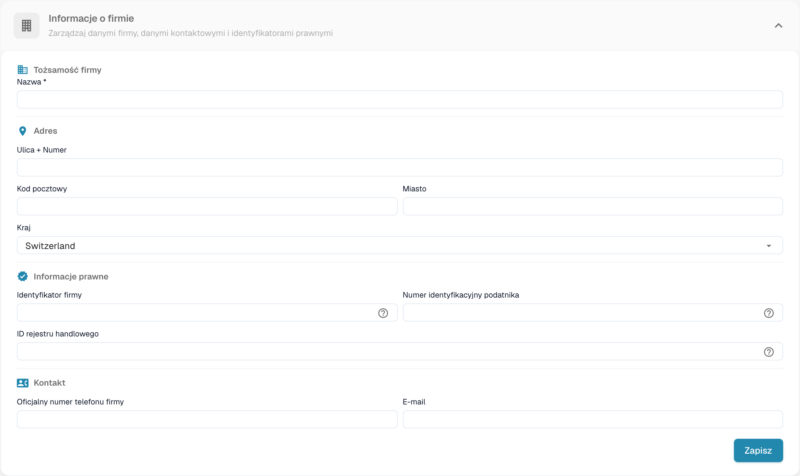
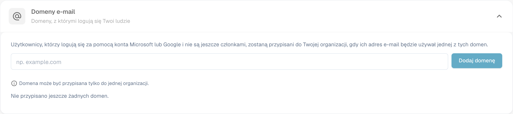

# Informacje o firmie

<figure><figcaption>
Dane firmy z ukrytymi wartościami organizacji.
</figcaption></figure>

Strona Company Information pozwala zarządzać profilem firmy, preferencjami i szczegółami subskrypcji. Jest podzielona na następujące sekcje:

## Informacje o firmie

Ta sekcja zawiera podstawowe dane firmy, pogrupowane w cztery obszary:

### Dane identyfikacyjne firmy

* **Nazwa** *(wymagane)*: Prawna nazwa Twojej firmy.

### Adres

* **Ulica + Numer**: Adres ulicy Twojej firmy.
* **Kod pocztowy**: Kod pocztowy.
* **Miasto**: Nazwa miasta.
* **Kraj**: Wybierz swój kraj z listy rozwijanej.

### Informacje prawne

* **Identyfikator firmy**: Unikalny identyfikator Twojej firmy, używany w integracjach i do wewnętrznych odniesień.
* **Numer identyfikacyjny podatnika**: Twój numer identyfikacji podatkowej na potrzeby sprawozdawczości finansowej.
* **ID rejestru handlowego**: Twój numer w rejestrze handlowym na potrzeby dokumentacji prawnej.

### Kontakt

* **Oficjalny numer telefonu firmy**: Główny numer telefonu Twojej firmy.
* **E-mail**: Główny adres e-mail używany do oficjalnej komunikacji.

Po wprowadzeniu lub zaktualizowaniu dowolnych pól kliknij **Zapisz**, aby zastosować zmiany. Ikony **?** obok identyfikatorów prawnych pokazują dodatkowe wskazówki dotyczące pól. Wybierz nagłówek sekcji, aby rozwinąć lub zwinąć formularz.

## Domeny poczty e-mail

Administratorzy organizacji mogą otworzyć **Ustawienia → Informacje o firmie → Domeny poczty elektronicznej**, aby zarządzać domenami używanymi do automatycznego przypisywania do organizacji. Gdy ktoś loguje się przez Microsoft lub Google i nie jest jeszcze członkiem żadnej organizacji, DocBits może przypisać go do tej organizacji, jeśli jego adres e-mail używa jednej z wymienionych domen. Domena może należeć tylko do jednej organizacji.

<figure><figcaption>
Konfiguracja domen e-mail firmy.
</figcaption></figure>

Wprowadź w polu samą domenę, na przykład `example.com`, i wybierz **Dodaj domenę** lub naciśnij Enter. Pierwsza domena staje się domeną główną. Jeśli na liście jest więcej domen, użyj **Utwórz podstawowy** w innym wierszu, aby zmienić domenę główną, lub ikony kosza, aby usunąć domenę. Błędy, takie jak nieprawidłowa domena, prywatny dostawca poczty e-mail lub domena już przypisana gdzie indziej, pojawiają się pod polem wprowadzania. **Nie przypisano jeszcze domen** oznacza, że ta organizacja nie ma reguły domeny.

Przed dodaniem domeny sprawdź, która organizacja powinna przyjmować nowe logowania. Aby zarządzać istniejącymi członkostwami, przejdź do [Users](../groups-users-and-permissions/users/README.md).

## Preferencje firmy

Skonfiguruj domyślne ustawienia dla całej firmy:

* **Wzór daty**: Wybierz, w jaki sposób daty są wyświetlane w całym DocBits (np. `%m/%d/%Y`, `%d.%m.%Y`).
* **Formatowanie kwoty**: Wybierz format liczbowy kwot (np. Deutsch dla `1.000,00`, English dla `1,000.00`).
* **Okno dialogowe informacji o nowej wersji**: Określ, czy użytkownicy widzą powiadomienie o wydaniu nowej wersji DocBits.

Po wprowadzeniu zmian kliknij **Zapisz**.

## Kolor aplikacji

Dostosuj kolor podstawowy interfejsu DocBits. Jest to przydatne do wizualnego odróżniania różnych środowisk (np. dev od produkcyjnego).

* **Kolor**: Wprowadź kod koloru szesnastkowego (np. `#2388AE`) lub użyj próbnika kolorów.
* Kliknij **Zapisz**, aby zastosować, lub **Nastawić**, aby przywrócić kolor domyślny.

## Plan subskrypcji

Wyświetl aktywne plany subskrypcji i ich szczegóły:

* **Nazwa planu**: Nazwa każdego aktywnego planu (np. DocBits, DocFlow Users, DocSearch).
* **dni pozostałe**: Liczba dni pozostałych do wygaśnięcia planu.
* **Start Date / End Date**: Okres subskrypcji.
* **Liczba użytkowników**: Łączna liczba użytkowników w Twojej organizacji.
* **Liczba podorganizacji**: Liczba skonfigurowanych podorganizacji.
* **Liczba dostawców**: Liczba zarejestrowanych dostawców.

## Wykorzystanie subskrypcji

Monitoruj miesięczne zużycie tokenów i workflowów:

| Kolumna | Opis |
|--------|-------------|
| **Typ** | Typ zużycia (Document lub Workflow). |
| **From / To** | Daty okresu rozliczeniowego. |
| **Wykorzystane tokeny** | Liczba tokenów zużytych w bieżącym okresie. |
| **Pozostałe tokeny** | Tokeny nadal dostępne w bieżącym okresie. |

Użyj przycisku **Wybierać**, aby filtrować według określonych zakresów dat.
