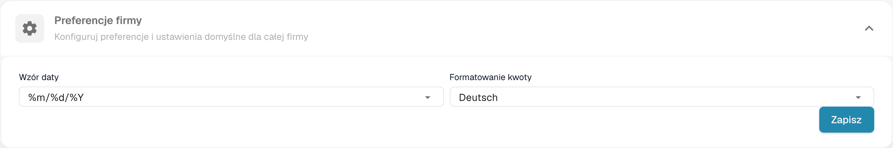
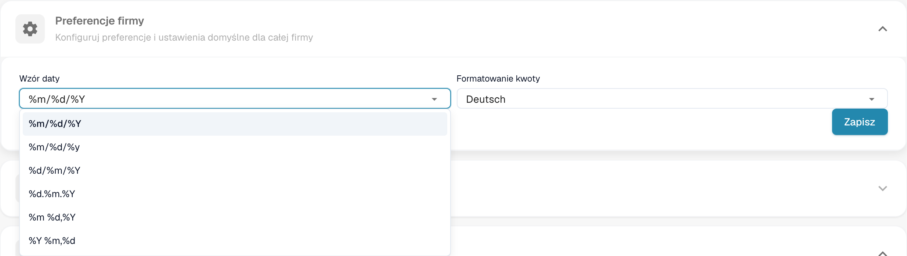

# Preferencje firmy

## Samouczek wideo: Firma, subskrypcja i audyt


Informacje o firmie, plan subskrypcji i dzienniki audytu w DocBits


Film pokazuje informacje i preferencje firmy, plan subskrypcji, aktywność logowania oraz dzienniki audytu.

Otwórz preferencje w danych firmy, aby ustawić formaty dat i kwot organizacji.

<figure><figcaption>
Preferencje firmy oraz formaty kwot i dat.
</figcaption></figure>

Wybierz format daty odpowiedni dla dokumentów. Symbole %d, %m i %Y są technicznymi kodami formatu.

<figure><figcaption>
Wybór formatu daty w preferencjach firmy.
</figcaption></figure>

Format kwot jest oddzielnym ustawieniem; jego skonfigurowana nazwa może pozostać bez zmian. Sprawdź oba formaty przed zapisaniem. Dawne okno informacji o wersji nie jest częścią aktualnego widoku. Przy wykonywaniu tych obrazów nie zmieniono preferencji.


