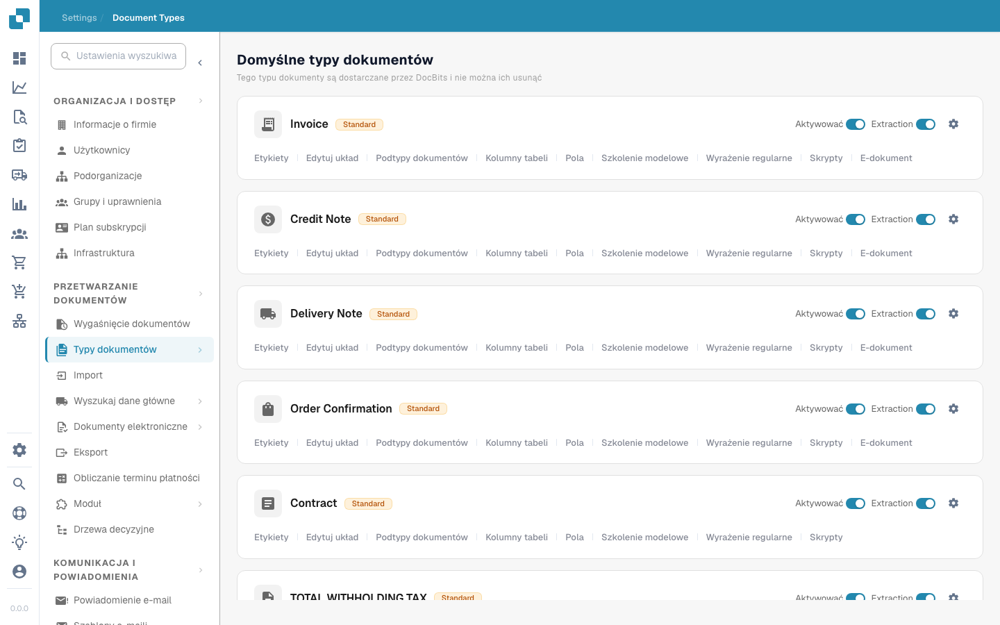

# Typy dokumentów


DocBits Document Types Explained: Create, Configure & Assign Processing Settings


<figure><figcaption>
Strona typów dokumentów
</figcaption></figure>

## Przegląd

Strona Document Types wyświetla wszystkie typy dokumentów rozpoznawane i przetwarzane przez DocBits. Jest podzielona na dwie sekcje:

* **Default Document Types**: Wstępnie skonfigurowane typy dostarczane przez DocBits (Invoice, Credit Note, Delivery Note, Order Confirmation, Contract, ZUGFeRD itd.). Nie można ich usunąć.
* **Custom Document Types**: Typy tworzone na potrzeby Twojej firmy. Można je edytować i usuwać.

## Elementy sterujące dla każdego typu dokumentu

Karta każdego typu dokumentu zawiera:

| Element | Opis |
|---------|-------------|
| **Activate** | Przełącznik włączający lub wyłączający ten typ dokumentu w przetwarzaniu. |
| **Extraction** | Przełącznik włączający lub wyłączający ekstrakcję danych opartą na AI dla tego typu. |
| **Settings** (ikona koła zębatego) | Otwiera dodatkowe opcje konfiguracji typu dokumentu. |

## Karty konfiguracji

Pod każdym typem dokumentu dostępne są następujące karty konfiguracji:

| Karta | Opis |
|-----|-------------|
| **Labels** | Zarządzanie etykietami wyświetlanymi i tłumaczeniami dla typu dokumentu. |
| **Edit layout** | Modyfikowanie wyglądu dokumentu w widoku walidacji, w tym pozycji pól. |
| **Document Sub Types** | Konfigurowanie podkategorii tego typu dokumentu (np. różnych formatów faktur). |
| **Table columns** | Dostosowanie, które kolumny danych pojawiają się w tabeli pozycji. |
| **Fields** | Zarządzanie polami danych wyodrębnianymi z dokumentu (dodawanie, edytowanie lub usuwanie pól). |
| **Model Training** | Konfigurowanie i trenowanie modelu AI używanego do rozpoznawania i ekstrakcji danych. |
| **Regex** | Definiowanie wyrażeń regularnych do ekstrakcji danych opartej na wzorcach. |
| **Scripts** | Pisanie własnych skryptów przetwarzania uruchamianych podczas przetwarzania dokumentu. |
| **E-Doc** | Konfigurowanie standardów dokumentów elektronicznych (XRechnung, ZUGFeRD, EDI, FatturaPA). |

## Niestandardowe reguły walidacji

Otwórz typ dokumentu i wybierz **Custom Validation Rules**, aby zarządzać jego własnymi regułami walidacji. Aby ponownie wykorzystać istniejącą regułę bez jej odtwarzania, postępuj zgodnie z przewodnikiem [Duplikowanie niestandardowej reguły walidacji](duplicate-a-custom-validation-rule.md). Przewodnik opisuje nazwę reguły, klucz reguły oraz przyciski potwierdzenia.

## Tworzenie niestandardowego typu dokumentu

1. Przewiń w dół do sekcji **Custom Document Types**.
2. Kliknij **+ New**.
3. Wprowadź nazwę nowego typu dokumentu.
4. Skonfiguruj pola, układ i ustawienia ekstrakcji według potrzeb.


Szczegółowe instrukcje konfiguracji znajdziesz w [Setup Document Type](../../../setup/document-types/).

