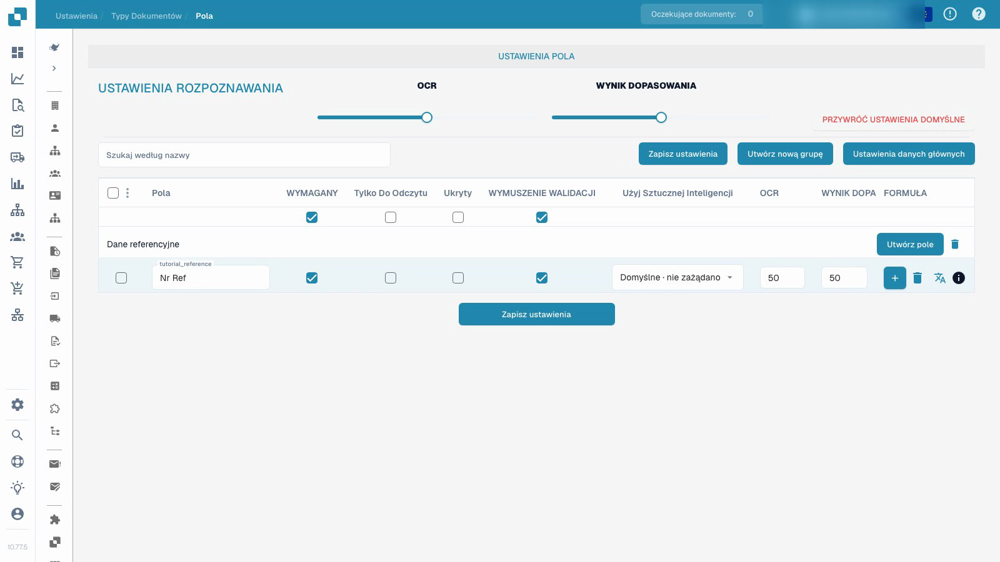

# Typy dokumentów

Film demonstruje konfigurację pól w izolowanym niestandardowym typie dokumentu testowego.


Typy dokumentów


[Oglądaj z napisami](https://docbits-videos.fra1.cdn.digitaloceanspaces.com/settings-assistant/document-types-fields-admin/v1/pl.html)

Uwaga: Niektóre natywne etykiety produktów mogą pozostać nieprzetłumaczone. Nagranie zachowuje rzeczywisty interfejs użytkownika.

## Przegląd

Typy dokumentów definiują konfigurację używaną dla różnych rodzajów dokumentów. DocBits zapewnia standardowe typy, takie jak faktury i dokumenty korygujące. Niestandardowe typy pozwalają administratorowi skonfigurować inną kategorię dokumentów biznesowych. Standardowych typów nie można usunąć; zarządzaj niestandardowymi typami w ramach uprawnień organizacji.

## Kontrolki na karcie typu dokumentu

| Kontrolka | Cel |
| --- | --- |
| Aktywuj | Włącz lub wyłącz typ dokumentu do przetwarzania. |
| Extraction | Wybierz tryb ekstrakcji pokazywany przez natywną kontrolkę: Flex lub Fix. Jest to wybór trybu, niezależny od przełącznika Aktywuj. |
| Ustawienia, pokazane jako koło zębate | Otwórz dalszą konfigurację dla tego typu dokumentu. |

Dostępne linki zależą od typu, uprawnień i włączonych modułów. Obecny interfejs może oferować układy, pola, tabele, skrypty, trenowanie modelu i podtypy dokumentów. Reguły transformacji, reguły walidacji i konfiguracja dokumentów elektronicznych są dostępne tam, gdzie mają zastosowanie ich odpowiednie funkcje. Inne opcje konfiguracji mogą znajdować się w ustawieniach typu dokumentu, a nie w osobnej zakładce pod każdą kartą.

## Konfiguruj pola i wymagane informacje

Film wykorzystuje już utworzony, izolowany niestandardowy typ dokumentu testowego. Zmienia pole referencyjne tego typu; nie zmienia istniejącej konfiguracji faktury.

1. Otwórz typ dokumentu i wybierz jego pola.
2. Sprawdź grupę pól i stabilną techniczną nazwę pola. Czytelna etykieta wyświetlania to osobne ustawienie; jej zmiana nie tworzy nowego identyfikatora pola.
3. Ustaw pole referencyjne jako wymagane, zachowując je widocznym i edytowalnym. Wymagane informacje muszą zostać podane; ustawienie nie wymyśla brakującej wartości ani nie gwarantuje poprawnej ekstrakcji.
4. Skonfiguruj jawną weryfikację pola niezależnie od wymaganej wartości. Tylko do odczytu, ukryte, progi OCR i progi Match Score mają swoje własne efekty; nie są to przełączniki zamienne.
5. Zapisz konfigurację, otwórz ją ponownie i sprawdź zapisaną etykietę wyświetlania oraz ustawienia.

<figure><figcaption>
Zapisane pola w izolowanym typie dokumentu testowego.
</figcaption></figure>

Zademonstrowany wynik dowodzi, że konfiguracja pola została zapisana i ponownie załadowana. Nie stanowi to trenowania modelu, zatwierdzenia faktury, eksportu ani testu walidacji na dalszym etapie. Przed użyciem konfiguracji w środowisku produkcyjnym przetestuj reprezentatywne dokumenty i zamierzony przepływ pracy zwykłego użytkownika.

## Niestandardowe reguły walidacji

Tam, gdzie ta funkcja jest dostępna, otwórz reguły walidacji typu dokumentu. Aby ponownie użyć istniejącej reguły, postępuj zgodnie z [Duplikowanie niestandardowej reguły walidacji](duplicate-a-custom-validation-rule.md). Jest to niezależne od poszczególnych ustawień pól pokazanych na filmie.

## Utwórz niestandardowy typ dokumentu

Otwórz sekcję niestandardowych typów dokumentów, wybierz Nowy i wprowadź jasną nazwę. Zakończ oferowane kroki konfiguracji dla zamierzonego trybu ekstrakcji, pól, grup i wszelkich tabel. Trenowanie modelu i konfiguracja ekstrakcji są niezależne od samego zapisania ustawienia pola wymaganego.


Zobacz [Konfiguracja typu dokumentu](../../../setup/document-types/) w celu zapoznania się z procedurą konfiguracji.


## Dodatkowe nagranie


Typy dokumentów

