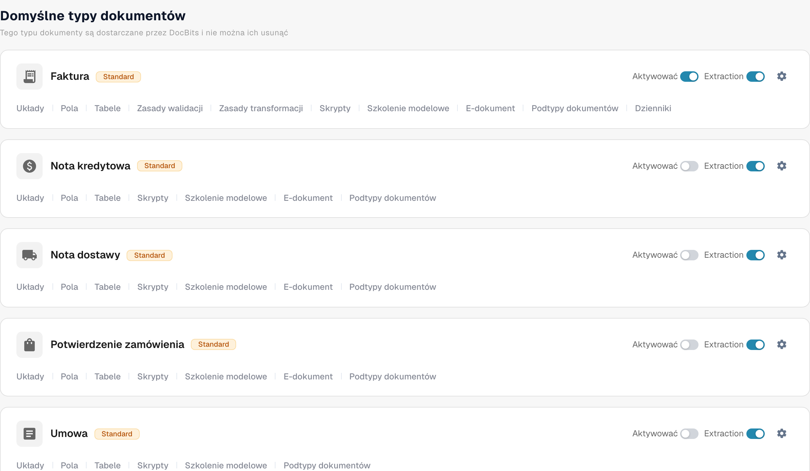

# Aktywacja lub dezaktywacja typu dokumentu

Administratorzy mogą wybierać, które typy dokumentów są dostępne w ich organizacji. Możesz to zmienić na stronie **Typy dokumentów** bez usuwania typu ani jego konfiguracji.

1. Otwórz **Ustawienia → Typy dokumentów**.
2. Znajdź typ dokumentu, na przykład **Faktura**, w sekcji **Domyślne typy dokumentów** lub **Niestandardowe typy dokumentów**.
3. Użyj przełącznika **Aktywować** na karcie tego typu. Kolorowy przełącznik oznacza, że typ jest aktywny; szary przełącznik oznacza, że jest nieaktywny. Przed opuszczeniem strony poczekaj na komunikat potwierdzający. Dla tego przełącznika nie ma osobnego przycisku Save.

<figure><figcaption>
Typy dokumentów i opcje aktywacji.
</figcaption></figure>

Przełącznik **Ekstrakcja** obok **Aktywować** to inne ustawienie. Wybiera on tryb ekstrakcji (Flex lub Fix); nie aktywuje ani nie dezaktywuje typu dokumentu. Ikona koła zębatego otwiera dodatkowe ustawienia tego typu. Linki pod nazwą typu otwierają jego układy, pola, tabele, skrypty i inne dostępne obszary konfiguracji.

DocBits udostępnia domyślne typy dokumentów, których nie można usunąć. Możesz też tworzyć własne typy i nimi zarządzać. Kolejne kroki konfiguracji znajdziesz w [Adding and Editing Document Types](adding-editing-document-types.md), a konfigurację wyodrębnianych pozycji — w [Table Columns](table-columns/README.md).
