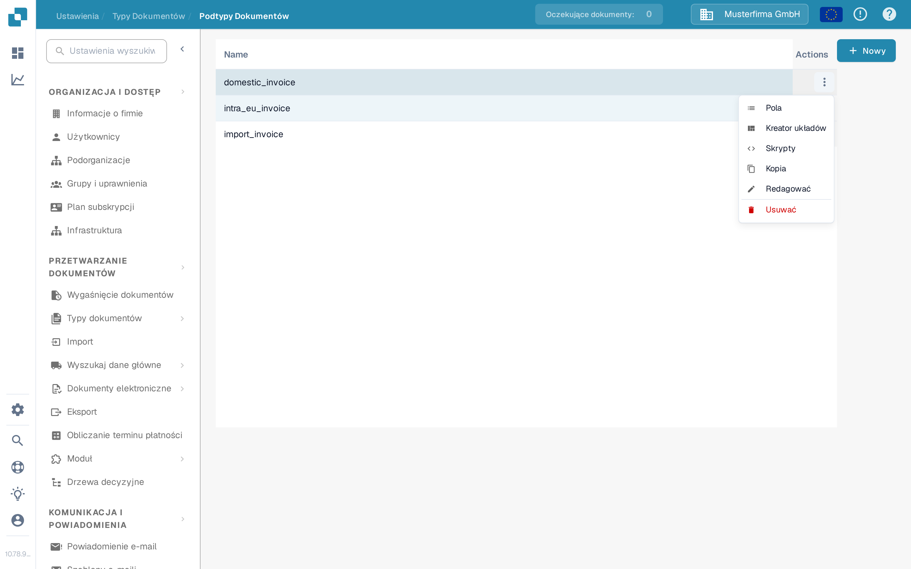
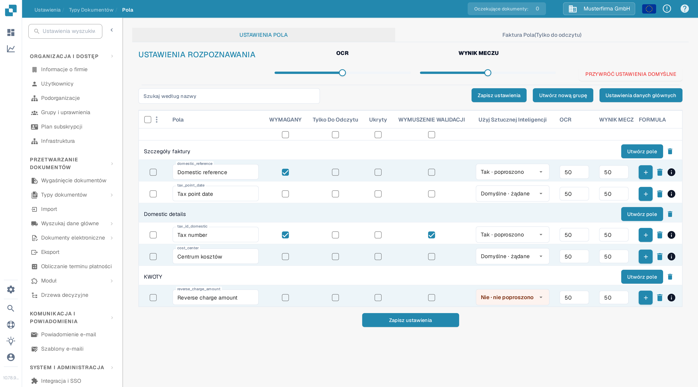
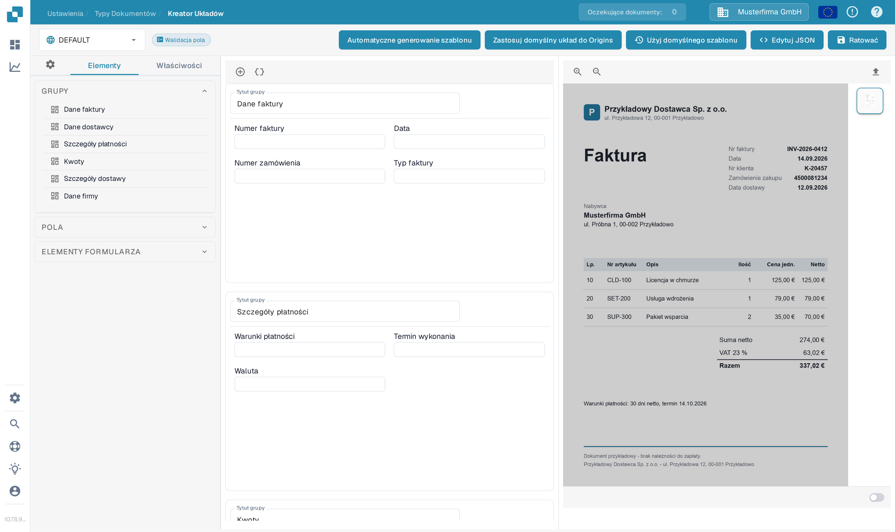
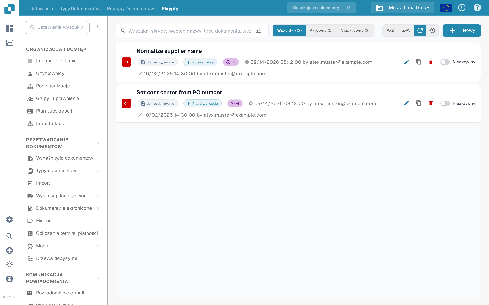

# Konfigurowanie podtypów

Użyj podtypu dokumentu, gdy faktury tego samego typu dokumentu wymagają innych pól, innego układu walidacji lub własnych skryptów przetwarzania. Najpierw [utwórz podtyp](creating-a-new-sub-type.md), następnie otwórz **Ustawienia → Typy Dokumentów**, wybierz typ dokumentu i otwórz **Podtypy Dokumentów**. W wierszu podtypu otwórz **Actions** (trzy kropki). Menu oferuje **Pola**, **Kreator układów** i **Skrypty**; zawiera także [Kopia, Redagować i Usuwać](using-actions.md).

<figure><figcaption>
Wybierz część podtypu, którą chcesz skonfigurować.
</figcaption></figure>

## Pola

Wybierz **Pola**, aby zdecydować, jakie informacje użytkownicy widzą i wprowadzają dla tego podtypu. Możesz utworzyć pole w grupie, oznaczyć istniejące pole jako wymagane, tylko do odczytu lub ukryte oraz dostosować opcje rozpoznawania. Po zmianach wybierz **Zapisz ustawienia**. Kroki opisuje [Dodawanie i Edytowanie Pól](fields/adding-and-editing-fields.md), opcje kolumn [Konfiguracja właściwości pól](fields/configuring-field-properties-1.md), a gdy pole ma korzystać z danych wyszukiwania, [Ustawienia danych głównych](fields/master-data-settings.md).

<figure><figcaption>
Ustawienia pól w organizacji testowej dokumentacji. Nie są pokazywane żadne dane klientów.
</figcaption></figure>

## Kreator układów

Wybierz **Kreator układów**, aby rozmieścić grupy i pola na ekranie walidacji dokumentu. Lewa strona zawiera listę elementów; prawa przyjmuje przykładowy dokument do podglądu. Sprawdź wynik i wybierz **Ratować**, gdy układ będzie gotowy. [Przewodnik po Kreatorze Układów](../../../setup/document-types/layout-builder.md) wyjaśnia elementy, podgląd dokumentu i zapisywanie układu.

<figure><figcaption>
Układ podtypu przed dodaniem przykładowego dokumentu.
</figcaption></figure>

## Skrypty

Wybierz **Skrypty**, aby wyświetlić skrypty tego podtypu. Na pustej liście wybierz **Utwórz skrypt** lub **Nowy**, aby zacząć. Wyszukiwanie oraz filtry **Wszystko**, **Aktywny** i **Nieaktywny** pomagają znaleźć istniejące skrypty. Aby utworzyć skrypt, postępuj zgodnie z [Tworzenie i edycja skryptów](script/creating-and-editing-scripts.md), a przed włączeniem go do przetwarzania z [Aktywacja i zarządzanie skryptami](script/script-activation-and-management.md).

<figure><figcaption>
W testowym podtypie dokumentacji nie utworzono żadnych skryptów.
</figcaption></figure>
