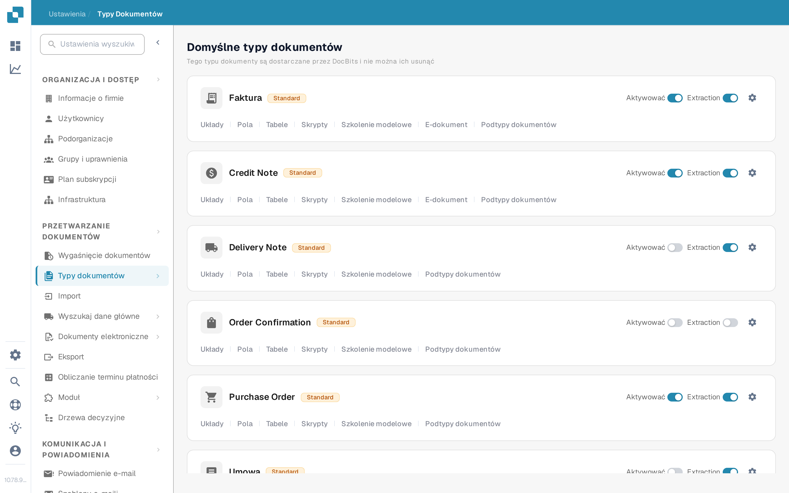
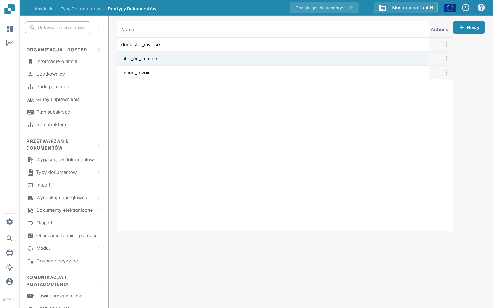
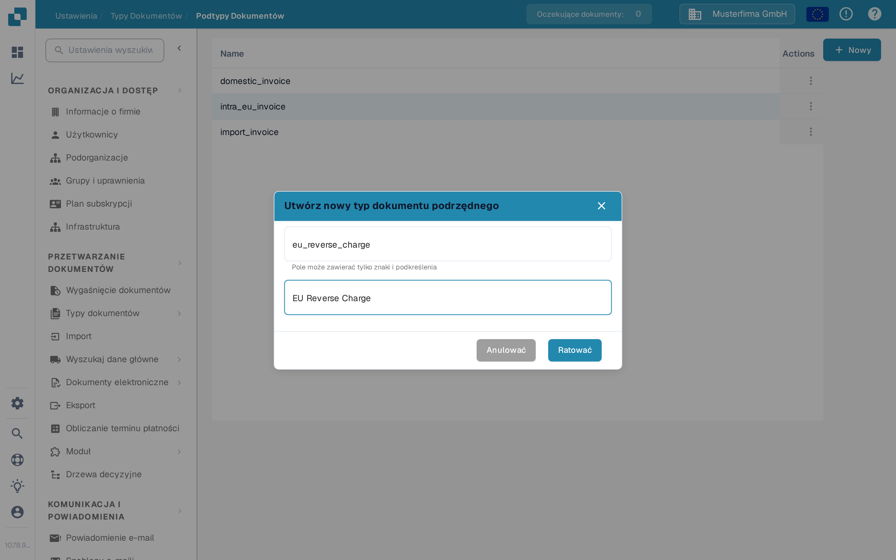

# Tworzenie nowego Podtypu

Utwórz podtyp dokumentu, gdy jeden rodzaj dokumentu potrzebuje własnych ustawień pól, układu walidacji lub skryptów. Potrzebujesz dostępu do **Ustawienia → Typy dokumentów**.

## 1. Otwórz typ dokumentu

Otwórz **Ustawienia → Typy dokumentów**. W karcie odpowiedniego typu dokumentu wybierz **Podtypy dokumentów**. Poniższy przykład używa typu **Faktura**; wybierz typ pasujący do Twoich dokumentów. Inne linki w karcie prowadzą do ustawień całego typu dokumentu.

<figure><figcaption>
Otwórz podtypy typu dokumentu, który chcesz skonfigurować.
</figcaption></figure>

## 2. Rozpocznij nowy podtyp

Na stronie **Podtypy dokumentów** wybierz **Nowy**. Istniejące podtypy są widoczne na liście; menu **Actions** (trzy kropki) służy do istniejącego wiersza. Jeśli przycisk **Nowy** nie reaguje na kliknięcie myszą, ustaw na nim fokus klawiaturą i naciśnij **Enter**.

<figure><figcaption>
Organizacja testowa dokumentacji zawiera tylko przykładowy podtyp.
</figcaption></figure>

## 3. Nazwij go i zapisz

Wprowadź **Name** używając liter i podkreślników, a następnie wprowadź opisowy **Title**. Oba pola są wymagane. Nazwy na tym zrzucie ekranu są tylko przykładami. Wybierz **Ratować**, aby utworzyć podtyp, lub **Anulować**, aby wyjść bez tworzenia go.

<figure><figcaption>
Podczas tworzenia wprowadzane są tylko pola Name i Title.
</figcaption></figure>

Po zapisaniu nowy podtyp pojawia się na liście. Aby ustawić jego pola, układ lub skrypty, otwórz jego menu **Actions** i postępuj zgodnie z instrukcją [Konfiguruj podtypy](https://github.com/Fellow-Consulting-AG/docbits/tree/pl/readme/administration-and-setup/settings/global-settings/document-types/configure-subtypes.md). Te ustawienia wykonuje się po utworzeniu, a nie w oknie **Nowy**.
