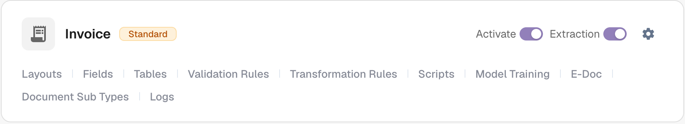
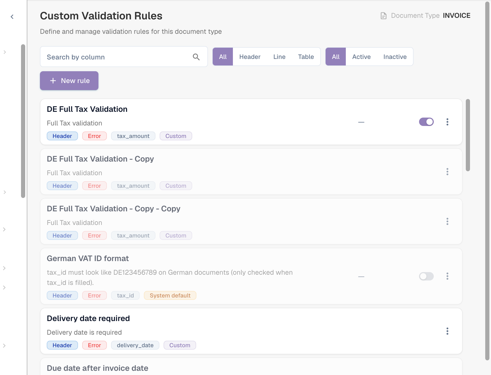
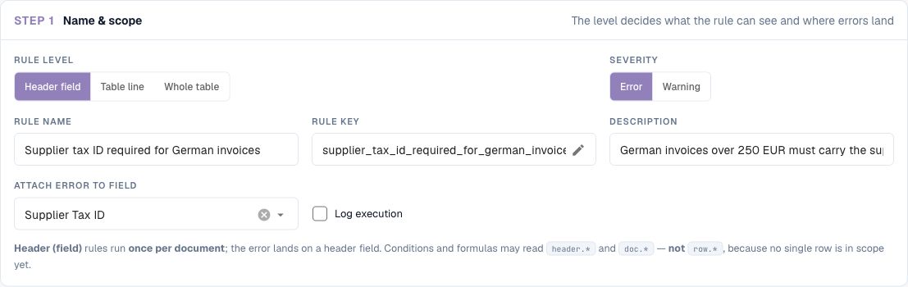
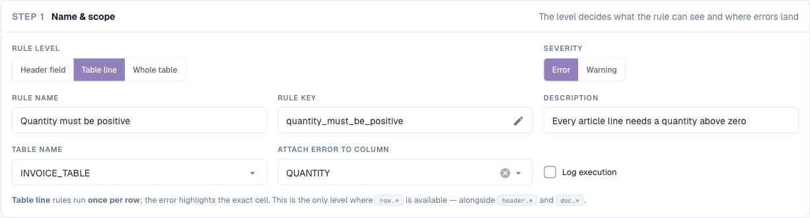
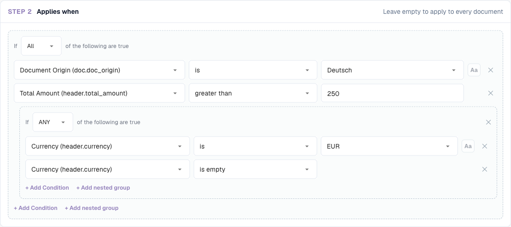
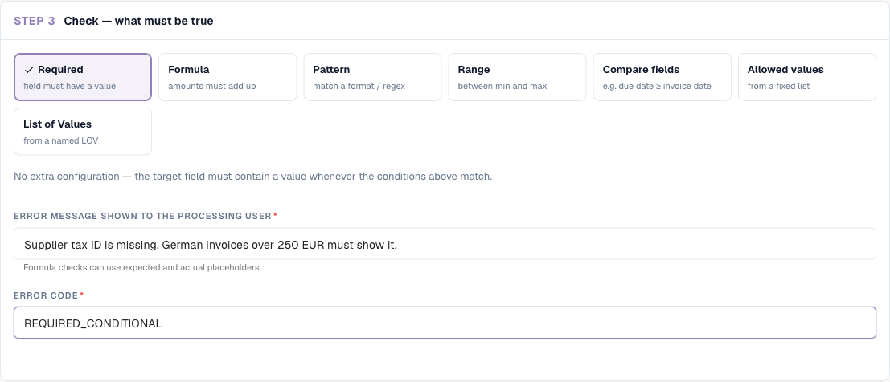
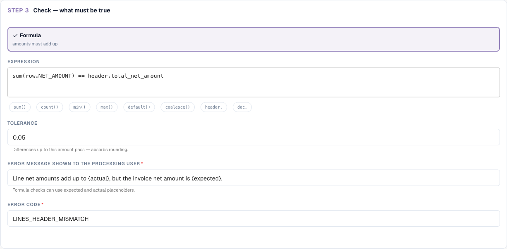
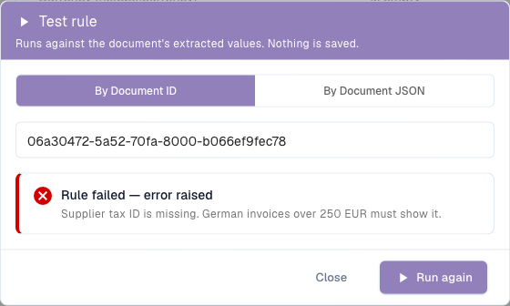
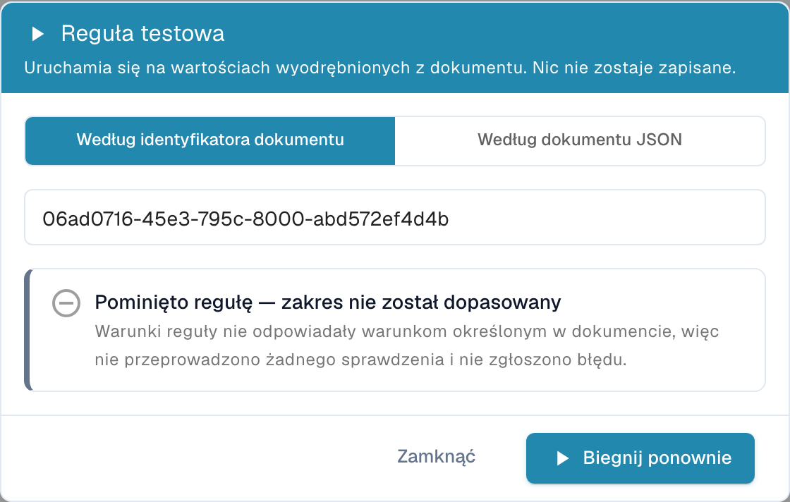
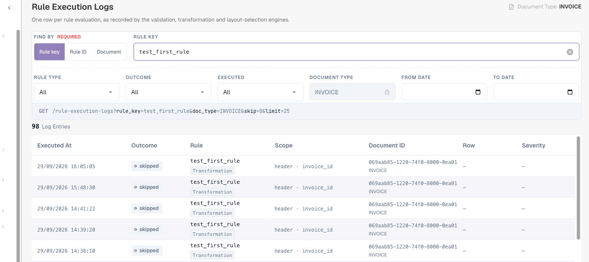

# Niestandardowe reguły walidacji

## Przegląd

Niestandardowe reguły walidacji pozwalają administratorowi zdefiniować **własne kontrole** danych, które DocBits ekstrahuje z dokumentu — bez pisania skryptu i bez czekania na zmianę w produkcie.

Reguła odpowiada na trzy pytania:

1. **Gdzie** pokazać problem? W polu nagłówka albo w komórce wiersza tabeli.
2. **Kiedy** reguła obowiązuje? Zawsze albo tylko dla dokumentów (lub wierszy) spełniających warunek — zobacz [Warunki reguł (Dotyczy, gdy)](rule-conditions-applies-when.md).
3. **Co** musi być spełnione? Pole musi być wypełnione, zgodne z formatem, mieścić się w zakresie, pasować do listy, poprawnie porównywać się z innym polem albo się sumować.

Gdy kontrola się nie powiedzie, DocBits oznacza pole lub komórkę na **ekranie walidacji** i wyświetla Twój komunikat — dokładnie tak jak wbudowana kontrola. Przy ważności **Error** dokument nie może zostać zwalidowany, dopóki problem nie zostanie usunięty; przy **Warning** użytkownik widzi tylko podpowiedź.

Reguły są definiowane dla każdego **typu dokumentu** i działają na każdym dokumencie tego typu: podczas przetwarzania i przy każdym zapisie dokumentu.

### Problemy, które rozwiązują

| Wymaganie biznesowe | Bez reguł niestandardowych | Z regułą niestandardową |
| --- | --- | --- |
| Niemieckie faktury powyżej 250 EUR muszą zawierać numer identyfikacji podatkowej dostawcy | skrypt albo użytkownicy muszą o tym pamiętać | **Required** dla Supplier Tax ID, *dotyczy, gdy* pochodzenie to DE, a kwota całkowita jest większa niż 250 |
| Numery faktur danego dostawcy zawsze wyglądają jak `INV-123456` | literówki trafiają do ERP | **Pattern** `^INV-\d{6}$` dla Invoice Number dla tego dostawcy |
| Każda pozycja towarowa musi mieć ilość większą od zera | pozycje z ilością 0 są eksportowane | **Range** (minimum 0,01) dla kolumny Quantity |
| Termin płatności nie może być wcześniejszy niż data faktury | błędne przebiegi płatności | **Compare fields**: Due Date w dniu lub po Invoice Date |
| Pozycje muszą sumować się do kwoty netto | tylko stała wbudowana kontrola | **Formula** `sum(row.NET_AMOUNT) == header.total_net_amount` z własną tolerancją |
| Dozwolone są tylko waluty znane Twojemu ERP | błędy eksportu w ERP | **List of Values** dla Currency |
| Informowanie użytkowników o nietypowych wartościach bez blokowania | niemożliwe | dowolna reguła o ważności **Warning** |

## Włączanie niestandardowych reguł walidacji

Niestandardowe reguły walidacji włącza się **dla każdego typu dokumentu**. Nie ma przełącznika obejmującego całą organizację.

1. Przejdź do **Ustawienia → Ustawienia globalne → Typy dokumentów**.
2. Na karcie typu dokumentu kliknij ikonę **ustawień** (koło zębate).
3. Otwórz sekcję **Niestandardowe reguły walidacji** i włącz przełącznik.
4. Kliknij **Zarządzaj regułami walidacji**, aby otworzyć listę reguł.

<figure><figcaption>
Przełączniki Manage Layouts, Custom Validation Rules i Transformation Rules
</figcaption></figure>

Od tej chwili karta typu dokumentu pokazuje także link **Reguły walidacji** oraz link **Logi** do dzienników wykonania.

<figure><figcaption>
Linki na karcie typu dokumentu
</figcaption></figure>


**Przełącznik zastępuje wbudowane kontrole kwot.** Gdy niestandardowe reguły walidacji są włączone dla typu dokumentu, zakodowane na stałe kontrole „kwota całkowita = kwota netto + kwota podatku” oraz kontrole kwot i rabatów pozycji **nie są** dla niego uruchamiane; ich miejsce zajmują konfigurowalne reguły. Przed włączeniem odtwórz potrzebne kontrole jako reguły (zobacz [przepisy](#przepisy)). Wyłączenie przełącznika przywraca wbudowane kontrole. Wszystkie pozostałe walidacje pól (pola wymagane, formaty, dane podstawowe) nadal działają.


## Lista reguł

**Typy dokumentów → (typ dokumentu) → Reguły walidacji** wyświetla wszystkie reguły danego typu dokumentu.

<figure><figcaption>
Lista reguł z poziomem, ważnością, polem docelowym i źródłem każdej reguły
</figcaption></figure>

Każda karta pokazuje nazwę i opis reguły oraz plakietki jej **poziomu** (Header / Line / Table), **ważności** (Error / Warning), **pola**, do którego przypisany jest błąd, oraz jej **źródła**. Użyj przełącznika po prawej stronie, aby aktywować lub dezaktywować regułę, oraz menu **⋮**, aby ją zduplikować lub usunąć. Listę można filtrować według poziomu (**Wszystkie / Header / Line / Table**) i stanu (**Wszystkie / Aktywne / Nieaktywne**) lub przeszukiwać.

### Reguły systemowe, dostosowane i niestandardowe

| Źródło | Co to jest | Co możesz zrobić |
| --- | --- | --- |
| **System default** | Reguła dostarczana z DocBits dla wszystkich organizacji. | Nie można jej edytować bezpośrednio — kreator pokazuje komunikat „This is a system default rule and cannot be edited.” Kliknij **Customize**, aby utworzyć własną edytowalną kopię, lub wyłącz regułę, aby przestała działać w Twojej organizacji. |
| **Customized** | Reguła systemowa, którą Twoja organizacja zmieniła lub wyłączyła. | Edytuj ją jak własną regułę. **Reset to Default** usuwa Twoją kopię i przywraca oryginał. |
| **Custom** | Reguła utworzona przez Twoją organizację. | Edytuj, **Duplicate**, **Delete**. |

Zmiany reguł systemowych nigdy nie wpływają na inne organizacje.

## Tworzenie reguły

Kliknij **Nowa reguła**. Kreator ma trzy kroki. **Test rule** i **Save** znajdują się w prawym górnym rogu.

### Krok 1 — Nazwa i zakres

<figure><figcaption>
Krok 1 dla reguły pola nagłówka
</figcaption></figure>

| Ustawienie | Co robi |
| --- | --- |
| **Poziom reguły** | Na co patrzy reguła i gdzie pokazywany jest błąd — zobacz [Poziomy reguł](#poziomy-regul). |
| **Ważność** | **Error** oznacza pole jako nieprawidłowe i blokuje walidację. **Warning** pokazuje komunikat, ale nigdy nie blokuje. |
| **Nazwa reguły** | Wyświetlana na liście, w logach i dla administratorów. Niech opisuje regułę („Numer identyfikacji podatkowej dostawcy wymagany dla niemieckich faktur”). |
| **Klucz reguły** | Klucz techniczny generowany z nazwy. Pozostaje taki sam, gdy później zmienisz nazwę reguły. Kliknij ołówek, aby wybrać własny klucz przed pierwszym zapisem; potem jest on stały. |
| **Opis** | Opcjonalne wyjaśnienie dla innych administratorów. |
| **Nazwa tabeli** | *Tylko wiersz tabeli.* Tabela, której wiersze są sprawdzane, na przykład `INVOICE_TABLE`. |
| **Przypisz błąd do pola / kolumny** | Pole (a dla wierszy tabeli — kolumna), które pokazuje błąd na ekranie walidacji. |
| **Rejestruj wykonanie** | Zapisuje jeden wpis w logu dla każdej oceny, w tym informację, dlaczego reguła obowiązywała lub nie. Zobacz [Logi](#logi). |

#### Poziomy reguł

| Poziom | Uruchamiana | Błąd jest pokazywany w | Może odczytywać | Typowa reguła |
| --- | --- | --- | --- | --- |
| **Header field** | raz na dokument | polu nagłówka | `header.*`, `doc.*` | „Numer identyfikacji podatkowej dostawcy jest wymagany dla niemieckich faktur” |
| **Table line** | raz dla każdego wiersza wybranej tabeli | komórce wiersza, który nie przeszedł kontroli | `row.*` (bieżący wiersz), `header.*`, `doc.*` | „Ilość musi być większa od zera” |
| **Whole table** | raz na dokument, patrząc na wszystkie wiersze razem | polu nagłówka | sumy po wierszach (`sum()`, `count()`, `min()`, `max()`), `header.*`, `doc.*` | „Kwoty netto pozycji muszą sumować się do kwoty netto” |

<figure><figcaption>
Reguła wiersza tabeli: tabela i kolumna, która pokazuje błąd
</figcaption></figure>

### Krok 2 — Dotyczy, gdy

Zdecyduj, czy reguła działa dla każdego dokumentu, czy tylko dla niektórych. Pozostaw puste, aby sprawdzać każdy dokument. W przeciwnym razie dodaj wiersze warunków — na przykład „Document Origin is Deutsch” i „Total Amount greater than 250” — i połącz je za pomocą **All** / **ANY** oraz zagnieżdżonych grup.

<figure><figcaption>
Kontrola działa tylko dla niemieckich dokumentów powyżej 250 z walutą EUR lub bez waluty
</figcaption></figure>

W przypadku reguł wiersza tabeli warunek może również korzystać z kolumn bieżącego wiersza i jest oceniany **wiersz po wierszu**: wiersze, które nie pasują, po prostu nie są sprawdzane.

<figure><figcaption>
Sprawdzane są tylko pozycje towarowe (wiersze z numerem pozycji)
</figcaption></figure>

Warunki są szczegółowo wyjaśnione — każde pole, operator i reguła porównania, z wieloma przykładami — na stronie [Warunki reguł (Dotyczy, gdy)](rule-conditions-applies-when.md).

### Krok 3 — Kontrola: co musi być spełnione

Wybierz jedną kontrolę. Ustawienia pod kartami zmieniają się zależnie od wybranej kontroli.

<figure><figcaption>
Siedem kontroli. Required nie wymaga dalszych ustawień
</figcaption></figure>

#### Required — pole musi mieć wartość

Nie przechodzi, gdy pole jest puste (brak wartości lub same spacje). Brak dalszych ustawień.

Użyj razem z **Dotyczy, gdy**, aby uczynić pole **warunkowo** wymaganym. Pole, które musi być zawsze wypełnione, lepiej skonfigurować jako pole wymagane w ustawieniach pola.

> *Numer identyfikacji podatkowej dostawcy jest wymagany* — dotyczy, gdy *Document Origin is Deutsch* i *Total Amount greater than 250*.

#### Formula — kwoty muszą się sumować

Porównanie arytmetyczne. Wyrażenie zawiera dokładnie **jedno** porównanie (`==`, `!=`, `>`, `>=`, `<`, `<=`); obie strony mogą używać `+ - * /`, liczb, nawiasów i odwołań do pól.

<figure><figcaption>
Formuła całej tabeli z tolerancją i symbolami zastępczymi w komunikacie
</figcaption></figure>

* Kliknij chipy pod wyrażeniem, aby wstawić funkcje i prefiksy pól: `sum()`, `count()`, `min()`, `max()`, `default()`, `coalesce()`, `header.`, `doc.`. Podczas wpisywania nazwy pola otwiera się lista pasujących pól.
* `sum(row.NET_AMOUNT)`, `count(row.ITEM_NUMBER)`, `min(...)`, `max(...)` działają na wszystkich wierszach i są dostępne tylko na poziomie **Whole table**. `count()` liczy wiersze, w których kolumna jest wypełniona.
* `default(header.discount, 0)` używa `0`, gdy pole jest puste; `coalesce(header.a, header.b, 0)` używa pierwszej wypełnionej wartości.
* **Tolerancja**: dla `==` i `!=` różnice do tej kwoty są traktowane jako równe. Użyj `0.01` lub `0.05`, aby wchłonąć zaokrąglenia. Nie ma wpływu na `<`, `>`, `<=` i `>=`.
* Puste lub nieczytelne kwoty są liczone jako `0`. Dzielenie przez zero powoduje pominięcie reguły zamiast zgłoszenia błędu.
* W komunikacie o błędzie `{actual}` jest zastępowane wynikiem lewej strony, a `{expected}` wynikiem prawej strony.

Przykłady:

| Cel | Poziom | Wyrażenie | Tolerancja |
| --- | --- | --- | --- |
| Sumy nagłówka są spójne | Header field | `header.total_amount == header.total_net_amount + header.total_tax_amount` | 0.01 |
| Pozycje sumują się do kwoty netto | Whole table | `sum(row.NET_AMOUNT) == header.total_net_amount` | 0.05 |
| Kwota pozycji = ilość × cena jednostkowa | Table line | `row.NET_AMOUNT == row.QUANTITY * row.UNIT_PRICE` | 0.01 |
| Podatek nie wyższy niż 19 % kwoty netto | Header field | `header.total_tax_amount <= header.total_net_amount * 0.19` | – |
| Co najmniej jedna pozycja | Whole table | `count(row.ITEM_NUMBER) >= 1` | 0 |

#### Pattern — zgodność z formatem / wyrażeniem regularnym

Wartość musi pasować do **wyrażenia regularnego**. Wyrażenie przeszukuje wartość, więc zakotwicz je za pomocą `^` (początek) i `$` (koniec), gdy musi pasować cała wartość. Zaznacz **Dopasowanie bez rozróżniania wielkości liter**, jeśli wielkość liter nie ma znaczenia.

| Format | Wyrażenie regularne |
| --- | --- |
| `INV-` a po nim sześć cyfr | `^INV-\d{6}$` |
| Niemiecki numer VAT | `^DE\d{9}$` |
| Zamówienie zakupu zaczynające się od 45 i mające 10 cyfr | `^45\d{8}$` |
| Tylko cyfry | `^\d+$` |
| IBAN (kontrola przybliżona) | `^[A-Z]{2}\d{2}[A-Z0-9]{11,30}$` |

#### Range — między wartością minimalną a maksymalną

Wartość musi być liczbą pomiędzy **Minimum** a **Maksimum** (włącznie). Wypełnij jedno lub oba. Wartość, która nie jest liczbą, nie przechodzi kontroli. Sformatowane kwoty, takie jak `1.234,56`, są rozpoznawane.

<figure><figcaption>
Range tylko z minimum: ilości muszą wynosić co najmniej 0,01
</figcaption></figure>

#### Compare fields — np. termin płatności ≥ data faktury

Porównuje wartość pola z innym polem, z **dzisiejszą datą** lub ze stałą wartością, używając operatorów *równe*, *różne od*, *większe niż*, *mniejsze niż*, *w dniu lub po (≥)* albo *w dniu lub przed (≤)*. Liczby są porównywane jako liczby, a daty jako daty.

* Due Date **w dniu lub po (≥)** Invoice Date
* Invoice Date **w dniu lub przed (≤)** dzisiaj — brak faktur z datą przyszłą
* Discount **mniejszy niż** 100

#### Allowed values — ze stałej listy

Wartość musi być jedną z wpisanych przez Ciebie wartości, **jedna wartość w wierszu**. Opcjonalnie bez rozróżniania wielkości liter. Dobre dla krótkich, stabilnych list (`EUR`, `CHF`, `USD`).

#### List of Values — z nazwanej listy LOV

Jak *Allowed values*, ale wartości pochodzą ze wspólnej **listy wartości** zarządzanej w **Ustawienia › Listy wartości**. Wybierz listę zamiast wpisywać ją ponownie; gdy lista się zmieni, reguła używa nowych wartości (po krótkim opóźnieniu wynikającym z buforowania). Liczą się tylko wartości wpisów listy, nie ich etykiety.


Z wyjątkiem **Required**, każda kontrola **przechodzi, gdy wartość jest pusta**. Reguła Pattern dla zamówienia zakupu nie zgłasza zastrzeżeń do faktur bez zamówienia zakupu. Jeśli pusta wartość również stanowi problem, dodaj regułę Required lub ogranicz regułę za pomocą *Dotyczy, gdy … nie jest puste*.


#### Komunikat o błędzie i kod błędu

* **Komunikat o błędzie wyświetlany użytkownikowi przetwarzającemu** — tekst na ekranie walidacji. Napisz, co jest nie tak **i** co zrobić: „Brak numeru identyfikacji podatkowej dostawcy. Niemieckie faktury powyżej 250 EUR muszą go zawierać.”
* **Kod błędu** — krótki kod techniczny, na przykład `REQUIRED_CONDITIONAL`, `FORMAT_MISMATCH`, `OUT_OF_RANGE`, `DATE_ORDER`, `LINES_HEADER_MISMATCH`, `VALUE_NOT_ALLOWED`. Pojawia się w eksportach i logach i pozwala grupować błędy.

## Test reguły

Kliknij **Test rule**, aby uruchomić bieżącą wersję reguły — zapisaną lub nie — na dokumencie. Wpisz **ID dokumentu** lub przełącz na **By Document JSON** i wklej wyekstrahowane dane. **Nic nie jest zapisywane**, a dokument nie jest zmieniany.

Wynik to jeden z trzech rezultatów:

| Wynik | Znaczenie |
| --- | --- |
| **Rule failed — error raised** | Warunek został spełniony, a kontrola się nie powiodła. Komunikat jest wyświetlany dokładnie tak, jak zobaczyłby go użytkownik. |
| **Rule passed** | Warunek został spełniony, a kontrola zakończyła się powodzeniem. Reguły wiersza tabeli pokazują wynik dla każdego wiersza („4 of 4 checked rows passed”). |
| **Rule skipped — scope not matched** | Warunek *Dotyczy, gdy* był fałszywy dla tego dokumentu, więc nic nie sprawdzono i nie zgłoszono błędu. |

<figure><figcaption>
Niemiecka faktura nie ma numeru identyfikacji podatkowej dostawcy: reguła nie przechodzi ze skonfigurowanym komunikatem
</figcaption></figure>

<figure><figcaption>
Ta sama reguła z progiem podniesionym do 1000: faktura (469,18) jest poza zakresem, więc reguła jest pomijana
</figcaption></figure>

<figure><figcaption>
Reguła wiersza tabeli raportuje każdy sprawdzony wiersz
</figcaption></figure>

Przetestuj każdą nową regułę na co najmniej jednym dokumencie, który powinien nie przejść kontroli, jednym, który powinien przejść, i jednym, który powinien zostać pominięty.

## Kiedy reguły są uruchamiane

* **Podczas przetwarzania**, razem z innymi walidacjami, po ekstrakcji i regułach transformacji.
* **Przy każdym zapisie** dokumentu na ekranie walidacji.
* **Po zmianie reguły** istniejące dokumenty **nie** są sprawdzane ponownie jednocześnie. Każdy dokument jest sprawdzany ponownie z nowymi regułami przy następnym zapisie lub ponownym przetworzeniu. Dokumenty już wyeksportowane nie są objęte zmianą.
* Reguły są uruchamiane w kolejności priorytetu (potem według klucza). Pole pokazuje **jeden** błąd: jeśli dwie reguły nie przechodzą dla tego samego pola, wygrywa pierwsza; kolejne reguły jej nie nadpisują.
* Ostrzeżenia są zbierane osobno i nigdy nie ukrywają błędu.
* Jeśli reguły nie da się ocenić — na przykład z powodu dzielenia przez zero w formule — jest pomijana. Uszkodzona reguła nigdy nie oznacza dokumentu omyłkowo jako nieprawidłowego.

## Logi

Włącz **Rejestruj wykonanie** w regule, aby zapisywać każdą ocenę. Otwórz **Typy dokumentów → (typ dokumentu) → Logi** i wyszukuj według **klucza reguły**, **ID reguły** lub **dokumentu**; filtruj według typu reguły, wyniku i daty.

<figure><figcaption>
Jeden wiersz na ocenę, z wynikiem, zakresem, dokumentem i wierszem
</figcaption></figure>

Otwórz wpis, aby zobaczyć jego szczegóły, w tym **ślad warunku**: każdy wiersz *Dotyczy, gdy* z wartością oczekiwaną, rzeczywistą wartością dokumentu oraz informacją, czy warunek został spełniony. Zobacz [Odczytywanie śladu warunku](rule-conditions-applies-when.md#odczyt-sladu-warunku-w-logach).

Ta sama strona pokazuje logi reguł transformacji i reguł wyboru układu.

## Przepisy

Skopiuj te reguły jako punkt wyjścia. Klucze pól i kolumn pochodzą ze standardowego typu dokumentu **Invoice**; dostosuj je do swoich typów dokumentów.

**1. Numer identyfikacji podatkowej dostawcy dla niemieckich faktur powyżej 250 EUR**
Header field · Error · przypisz do *Supplier Tax ID* · Dotyczy, gdy **All**: *Document Origin* is *Deutsch*, *Total Amount* greater than *250* · Kontrola **Required** · Komunikat „Brak numeru identyfikacji podatkowej dostawcy. Niemieckie faktury powyżej 250 EUR muszą go zawierać.” · Kod `REQUIRED_CONDITIONAL`.

**2. Sumy nagłówka się zgadzają** (zastępuje wbudowaną kontrolę)
Header field · Error · przypisz do *Total Amount* · zawsze · **Formula** `header.total_amount == header.total_net_amount + header.total_tax_amount`, tolerancja `0.01` · Komunikat „Suma {actual} nie jest równa kwocie netto plus podatek ({expected}).”

**3. Pozycje sumują się do kwoty netto** (zastępuje wbudowaną kontrolę)
Whole table · Error · przypisz do *Total Net Amount* · zawsze · **Formula** `sum(row.NET_AMOUNT) == header.total_net_amount`, tolerancja `0.05` · Komunikat „Kwoty netto pozycji sumują się do {actual}, ale kwota netto faktury wynosi {expected}.” · Kod `LINES_HEADER_MISMATCH`.

**4. Ilość musi być dodatnia na pozycjach towarowych**
Table line · Error · tabela `INVOICE_TABLE`, kolumna `QUANTITY` · Dotyczy, gdy *row.ITEM_NUMBER* is not empty · **Range** minimum `0.01` · Kod `OUT_OF_RANGE`.

**5. Kwota pozycji = ilość × cena jednostkowa**
Table line · Warning · kolumna `NET_AMOUNT` · zawsze · **Formula** `row.NET_AMOUNT == row.QUANTITY * row.UNIT_PRICE`, tolerancja `0.01`.

**6. Format numeru faktury jednego dostawcy**
Header field · Error · *Invoice Number* · Dotyczy, gdy *Supplier ID* is *20723* · **Pattern** `^INV-\d{6}$`.

**7. Termin płatności nie wcześniejszy niż data faktury**
Header field · Error · *Due Date* · zawsze · **Compare fields** Due Date *w dniu lub po (≥)* Invoice Date · Kod `DATE_ORDER`.

**8. Brak faktur z datą przyszłą**
Header field · Error · *Invoice Date* · zawsze · **Compare fields** Invoice Date *w dniu lub przed (≤)* dzisiaj.

**9. Tylko zatwierdzone waluty (wyłącznie podpowiedź)**
Header field · **Warning** · *Currency* · zawsze · **List of Values** *approved_currencies* · Kod `VALUE_NOT_ALLOWED`.

**10. Zamówienie zakupu wymagane powyżej 5 000**
Header field · Error · *Purchase Order* · Dotyczy, gdy *Total Amount* greater than *5000* · **Required**.

## Dobre praktyki

* **Zacznij od ostrzeżenia.** Zapisz nową regułę z ważnością **Warning**, obserwuj ją przez kilka dni (Test rule, logi), a następnie zmień na **Error**.
* **Jedna reguła, jeden komunikat.** Kilka małych reguł z jasnymi komunikatami jest łatwiejszych do zrozumienia niż jedna duża formuła.
* **Używaj Dotyczy, gdy zamiast kopii.** Jedna reguła z warunkiem jest lepsza niż pięć kopii dla pięciu dostawców.
* **Bądź tolerancyjny przy kwotach.** Zawsze nadawaj formułom kwotowym tolerancję.
* **Nazywaj reguły według reguły biznesowej**, a nie techniki („Termin płatności nie wcześniejszy niż data faktury”, a nie „Reguła porównania 3”).
* **Wyłącz Rejestruj wykonanie**, gdy reguła działa; zapisuje wpis przy każdym zapisie.

## Rozwiązywanie problemów

| Objaw | Co sprawdzić |
| --- | --- |
| Reguła nigdy nie zgłasza błędu | Czy funkcja jest włączona dla typu dokumentu, a reguła jest **aktywna**? Uruchom **Test rule** na dokumencie: „skipped” oznacza, że *Dotyczy, gdy* było fałszywe. |
| Puste pole nie jest zgłaszane | Tylko **Required** zgłasza puste wartości. Dodaj regułę Required. |
| Wbudowane kontrole sum zniknęły | Oczekiwane, gdy reguły niestandardowe są włączone. Odtwórz je jako reguły Formula (przepisy 2 i 3). |
| Zmieniona reguła nie wpływa na dokument | Dokumenty są sprawdzane ponownie przy następnym zapisie. Zapisz lub przetwórz dokument ponownie. |
| Pattern pasuje do wartości, do których nie powinien | Wzorce przeszukują wnętrze wartości. Zakotwicz za pomocą `^` i `$`. |
| Dla pola wyświetlany jest tylko jeden z dwóch błędów | Pole pokazuje tylko pierwszą regułę, która nie przeszła. Dostosuj priorytety lub przypisz jedną z reguł do innego pola. |
| Brakuje kolumn tabeli w *Dotyczy, gdy* | Są dostępne tylko na poziomie **Table line**. |
| Reguły systemowej nie można zmienić | Kliknij **Customize**, aby utworzyć własną kopię. |

## Powiązane

* [Warunki reguł (Dotyczy, gdy)](rule-conditions-applies-when.md) — szczegółowe omówienie warunków
* [Reguły transformacji](transformation-rules.md) — poprawianie wartości przed ich walidacją
* [Reguły wyboru układu](layout-manager/layout-selection-rules.md) — wybór układu używanego przez dokument
* [Ustawianie walidacji i wyniku dopasowania](fields/setting-validation-and-match-score.md) — ustawienia walidacji dla każdego pola
