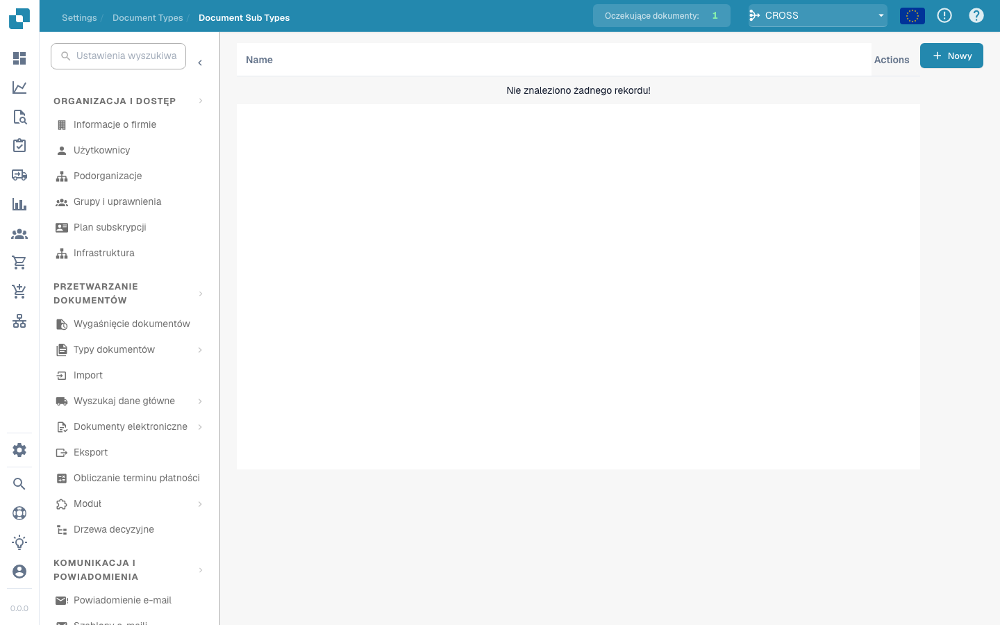

# Podtypy Dokumentów

<figure><figcaption></figcaption></figure>

#### Przegląd

Typy Dokumentów to w zasadzie specjalizowane wersje głównych typów dokumentów. Na przykład, pod głównym typem dokumentu "Faktura" mogą istnieć podtypy takie jak "Standardowa Faktura," "Faktura Pro-forma," i "Faktura Kredytowa," każda z nieco innymi wymaganiami dotyczącymi danych lub regułami przetwarzania.

#### Główne Funkcje i Opcje

1. **Lista Podtypów**:

* Każdy wiersz reprezentuje podtyp głównego typu dokumentu.
* Zawiera nazwę podtypu oraz zestaw działań, które można na nim wykonać.

2. **Działania**:

* **Pola**: Konfiguruj, które pola danych są zawarte w podtypie i jak są nimi zarządzane.
* **Edytuj Układ**: Modyfikuj wizualny układ, w jaki sposób informacje są wyświetlane i wprowadzane dla tego podtypu.
* **Skrypty**: Dołącz lub edytuj skrypty, które wykonują określone operacje podczas przetwarzania dokumentów tego podtypu.
* **Kopiuj**: Duplikuj istniejącą konfigurację podtypu do użycia jako podstawa dla nowej.
* **Usuń**: Usuń podtyp, jeśli nie jest już potrzebny.

3. **Dodawanie Nowych Podtypów**:

* Przycisk "+ Nowy" pozwala administratorom tworzyć nowe podtypy, definiując unikalne właściwości i reguły według potrzeb.

Typy Dokumentów w DocBits zapewniają elastyczny i potężny sposób obsługi różnorodnych dokumentów w ramach jednego systemu, zapewniając dokładne i efektywne przetwarzanie każdego typu i podtypu zgodnie z jego unikalnymi specyfikacjami.


