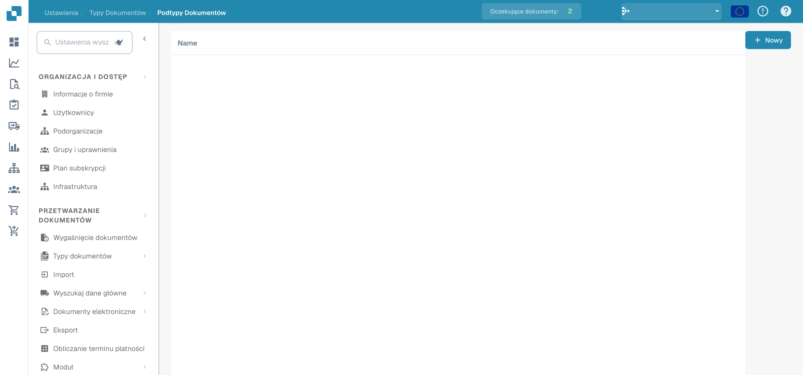
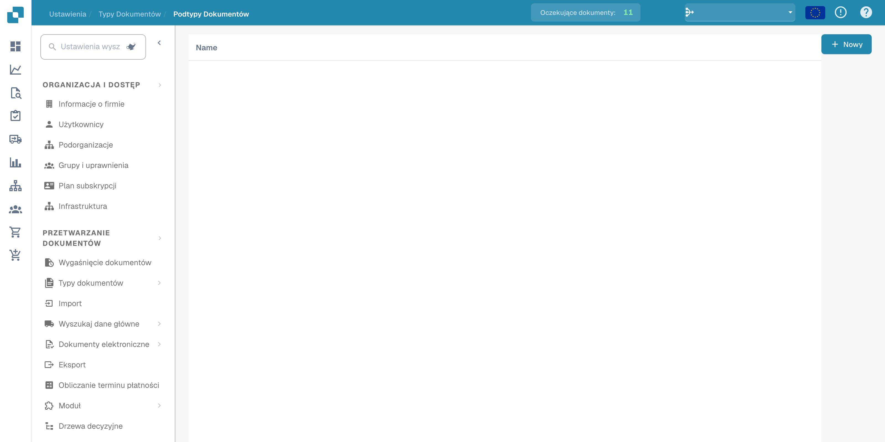

# Podtypy dokumentów

Podtypy rozróżniają kategorie w obrębie typu dokumentu. Otwórz typy dokumentów w ustawieniach i wybierz łącze do podtypów właściwego typu.

<figure><figcaption>
Przegląd podtypów dokumentów. Nagłówek Name pozostaje w języku angielskim.
</figcaption></figure>

Lista pokazuje skonfigurowane podtypy. Niektóre nagłówki kolumn produktu mogą pozostać w języku angielskim.

<figure><figcaption>
Lista podtypów dokumentów w ustawieniach. Nagłówek Name pozostaje w języku angielskim.
</figcaption></figure>

Przy tworzeniu podtypu sprawdź nazwę i konfigurację przed zapisaniem. Przykłady przedstawiają przegląd i listę; nie potwierdzają utworzenia podtypu ani zapisania ustawień.
