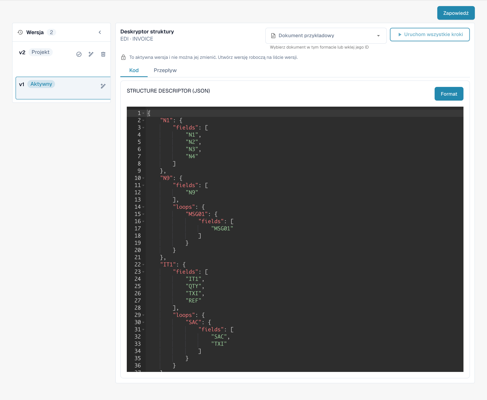

# e-docs


DocBits Poradnik dotyczący e-faktury: Przetwarzaj XRechnung / ZUGFeRD (Factur-X), sprawdzaj poprawność danych i automatyzuj przepływy pracy


<figure><figcaption>
Istniejący format EDI z czterema skonfigurowanymi atrybutami.
</figcaption></figure>

#### Przegląd

W Docbits ustawienia EDI zapewniają narzędzia do definiowania i zarządzania strukturą i formatem wiadomości EDI, które odpowiadają różnym typom dokumentów, takim jak faktury lub zamówienia. Ustawienia umożliwiają dostosowanie wiadomości EDI do standardów i wymagań specyficznych dla różnych partnerów handlowych i branż.

#### Najważniejsze funkcje i opcje

1. **EDI Configuration Elements**:
   * **Deskryptor struktury**: Definiuje podstawową strukturę dokumentu EDI, w tym kolejność segmentów, pola obowiązkowe i kwalifikatory niezbędne, aby dokument EDI był ważny.
   * **Transformacja**: Określa transformacje zastosowane do konwersji danych dokumentu na wiadomość w formacie EDI. Zwykle obejmuje to określenie odwzorowań pól dokumentu na segmenty i elementy EDI.
   * **Podgląd**: Umożliwia administratorom sprawdzenie, jak wiadomość EDI będzie wyglądać po transformacji, pomagając zapewnić dokładność przed transmisją.
   * **Ścieżki wyodrębniania**: Pokazuje ścieżki używane do wyodrębniania wartości z dokumentu, które są następnie wykorzystywane do wypełnienia komunikatu EDI.
2. **XSLT Editor**:
   * Używane do edycji i sprawdzania poprawności XSLT (eXtensible Stylesheet Language Transformations) używanego w procesie transformacji. XSLT to potężny język przeznaczony do przekształcania dokumentów XML na inne dokumenty XML lub inne formaty, takie jak HTML, tekst, a nawet inne struktury XML.

<figure><figcaption>
Aktywny atrybut STRUCTUREDESCRIPTOR: deskryptor struktury JSON w edytorze tylko do odczytu.
</figcaption></figure>

## Faktycznie używane reguły i aktywacja

Jeśli elektroniczna nota kredytowa jest wyświetlana jako Invoice, skorzystaj z [przewodnika rozwiązywania problemów z klasyfikacją](credit-note-recognized-as-invoice.md). Opisuje on faktycznie używane źródło niestandardowe lub domyślne, kody typów, Extraction Paths i bezpieczną aktywację.

## Przewodniki krajowe

Przewodniki krajowe zawierają dokładne oznaczenia formatów, składnię, ograniczenia wersji i sprawdzony stan konfiguracji. [Formaty eDocs, wersje i przewodniki krajowe](supported-electronic-documents/README.md).

Widoki przedstawiają istniejącą konfigurację i wersję. Ustawienia różnią się w zależności od typu dokumentu i formatu. Sprawdź zmiany w wersji roboczej przed aktywacją.

Ilustracje przedstawiają polskie karty etapów oraz aktywną wersję konfiguracji w trybie tylko do odczytu. W pokazanej wersji interfejsu przycisk podglądu ma błędny podpis „Zapowiedź”; odpowiada on funkcji podglądu, oznaczonej w karcie jako „Podgląd”. Techniczne nagłówki edytora, identyfikatory atrybutów i kod konfiguracji pozostają w oryginalnej postaci.
