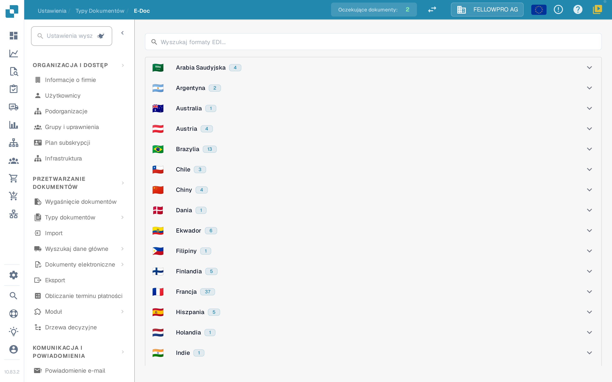
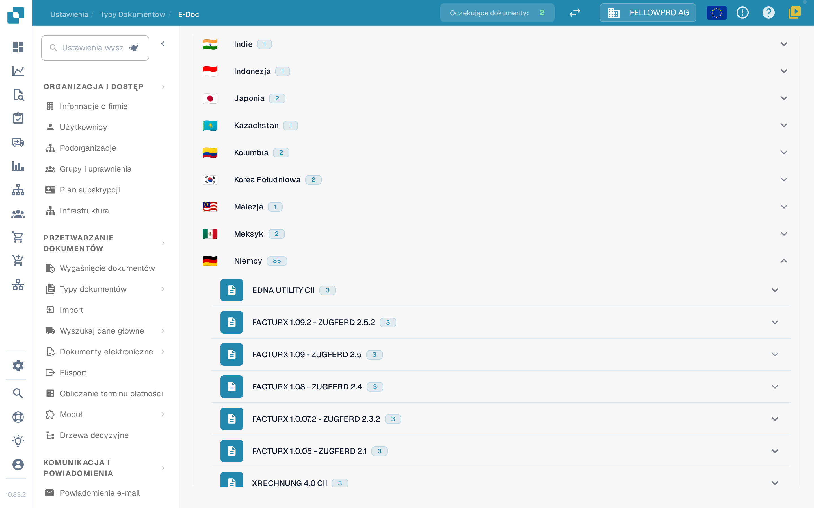
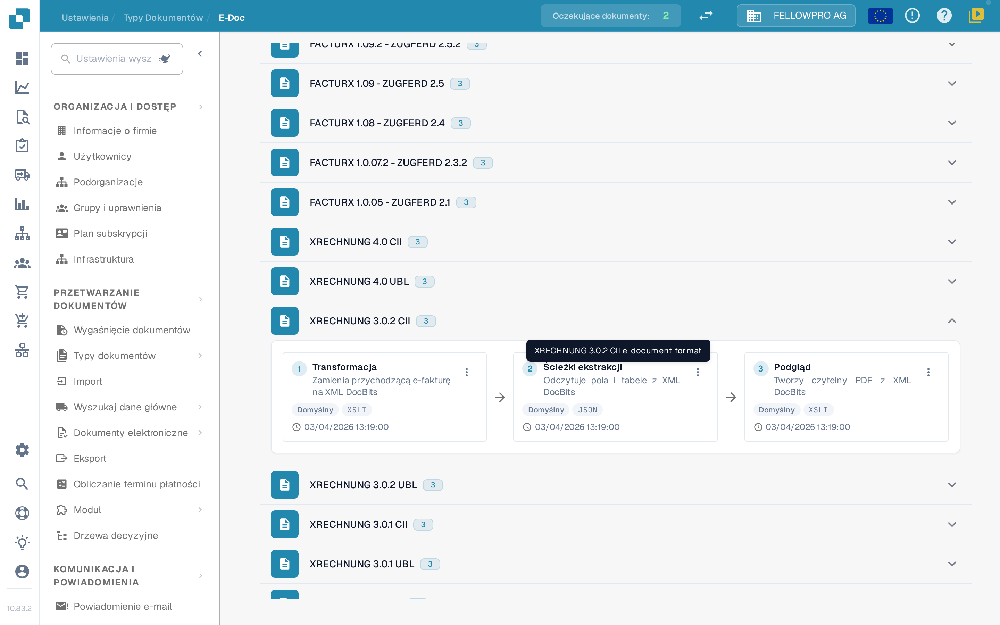
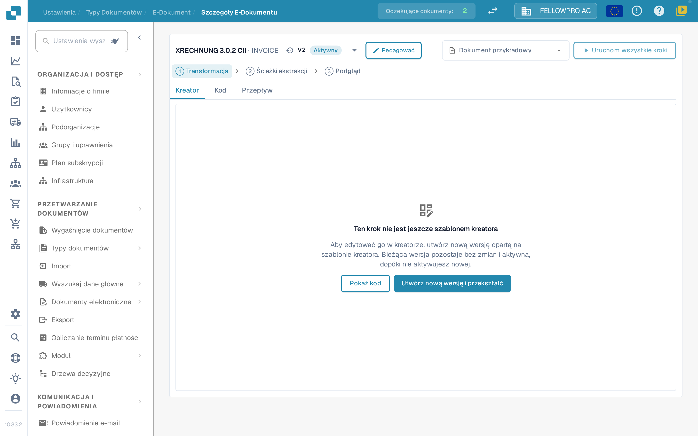
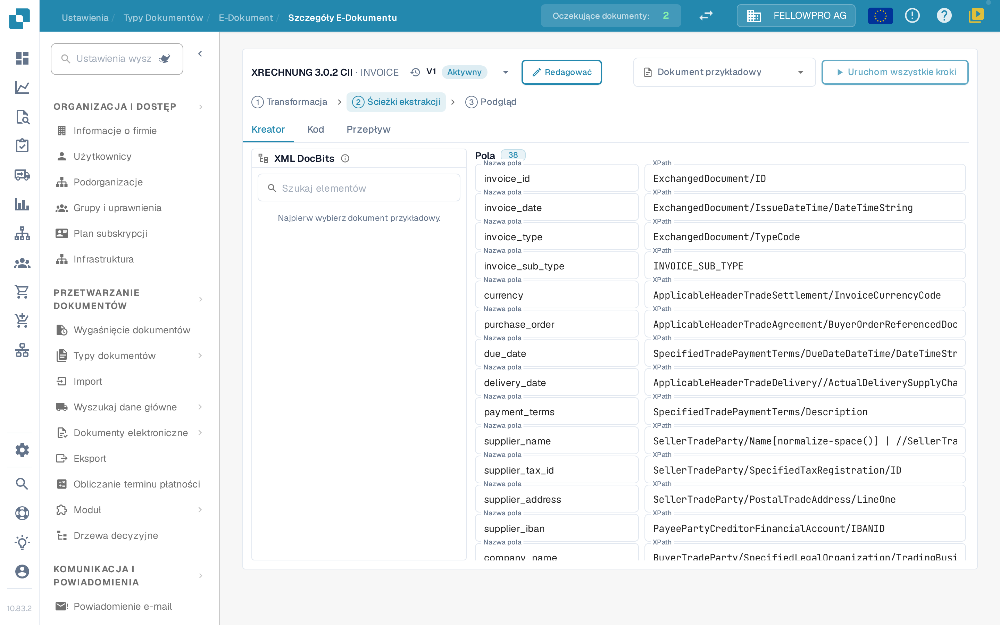

# e-docs

Dokumenty elektroniczne, takie jak XRechnung, ZUGFeRD/Factur-X, CFDI czy FatturaPA, przychodzą jako XML lub hybrydowy plik PDF. DocBits odczytuje plik, wyodrębnia dane faktury i tworzy z nich czytelny plik PDF. W ustawieniach **E-Doc** znajdują się reguły dla każdego formatu używanego w Twojej organizacji.

## Otwieranie administracji E-Doc

1. Otwórz **Ustawienia → Typy dokumentów**.
2. Wybierz typ dokumentu, na przykład **Faktura**, i otwórz **E-Doc**.

Formaty są pogrupowane według krajów. Każdy kraj pokazuje swoją flagę, nazwę i liczbę zawartych formatów.

<figure><figcaption>
Formaty są pogrupowane według krajów i początkowo zwinięte.
</figcaption></figure>

Wybierz kraj, aby otworzyć jego formaty. W ramach kraju najnowsza wersja znajduje się na początku. Formaty łączone, takie jak Factur-X / ZUGFeRD, znajdują się pod Niemcami. Pole wyszukiwania przeszukuje jednocześnie nazwy formatów i krajów.

<figure><figcaption>
Otwórz kraj, aby zobaczyć jego formaty.
</figcaption></figure>

## Formaty i ich kroki

Każdy format pokazuje swoje kroki jako trzy karty połączone strzałkami, w kolejności, w jakiej DocBits je wykonuje:

| Krok | Co robi |
| --- | --- |
| **Transformacja** | Mapuje przychodzący XML na XML DocBits. |
| **Ścieżki ekstrakcji** | Określa, jakie wartości DocBits pobiera z przekształconego XML. |
| **Podgląd** | Określa układ czytelnego pliku PDF, który generuje DocBits. |

Pozostałe atrybuty formatu są wymienione pod kartami.

<figure><figcaption>
Trzy kroki formatu: Transformacja, Ścieżki ekstrakcji i Podgląd.
</figcaption></figure>

Wybierz kartę, aby otworzyć ten krok.

## Edytowanie kroku

Strona szczegółów ma tę samą strukturę dla wszystkich trzech kroków:

* Nagłówek pokazuje format i rozwijaną listę z jego wersjami, w tym status każdej wersji. Z rozwijanej listy możesz aktywować, edytować lub usunąć wersję.
* **Kreator**, **Kod** i **Przepływ** przełączają między edytorem wizualnym, podstawowym arkuszem stylów lub plikiem JSON oraz wynikiem potoku.
* **Dokument przykładowy** oferuje najnowsze dokumenty tego formatu; możesz też wkleić identyfikator lub adres URL dokumentu.
* **Uruchom wszystkie kroki** wykonuje transformację, ekstrakcję i podgląd dla dokumentu przykładowego za jednym razem.
* **Ctrl + S** zapisuje wersję roboczą.

Edycja aktywnej lub już używanej wersji jej nie zmienia: DocBits tworzy kopię roboczą i ją otwiera. Nieużywana wersja robocza jest edytowana bezpośrednio. Krok napisany ręcznie pozostaje w **Kod** do czasu, gdy kreator będzie mógł przejąć go bez zmian.

<figure><figcaption>
Strona szczegółów: rozwijana lista wersji w nagłówku, karty Kreator, Kod i Przepływ, dokument przykładowy i sam krok.
</figcaption></figure>

### Transformacja

**Kreator** pokazuje źródłowy XML po lewej, mapowanie na środku i wynikowy XML po prawej. Wybierz element w drzewie źródłowym i przeciągnij go na pole albo dodaj stałą wartość tekstową.

Pole może składać się z kilku części, a każda część może mieć warunek: **istnieje**, **brak**, **równe**, **nierówne** lub dowolne wyrażenie XPath, połączone za pomocą **wszystkie** lub **dowolne**. Trzy panele można zmieniać rozmiar, a obszar wyników ma listę **Pola** i widok **XML**.

### Ścieżki ekstrakcji

Kreator ścieżek ekstrakcji pokazuje XML DocBits po lewej, pola na środku i ścieżkę używaną przez każde pole po prawej. Wybierz pole i ustaw jego ścieżkę; istniejące wpisy, w tym starsze wpisy płaskie, nadal działają.

<figure><figcaption>
Kreator ścieżek ekstrakcji: XML DocBits, pola i ich ścieżki.
</figcaption></figure>

### Podgląd

Kreator podglądu układa PDF za pomocą bloków przeciąganych myszą i pokazuje obok wynik. Rozmiar strony, marginesy, rozmiar czcionki, kolory i odstępy bloków ustawia się dla całego dokumentu i obowiązują one każdy blok.

### Przepływ

**Przepływ** pokazuje cały potok dla wybranego dokumentu przykładowego: co wyprodukowała transformacja, jakie wartości znalazły ścieżki ekstrakcji i jak podgląd je prezentuje. Użyj tego, aby sprawdzić zmianę od początku do końca bez opuszczania strony.

## Powiązane strony

* [Formaty eDocs, wersje i przewodniki krajowe](supported-electronic-documents/README.md)

Zrzuty ekranu na tej stronie pokazują interfejs w języku polskim.
