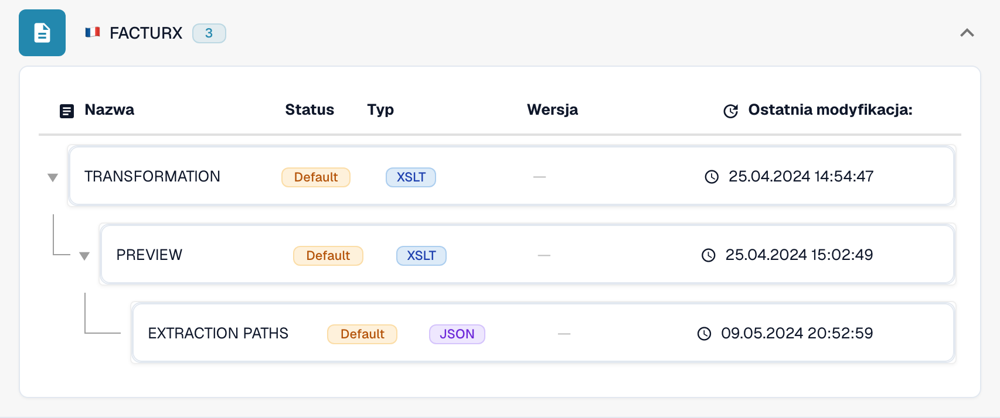
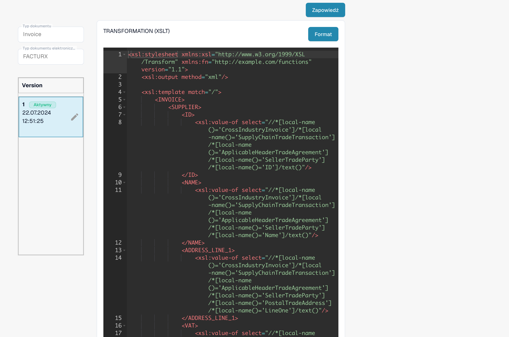

# Elektroniczna nota kredytowa jest rozpoznawana jako faktura

Elektroniczna nota kredytowa może być wyświetlana jako **Invoice**, mimo że jej oryginalny plik XML zawiera kod noty kredytowej. Zanim uznasz to za błąd produktu, sprawdź faktycznie używaną konfigurację. **TRANSFORMATION** specyficzna dla organizacji ma pierwszeństwo przed konfiguracją domyślną dla danego formatu eDoc. Stała taka jak `<INVOICE_TYPE>Invoice</INVOICE_TYPE>` może więc nadpisać domyślną klasyfikację.

## Sprawdź klasyfikację elektronicznych not kredytowych

Film pokazuje sprawdzenie w DocBits bez wprowadzania zmian, na przykładzie FACTURX 1.0.05 / ZUGFeRD 2.1. Mapowania i wersje mogą się różnić w Twojej organizacji. Zawsze sprawdzaj aktywną Transformation dla wykrytego formatu.

Starszy przykład XSLT pokazany w filmie zawiera gałęzie dla kodów 381 i 389. Sprawdź w rzeczywistej Transformation, które kody zachowuje ta konkretna wersja; ogólna lista kodów nie dowodzi ich obsługi w każdym historycznym mapowaniu.


Sprawdź klasyfikację elektronicznych not kredytowych



WebVTT


## Sprawdź kod dokumentu

Odczytaj kod typu w oryginalnym pliku XML, a nie tylko w pliku PDF lub tytule dokumentu. Jego położenie zależy od składni XML. CII używa `ExchangedDocument/TypeCode`; UBL używa `InvoiceTypeCode` lub `CreditNoteTypeCode`. Podczas sprawdzania wyrażenia XPath uwzględnij przestrzenie nazw XML.

| Kod | Znaczenie | Weryfikacja klasyfikacji |
| --- | --- | --- |
| `380` | Faktura handlowa | Invoice |
| `381` | Nota kredytowa | Credit Note |
| `261` | Nota kredytowa wystawiona w ramach samofakturowania | Credit Note w mapowaniu domyślnym (FACTURX/ZUGFeRD) |
| `383` | Nota debetowa | Nie mapuj na Credit Note tylko dlatego, że dokument zmienia fakturę |
| `384` | Faktura skorygowana | Nie mapuj na Credit Note tylko dlatego, że dokument koryguje fakturę |

Domyślne mapowanie not kredytowych FACTURX/ZUGFeRD obejmuje **381 i 261**. Wymaganie biznesowe, które wymienia tylko 381, nie oznacza, że 383 lub 384 są kodami not kredytowych. Każde planowane odstępstwo uzgodnij z osobą odpowiedzialną za integrację z systemem księgowym.

## Ustal, na którym etapie zmienia się wartość

1. **Ustal faktyczny format.** Otwórz **Ustawienia → Typy dokumentów → Invoice → E-Doc**. Wybierz format wykryty dla danego dokumentu, na przykład **FACTURX**. Plik PDF ZUGFeRD może zawierać XML Factur-X; sprawdzanie reguł innego formatu nie wyjaśni sposobu przetwarzania tego dokumentu.
2. **Sprawdź faktycznie używane źródło i wersję.** Sprawdź **TRANSFORMATION**. Lista rozróżnia **Default** i **Custom**. Otwórz regułę i zanotuj aktywną wersję oraz jej źródło. Nowsza wersja robocza nie musi być aktywna. Dla dokumentu historycznego ustal źródło i wersję użyte podczas tamtego przetwarzania; obecnie aktywna wersja może być inna. Porównaj niestandardowe źródło organizacji ze źródłem domyślnym; nie zakładaj, że używana jest konfiguracja domyślna.

<figure><figcaption>Status wskazuje źródło każdej reguły. W tym przykładzie używane są reguły domyślne.</figcaption></figure>

3. **Sprawdź przekształcony plik XML.** Dla FACTURX/ZUGFeRD wyszukaj `INVOICE_TYPE` w faktycznie używanym pliku XSLT. Jeśli oryginalny kod to 381, stały wynik `<INVOICE_TYPE>Invoice</INVOICE_TYPE>` oznacza problem konfiguracji. Przetestuj proponowaną transformację i sprawdź jej wynik; oczekiwana wartość dla noty kredytowej to `Credit Note`. Zachowaj wszystkie pozostałe wymagane mapowania specyficzne dla organizacji.
4. **Sprawdź Extraction Paths.** Upewnij się, że pole DocBits o identyfikatorze `invoice_type` odczytuje właściwy węzeł klasyfikacji z **przekształconego pliku XML**. FACTURX/ZUGFeRD często używa `INVOICE_TYPE`; XRechnung może zachować `TypeCode` (CII), `InvoiceTypeCode` lub `CreditNoteTypeCode` (UBL). Sprawdź faktycznie używane źródło i wynik transformacji przed wyborem ścieżki. Po zmianie struktury XML ścieżki prowadzące do oryginalnego pliku mogą już być nieprawidłowe. Zapoznaj się z [przewodnikiem po Extraction Paths](edi/edi-extraction-paths-file-guide.md).
5. **Sprawdź dalsze przetwarzanie.** Sprawdź skrypty, które mogą przypisywać wartość `invoice_type`, a następnie porównaj zapisane pole, pulpit i dane eksportu. Sama poprawna transformacja nie dowodzi, że późniejszy skrypt zachowuje tę wartość. Wygenerowany **Preview** pokazuje sposób prezentacji; nie potwierdza zapisanej klasyfikacji.

<figure><figcaption>Sprawdź wybrane źródło i wersję przed utworzeniem lub aktywowaniem zmiany.</figcaption></figure>

Pełna procedura MCP jest w [Konfigurowanie DocBits przez Claude lub Codex](../../../../../advanced-functions-and-tools/docbits-mcp/configuration-with-claude-or-codex.md). `list_edoc_custom_attributes`, `get_edoc_attribute_source` i `list_edoc_attribute_versions` ustalają źródło i aktywną wartość. `preview_edoc_custom_xslt` testuje propozycję transformacji. `compare_edoc_extraction` porównuje tylko Extraction Paths i wymaga własnego atrybutu ścieżek ekstrakcji. `test_electronic_document` testuje aktywną konfigurację, nie nieaktywny szkic.

## Bezpiecznie popraw i aktywuj konfigurację

1. Zanotuj aktualną aktywną wersję i zachowaj jej źródło, aby móc ją przywrócić.
2. Utwórz **wersję roboczą** za pomocą ikony ołówka. Zmień warunek klasyfikacji lub ścieżkę ekstrakcji wskazaną podczas diagnozy. Nie zastępuj całej transformacji tylko po to, aby poprawić jedno pole.
3. Wybierz wersję roboczą i zapisz ją przyciskiem **Save**. Zapisanie wersji roboczej **nie** powoduje jej aktywowania.
4. Przetestuj wersję roboczą w organizacji deweloperskiej lub testowej na reprezentatywnych dokumentach: kody 380 i 381. Dodaj 261, 383 i 384, jeśli wykryty format i proces je obsługują. Sprawdź klasyfikację, kwoty i inne pola niestandardowe. Porównaj wyniki z aktywną wersją.
5. Po pomyślnym zakończeniu kontroli użyj **znacznika wyboru** przy wersji roboczej, aby ją aktywować. Upewnij się, że właściwa wersja ma teraz status **Active**. W MCP aktywację wykonuje `activate_edoc_attribute_version`; jest to osobna zmiana, niezależna od próby.
6. Przetwórz nowy dokument testowy. Sprawdź zapisane `invoice_type`, pulpit, kwoty i eksport do **Infor ERP / SAP** lub innego systemu docelowego. Zachowaj poprzednią wersję, aby w razie potrzeby móc ją przywrócić.


Nie przywracaj domyślnych reguł organizacji bez porównania i zachowania wymaganych dostosowań. Nie uruchamiaj ponownie masowo dokumentów historycznych. Ponowne uruchomienie usuwa wyodrębnione dane i dzienniki eksportu oraz może powtórzyć procesy zatwierdzania lub eksportu. Przed podjęciem decyzji o ponownym przetworzeniu sprawdź stan eksportu, zatwierdzenia i ręczne zmiany każdego dokumentu.


## Sprawdź znak kwot oddzielnie

Klasyfikacja i znak kwot wymagają powiązanych kontroli. Ustawienie [Set Negative Sign for Credit Notes](../../../document-processing/module/set-negative-sign-for-credit-notes.md) jest domyślnie włączone, ale można je wyłączyć. Gdy jest włączone, kwoty not kredytowych są zapisywane jako wartości ujemne. Sprawdź rzeczywiste ustawienie organizacji i konwencję znaków w systemie odbierającym dane; nie określaj typu dokumentu wyłącznie na podstawie znaku kwoty.

Jeśli wynik pozostaje nieprawidłowy mimo zweryfikowania aktywnego źródła, zachowaj dla pomocy technicznej oryginalny plik XML, wykryty format, identyfikatory wersji, przekształcony wynik, mapowanie ekstrakcji oraz wszelkie zmiany wprowadzane przez późniejsze skrypty. Informacje te pozwolą ustalić, czy rozbieżność wynika z konfiguracji, czy wymaga dalszego zbadania produktu.

<!-- Internal evidence: TRL-72. The organization-specific constant is a likely cause; later scripts/effective historical versions were not conclusively excluded. -->
